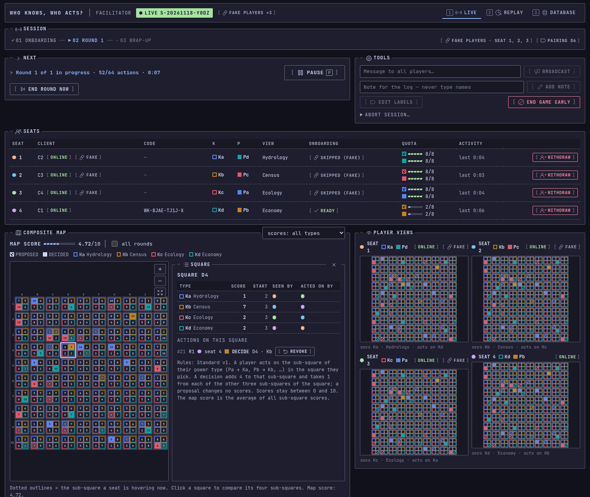
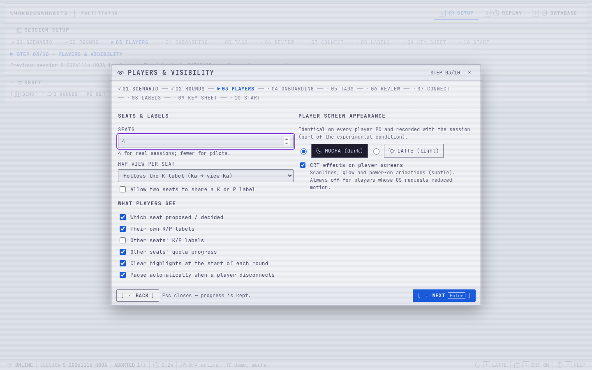
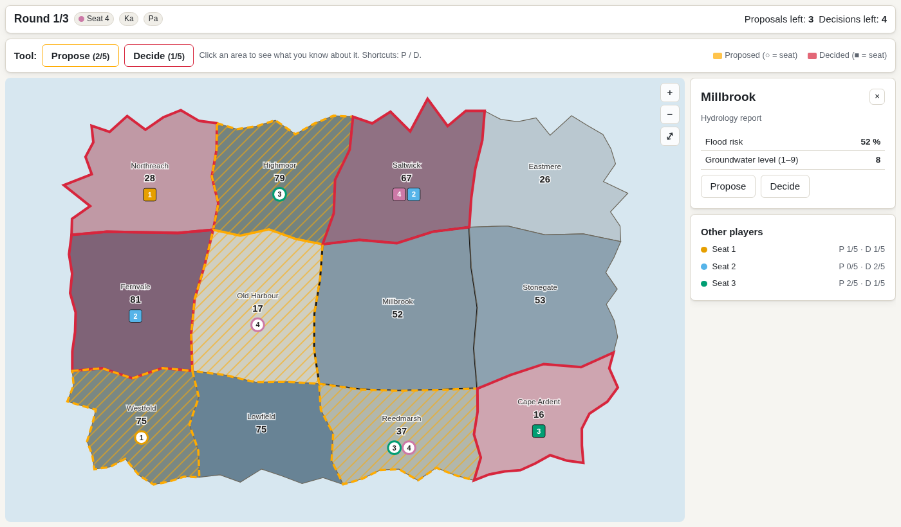
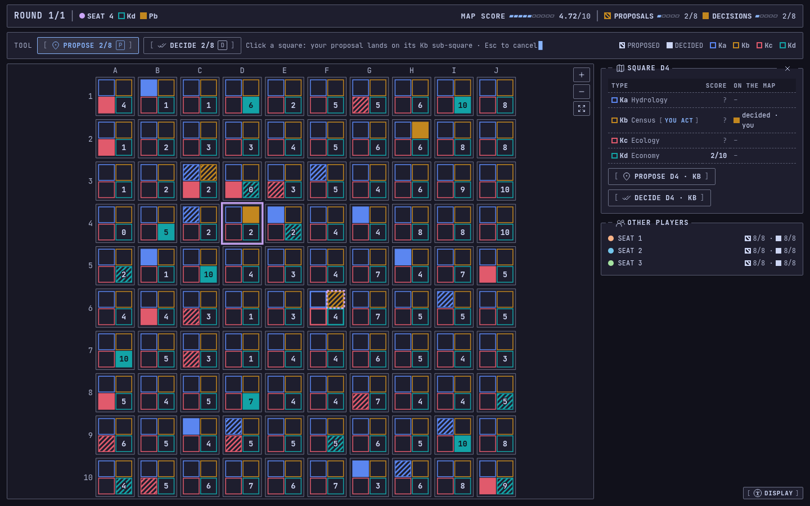

# Who Knows, Who Acts?

A **research game harness** for a four-player, map-based serious game played on a local network. It provides everything *around* the game: networking, sessions and rounds, per-player map views, propose/decide interactions, a facilitator manager, and a GDPR-aware data pipeline with rich, documented metadata. The game itself can then be designed on top.

| Facilitator · LIVE (Catppuccin Mocha) | Facilitator · SETUP wizard (Catppuccin Latte) |
| --- | --- |
|  |  |
| **Player · game (Latte)** | **Player · game (Mocha)** |
|  |  |

*Screenshots use the fictional demo scenario and simulated players. Every player and the facilitator choose their own display settings (colours, font, text size, animations) as accessibility settings; they are never recorded.*

## What it does

- **Hub-and-spoke LAN game.** Four browsers connect to one server (the facilitator's laptop), and every message passes through it. No internet is needed; all assets are bundled.
- **Same outline, different knowledge.** Every player sees the same map regions, but each gets a different dataset (*view*) for them. The server enforces this: a player's browser never receives another player's data. The facilitator sees the **composite** of all views and live mirrors of every player's screen.
- **Propose and decide.** *Propose* highlights a region for everyone (amber, hatched); *decide* marks it in a second colour (red). Both pass through a confirmation step.
- **Rounds.** Default: 3 rounds, and a round ends when every player has made 5 proposals and 5 decisions. Rounds can be changed per session (quotas, unlimited, time limits, facilitator-ended rounds, per-round overrides) and extended in code (pluggable round rules and validators).
- **Labels.** Each seat gets a knowledge type (`Ka`–`Kd`) and a power type (`Pa`–`Pd`), assigned manually or randomly in setup step 08 (the seed is logged). By default the K label selects the seat's map view.
- **Every interaction is recorded** in an append-only, event-sourced log with server and clock-corrected client timestamps. Fine-grained UI telemetry is recorded too: hover, inspect, pan/zoom, tool choice, confirm/cancel, focus, idle, and state acknowledgements for exact reaction times.
- **Facilitator manager**, organised in order of use: **[1] SETUP | LIVE · [2] REPLAY · [3] DATABASE**.
  - **SETUP** is 10 steps stacked as a vertical accordion (scenario → rounds → players → onboarding → tags → review & create → connect clients → labels → key sheet → start). The current step is expanded; finished steps collapse into a one-line summary, and a blue wayfinder bar stays pinned to the top while you scroll, so you always see where you are. Review & create and start onboarding have their own colour.
  - After *Start onboarding* the tab flips to **LIVE**, and a green **● LIVE** indicator appears. LIVE has a lifecycle stepper, a NEXT panel with the next action, seats with quota bars, a composite map, player mirrors, a timeline, the event log, live telemetry, and wrap-up popups (takedown cards → export → close).
  - **REPLAY** plays any session back at 1 s per action, pausing at each round end (about 2 minutes for a default session), or lets you step and scrub; **DATABASE** holds exports, printables and takedown.
- **Intentional TUI aesthetic:**
  - Catppuccin **Latte** and **Mocha** plus a **High contrast** theme (WCAG AAA text), with contrast-tested tokens, **JetBrains Mono**, **Iconoir** icons, box-drawn panels and keyboard shortcuts.
  - CRT-style **animations** only (tab/screen switches, popups, connect/disconnect), no scanlines or glow; off under reduced motion.
  - **Display settings on every screen** (accessibility, never recorded): colours (Latte / Mocha / High contrast), font (JetBrains Mono / **OpenDyslexic** / system font), text size (Small / Large), animations on/off.
  - The rules every screen follows are in [AESTHETIC-RULES.md](docs/AESTHETIC-RULES.md).
- **GDPR by design:**
  - in-game versioned consent, with the hash of the exact text shown
  - **no telemetry before consent**
  - pseudonymous participant codes with a check character
  - names only on a hand-written paper key sheet
  - the database **encrypted at rest** (SQLCipher)
  - IP-free logs
  - one-step **takedown/erasure** with a register
  - anonymised exports for publication
- **Documented data.** Every export comes with a generated codebook. The docs are generated from the same schemas that validate the data, and tests fail if they drift.

## Quick start

Requirements: **Node.js ≥ 22**. A C/C++ build toolchain (Python 3, make, g++) may be needed for the native SQLCipher module if no prebuilt binary exists for your platform.

```bash
npm install
npm run build        # build the browser clients
npm start            # asks for (or creates) the database passphrase
```

- Facilitator manager: open `http://localhost:3000/facilitator` **on the server laptop**. The SETUP wizard opens automatically.
- Players: open one of the `http://<laptop-ip>:3000/` URLs printed at start-up.

Try it alone: walk the SETUP wizard in the manager, then run `npm run bots -- --count 3` and play the fourth seat yourself in another browser window. Alternatively, `npm run bots -- --count 4 --auto` plays a whole session by itself.

For real sessions, follow the **[session runbook](docs/SESSION-RUNBOOK.md)**.

## Commands

| Command | Purpose |
| --- | --- |
| `npm start` | Run the server (serves the built clients). Env: `PORT`, `HOST`, `WKWA_DATA_DIR`, `WKWA_EXPORTS_DIR`, `ADMIN_TOKEN`, `TLS_CERT`/`TLS_KEY` (see [NETWORKING.md](docs/NETWORKING.md)) |
| `npm run dev` | Development mode: server with auto-restart, plus Vite with hot reload on `http://localhost:5173` (separate dev database) |
| `npm run build` | Build the player and facilitator clients |
| `npm run bots -- [--count N] [--auto]` | Simulated players (and optionally an automatic facilitator) |
| `npm run cli -- <command>` | Data management: `sessions`, `lookup`, `export`, `anonymise`, `erase`, `erasures`, `backup`, `rekey`, `verify` |
| `npm test` | Unit and integration tests (rules, full bot games, GDPR guarantees, docs drift) |
| `npm run test:e2e` | Playwright: a full game through the real UI with 4 player browsers, plus a render check of every diagram |
| `npm run docs:generate` | Regenerate the schema-derived parts of `docs/` |
| `npm run lint` / `npm run typecheck` | Biome / TypeScript |

## Documentation

| Document | Contents |
| --- | --- |
| [ARCHITECTURE.md](docs/ARCHITECTURE.md) | Components, event sourcing, state machines, projections (information asymmetry), rules, extension guide, testing |
| [NETWORKING.md](docs/NETWORKING.md) | LAN topology, hub-and-spoke protocol, connection/reconnect/clock-sync sequences, message catalogue, REST API, security, troubleshooting |
| [DATA-MANAGEMENT.md](docs/DATA-MANAGEMENT.md) | GDPR design: data inventory and flow, pseudonymisation, consent, encryption, takedown procedure, anonymisation, retention, risk table, ethics checklist |
| [DATA-TYPES.md](docs/DATA-TYPES.md) | Field-level catalogue of everything that is logged and exported |
| [SESSION-RUNBOOK.md](docs/SESSION-RUNBOOK.md) | Step by step for running a session (setup wizard, LIVE, wrap-up), plus troubleshooting |
| [AESTHETIC-RULES.md](docs/AESTHETIC-RULES.md) | Colour tokens and reserved meanings, typography, icons, panels, popups, wayfinding, CRT/motion, keyboard, checklist for new UI |

## Repository layout

```
packages/shared/   schemas (zod), event reducer, rules, projections, doc generators — used by server and clients
apps/server/       Fastify + Socket.IO server, encrypted store, session manager, REST API, GDPR tooling, CLI, bots
apps/client/       React/Vite: design system (ui/), player app (/) and facilitator manager (/facilitator)
config/            study info, consent, demographics, briefing, default session settings (placeholders!)
scenarios/demo/    fictional demo map (SVG) with four placeholder datasets
docs/              design documentation
e2e/               Playwright tests
```

## Building the actual game on top

The harness is meant to be extended. See [ARCHITECTURE.md § 12 Extension guide](docs/ARCHITECTURE.md#12-extension-guide). In short:

- **Your map and data:** add `scenarios/<id>/` with an SVG outline (one `<path id>` per region) and one view per K label.
- **Rules:** add validators (`packages/shared/src/rules/validators.ts`), e.g. "decide only on proposed regions" or rules that depend on power type, and add round rules (`roundRules.ts`).
- **New actions or data:** add event or telemetry types in `packages/shared/src/events.ts` / `telemetry.ts`, with their documentation metadata, then run `npm run docs:generate`.

> **This repository is public.** Research data lives in `data/` and `exports/`, which are git-ignored (a test checks this). Never commit databases, exports, filled-in key sheets or real participant information. Replace the `[placeholders]` in `config/` with your approved texts.

## License

[MIT](LICENSE). The license covers the software only: research data collected with it is not part of this repository and is governed by your study's data management plan.
