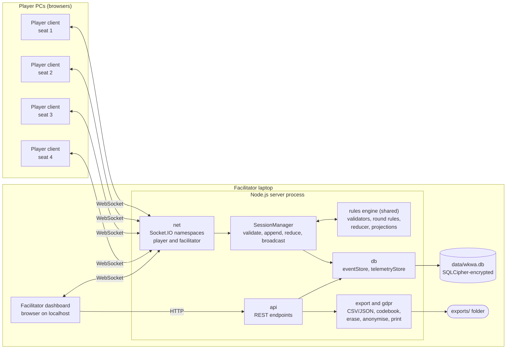
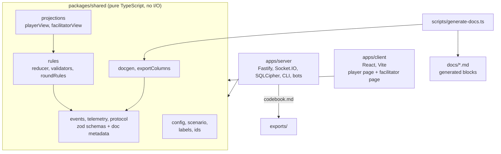
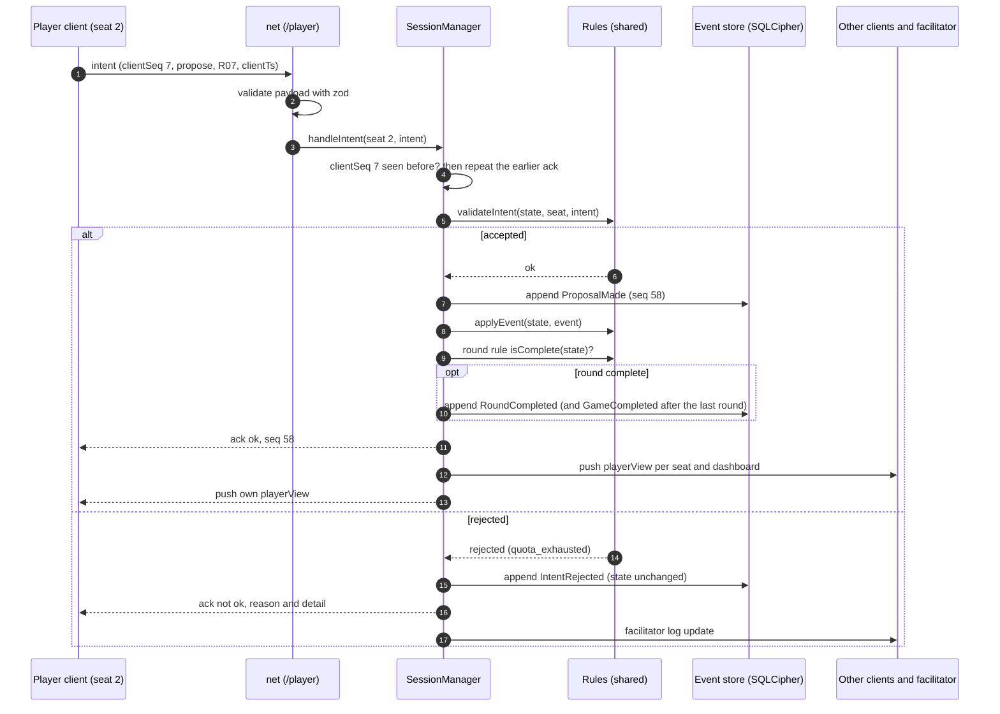
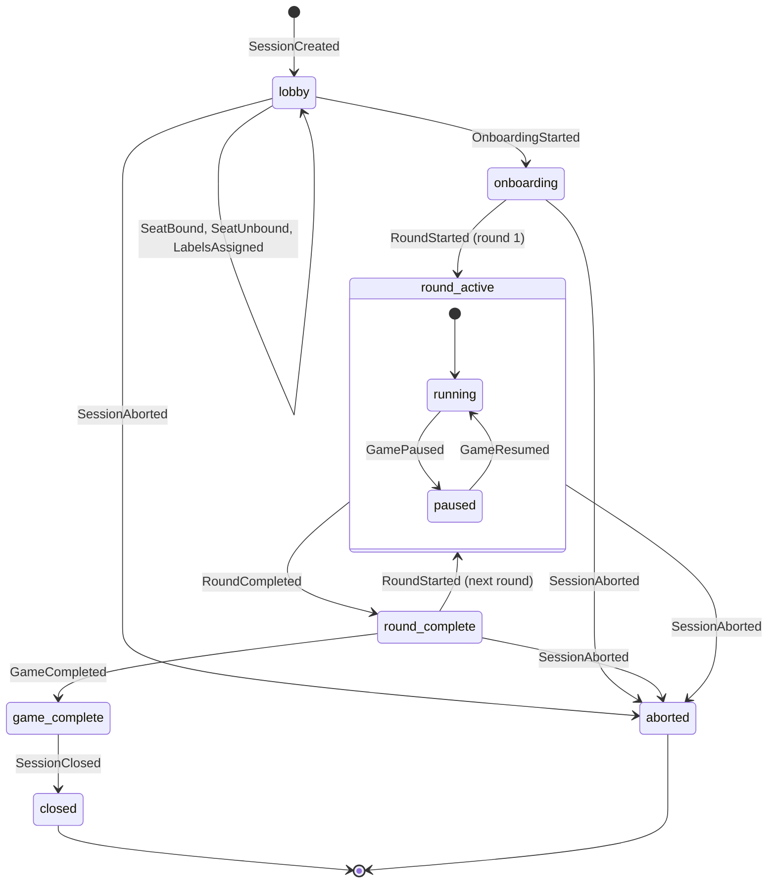
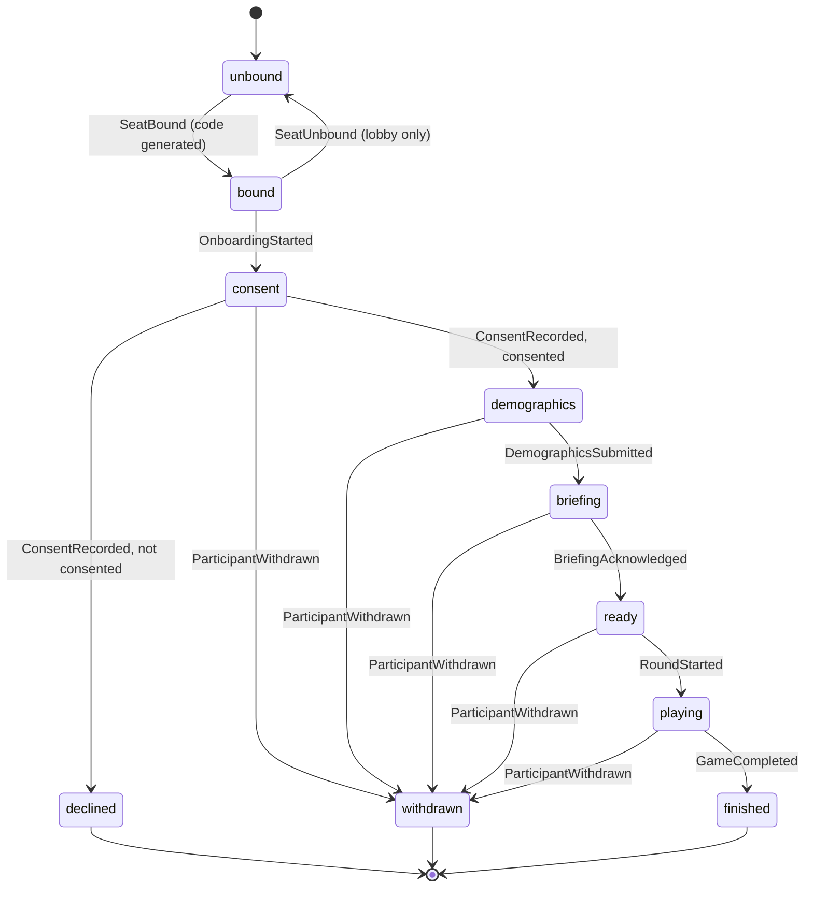
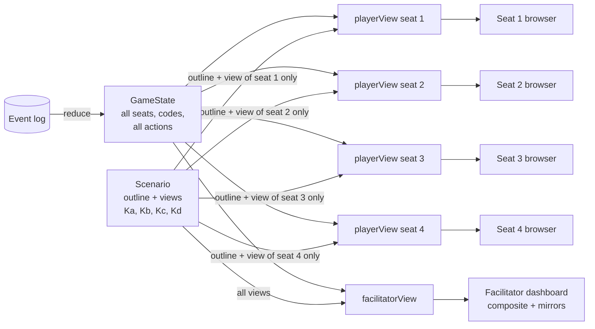

# Architecture

*Change log: [ARCHITECTURE-CHANGELOG.md](changelog/ARCHITECTURE-CHANGELOG.md)*

This document describes how the ***Who Knows, Who Acts?* harness** is built: the parts of the system, how a player's click becomes research data, how game state is derived, and how to extend the harness when the actual game design is ready. It is written as a standalone design reference that can be cited or adapted for a thesis methods chapter.

Related documents: [NETWORKING.md](NETWORKING.md) (network and protocol), [DATA-MANAGEMENT.md](DATA-MANAGEMENT.md) (GDPR and research data management), [DATA-TYPES.md](DATA-TYPES.md) (field-level catalogue of everything logged).

## Contents

1. [Purpose and scope](#1-purpose-and-scope)
2. [Glossary](#2-glossary)
3. [System overview](#3-system-overview)
4. [Code layout](#4-code-layout)
5. [Event sourcing: from click to data](#5-event-sourcing-from-click-to-data)
6. [Session lifecycle](#6-session-lifecycle)
7. [Seat onboarding](#7-seat-onboarding)
8. [Projections: who sees what](#8-projections-who-sees-what)
9. [Rounds and the rules engine](#9-rounds-and-the-rules-engine)
10. [Timing model](#10-timing-model)
11. [Persistence, recovery and reproducibility](#11-persistence-recovery-and-reproducibility)
12. [Extension guide](#12-extension-guide)
13. [Testing strategy and bots](#13-testing-strategy-and-bots)

---

## 1. Purpose and scope

The harness is the **infrastructure** for a 4-player, turn-based, map-interaction research game played on a local network (LAN). The game design itself is still open, so the harness provides the parts that every variant will need:

| The harness provides | Left to the game built on top |
| --- | --- |
| Networking (hub-and-spoke, server-authoritative) | The actual scenario: map, region data, narrative |
| Sessions, seats, participant codes, K/P labels | What K and P labels *mean* in the rules |
| Per-player map views on a shared outline | Scoring, win conditions, extra action types |
| `propose` / `decide` interactions with quotas | Game-specific validators (e.g. "decide only proposed areas") |
| Configurable rounds (default: 5 + 5 per player, 3 rounds) | Final round structure |
| Facilitator dashboard, composite view, replay | Game-specific dashboard widgets |
| Complete event + telemetry logging, exports, codebook | Analysis scripts |
| GDPR tooling: consent, pseudonymisation, encryption, erasure | Ethics approval, consent text, retention policy |

Design principles:

- **Server-authoritative.** Clients only send *intents*. The server decides what happens and is the single source of truth.
- **Event-sourced.** Every state change is an immutable event in an append-only log. Game state is always *derived* from the log and never stored separately.
- **Asymmetry enforced on the server.** A player's browser never receives another player's view data.
- **Privacy by design.** No names, IP addresses or device data are recorded. Participant codes live in one indexed column, so erasure is a single delete.
- **One source of truth for documentation.** Schemas carry their own descriptions. The tables in DATA-TYPES.md, NETWORKING.md and the per-export codebook are generated from them.

## 2. Glossary

| Term | Meaning |
| --- | --- |
| **Session** | One play-through with 4 participants, identified by `S-YYYYMMDD-XXXX`. |
| **Client** | A player browser that connected to the server, shown as "Client N" until it is bound. In events, exports and the protocol the number is stored in fields named `terminal` (e.g. `SeatBound.terminal`, `players.csv.terminal`), kept for compatibility. |
| **Seat** | One of the 4 player positions (1–4). A client is *bound* to a seat by the facilitator. |
| **Participant code** | Random pseudonymous id (`WK-XXXX-XXXX-C`) generated when a seat is bound. Used for takedown requests. |
| **Labels** | Each seat gets one knowledge type (`Ka`–`Kd`) and one power type (`Pa`–`Pd`). |
| **Scenario** | Map outline (SVG regions) plus a set of *views*. |
| **View** | One dataset on the outline (fill colour, label, attributes per region). By default a seat sees the view matching its K label. |
| **Region** | One polygon of the outline. Every action targets exactly one region. |
| **Intent** | A request from a client ("propose R07"). It may be accepted or rejected. |
| **Event** | An immutable record in the session log (`ProposalMade`, `RoundStarted`, …). |
| **Telemetry** | Fine-grained UI behaviour (hover, inspect, focus …). Stored separately and never changes game state. |
| **Reducer** | Pure function `applyEvent(state, event)` that derives game state from events. |
| **Projection** | The filtered part of the state that one recipient may see (`playerView`, `facilitatorView`). |
| **Round rule** | Plug-in that decides what counts as a round and when it is complete. |
| **Validator** | Plug-in that accepts or rejects an intent (a game-design hook). |
| **Composite** | The facilitator's overlay of all four views on one map. |

## 3. System overview



| Component | Technology | Responsibility |
| --- | --- | --- |
| Player client | React + Vite, SVG map | Shows the player's own view, sends intents, collects telemetry, syncs its clock. |
| Facilitator dashboard | React + Vite (same app, second page) | Session setup, seat binding, labels, composite map, live mirrors, controls, replay, data management. |
| `net` | Socket.IO 4 on Fastify 5 | Namespaces `/player` and `/facilitator`. Validates every incoming payload with zod. |
| `api` | Fastify REST | Session listing, exports, printables (key sheet page, takedown-card PDFs), erasure, session deletion. |
| `SessionManager` | TypeScript | Owns the live `GameState`. Turns intents and commands into events, appends them, then pushes projections. |
| Rules engine | `packages/shared` (pure TS) | Validators, round rules, reducer, projections. The server, the client (replay) and the tests share the same code. |
| `db` | better-sqlite3-multiple-ciphers | Encrypted SQLite (SQLCipher). Append-only `events`, `telemetry`, plus `sessions`, `erasures`, `exports`, `meta`. |
| `export` / `gdpr` | TypeScript | CSV/JSON exports with a generated codebook, anonymisation, erasure, backups, printable key sheet and cards. |

## 4. Code layout

The repository is an npm-workspaces monorepo. All shared logic lives in one pure package, without I/O, so the browser and the server run identical rules.



| Path | Contents |
| --- | --- |
| `packages/shared/src/config.ts` | Session config (rounds, quotas, visibility flags), study/consent/demographics schemas |
| `packages/shared/src/scenario.ts` | Scenario, region, view schemas; path → anchor geometry |
| `packages/shared/src/events.ts` | All game event types with payload schemas and documentation metadata |
| `packages/shared/src/telemetry.ts` | All telemetry types |
| `packages/shared/src/protocol.ts` | Socket message schemas and catalogue |
| `packages/shared/src/state.ts` | `GameState` and derived helpers |
| `packages/shared/src/rules/` | `reducer.ts`, `validators.ts`, `roundRules.ts` |
| `packages/shared/src/projections.ts` | `playerView`, `facilitatorView` |
| `packages/shared/src/docgen.ts`, `exportColumns.ts` | Documentation and codebook generation; export file contract |
| `apps/server/src/` | `index.ts` (boot), `cli.ts`, `app.ts`, `content.ts` (scenario/config loading), `db/` (SQLCipher, store), `session/SessionManager.ts`, `net/hub.ts` (Socket.IO), `api/` (REST), `gdpr/` (exporter, erasure, print pages), `tools/` (bots) |
| `apps/client/src/ui/` | Design system: `tokens.ts` (Catppuccin Latte/Mocha → semantic colour tokens, contrast-tested), `theme.css` (TUI base styles), `crt.css` (subtle CRT layer), components (`Panel`, `Button`, `Popup`, `useConfirm`, `Stepper`, `StatusTag`, `AsciiProgress`, …), `Icon.tsx` + `icons.ts` (semantic Iconoir icons), `prefs.ts` + `DisplaySettings.tsx` (per-browser display settings: colours, font, text size, animations). Rules: [AESTHETIC-RULES.md](AESTHETIC-RULES.md) |
| `apps/client/src/facilitator/` | Manager shell (`App.tsx`: top bar, LIVE indicator, tabs, status bar, shortcuts), `setup/` (10-step wizard), `live/` (lifecycle, NEXT, tools, wrap-up), `seats.tsx`, `Composite.tsx`, `EventLog.tsx`, `Timeline.tsx`, `Replay.tsx`, `Database.tsx` |
| `apps/client/src/player/` | Player screens (waiting, onboarding with stepper, game, end) and the DISPLAY panel; display settings are per browser (`ui/prefs.ts`), never from or to the server |
| `apps/client/src/` (other) | `map/` (SVG renderer, themed via CSS variables), `net/` (socket, clock sync, telemetry) |
| `config/` | `study.json`, `consent.json` + `consent.md`, `demographics.json`, `briefing.md`, `session.default.json` |
| `scenarios/<id>/` | `scenario.json`, `map.svg`, `views.json` |

## 5. Event sourcing: from click to data

Clients send **intents**. The server validates them against the current state and records the outcome as an **event**, *including rejections*. State is the fold of all events: `state = events.reduce(applyEvent, initialState())`.



Properties that follow from this design:

- **Complete audit trail.** Nothing is ever updated or deleted in normal operation. Undo is a new event (`ActionRevoked`) that marks the original as revoked.
- **Deterministic replay.** The reducer is pure: no clock, no randomness. Replaying the log reproduces every intermediate state exactly. The facilitator's replay view and the tests rely on this.
- **Idempotency.** Each intent carries a per-seat `clientSeq`. A resend after a reconnect returns the original acknowledgement and appends nothing.
- **Facilitator commands are events too** (`SeatBound`, `LabelsAssigned`, `RoundStarted`, `GamePaused`, …), so the log also documents how the session was run.

## 6. Session lifecycle



| Phase | What happens | Who moves it on |
| --- | --- | --- |
| `lobby` | Clients connect and are bound to seats. K/P labels (and views) are assigned. | Facilitator: *Start onboarding* (all seats bound and labelled) |
| `onboarding` | Each player completes consent → demographics → briefing. Steps can be disabled in config. | Facilitator: *Start round 1* (only once every seat is ready) |
| `round_active` | Players propose and decide within their quotas. Can be **paused** (by the facilitator, or automatically on disconnect). | Round rule (quotas met), time limit, or facilitator *End round* |
| `round_complete` | Break between rounds. | Facilitator *Start round* (or auto-advance after `autoAdvanceDelaySec`) |
| `game_complete` | End screen. Each player sees their participant code (takedown card). | Facilitator *Close session* |
| `closed` / `aborted` | Archived. Only erasure markers can still be appended. | — |

When the facilitator ends the game early, the server records `RoundCompleted` (reason `facilitator`) followed by `GameCompleted` (reason `facilitator`).

## 7. Seat onboarding



- A disabled onboarding step is skipped (consent then shows status `skipped`). **Keep consent enabled for real sessions.**
- **No telemetry before consent.** UI telemetry for a seat starts only once its consent is `given` (or `skipped`). Until then only operational events are recorded.
- If a player **declines** consent, the seat is blocked and the facilitator is alerted. Round 1 cannot start until every active seat is ready. The decliner's remaining records can be erased afterwards (see [DATA-MANAGEMENT.md § 7](DATA-MANAGEMENT.md#7-consent-design)).
- A **withdrawn** seat is excluded from round completion and its intents are rejected (`seat_inactive`).
- *Unbound → bound* happens only in the lobby. Once onboarding has started, seats are locked.

## 8. Projections: who sees what

The full `GameState` exists only on the server. Each recipient gets a **projection**:



| Information | Own player | Other players | Facilitator |
| --- | --- | --- | --- |
| Map outline (regions) | ✓ | ✓ | ✓ |
| Region content of the player's own view | ✓ | ✗ never sent | ✓ (all views) |
| Proposals and decisions (highlights) | ✓ | ✓ (actor seat only if `showActorToPlayers`) | ✓ with seat and time |
| Own K/P labels | if `showOwnLabels` | if `showOtherLabelsToPlayers` | ✓ |
| Quota progress | ✓ | if `showOthersProgress` | ✓ |
| Connection / ready status of seats | ✓ | ✓ | ✓ (+ focus, idle, latency, hover) |
| Participant code (+ study contact for takedown) | only on the end / withdrawn screen | ✗ | ✓ |
| Demographic answers | ✗ (only sends them) | ✗ | ✗ live (only "submitted ✓"); in exports only |
| Consent answers | ✗ | ✗ | consent status only |

`playerView` is the **only** code path that builds a message for a player. The automated tests check that no player's messages ever contain another view's data.

## 9. Rounds and the rules engine

**What counts as a round** is set per session (`SessionConfig.defaultRound`, overridable per round via `roundOverrides`):

| Rule | Ends when | Quotas |
| --- | --- | --- |
| `quota` (default) | every active seat has used all limited quotas | `propose` and `decide` per player per round (default 5 and 5; `null` = unlimited) |
| `manual` | the facilitator ends it | quotas still cap actions |
| *(any)* + `timeLimitSec` | additionally when the time limit (paused time excluded) elapses | — |

**Validation pipeline.** Every intent passes an ordered list of validators. The first rejection wins and is logged as `IntentRejected` with a machine-readable reason:

| # | Validator | Rejection reason |
| --- | --- | --- |
| 1 | `roundIsActive` | `round_not_active` |
| 2 | `notPaused` | `paused` |
| 3 | `seatIsActive` (bound, not withdrawn) | `seat_inactive` |
| 4 | `regionExists` | `unknown_region` |
| 5 | `roundRuleAllows` (quota) | `quota_exhausted` |
| + | game-specific validators you add | `rule` |

`decide` is deliberately **independent** of `propose`: a player may decide any region. The `DecisionMade` event records which seats had proposed or decided that region beforehand, so the relationship can still be analysed.

## 10. Timing model

| Timestamp | Clock | Precision | Use |
| --- | --- | --- | --- |
| `serverTs` | server, `performance.timeOrigin + performance.now()` | sub-ms, monotonic within one server run | Ordering and durations of events (authoritative) |
| `serverWall` | server wall clock (ISO-8601 UTC) | ms | Human-readable copy |
| `clientTs` | client clock **corrected to server time** | ~RTT/2 (≈ 1–5 ms on a LAN) | When the player actually clicked or hovered |
| `durationMs` | measured on the client | ms | Time spent on screens and panels, hover durations |

Clients estimate their clock offset with an NTP-style exchange (5 samples on connect, again every 60 s; see [NETWORKING.md § Clock synchronisation](NETWORKING.md#8-clock-synchronisation)). Each push of state is acknowledged with `state_received` telemetry. That makes the **reaction time** (from seeing the latest state to acting) computable exactly; `actions.csv` includes it as `reaction_ms`.

## 11. Persistence, recovery and reproducibility

- The **event log is the database of record.** `GameState` is never persisted; it is rebuilt from the log whenever a session is loaded.
- **Server restart:** start the server again, enter the passphrase, then use *Resume* on the dashboard (`session:resume`). The server broadcasts `rehello`, and every player browser re-claims its seat with the reconnect token stored in `localStorage` (see [NETWORKING.md § 7](NETWORKING.md#7-disconnects-and-reconnects)). Durations keep counting from the logged timestamps.
- **Reproducibility:** `SessionCreated` stores the full effective configuration, the scenario id, version and **SHA-256 hash**, and the harness version and git commit. Together with the event log, that is enough to replay exactly what every participant saw.
- **Encryption at rest:** the SQLite file is encrypted with SQLCipher. The passphrase is typed at start-up and never stored (see [DATA-MANAGEMENT.md](DATA-MANAGEMENT.md#9-encryption-and-key-management)).

## 12. Extension guide

The harness is meant to be extended once the game design is settled. For each extension point: **where** to change it, and what to keep in sync.

### Add a game rule (validator)

1. Write a `Validator` in `packages/shared/src/rules/validators.ts`, e.g. "decide only on regions proposed by someone else". Return `{ ok: false, reason: "rule", detail }` to reject.
2. Add it to `DEFAULT_VALIDATORS` (order matters; the first rejection wins).
3. Add a unit test in `packages/shared/test/rules.test.ts`.

Labels are available in the state (`state.seats[seat].k` / `.p`), so rules like "power type `Pa` may decide twice as often" are validators too.

### Add a round rule

1. Implement `RoundRule` (`canAct`, `isComplete`) in `packages/shared/src/rules/roundRules.ts`.
2. Register it in `ROUND_RULES`.
3. Add its id to the `rule` enum of `RoundSpecSchema` in `config.ts`.
4. Run `npm run docs:generate` (the config table and the `RoundStarted` payload change).

### Add a new action type (e.g. `veto`)

1. Add the kind to `ACTION_KINDS` in `labels.ts`, and a quota field to `RoundSpecSchema.quota`.
2. Add an event definition (`VetoMade`) to `EVENT_DEFS` with metadata and an example.
3. Handle it in the reducer. TypeScript's exhaustiveness check flags the missing `case`.
4. Give it a colour or style in the client map overlay and a tool button.
5. Include it in `actions.csv` (`exportColumns.ts` `kind` description and the exporter).
6. Regenerate the docs and update the briefing text.

### Add an event type

1. Add an entry to `EVENT_DEFS` in `events.ts`: summary, trigger, actors, data class, frequency, payload schema with `.describe()` on every field, and an example.
2. Handle it in `applyEvent`, even if it does not change state.
3. Emit it from `SessionManager`. For an event about one seat, set `seat` **and** `participantCode` in the envelope so erasure finds it. **Never put a participant code in a payload.**
4. Run `npm run docs:generate`. DATA-TYPES.md and the codebook pick it up automatically.

### Add a telemetry type

1. Add an entry to `TELEMETRY_DEFS` in `telemetry.ts`.
2. Emit it from the client (`apps/client/src/net/` telemetry batcher).
3. Run `npm run docs:generate`. Weigh the addition against the data minimisation principle ([DATA-MANAGEMENT.md](DATA-MANAGEMENT.md#8-data-minimisation-decisions)).

### Add a scenario / map

```
scenarios/<id>/
  scenario.json   { id, title, version, description, map: "map.svg", attributes: [...], views: "views.json" }
  map.svg         one <path id="R01" data-name="Northreach" d="..."/> per region, viewBox on <svg>
  views.json      { "Ka": { name, description, regions: { "R01": { fill, label, icon, attributes, notes } } }, "Kb": … }
```

- SVG constraints: one `<path>` per region with a unique `id`, optional `data-name`, and **no transforms** (flatten them in Inkscape: *Path → Object to Path*, then apply the transform). The `viewBox` goes on the root element.
- With `viewAssignment: "byKnowledgeType"`, view ids must be `Ka`–`Kd`.
- Bump `version` whenever you change the scenario. Its hash is recorded in every session anyway.

### Keeping documentation and data contracts in sync

| Changed | Run / update |
| --- | --- |
| Any schema in `packages/shared` | `npm run docs:generate` (tests fail if you forget) |
| Export columns | `exportColumns.ts` → exporter → `npm run docs:generate` |
| Consent text | bump `version` in `config/consent.json` (the text hash is logged anyway) |
| Demographic questions | bump `version` in `config/demographics.json` |
| Data collected (new field/type) | update the inventory in DATA-MANAGEMENT.md and check it against your ethics approval |

## 13. Testing strategy and bots

| Layer | Tool | What is checked |
| --- | --- | --- |
| Rules | Vitest (`packages/shared/test`) | Quotas, round completion, pause, revoke, overrides, custom validators, deterministic replay, projection asymmetry, participant-code checksums |
| Documentation | Vitest + `npm run docs:check` | Generated blocks are up to date; every event, telemetry type and message is documented |
| Server integration | Vitest + `socket.io-client` bots | A full 3-round game with 4 bots on a temporary encrypted DB: event counts, rejections, reconnect + auto-pause, intent deduplication, revoke, resume from the log, **no cross-view data leakage**, no codes in payloads, IP-free logs |
| GDPR | Vitest | Wrong passphrase fails; no plaintext codes in the DB file; export files match `EXPORT_FILES` column by column; anonymised exports contain no codes; erasure removes every row, adds the register entry and never reuses seq numbers; backups are encrypted; rekey works; data folders are git-ignored |
| Browser | Playwright (`npm run test:e2e`) | Facilitator page + 4 real player browsers through binding → consent → demographics → briefing → a round of propose/decide → end screen with code → export → replay (fresh temporary DB per run); every Mermaid diagram in the docs parses and renders |

**Bots** (`npm run bots -- --count 3`) are simulated players. They connect like real browsers, complete onboarding and propose/decide at random within their quotas. Use them to rehearse a session alone: run 3 bots, play the fourth seat yourself, and watch the dashboard.

| Flag | Default | Meaning |
| --- | --- | --- |
| `--url` | `http://localhost:3000` | Server to connect to |
| `--count` | `3` | Number of simulated players |
| `--delay` | `1500-5000` | Random pause between a bot's actions (ms, `min-max`) |
| `--auto` | off | Also act as facilitator: create a session if none is attached, bind every client (bots **and** humans) to the next free seat, randomise labels, start onboarding and each round. **Never use during a real session.** |
| `--seats` | `4` | Seat count of the session `--auto` creates |
| `--round-pause` | `3000` | Pause (ms) `--auto` waits between rounds |
| `--admin-token` | – | `ADMIN_TOKEN` when the server is on another machine |
