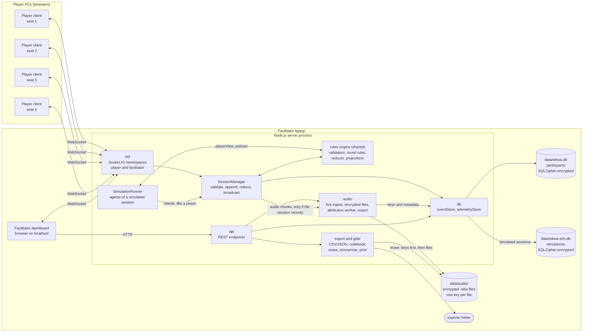
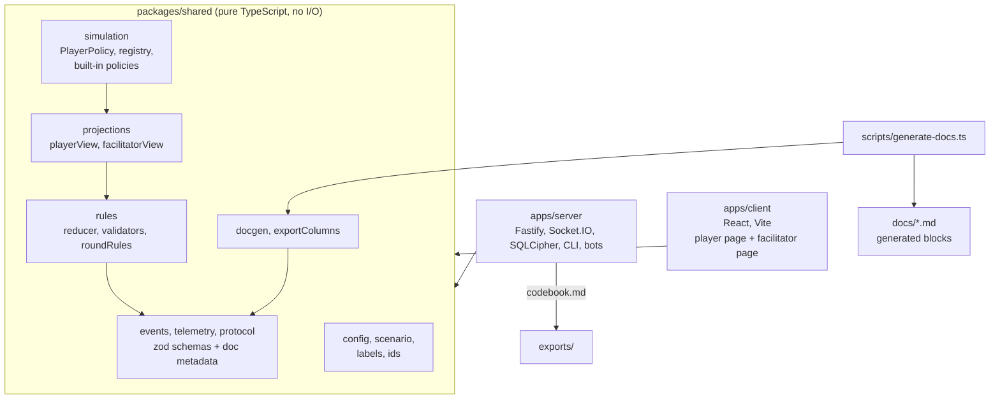
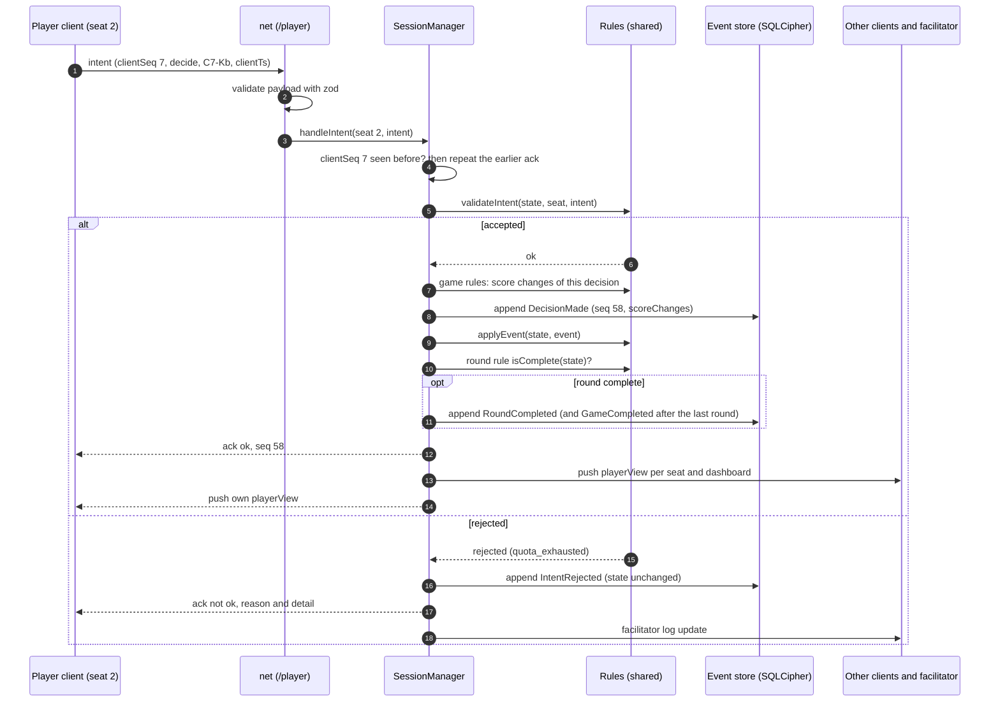
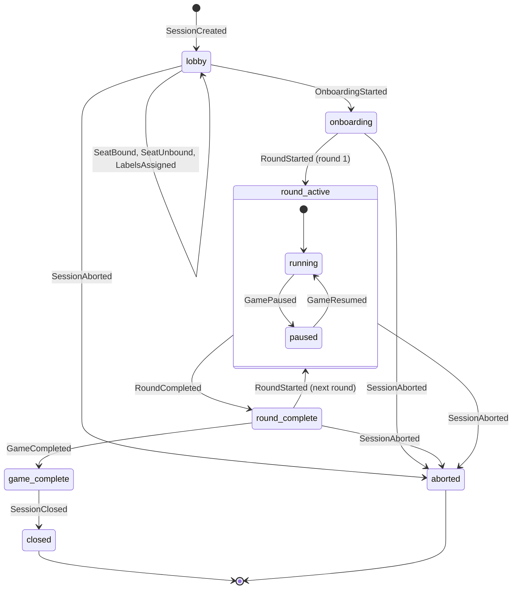
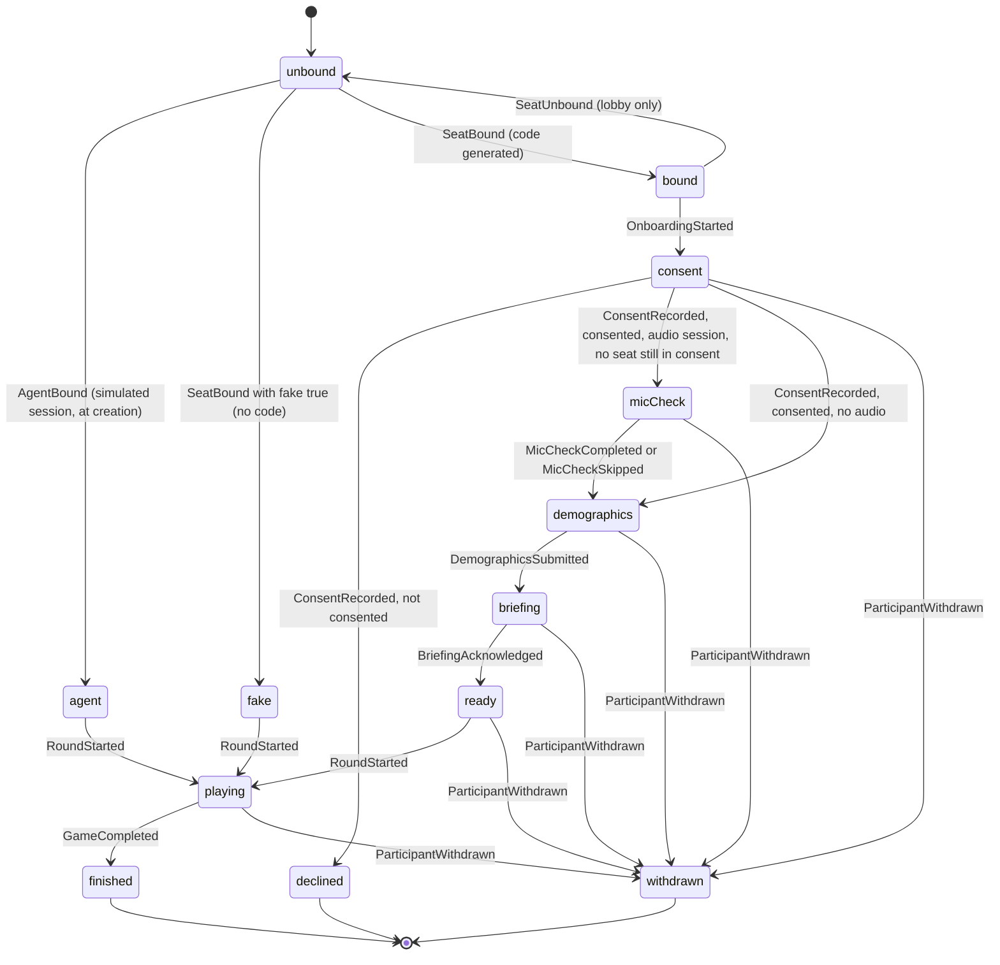
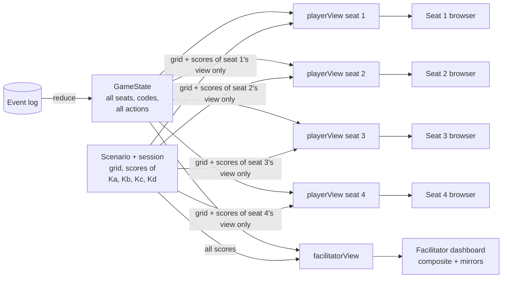
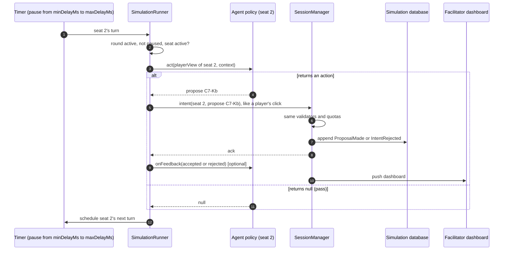
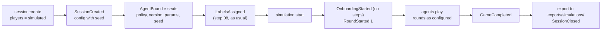
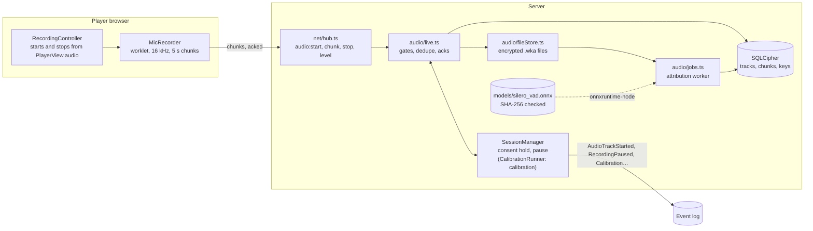

# Architecture

*Change log: [ARCHITECTURE-CHANGELOG.md](changelog/ARCHITECTURE-CHANGELOG.md)*

This document describes how the ***Who Knows, Who Acts?* harness** is built: the parts of the system, how a player's click becomes research data, how game state is derived, and how to extend the harness when the actual game design is ready. It is written as a standalone design reference that can be cited or adapted for a thesis methods chapter.

Related documents: [AUDIO.md](AUDIO.md) (microphone recording and speaker attribution), [NETWORKING.md](NETWORKING.md) (network and protocol), [DATA-MANAGEMENT.md](DATA-MANAGEMENT.md) (GDPR and research data management), [DATA-TYPES.md](DATA-TYPES.md) (field-level catalogue of everything logged).

## Contents

1. [Purpose and scope](#1-purpose-and-scope)
2. [Glossary](#2-glossary)
3. [System overview](#3-system-overview)
4. [Code layout](#4-code-layout)
5. [Event sourcing: from click to data](#5-event-sourcing-from-click-to-data)
6. [Session lifecycle](#6-session-lifecycle)
7. [Seat onboarding](#7-seat-onboarding)
8. [Projections: who sees what](#8-projections-who-sees-what)
9. [Rounds and the rules engine](#9-rounds-and-the-rules-engine)
10. [Timing model](#10-timing-model)
11. [Persistence, recovery and reproducibility](#11-persistence-recovery-and-reproducibility)
12. [Extension guide](#12-extension-guide)
13. [Testing strategy and bots](#13-testing-strategy-and-bots)
14. [Simulated players](#14-simulated-players)
15. [Microphone audio](#15-microphone-audio)

---

## 1. Purpose and scope

The harness is the **infrastructure** for a 4-player, turn-based, map-interaction research game played on a local network (LAN). The game design itself is still open, so the harness provides the parts that every variant will need:

| The harness provides | Left to the game built on top |
| --- | --- |
| Networking (hub-and-spoke, server-authoritative) | The actual scenario: board size, starting scores, narrative |
| Sessions, seats, participant codes, K/P labels | Win conditions, extra action types |
| A grid map (squares of four knowledge-type sub-squares), each player seeing only their own type's scores | |
| `propose` / `decide` interactions with quotas | |
| Pluggable **game rules**: what a player acts on, what actions do to the scores, the map score ([GAME-RULES.md](GAME-RULES.md)) | The final rule set and its numbers |
| Configurable rounds (default: 5 + 5 per player, 3 rounds) | Final round structure |
| Facilitator dashboard, composite view, replay | Game-specific dashboard widgets |
| Complete event + telemetry logging, exports, codebook | Analysis scripts |
| GDPR tooling: consent, pseudonymisation, encryption, erasure | Ethics approval, consent text, retention policy |
| Optional microphone recording of every participant, encrypted storage, who-spoke-when attribution ([AUDIO.md](AUDIO.md)) | Transcription (researched only: [AUDIO-TRANSCRIPTION.md](AUDIO-TRANSCRIPTION.md)), what to analyse in the talk |
| Simulated players: pluggable agent policies, a runner, a separate simulation database | The rules the agents follow (their policies) |

Design principles:

- **Server-authoritative.** Clients only send *intents*. The server decides what happens and is the single source of truth.
- **Event-sourced.** Every state change is an immutable event in an append-only log. Game state is always *derived* from the log and never stored separately.
- **Asymmetry enforced on the server.** A player's browser never receives another player's view data.
- **Privacy by design.** No names, IP addresses or device data (microphone names and ids included) are recorded. Participant codes live in one indexed column, so erasure is a single delete.
- **One source of truth for documentation.** Schemas carry their own descriptions. The tables in DATA-TYPES.md, NETWORKING.md and the per-export codebook are generated from them.

## 2. Glossary

| Term | Meaning |
| --- | --- |
| **Session** | One play-through with 4 participants, identified by `S-YYYYMMDD-XXXX`, or with 4 agents (a *simulated session*), identified by `SIM-YYYYMMDD-XXXX`. |
| **Client** | A player browser that connected to the server, shown as "Client N" until it is bound. In events, exports and the protocol the number is stored in fields named `terminal` (e.g. `SeatBound.terminal`, `players.csv.terminal`), kept for compatibility. |
| **Seat** | One of the 4 player positions (1–4). A client is *bound* to a seat by the facilitator. |
| **Participant code** | Random pseudonymous id (`WK-XXXX-XXXX-C`) generated when a seat is bound. Used for takedown requests. |
| **Labels** | Each seat gets one knowledge type (`Ka`–`Kd`) and one power type (`Pa`–`Pd`). |
| **Scenario** | A board size (squares), one *view* per knowledge type, and the starting score of every sub-square. |
| **Square** | One tile of the grid map, e.g. `C7` (column C, row 7). It holds four sub-squares, one per knowledge type. |
| **Sub-square (region)** | One knowledge type's part of a square, e.g. `C7-Kb`. It has a score (0–10) and is what every action targets. Events, telemetry and exports call its id the *region id*. |
| **View** | One knowledge type (name and description): the scores of its sub-squares are what a seat with that view knows. By default a seat's view is its K label. |
| **Game rules** | The rule set of a session: which sub-square an action lands on, what it does to the scores, and the map score ([GAME-RULES.md](GAME-RULES.md)). |
| **Map score** | One score for the whole map; in the standard rules, the average of every sub-square's score. |
| **Intent** | A request from a client ("decide C7-Kb"). It may be accepted or rejected. |
| **Event** | An immutable record in the session log (`ProposalMade`, `RoundStarted`, …). |
| **Telemetry** | Fine-grained UI behaviour (hover, inspect, focus …). Stored separately and never changes game state. |
| **Reducer** | Pure function `applyEvent(state, event)` that derives game state from events. |
| **Projection** | The filtered part of the state that one recipient may see (`playerView`, `facilitatorView`). |
| **Round rule** | Plug-in that decides what counts as a round and when it is complete. |
| **Validator** | Plug-in that accepts or rejects an intent (a game-design hook). |
| **Composite** | The facilitator's overlay of all four views on one map. |
| **Fake player** | A test client the server creates itself in a session with real players (setup step 07). It connects over the network like a browser and plays at random, but its seat is logged as fake, gets no participant code and skips onboarding. |
| **Simulated session** | A session where software agents play every seat instead of people (setup step 03: *Simulated players*). |
| **Agent** | The simulated player in one seat. It sees what a player of that seat would see and acts through the same rules. |
| **Agent policy** | The code that decides what an agent does on its turn (`PlayerPolicy`, § 14). The rules for simulations are written as policies. |
| **Simulation database** | `data/wkwa-sim.db`: where simulated sessions are stored, separate from the participant database `data/wkwa.db`. |

## 3. System overview



| Component | Technology | Responsibility |
| --- | --- | --- |
| Player client | React + Vite, SVG map | Shows the player's own view, sends intents, collects telemetry, syncs its clock. |
| Facilitator dashboard | React + Vite (same app, second page) | Session setup, seat binding, labels, composite map, live mirrors, controls, replay, data management. |
| `net` | Socket.IO 4 on Fastify 5, over HTTPS (self-signed certificate by default) | Namespaces `/player` and `/facilitator`. Validates every incoming payload with zod. |
| `api` | Fastify REST | Session listing, exports, printables (key sheet page, takedown-card PDFs), erasure, session deletion. |
| `SessionManager` | TypeScript | Owns the live `GameState`. Turns intents and commands into events, appends them, then pushes projections. Audio ingest (`LiveAudio`) and the calibration (`CalibrationRunner`) are parts it owns; their events go through its `append`. |
| Rules engine | `packages/shared` (pure TS) | Validators, round rules, reducer, projections. The server, the client (replay) and the tests share the same code. |
| `db` | better-sqlite3-multiple-ciphers | Encrypted SQLite (SQLCipher). Append-only `events`, `telemetry`, plus `sessions`, `erasures`, `exports`, `meta`. Two files with the same schema and passphrase: the participant database and the simulation database (`SessionStores` knows which session is where). |
| `FakePlayers` | TypeScript + socket.io-client | Starts and stops the fake players of a real session: network clients of this same server whose terminal keys the server registers before they connect, so their seats are marked fake. |
| `SimulationRunner` | TypeScript | Plays the agents of an attached simulated session: gives each agent a turn, asks its policy for an action and passes it to `SessionManager.intent` (§ 14). |
| `audio` | TypeScript (server), Web Audio (browser), onnxruntime-node (attribution worker only) | Browser capture engine, live ingest with consent hold, calibration and pause, encrypted file store, offline speaker attribution in a worker thread (Silero VAD speech model plus a level gate between the headset mics), *Export audio* ([AUDIO.md](AUDIO.md)). |
| `export` / `gdpr` | TypeScript | CSV/JSON exports with a generated codebook, anonymisation, erasure, backups, printable key sheet and cards. |

## 4. Code layout

The repository is an npm-workspaces monorepo. All shared logic lives in one pure package, without I/O, so the browser and the server run identical rules.



| Path | Contents |
| --- | --- |
| `packages/shared/src/config.ts` | Session config (rounds, quotas, visibility flags), study/consent/demographics schemas |
| `packages/shared/src/board.ts` | Grid geometry: squares, sub-squares, ids (`C7-Kb`), starting-score matrices |
| `packages/shared/src/game/` | `rules.ts` (rule sets: targeting, score changes, map score; registry `GAME_RULES`), `scoring.ts` (glue between rules and session state). See [GAME-RULES.md](GAME-RULES.md) |
| `packages/shared/src/scenario.ts` | Scenario, region (sub-square) and view schemas |
| `packages/shared/src/events.ts` | All game event types with payload schemas and documentation metadata |
| `packages/shared/src/telemetry.ts` | All telemetry types |
| `packages/shared/src/protocol.ts` | Socket message schemas, the schema table of each namespace (`PLAYER_SCHEMAS`, `FACILITATOR_SCHEMAS`) and the catalogue |
| `packages/shared/src/socket.ts` | Typed Socket.IO event maps derived from the schema tables (payloads, acknowledgements, server→client messages); used by every socket ([NETWORKING.md § 9](NETWORKING.md#9-message-catalogue)) |
| `packages/shared/src/state.ts` | `GameState` and derived helpers |
| `packages/shared/src/rules/` | `reducer.ts`, `validators.ts`, `roundRules.ts` |
| `packages/shared/src/projections.ts` | `playerView`, `facilitatorView` |
| `packages/shared/src/simulation/` | `policy.ts` (the `PlayerPolicy` interface, registry, helpers for writing policies), `policies.ts` (built-in policies `random` and `idle`) |
| `packages/shared/src/audio.ts` | Audio constants, start/stop reasons, settings, ack and REST schemas; `state.ts` holds `shouldRecord`, the consent hold and the calibration gate |
| `packages/shared/src/docgen.ts`, `exportColumns.ts` | Documentation and codebook generation; export file contract |
| `apps/server/src/` | `index.ts` (boot), `cli.ts`, `app.ts`, `content.ts` (scenario/config loading), `db/` (SQLCipher, store, `stores.ts`: participant and simulation database), `session/SessionManager.ts`, `session/CalibrationRunner.ts` (the timed calibration turns and the quick check), `simulation/SimulationRunner.ts` (agents), `fake/FakePlayers.ts` (fake players), `net/hub.ts` (Socket.IO), `api/` (REST; `audioRoutes.ts`), `audio/` (live ingest, encrypted `.wka` store, attribution, jobs; the speech model file is `apps/server/models/silero_vad.onnx`), `gdpr/` (exporter, erasure, audio deletion, print pages), `tls.ts` (self-signed certificate), `tools/` (bots) |
| `apps/client/src/ui/` | Design system: `tokens.ts` (Catppuccin Latte/Mocha → semantic colour tokens, contrast-tested), `theme.css` (TUI base styles), `crt.css` (subtle CRT layer), components (`Panel`, `Button`, `Popup`, `useConfirm`, `Stepper`, `StatusTag`, `AsciiProgress`, …), `Icon.tsx` + `icons.ts` (semantic Iconoir icons), `prefs.ts` + `DisplaySettings.tsx` (per-browser display settings: colours, font, text size, animations). Rules: [AESTHETIC-RULES.md](AESTHETIC-RULES.md) |
| `apps/client/src/facilitator/` | Manager shell (`App.tsx`: top bar, LIVE indicator, tabs, status bar, shortcuts), `setup/` (10-step wizard), `live/` (lifecycle, NEXT, tools, wrap-up), `seats.tsx`, `Composite.tsx`, `EventLog.tsx`, `Timeline.tsx`, `Replay.tsx`, `Database.tsx` |
| `apps/client/src/player/` | Player screens (waiting, onboarding with stepper, game, end) and the DISPLAY panel; display settings are per browser (`ui/prefs.ts`), never from or to the server |
| `apps/client/src/audio/` | Browser capture engine (`MicRecorder`, AudioWorklet, resampler, chunker, send queue, speech detector); no socket or UI code. `player/recording.ts` connects it to the socket |
| `apps/client/src/` (other) | `map/` (grid map in SVG: squares, sub-squares, hatches, scores, legend, map score; themed via CSS variables), `net/` (typed sockets, clock sync, telemetry), `player/intents.ts` (the player's actions until answered: resent after a reconnect) |
| `config/` | `study.json`, `consent.json` + `consent.md` (audio item and section only in audio sessions), `demographics.json`, `briefing.md`, `audio.json` (mic-check phrase, calibration sentences), `session.default.json` |
| `scenarios/<id>/` | `scenario.json` (board, views), `scores.json` (starting scores) |
| `scripts/demo-scores.mjs` | Regenerates the fixed-seed starting scores of the demo scenarios |

## 5. Event sourcing: from click to data

Clients send **intents**. The server validates them against the current state and records the outcome as an **event**, *including rejections*. State is the fold of all events: `state = events.reduce(applyEvent, initialState())`.



Properties that follow from this design:

- **Complete audit trail.** Nothing is ever updated or deleted in normal operation. Undo is a new event (`ActionRevoked`) that marks the original as revoked.
- **Deterministic replay.** The reducer is pure: no clock, no randomness. Replaying the log reproduces every intermediate state exactly. The facilitator's replay view and the tests rely on this.
- **Only the reducer changes state.** Everything outside `rules/reducer.ts` sees the state as `ReadonlyGameState` (a deep read-only type): `SessionManager.state`, the projections, rules, validators, `LiveAudio`, `CalibrationRunner` and the facilitator UI. The compiler rejects a write anywhere else. `SessionManager` holds the one mutable copy privately and hands it only to `applyEvent` and `afterReplay` (which marks every human seat disconnected after a load, until its browser says hello again).
- **Idempotency.** Each intent carries a per-seat `clientSeq`. The browser resends an unanswered intent, unchanged, after every reconnect; the resend returns the original acknowledgement and appends nothing, also after a server restart (the answers are rebuilt from the log). See [NETWORKING.md § 7](NETWORKING.md#7-disconnects-and-reconnects).
- **Facilitator commands are events too** (`SeatBound`, `LabelsAssigned`, `RoundStarted`, `GamePaused`, …), so the log also documents how the session was run.

## 6. Session lifecycle



| Phase | What happens | Who moves it on |
| --- | --- | --- |
| `lobby` | Clients connect and are bound to seats. K/P labels (and views) are assigned. | Facilitator: *Start onboarding* (all seats bound and labelled) |
| `onboarding` | Each player completes consent → (mic check, in sessions that record audio) → demographics → briefing. Steps can be disabled in config. In an audio session the facilitator also runs the calibration. | Facilitator: *Start round 1* (only once every seat is ready, and the calibration is done or skipped) |
| `round_active` | Players propose and decide within their quotas. Can be **paused** (by the facilitator, or automatically on disconnect). | Round rule (quotas met), time limit, or facilitator *End round* |
| `round_complete` | Break between rounds. | Facilitator *Start round* (or auto-advance after `autoAdvanceDelaySec`) |
| `game_complete` | End screen. Each player sees their participant code (takedown card). | Facilitator *Close session* |
| `closed` / `aborted` | Archived. Only erasure markers can still be appended. | — |

When the facilitator ends the game early, the server records `RoundCompleted` (reason `facilitator`) followed by `GameCompleted` (reason `facilitator`).

A **simulated session** (§ 14) follows the same phases. Its seats are filled by agents when it is created, and *Start simulation* records `OnboardingStarted` with no steps and `RoundStarted` for round 1 in one command, so the `onboarding` phase lasts zero time.

## 7. Seat onboarding



- **Mic check (audio sessions only).** The step follows consent. It applies only to real participants who ticked the audio item. **No seat may start it, and so no microphone opens, until every real seat has given consent** (the consent hold, [AUDIO.md § 8](AUDIO.md#8-recording-lifecycle)); a decliner keeps the hold until the facilitator withdraws that seat. The facilitator can skip one seat's mic check (`MicCheckSkipped`), and that seat is then not recorded. Fake players and agents have no mic check.
- A disabled onboarding step is skipped (consent then shows status `skipped`). **Keep consent enabled for real sessions.**
- **No telemetry before consent.** UI telemetry for a seat starts only once its consent is `given` (or `skipped`). Until then only operational events are recorded.
- If a player **declines** consent, the seat is blocked and the facilitator is alerted. Round 1 cannot start until every active seat is ready. The decliner's remaining records can be erased afterwards (see [DATA-MANAGEMENT.md § 7](DATA-MANAGEMENT.md#7-consent-design)).
- A **withdrawn** seat is excluded from round completion and its intents are rejected (`seat_inactive`).
- *Unbound → bound* happens only in the lobby. Once onboarding has started, seats are locked.
- A **fake player** (a test client the server created, § 13) goes *unbound → fake*: `SeatBound` with `fake: true` and no participant code. It skips consent, demographics and briefing, so no answers are ever made up, and counts as ready as soon as onboarding starts.
- In a **simulated session** every seat goes *unbound → agent* when the session is created (`AgentBound`). Agents have no participant code and no onboarding, and a browser can never be bound to their seats.

## 8. Projections: who sees what

The full `GameState` exists only on the server. Each recipient gets a **projection**:



| Information | Own player | Other players | Facilitator |
| --- | --- | --- | --- |
| Grid (board size, knowledge-type names) | ✓ | ✓ | ✓ |
| Scores of the player's own knowledge type (view) | ✓ | ✗ never sent | ✓ (all types) |
| Map score | ✓ | ✓ | ✓ |
| Which knowledge type the player acts on (`me.actsOn`) | ✓ | ✗ | ✓ |
| Proposals and decisions (hatched / filled marks) | ✓ | ✓ (actor seat only if `showActorToPlayers`) | ✓ with seat and time |
| Own K/P labels | if `showOwnLabels` | if `showOtherLabelsToPlayers` | ✓ |
| Quota progress | ✓ | if `showOthersProgress` | ✓ |
| Connection / ready status of seats | ✓ | ✓ | ✓ (+ focus, idle, latency, hover) |
| Participant code (+ study contact for takedown) | only on the end / withdrawn screen | ✗ | ✓ |
| Demographic answers | ✗ (only sends them) | ✗ | ✗ live (only "submitted ✓"); in exports only |
| Consent answers | ✗ | ✗ | consent status only |

`playerView` is the **only** code path that builds a message for a player. The automated tests check that no player's messages ever contain another view's scores.

## 9. Rounds and the rules engine

**What counts as a round** is set per session (`SessionConfig.defaultRound`, overridable per round via `roundOverrides`):

| Rule | Ends when | Quotas |
| --- | --- | --- |
| `quota` (default) | every active seat has used all limited quotas | `propose` and `decide` per player per round (default 5 and 5; `null` = unlimited) |
| `manual` | the facilitator ends it | quotas still cap actions |
| *(any)* + `timeLimitSec` | additionally when the time limit (paused time excluded) elapses | — |

**Validation pipeline.** Every intent passes an ordered list of validators. The first rejection wins and is logged as `IntentRejected` with a machine-readable reason:

| # | Validator | Rejection reason |
| --- | --- | --- |
| 1 | `roundIsActive` | `round_not_active` |
| 2 | `notPaused` | `paused` |
| 3 | `seatIsActive` (bound, not withdrawn) | `seat_inactive` |
| 4 | `regionExists` (a sub-square of the board) | `unknown_region` |
| 5 | `roundRuleAllows` (quota) | `quota_exhausted` |
| 6 | `gameRulesAllow`: the sub-square the game rules give the seat (standard rules: the one of its power type), then the rule set's own validators | `rule` |

`decide` is deliberately **independent** of `propose`: a player may decide any square. The `DecisionMade` event records which seats had proposed or decided that sub-square beforehand, so the relationship can still be analysed.

**Scores.** When the server accepts a proposal or decision, it asks the session's game rules what the action does to the scores and records the result in the event (`scoreChanges`). The reducer only replays recorded changes, so a past session's scores never change when the rules do. Revoking an action records the changes that undo it. Details and the rule set itself: [GAME-RULES.md](GAME-RULES.md).

## 10. Timing model

| Timestamp | Clock | Precision | Use |
| --- | --- | --- | --- |
| `serverTs` | server, `performance.timeOrigin + performance.now()` | sub-ms, monotonic within one server run | Ordering and durations of events (authoritative) |
| `serverWall` | server wall clock (ISO-8601 UTC) | ms | Human-readable copy |
| `clientTs` | client clock **corrected to server time** | ~RTT/2 (≈ 1–5 ms on a LAN) | When the player actually clicked or hovered |
| `durationMs` | measured on the client | ms | Time spent on screens and panels, hover durations |

Clients estimate their clock offset with an NTP-style exchange (5 samples on connect, again every 60 s; see [NETWORKING.md § Clock synchronisation](NETWORKING.md#8-clock-synchronisation)). Each push of state is acknowledged with `state_received` telemetry. That makes the **reaction time** (from seeing the latest state to acting) computable exactly; `actions.csv` includes it as `reaction_ms`.

## 11. Persistence, recovery and reproducibility

- The **event log is the database of record.** `GameState` is never persisted; it is rebuilt from the log whenever a session is loaded.
- **Two database files.** Sessions with participants live in `data/wkwa.db`, simulated sessions in `data/wkwa-sim.db` (same schema, same passphrase). Every API call and *Resume* finds the right file from the session id.
- **Server restart:** start the server again, enter the passphrase, then use *Resume* on the dashboard (`session:resume`). The server broadcasts `rehello`, and every player browser re-claims its seat with the reconnect token stored in `localStorage` (see [NETWORKING.md § 7](NETWORKING.md#7-disconnects-and-reconnects)). Durations keep counting from the logged timestamps.
- **Switching sessions** (create or resume another, an erasure's reload, a deletion) sends `detached` to the seated browsers: they keep their tokens, so resuming the session again gives every player their seat back.
- **Reproducibility:** `SessionCreated` stores the full effective configuration, the scenario id, version and **SHA-256 hash**, and the harness version and git commit. Together with the event log, that is enough to replay exactly what every participant saw.
- **Encryption at rest:** the SQLite file is encrypted with SQLCipher. The passphrase is typed at start-up and never stored (see [DATA-MANAGEMENT.md](DATA-MANAGEMENT.md#9-encryption-and-key-management)).

## 12. Extension guide

The harness is meant to be extended once the game design is settled. For each extension point: **where** to change it, and what to keep in sync.

### Change the game rules

Everything that is "the game" lives in `packages/shared/src/game/rules.ts`: which sub-square an action lands on (`targetOf`), what it does to the scores (`deltas`), the map score, and optional extra validators. Change the numbers in `STANDARD`, or add a rule set to `GAME_RULES`; bump the version, update the tests in `packages/shared/test/gameRules.test.ts` and [GAME-RULES.md](GAME-RULES.md) (step by step in its § 10). Nothing else in the harness needs to change.

### Add a harness validator

Restrictions that are part of the game (e.g. "decide only on sub-squares proposed by someone else") belong in the rule set's `validators` (above). A validator that every game needs goes in `packages/shared/src/rules/validators.ts`:

1. Write a `Validator`. Return `{ ok: false, reason: "rule", detail }` to reject.
2. Add it to `DEFAULT_VALIDATORS` (order matters; the first rejection wins).
3. Add a unit test in `packages/shared/test/rules.test.ts`.

Labels are available in the state (`state.seats[seat].k` / `.p`), so rules like "power type `Pa` may decide twice as often" are validators too.

### Add an agent policy (simulated players)

1. Write a policy with `definePolicy({ id, version, name, description, params, act })` in `packages/shared/src/simulation/policies.ts` (a commented template is at the top of the file). `act(view, ctx)` gets the seat's `PlayerView` and returns `{ kind, regionId }` or `null`.
2. Add it to `BUILT_IN_POLICIES` in the same file. It then appears in setup step 03.
3. Use `ctx.random()` for every random choice (never `Math.random()`), and `ctx.memory` for anything to remember between turns.
4. Add a unit test in `packages/shared/test/simulation.test.ts` and run `npm run docs:generate` (§ 14 lists every policy and its parameters).
5. Bump `version` whenever the behaviour changes. Each seat logs the version it ran with in `AgentBound`.

### Add a round rule

1. Implement `RoundRule` (`canAct`, `isComplete`) in `packages/shared/src/rules/roundRules.ts`.
2. Register it in `ROUND_RULES`.
3. Add its id to the `rule` enum of `RoundSpecSchema` in `config.ts`.
4. Run `npm run docs:generate` (the config table and the `RoundStarted` payload change).

### Add a new action type (e.g. `veto`)

1. Add the kind to `ACTION_KINDS` in `labels.ts`, and a quota field to `RoundSpecSchema.quota`.
2. Add an event definition (`VetoMade`) to `EVENT_DEFS` with metadata and an example.
3. Handle it in the reducer. TypeScript's exhaustiveness check flags the missing `case`.
4. Give it a colour or style in the client map overlay and a tool button.
5. Include it in `actions.csv` (`exportColumns.ts` `kind` description and the exporter).
6. Regenerate the docs and update the briefing text.

### Add an event type

1. Add an entry to `EVENT_DEFS` in `events.ts`: summary, trigger, actors, data class, frequency, payload schema with `.describe()` on every field, and an example.
2. Handle it in `applyEvent`, even if it does not change state.
3. Emit it from `SessionManager`. For an event about one seat, set `seat` **and** `participantCode` in the envelope so erasure finds it. **Never put a participant code in a payload.**
4. Run `npm run docs:generate`. DATA-TYPES.md and the codebook pick it up automatically.

### Add a telemetry type

1. Add an entry to `TELEMETRY_DEFS` in `telemetry.ts`.
2. Emit it from the client (`apps/client/src/net/` telemetry batcher).
3. Run `npm run docs:generate`. Weigh the addition against the data minimisation principle ([DATA-MANAGEMENT.md](DATA-MANAGEMENT.md#8-data-minimisation-decisions)).

### Add a socket message

1. Write its zod schema in `packages/shared/src/protocol.ts` (`.describe()` the fields) and add it to the namespace's schema table (`PLAYER_SCHEMAS` or `FACILITATOR_SCHEMAS`).
2. If it has an acknowledgement, add its type to `PlayerAcks` (or a result to `FacilitatorResults`) in `socket.ts`. A server→client message goes in `PlayerServerToClient` / `FacilitatorServerToClient`.
3. Add its entry to `MESSAGES`. Until steps 1–3 agree, the shared package does not compile.
4. Handle it in `net/hub.ts` (`seatCmd`, `audioCmd`, `cmd` or `act`: the schema is looked up from the table) and send it from the client; the compiler checks the name, the payload and the acknowledgement at both ends.
5. Run `npm run docs:generate` (the message catalogue in NETWORKING.md).

### Add a scenario / map

```
scenarios/<id>/
  scenario.json   { id, title, version, description, board: { cols, rows },
                    views: { "Ka": { name, description }, "Kb": …, "Kc": …, "Kd": … },
                    scores: "scores.json" }
  scores.json     { "Ka": [[3, 5, …], …], "Kb": …, "Kc": …, "Kd": … }   rows top first, columns A first
```

- The board is at most 26 × 26 squares. `demo` is 10 × 10 (400 sub-squares) and `demo-small` 5 × 5 (100).
- Every knowledge type `Ka`–`Kd` needs a view and a score matrix of exactly `rows` × `cols` numbers; the server lists a scenario with a size error in setup step 01 and does not let you choose it. Starting scores must lie in the rule set's range (0–10 for the standard rules).
- Details: [GAME-RULES.md § 11](GAME-RULES.md#11-starting-scores-and-scenarios).
- Bump `version` whenever you change the scenario. Its hash is recorded in every session anyway.

### Keeping documentation and data contracts in sync

| Changed | Run / update |
| --- | --- |
| Any schema in `packages/shared` | `npm run docs:generate` (tests fail if you forget) |
| Export columns | `exportColumns.ts` → exporter → `npm run docs:generate` |
| Consent text | bump `version` in `config/consent.json` (the text hash is logged anyway) |
| Demographic questions | bump `version` in `config/demographics.json` |
| Data collected (new field/type) | update the inventory in DATA-MANAGEMENT.md and check it against your ethics approval |

## 13. Testing strategy and bots

| Layer | Tool | What is checked |
| --- | --- | --- |
| Rules | Vitest (`packages/shared/test`) | Quotas, round completion, pause, revoke, overrides, custom validators, deterministic replay, projection asymmetry, participant-code checksums |
| Game rules | Vitest (`packages/shared/test/gameRules.test.ts`) | Board ids and starting-score matrices, targeting by power type (also in a dissociated pairing), +4 / −1 with the 0–10 limits, map score, the reducer replaying recorded score changes, revoke replay, a second rule set plugging in |
| Documentation | Vitest + `npm run docs:check` | Generated blocks are up to date; every event, telemetry type and message is documented |
| Server integration | Vitest + `socket.io-client` bots | A full 3-round game with 4 bots on a temporary encrypted DB: event counts, rejections, reconnect + auto-pause, intent deduplication (also across a server restart), the transient "Not seated" refusal, revoke, resume from the log, **no cross-view data leakage**, no codes in payloads, IP-free logs |
| Protocol | Vitest (`packages/shared/test/protocol.test.ts`, `apps/client/test/intents.test.ts`) and the compiler | The catalogue documents exactly the schema tables' messages with the same schemas; the typed event maps check every emit and listener; the browser's action queue sends only while seated, resends unchanged after a reconnect, takes the first answer, gives up after its deadline |
| GDPR | Vitest | Wrong passphrase fails; no plaintext codes in the DB file; export files match `EXPORT_FILES` column by column; anonymised exports contain no codes; erasure removes every row, adds the register entry and never reuses seq numbers; backups are encrypted; rekey works; data folders are git-ignored |
| Fake players | Vitest (`apps/server/test/fake.test.ts`) | Fake players in a real session: seats logged as fake without codes, no consent or demographics recorded for them, they play a full round over the network, `fake_player` / `fakeSeats` in exports, FAKE PLAYER on the key sheet and no takedown card, refused outside the lobby and in simulated sessions, a browser can never count as fake, restored after a server restart with their pace |
| Simulated players | Vitest (`packages/shared/test/simulation.test.ts`, `apps/server/test/simulation.test.ts`) | Policy registry and parameters, the random policy's quotas and seed, agents see only their own view; a full simulated game in the simulation database only, no participant codes or consent, a run repeats exactly from its seed, per-seat policies, a failing policy is stopped and noted, simulation exports, resume after a restart |
| Browser | Playwright (`npm run test:e2e`) | Facilitator page + 4 real player browsers through binding → consent → demographics → briefing → a round of propose/decide → end screen with code → export → replay (fresh temporary DB per run); a simulated session through setup (no binding or key sheet) → LIVE → export → DATABASE › Simulations; a real session with one browser and three fake players → round → wrap-up (one takedown card) → marked in DATABASE; every Mermaid diagram in the docs parses and renders |
| Audio | Vitest (`apps/server/test/liveAudio.test.ts`, `audioProcessing.test.ts`, `audioRoutes.test.ts`, `tls.test.ts`, attribution and file-store suites; `apps/client/test/audio-*.test.ts`), Playwright (`e2e/app-audio.spec.ts`) | The encrypted store (round trip, tampering, truncation, no plaintext on disk), every ingest gate, the consent hold, calibration timers, pause and resume, track lifecycle, attribution against synthetic headset and laptop-like mixes with known truth, the export of a clean track with a damaged record, the `.partial` export folder and its clean-up at start, erasure (overlap partners stripped) and the busy check; a real Chromium with a fake microphone that plays a synthetic voice goes through mic check, calibration, a round, pause and game complete |
| Screenshots | Playwright (`npm run screenshots -- capture`, own project, not run by `test:e2e`) | Not a test: three scenarios (a full session with 4 player browsers, a 5 × 5 session with fake players, a simulation) take the shots listed in `e2e/screenshots/catalogue.ts` at 1920 × 1080 and compare them with the published versions. `publish` files a real change as a new version (`name-v2.png`, …) in `docs/img/server/` (facilitator) or `docs/img/client/` (players), so old versions stay; the gallery [docs/img/SCREENSHOTS.md](img/SCREENSHOTS.md) is generated from the version history `docs/img/screenshots.json`. Workflow: the `/screenshot-app` skill |

Three kinds of non-human players exist, for different purposes:

| | Bots (`npm run bots`) | Fake players | Simulated players (agents) |
| --- | --- | --- | --- |
| Started by | a separate command | the server, from setup step 07 | the server, when a simulated session is created |
| Connect over the network | yes, like a browser | yes, like a browser (loopback) | no, they run inside the server |
| Session type | real | real | simulated |
| Onboarding | consent, demographics, briefing (made-up answers) | skipped | none |
| Participant code | yes (`WK-…`) | none | none |
| Marked in the data | **no**: indistinguishable from a person | `SeatBound.fake`, `players.csv` `fake_player`, `session.json` `fakeSeats` | `AgentBound`, simulation database |
| Stored in | participant database | participant database | simulation database |
| Use | load tests, `--auto` rehearsals | trying a real session without a group of people | testing game rules with policies |

Prefer fake players over bots for rehearsals: their data is marked, and no consent or demographic answers are invented.

**Bots** (`npm run bots -- --count 3`) are test players for **real** sessions. They connect like real browsers, complete onboarding and propose/decide at random within their quotas. Use them to rehearse a session alone: run 3 bots, play the fourth seat yourself, and watch the dashboard. They are not the same as **simulated players** (§ 14): bots test the network path of a real session and are stored in the participant database, while agents run inside the server, follow a policy and are stored in the simulation database.

| Flag | Default | Meaning |
| --- | --- | --- |
| `--url` | this laptop: `https://localhost:3000` if the server speaks HTTPS, else `http://` (port from `PORT`) | Server to connect to. Over HTTPS the bots accept the server's self-signed certificate without checking it. |
| `--insecure` | off | Accept an unchecked (self-signed) certificate from a server on **another** machine; on this laptop (`localhost`, `127.0.0.1`, `[::1]`) it is accepted anyway |
| `--count` | `3` | Number of simulated players |
| `--delay` | `1500-5000` | Random pause between a bot's actions (ms, `min-max`) |
| `--auto` | off | Also act as facilitator: create a session if none is attached, bind every client (bots **and** humans) to the next free seat, randomise labels, start onboarding and each round. **Never use during a real session.** |
| `--audio` | off | Test microphone recording: tick the audio consent item, pass the mic check and upload synthetic 16 kHz audio (a noise floor with speech-like bursts, louder in the bot's own calibration turn, with 22 dB of crosstalk). With `--auto` it also creates an audio session and starts the calibration. Without it, a bot in an audio session declines the audio item and waits. The bursts are not a real voice, so the speech model finds no speech in them: start the server with `WKWA_SPEECH_MODEL=off` to attribute bot audio by energy (the e2e server does this). |
| `--seats` | `4` | Seat count of the session `--auto` creates |
| `--round-pause` | `3000` | Pause (ms) `--auto` waits between rounds |
| `--admin-token` | – | `ADMIN_TOKEN` when the server is on another machine |

## 14. Simulated players

A **simulated session** is played by software **agents** instead of people. The facilitator chooses *Simulated players* in setup step 03; consent, client binding, participant codes and the key sheet are then skipped, and the session is stored in the **simulation database** (`data/wkwa-sim.db`, see [DATA-MANAGEMENT.md § 17](DATA-MANAGEMENT.md#17-simulated-sessions-and-the-simulation-database)).

The rules the agents follow are not designed yet. The harness provides the frame for them: a small interface (`PlayerPolicy`), a registry, a runner that plays the agents, and two baseline policies.

### How an agent takes a turn



- **Same information as a person.** The policy gets the seat's `PlayerView`: the projection a player's browser would receive (§ 8), with only its own view's data. Information asymmetry between seats holds for agents too.
- **Same rules as a person.** An agent cannot change the state; it can only return one action per turn, which goes through `SessionManager.intent`, the validators and quotas, and is logged with the same event types (`ProposalMade`, `DecisionMade`, `IntentRejected`). Facilitator controls (pause, end round, revoke, withdraw, labels) work as in a real session.
- **Turns.** While a round is running and not paused, each agent gets a turn after a pause drawn between `simulation.minDelayMs` and `maxDelayMs`. After a pass (or an error) it is asked again after at least 250 ms. Rounds end by the round rule as usual; later rounds start by the facilitator or automatically (`roundAdvance`).
- **Errors.** If a policy throws three times in a row, its agent stops and a `SessionNote` (actor `system`) records why. The rest of the session carries on.
- **Dashboard.** Agents can act many times a second, so while they play the server sends the facilitator's full `dashboard` at most every 100 ms. New events still reach the event log one batch at a time.

### Lifecycle of a simulated session



### Reproducibility

| What | Where it is logged |
| --- | --- |
| Policy, its version and effective parameters per seat | `AgentBound` |
| Session seed (drawn at creation when left empty) | `SessionCreated.config.simulation.seed` |
| Seed of one agent | `AgentBound.seed` = session seed + `:` + seat |
| Pause range | `SessionCreated.config.simulation` |

Each agent's random choices come from its own seeded stream (`ctx.random`); the pauses use a separate stream, so the pace never changes the choices. With both pauses set to **0** the agents take turns in a fixed seat order, and a run with the same seed, settings and policy versions **repeats exactly** (a test checks this). With real-time pauses the choices are still seeded, but which agent acts first can depend on timer precision. After a server restart the agents continue with fresh streams and empty memory.

### Writing a policy

```ts
export const cautiousPolicy = definePolicy({
  id: "cautious",
  version: "1",
  name: "Cautious",
  description: "What it does, in one or two sentences.",
  params: z.object({ threshold: z.number().min(0).max(1).default(0.3).describe("…") }),
  act(view, ctx) {
    if (!canAct(view)) return null;            // round running, not paused, not withdrawn
    // view.scores: this seat's own knowledge type · view.highlights: what is on the map
    // view.me.actsOn[kind]: the K of the sub-square an action lands on (Pa → Ka …)
    // ctx.params, ctx.random(), ctx.memory, kindsWithQuota(view), pick(list, ctx.random)
    return null;                               // or { kind: "propose", regionId: "C7-Kb" }
  },
});
```

See [§ 12 Add an agent policy](#add-an-agent-policy-simulated-players) for where to register it. The table below is generated from the registered built-in policies.

<!-- BEGIN GENERATED: simulation-policies -->
<!-- Generated by `npm run docs:generate` from packages/shared — do not edit by hand. -->

| Policy | Version | Name | What it does |
| --- | --- | --- | --- |
| `random` | 2 | Random | Baseline. On each turn it proposes or decides on a uniformly random square (the sub-square the game rules give it) while it has quota left. It ignores the scores it sees. |
| `idle` | 1 | Idle | Never acts. Use it for a seat that only watches, or to test time limits and rounds the facilitator ends. |

**`random` parameters** (`simulation.params.random`):

| Parameter | Type | Default | Description |
| --- | --- | --- | --- |
| `proposeBias` | `number 0–1` | `0.5` | Chance of proposing rather than deciding when both are still possible |

**`idle` parameters** (`simulation.params.idle`): none.

<!-- END GENERATED: simulation-policies -->

## 15. Microphone audio

In a session with audio on (setup step 04), each participant's browser records its own microphone from the mic check until the game is complete, and uploads it to the server. The full design is in [AUDIO.md](AUDIO.md); this section shows where it fits.



| Topic | How it works |
| --- | --- |
| State | `GameState.audio` holds whether audio is on, whether calibration is required, whether recording is paused, and the calibration (status, order, turns, quality). `shouldRecord(state, seat)` is the single rule for when a seat's mic may be open. It is pure and shared, so the browser, the server and the facilitator views agree. |
| Events | Audio adds events to the same log: `MicCheckCompleted`, `MicCheckSkipped`, `AudioTrackStarted`, `AudioTrackStopped`, `Calibration*`, `RecordingPaused`, `RecordingResumed` (generated list: [DATA-TYPES.md](DATA-TYPES.md)). **The audio itself is never an event.** It goes to the encrypted store, so the event log stays free of voice and its replay stays small. |
| Projection | A player's `PlayerView.audio` says whether to record, whether the mic check is held, whether recording is paused and, during calibration, only that player's own sentence and only in their turn. |
| Timers | Calibration turns run on **server** timers (`session/CalibrationRunner.ts`) and are logged, so they survive a slow browser and can be analysed afterwards. A restart cancels a running calibration (`CalibrationSkipped`, `cancelled: true`). |
| Processing | Attribution is a job in a `worker_thread`, started from the DATABASE tab after the session. It reads the encrypted tracks, detects speech per mic with the Silero VAD model and decides per 10 ms which seats speak by comparing the mics' levels (a gate, [AUDIO.md § 10](AUDIO.md#10-speaker-attribution)), writes derived results and cleaned tracks, and never touches the raw audio. The model (`apps/server/models/silero_vad.onnx`, MIT licence) ships in the repository and is checked against its SHA-256 before use; `onnxruntime-node` is loaded only inside the worker, never by the game server. If the model cannot be loaded, or `WKWA_SPEECH_MODEL=off`, speech is detected by energy and the quality report says so. |
| Busy check | `AudioService.busyReason` says whether an attribution of a session is queued or running or an audio export of it is being written. Session deletion and participant erasure over REST refuse (409) while it does, so no job reads files that are being deleted. |
| Who never records | Simulated sessions (audio is forced off), fake players and agents. A seat without the audio consent item is never recorded either, and `skipped` consent never counts as audio consent. |
| Recovery | Tracks still open after a restart are closed with `interrupted`. Browsers resend unacknowledged chunks for up to 10 minutes after a track closed. |
