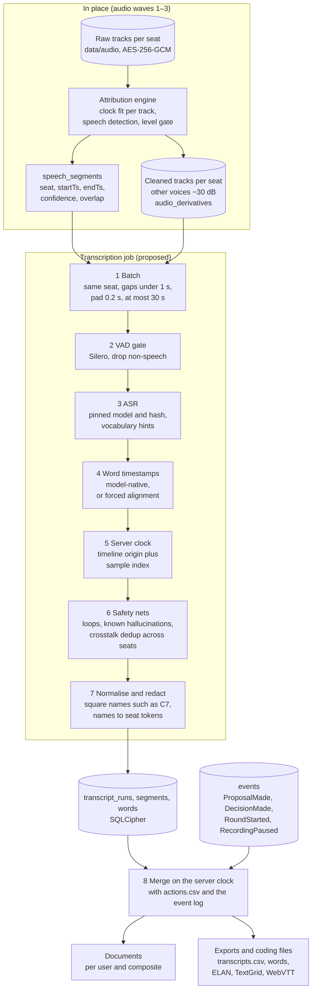
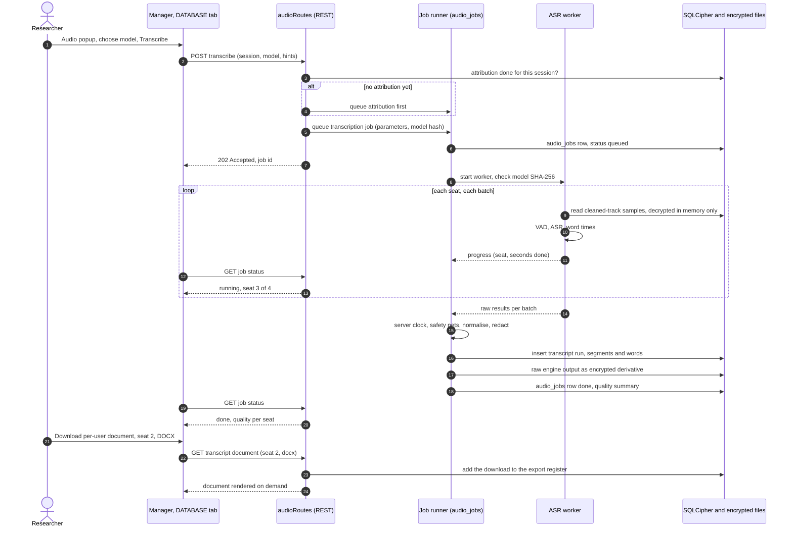
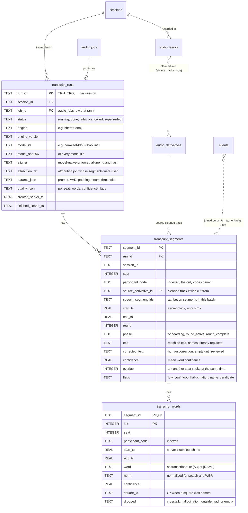

# Audio transcription (research)

*Change log: [AUDIO-TRANSCRIPTION-CHANGELOG.md](changelog/AUDIO-TRANSCRIPTION-CHANGELOG.md)*

> **Research only. Nothing in this document is implemented.** It compares local transcription engines and proposes how transcripts could later be produced from the audio the harness records. It is a basis for a decision, not a description of the software. Facts about the engines were checked on 2026-11-18; see [§ 12 Sources](#12-sources).

The game is played by four people in one room, and talk during play is research data (methodology v3). Each participant's browser records their microphone, and the server works out who spoke when. This document asks the next question: **what did they say, and how does that line up with what they proposed and decided?** It proposes one transcript document per participant, with their proposals and decisions embedded at the moment they happened, and one composite document of the whole group. Transcription runs **after the session, on the facilitator laptop (or a university machine), never in the cloud**, and is started from the DATABASE tab.

Related documents: [AUDIO.md](AUDIO.md) (how the audio is recorded and attributed, built) · [ARCHITECTURE.md](ARCHITECTURE.md) (event sourcing, timing model) · [DATA-TYPES.md](DATA-TYPES.md) (`actions.csv`, events) · [DATA-MANAGEMENT.md](DATA-MANAGEMENT.md) (GDPR) · [GAME-RULES.md](GAME-RULES.md) (squares, proposals, decisions) · [AESTHETIC-RULES.md](AESTHETIC-RULES.md) (UI rules for the DATABASE mock-up).

## Contents

1. [Purpose and scope](#1-purpose-and-scope)
2. [Requirements](#2-requirements)
3. [Candidate engines](#3-candidate-engines)
4. [Pitfalls and mitigations](#4-pitfalls-and-mitigations)
5. [Proposed pipeline](#5-proposed-pipeline)
6. [Data model](#6-data-model)
7. [Output documents](#7-output-documents)
8. [DATABASE tab](#8-database-tab)
9. [GDPR and ethics](#9-gdpr-and-ethics)
10. [Evaluation plan](#10-evaluation-plan)
11. [Recommendation and effort](#11-recommendation-and-effort)
12. [Sources](#12-sources)

---

## 1. Purpose and scope

### 1.1 What is already in place

The audio feature (built in waves 1–3 of the audio plan) records, stores and attributes speech. Transcription would build on every part of it:

| Part | What it gives transcription | Planned code |
| --- | --- | --- |
| **Capture**: raw 16 kHz mono PCM (s16le) per seat, in 5 s chunks; browser echo cancellation, noise suppression and gain control off | 16 kHz mono is the input format of every engine in § 3, so no resampling | `apps/client/src/audio/` |
| **Tracks**: one continuous capture run per track (random UUID); a reload, recording pause or permission loss starts a new one | Gaps are known exactly; nothing is transcribed across them | `audio_tracks`, `audio_chunks` |
| **Encrypted store**: `data/audio/<sessionId>/<fileId>.wka`, every chunk AES-256-GCM, a random key per track kept in SQLCipher | Transcription reads through the same store and never writes plaintext audio to disk | `apps/server/src/audio/fileStore.ts`, `crypto.ts` |
| **Timing**: every chunk placed on the server clock (corrected `clientTs` plus sample index); sample-clock drift estimated per track; the mics line up to within a few tens of milliseconds (not refined from the audio) | Word times can be put on the same clock as `server_ts` in `actions.csv` | attribution engine |
| **Calibration**: each seat reads a fixed sentence in turn; a 4×4 leakage matrix (how loud seat *i* is on mic *j*) | The fixed sentence doubles as a free accuracy check per seat (§ 10) | `CalibrationTurn` events |
| **Attribution engine** (offline): speech detected on each headset mic (Silero VAD) and a level gate between the mics; `speech_segments` (seat, `startTs`, `endTs`, confidence, overlap, round, phase) and **cleaned per-seat tracks** in which other voices are attenuated by −30 dB | Decides *what* to transcribe and *for whom*; the ASR never has to guess who spoke | `apps/server/src/audio/attribution/` |
| **Jobs and REST routes** in the DATABASE tab: download raw or clean WAV, run attribution | Transcription is one more job kind with the same progress, cancel and register | `apps/server/src/audio/jobs.ts`, `apps/server/src/api/audioRoutes.ts` |
| **Delete raw audio, keep derived** (retention still undecided) | Transcripts are derived data and would survive it (§ 9) | `audio_deletions` register |
| **Speech detection and loudness only, never voiceprints** | Transcription must not bring speaker embeddings back in (requirement R11) | — |
| **Exports** `audio_tracks.csv` and `speech_segments.csv` | Who spoke when, without content; transcripts add the content | `packages/shared/src/exportColumns.ts` |

### 1.2 What this document proposes

- A **transcription job**: engine, model management, and the pipeline from cleaned segments to words on the server clock (§ 5).
- **Transcript tables** and **export files** (§ 6).
- **Documents**: one per participant, one composite, plus formats for coding software (§ 7).
- A **DATABASE-tab** popup to run it and download the results (§ 8).
- **Name redaction**, GDPR notes (§ 9) and an **evaluation protocol** with acceptance thresholds (§ 10).

### 1.3 Out of scope

- Live transcription during play.
- Recognising speakers by their voice (diarization with speaker embeddings). Who spoke is decided by speech detection on each mic and loudness only.
- Languages other than English, and translation.
- Cloud or hosted APIs of any kind. The harness is LAN-only, and voice is personal data.
- Automatic coding of the discussion. Content analysis stays with human coders; transcripts are its input.

## 2. Requirements

| # | Requirement | Why | How it is checked |
| --- | --- | --- | --- |
| R1 | **English only.** The language is fixed to `en`; no language detection | The study is run in English. Detection can misfire on short, accented utterances | Engine setting, logged |
| R2 | **Timestamps on the server clock.** Word level preferred, utterance level at least. Same epoch milliseconds as `server_ts` | Talk has to be joined to proposals and decisions in `actions.csv` and the event log | Calibration turns line up with their seat's speech (§ 4.7); word-time error on a hand-aligned sample (§ 10) |
| R3 | **Per-seat attribution.** Every word belongs to exactly one seat, or is marked as overlap | The per-user documents and the discussion analysis depend on who said it | Misattributed words in the pilot sample (§ 10) |
| R4 | **Robust to non-native speakers.** Accuracy must not depend much on fluency | The methodology note flags that transcription favours fluent English speakers, and "who finds it easier to talk in English" is a moderator | WER per seat and the spread between seats (§ 10) |
| R5 | **Overlap and crosstalk.** Four mics in one room hear each other; overlapping talk is common | No word may appear in two seats' transcripts; overlaps must be visible, not silently merged | Duplicate-word count across seats; overlap WER reported separately |
| R6 | **Run time on a facilitator laptop.** CPU only: faster than the session itself (done the same day). With an NVIDIA GPU or Apple Silicon: minutes | No dedicated hardware in the budget. The amount to transcribe is the attributed speech, about the length of the session, not four times it | Real-time factor measured on the pilot laptop |
| R7 | **Offline install.** Binaries and model files are installed before the study and verified by SHA-256; nothing downloads at run time | LAN without internet; no silent model updates | Run with the network off |
| R8 | **Licence** of code and weights allows research use. Permissive (MIT, Apache-2.0, BSD) preferred; CC-BY-4.0 needs attribution; non-commercial weights are acceptable for a thesis but noted | The repository is public (MIT); weights are never committed to it | Licence column in § 3 |
| R9 | **Reproducible.** Engine and version, model id and file SHA-256, decoding parameters, prompt, VAD settings and the attribution run are stored with every transcript. Decoding is deterministic (greedy or a fixed beam, temperature 0, no random fallback) | A transcript must be traceable to exactly what produced it, like `SessionCreated` does for the scenario | `transcript_runs` row (§ 6); re-running gives the same text |
| R10 | **Fits the Node/TypeScript server.** Runs as a job like attribution (progress, cancel, re-run), on Windows, macOS and Linux | One install for the facilitator; no separate tool chain on session days | § 5.3 |
| R11 | **No identification by voice.** No speaker embeddings, voiceprints or diarization models | Keeps the processing out of Art. 9 biometric data; attribution stays speech/non-speech plus loudness | Dependency review: no pyannote or speaker models loaded |
| R12 | **No invented text.** Nothing transcribed where nobody spoke; suspicious output flagged and counted | Whisper-family models are known to hallucinate on silence and noise (§ 4.1) | Inserted words in non-speech regions of the pilot sample |

## 3. Candidate engines

Only engines that run **locally** are compared. An *engine* is the runtime (whisper.cpp, sherpa-onnx, …), a *model* the weights it runs; several rows share a model.

**How to read the numbers.** WER is the word error rate in %, lower is better. Most come from the Hugging Face **Open ASR Leaderboard**, which exists in two versions that cannot be compared with each other:

- the **classic set** (LibriSpeech, AMI meetings, Earnings22, TED-LIUM, …), which model cards and the leaderboard paper report [[1]](https://arxiv.org/abs/2510.06961);
- the **2026 set** of the live leaderboard (v1.16.0, 13 Nov 2026), which dropped LibriSpeech and TED-LIUM and added cleaned AMI and Earnings22, noisy speech, Indian-accented conversation and private data [[2]](https://huggingface.co/spaces/hf-audio/open_asr_leaderboard).

AMI (recorded meetings) is the closest public match to talk around a game table. RTFx is seconds of audio transcribed per second (RTFx 30 = one hour in two minutes).

### 3.1 Accuracy and timestamps

| Engine · model | Classic set: average · AMI | 2026 set: average · AMI | Accented English | Timestamps |
| --- | --- | --- | --- | --- |
| **Whisper large-v3** (reference; runs on whisper.cpp, faster-whisper, transformers.js) | 7.44 · 15.95 [[3]](https://huggingface.co/openai/whisper-large-v3/raw/refs%2Fpr%2F229/.eval_results/open_asr_leaderboard.yaml) | 8.24 · 13.63 [[2]](https://huggingface.co/spaces/hf-audio/open_asr_leaderboard) | non-US 10.52; IN/NG/EG 13.68 [[2]](https://huggingface.co/spaces/hf-audio/open_asr_leaderboard); 14 accents 15.0 [[4]](https://arxiv.org/abs/2604.27543); AfriSpeech read 26.49, dialogue 13.49 [[5]](https://arxiv.org/abs/2511.14255); EdAcc 19.7 (Whisper large) [[6]](https://arxiv.org/abs/2303.18110) | Segment; words by cross-attention DTW, which are estimates |
| **whisper.cpp** · large-v3-turbo (q5_0 or q8_0) | 7.83 · 16.13 (turbo, not quantised) [[3]](https://huggingface.co/openai/whisper-large-v3/raw/refs%2Fpr%2F229/.eval_results/open_asr_leaderboard.yaml) | not listed | not measured | Segment; token times with `-ml 1` (experimental) or `--dtw`; `whisper-server` `verbose_json` gives words with probability [[7]](https://github.com/ggml-org/whisper.cpp/blob/master/examples/cli/README.md) [[8]](https://github.com/ggml-org/whisper.cpp/blob/master/examples/server/README.md) |
| **faster-whisper** (CTranslate2) · large-v3 or turbo | as Whisper | as Whisper | as Whisper | `word_timestamps` from cross-attention [[9]](https://github.com/SYSTRAN/faster-whisper/blob/master/faster_whisper/transcribe.py) |
| **WhisperX** · faster-whisper + wav2vec2 alignment | as Whisper; alignment cut TED-LIUM WER from 10.5 to 9.7 [[10]](https://arxiv.org/abs/2303.00747) | — | as Whisper | Word, by forced alignment. AMI word boundaries (200 ms collar): precision 84.1, recall 60.3, against 78.9 and 52.1 for Whisper alone [[10]](https://arxiv.org/abs/2303.00747). Digits and symbols get no time [[11]](https://github.com/m-bain/whisperX) |
| **Distil-Whisper** · distil-large-v3.5 (English only) | 7.21 · 14.63 [[3]](https://huggingface.co/openai/whisper-large-v3/raw/refs%2Fpr%2F229/.eval_results/open_asr_leaderboard.yaml) | — | — | as Whisper |
| **NVIDIA Parakeet-TDT-0.6B-v2** (English only) | 6.05 · 11.16 [[12]](https://huggingface.co/nvidia/parakeet-tdt-0.6b-v2) | 6.93 · 9.09 [[2]](https://huggingface.co/spaces/hf-audio/open_asr_leaderboard) | non-US 9.33; IN/NG/EG 11.66 [[2]](https://huggingface.co/spaces/hf-audio/open_asr_leaderboard); 14 accents 9.6 [[4]](https://arxiv.org/abs/2604.27543); AfriSpeech read 30.20, dialogue 11.23 [[5]](https://arxiv.org/abs/2511.14255) | Character, word and segment (NeMo, parakeet.cpp, parakeet-mlx); token level in sherpa-onnx and onnx-asr [[12]](https://huggingface.co/nvidia/parakeet-tdt-0.6b-v2) [[13]](https://k2-fsa.github.io/sherpa/onnx/pretrained_models/offline-transducer/nemo-transducer-models.html) |
| Parakeet-TDT-0.6B-v3 (25 languages) | 6.34 · 11.31 [[14]](https://huggingface.co/nvidia/parakeet-tdt-0.6b-v3) | 7.04 · 9.42 [[2]](https://huggingface.co/spaces/hf-audio/open_asr_leaderboard) | non-US 9.75 [[2]](https://huggingface.co/spaces/hf-audio/open_asr_leaderboard); 14 accents 9.2 [[4]](https://arxiv.org/abs/2604.27543) | as v2 |
| **NVIDIA Canary-1B-flash** (en, de, fr, es) | 6.35 · 13.11 [[15]](https://huggingface.co/nvidia/canary-1b-flash) | — | — | Word and segment, "experimental"; clips under 40 s |
| Canary-Qwen-2.5B (English, LLM decoder) | 5.63 · 10.18 [[16]](https://huggingface.co/nvidia/canary-qwen-2.5b) | 6.92 · 7.91 [[2]](https://huggingface.co/spaces/hf-audio/open_asr_leaderboard) | non-US 9.85 [[2]](https://huggingface.co/spaces/hf-audio/open_asr_leaderboard); AfriSpeech read 29.87, dialogue 96.64: a collapse [[5]](https://arxiv.org/abs/2511.14255) | not stated |
| **transformers.js** in Node · Whisper ONNX (turbo, distil) | as Whisper; effect of q8/q4 quantisation not measured | — | — | `return_timestamps: 'word'` by cross-attention DTW (needs a `_timestamped` export). Parakeet only as CTC, without timestamps [[17]](https://github.com/huggingface/transformers.js/releases) |
| **Vosk** (Kaldi) · en-us-0.22 | LibriSpeech 5.69, TED-LIUM 6.05, call centre 29.78 [[18]](https://alphacephei.com/vosk/models) | — | — | Word start, end and confidence [[19]](https://github.com/alphacep/vosk-api/blob/master/src/vosk_api.h) |
| **Qwen3-ASR-1.7B** (2026, LLM decoder) | — | 6.15 · 8.31 [[2]](https://huggingface.co/spaces/hf-audio/open_asr_leaderboard) | non-US 8.26; IN/NG/EG 10.31 [[2]](https://huggingface.co/spaces/hf-audio/open_asr_leaderboard); 14 accents 8.3 [[4]](https://arxiv.org/abs/2604.27543) | Word or character through the separate Qwen3-ForcedAligner-0.6B (audio up to 5 min) [[20]](https://huggingface.co/Qwen/Qwen3-ASR-1.7B) |
| **Kyutai STT 2.6B en** (2025) | 6.4 · 12.17 [[21]](https://huggingface.co/kyutai/stt-2.6b-en) | — | 14 accents 11.3 [[4]](https://arxiv.org/abs/2604.27543) | Word [[21]](https://huggingface.co/kyutai/stt-2.6b-en) |
| **IBM Granite Speech 5.0-2b** (Oct 2026, LLM decoder) | — | 6.68 · 6.96 [[2]](https://huggingface.co/spaces/hf-audio/open_asr_leaderboard) | non-US 9.70 [[2]](https://huggingface.co/spaces/hf-audio/open_asr_leaderboard) | not stated [[22]](https://huggingface.co/ibm-granite/granite-speech-5.0-2b) |

*Accented columns:* **non-US** = the leaderboard's private data with speakers from the UK, Australia, Canada, India, Nigeria and Egypt (US speakers: Parakeet v2 9.48, Whisper large-v3 10.45); **IN/NG/EG** = Indian, Nigerian and Egyptian accents only; **14 accents** = AppTek's accented call-centre benchmark, average over 14 accents [[4]](https://arxiv.org/abs/2604.27543); **EdAcc** = conversations in 40+ accents [[6]](https://arxiv.org/abs/2303.18110); **AfriSpeech** = African-accented English, *read* (AfriSpeech-200) and *dialogue* (conversation) [[5]](https://arxiv.org/abs/2511.14255).

### 3.2 Speed, memory, licence and maintenance

| Engine · model | Speed | Memory and disk | Licence (code · weights) | Maintenance (checked 2026-11-18) |
| --- | --- | --- | --- | --- |
| **whisper.cpp** · large-v3-turbo | CPU, CUDA, Metal, Core ML, Vulkan, OpenVINO. Reference points from the faster-whisper benchmark (13 min of audio): *small* on an 8-thread i7 in 2 min 5 s (RTFx ≈ 6); *large-v2* on an RTX 3070 Ti in 1 min 5 s (RTFx ≈ 12) [[23]](https://github.com/SYSTRAN/faster-whisper). Turbo on a laptop CPU: to be measured | Disk: turbo 1.5 GiB, q8_0 834 MiB, q5_0 547 MiB [[24]](https://huggingface.co/ggerganov/whisper.cpp); RAM for large about 3.9 GB [[25]](https://github.com/ggml-org/whisper.cpp) | MIT · MIT [[25]](https://github.com/ggml-org/whisper.cpp) [[26]](https://github.com/openai/whisper) (the large-v3 card on Hugging Face says Apache-2.0 [[27]](https://huggingface.co/openai/whisper-large-v3); both permissive) | v1.9.5, 2026-10-06; Silero VAD since v1.7.6 [[28]](https://github.com/ggml-org/whisper.cpp/releases) |
| **faster-whisper** | *large-v2* int8 on an RTX 3070 Ti: 59 s for 13 min (RTFx ≈ 13), batched 16 s (≈ 49); *small* int8 on CPU: 1 min 42 s (≈ 8) [[23]](https://github.com/SYSTRAN/faster-whisper) | GPU 2.9 GB (large-v2 int8); RAM 1.5 GB (small int8) [[23]](https://github.com/SYSTRAN/faster-whisper) | MIT · MIT | v1.2.1, 2025-10-31; commits until 2026-11 [[23]](https://github.com/SYSTRAN/faster-whisper) |
| **WhisperX** | "70× real time" with large-v2 on a GPU [[11]](https://github.com/m-bain/whisperX) | GPU under 8 GB | BSD-2 · MIT; pyannote is a hard dependency even without diarization [[11]](https://github.com/m-bain/whisperX) | v3.8.6, 2026-05-25; commits until 2026-11 |
| **Distil-Whisper** | distil-large-v3 6.3× faster than large-v3; v3.5 about 1.5× faster than turbo [[29]](https://huggingface.co/distil-whisper/distil-large-v3) [[30]](https://huggingface.co/distil-whisper/distil-large-v3.5) | 756 M parameters (v3) | MIT · MIT [[31]](https://github.com/huggingface/distil-whisper) | ggml and CTranslate2 conversions exist |
| **Parakeet-TDT-0.6B-v2** | GPU RTFx 3380 (batch 128) [[12]](https://huggingface.co/nvidia/parakeet-tdt-0.6b-v2). CPU, 8 threads: RTFx 32 with parakeet.cpp, 22 with NeMo [[32]](https://localai.io/blog/parakeet-cpp-asr-on-cpu/) | NeMo at least 2 GB RAM, 5.5 GB peak on CPU; parakeet.cpp 2.5 GB [[32]](https://localai.io/blog/parakeet-cpp-asr-on-cpu/); sherpa-onnx int8 encoder 622 MB [[13]](https://k2-fsa.github.io/sherpa/onnx/pretrained_models/offline-transducer/nemo-transducer-models.html) | Runtimes Apache-2.0 (NeMo, sherpa-onnx) or MIT (parakeet.cpp) · **CC-BY-4.0** (attribution required) | sherpa-onnx v2.0.1, 2026-10-26 [[33]](https://github.com/k2-fsa/sherpa-onnx); parakeet.cpp v0.5.0, 2026-08-01, GPU backends not tested in CI [[34]](https://github.com/mudler/parakeet.cpp) |
| **Canary-1B-flash** | RTFx 1046 on an A100 [[15]](https://huggingface.co/nvidia/canary-1b-flash) | — | Apache-2.0 · CC-BY-4.0 | NeMo |
| **transformers.js** | whisper-tiny.en: the JFK sample clip in 0.65 s [[35]](https://huggingface.co/docs/transformers.js/guides/node-audio-processing); large models not measured | ONNX files per precision (fp32, fp16, q8, q4) | Apache-2.0 · per model | 4.3.2, 2026-10-27, on onnxruntime-node 1.31.1 [[17]](https://github.com/huggingface/transformers.js/releases) [[36]](https://unpkg.com/onnxruntime-node@1.31.1/README.md) |
| **Vosk** | Real time on CPU (not measured here) | 1.8 GB (en-us-0.22) or 40 MB (small) [[18]](https://alphacephei.com/vosk/models) | Apache-2.0 · Apache-2.0 | v0.3.50, 2024-04-22. npm `vosk` 0.3.39 (2022) fails to install on Node 22 [[37]](https://github.com/alphacep/vosk-api/issues/1613) |
| **Qwen3-ASR-1.7B** | RTFx 836 on the leaderboard GPU [[2]](https://huggingface.co/spaces/hf-audio/open_asr_leaderboard) | — | Apache-2.0 · Apache-2.0 [[20]](https://huggingface.co/Qwen/Qwen3-ASR-1.7B) | 2026 release |
| **Kyutai STT 2.6B en** | PyTorch, Rust server, MLX on Apple Silicon [[21]](https://huggingface.co/kyutai/stt-2.6b-en) | — | weights CC-BY-4.0 (code licence not checked) | 2025 |
| **Granite Speech 5.0-2b** | RTFx 548 [[2]](https://huggingface.co/spaces/hf-audio/open_asr_leaderboard) | GGUF via llama.cpp, MLX [[22]](https://huggingface.co/ibm-granite/granite-speech-5.0-2b) | Apache-2.0 · Apache-2.0 | 2026-10-20 |

### 3.3 Integration and offline packaging

| Engine | How the Node server would call it | What has to be installed offline |
| --- | --- | --- |
| **whisper.cpp** | `whisper-cli -ojf` per batch through `child_process`, or `whisper-server` on 127.0.0.1 (`/inference`, `verbose_json`) [[8]](https://github.com/ggml-org/whisper.cpp/blob/master/examples/server/README.md); Node bindings: the official `addon.node`, `nodejs-whisper` 0.4.1 [[38]](https://github.com/ChetanXpro/nodejs-whisper) | One binary per platform (built with CMake for CUDA), one model file, the Silero VAD model |
| **faster-whisper**, **WhisperX**, **NeMo**, **Qwen3-ASR**, **CrisperWhisper** | A Python sidecar process (JSON over stdin/stdout, or HTTP on loopback) | A Python environment with PyTorch or CTranslate2 (several GB with CUDA) from an offline wheel folder; model folders; `HF_HUB_OFFLINE=1`. faster-whisper on a GPU needs CUDA 12 and cuDNN 9 [[23]](https://github.com/SYSTRAN/faster-whisper) |
| **Parakeet via sherpa-onnx** | `sherpa-onnx-node`, a native addon with prebuilt binaries for Windows, macOS and Linux (x64, arm64), run in the server's job runner; Silero VAD and hotwords built in [[33]](https://github.com/k2-fsa/sherpa-onnx) [[39]](https://github.com/k2-fsa/sherpa-onnx/blob/master/nodejs-addon-examples/test_asr_non_streaming_nemo_parakeet_tdt_v2_hotwords.js) | `npm ci` plus one model folder (encoder, decoder, joiner, tokens) and `silero_vad.onnx` (2.3 MB) [[40]](https://github.com/snakers4/silero-vad) |
| **Parakeet via parakeet.cpp** | `parakeet-cli --json` through `child_process`: words with times and confidence [[34]](https://github.com/mudler/parakeet.cpp) | Release binary per platform (CPU, CUDA, Vulkan, Metal) and one GGUF file |
| **Parakeet via parakeet-mlx** | Python sidecar, Apple Silicon only [[41]](https://github.com/senstella/parakeet-mlx) | Python with MLX |
| **transformers.js** | In-process (`@huggingface/transformers` on onnxruntime-node): CPU everywhere, CUDA on Linux x64, CoreML on macOS, DirectML on Windows, WebGPU [[42]](https://unpkg.com/@huggingface/transformers@4.3.2/src/backends/onnx.js) [[36]](https://unpkg.com/onnxruntime-node@1.31.1/README.md) | npm, plus ONNX files in a local folder with remote downloads switched off |
| **Vosk** | `vosk-koffi` (FFI), since the official package no longer installs [[37]](https://github.com/alphacep/vosk-api/issues/1613) | Model folder |

### 3.4 Considered and set aside

| Model | Why not (for now) |
| --- | --- |
| Moonshine v2 (MIT, fast on CPU; Medium averages 6.65) | No word timestamps documented [[43]](https://arxiv.org/abs/2602.12241) |
| Cohere Transcribe 03-2026 (Apache-2.0; best open model in the leaderboard paper, 5.42) | No timestamps, stated on the model card; gated download [[44]](https://huggingface.co/CohereLabs/cohere-transcribe-03-2026) [[1]](https://arxiv.org/abs/2510.06961) |
| Voxtral Mini 3B (Apache-2.0) | No timestamps in the open model; about 9.5 GB of GPU memory [[45]](https://huggingface.co/mistralai/Voxtral-Mini-3B-2507) |
| Phi-4-multimodal (MIT, 5.6 B) | No timestamps; at most 40 s per request [[46]](https://huggingface.co/microsoft/Phi-4-multimodal-instruct) |
| VibeVoice-ASR (MIT, 9 B) | Diarizes speakers itself (speaker modelling, R11) and is far too large for a laptop [[47]](https://huggingface.co/microsoft/VibeVoice-ASR) |
| Nemotron-3.5-Transcribe-30B-A4B | Reference deployment is one 80 GB H100 [[2]](https://huggingface.co/spaces/hf-audio/open_asr_leaderboard) |
| CrisperWhisper 2.0 | **Keep in mind.** Verbatim transcripts (fillers, repetitions, false starts) with about 30 ms word-boundary error on read speech and about 41 ms on conversation; weights under a non-commercial research licence, Python only [[48]](https://huggingface.co/nyralabs/CrisperWhisper2.0_large). Worth it if hesitations and false starts become part of the coding scheme |
| parakeet-unified-en-0.6b (Apr 2026, classic average 5.91) | NVIDIA Open Model License; timestamps not documented yet [[49]](https://huggingface.co/nvidia/parakeet-unified-en-0.6b) |
| fluid-speech-pro (a CC-BY-4.0 fine-tune of Parakeet v3; 2026-set average 6.06) | Runs on sherpa-onnx, so it could be tried as a drop-in during the pilot [[50]](https://huggingface.co/FluidVoice-Labs/fluid-speech-pro) |
| Diarization in WhisperX (pyannote) or NeMo | Speaker embeddings: excluded by R11 |

### 3.5 What the comparison shows

- **Parakeet-TDT-0.6B-v2 is the best fit.** It is English-only and more accurate than Whisper large-v3 on four of the five accented measurements found, including both conversational ones (the exception is read African-accented speech, AfriSpeech-200). It gives word timestamps, and its transducer decoder emits text per audio frame instead of free-running like Whisper's (§ 4.1). On a CPU it transcribes about 30 times faster than real time, so a GPU is optional.
- **Qwen3-ASR-1.7B is more accurate still** on accented speech, but it needs a separate aligner for timestamps and Python, and its decoder is a language model. Two other LLM-decoder models (Canary-Qwen-2.5B, Granite Speech 3.3 2B) **collapsed on African-accented conversation** (96.64 % and 99.59 % WER), and the benchmark's authors find speech LLMs worse overall on conversational speech [[5]](https://arxiv.org/abs/2511.14255): a warning sign for free talk.
- **The Whisper family** remains the most widely used and has the best tooling (prompts, whisper.cpp, WhisperX), but it is the one most prone to hallucination and the weakest on accents here.
- The leaderboard paper sums it up: Conformer encoders with transformer decoders give the lowest WER, CTC and TDT decoders the highest speed [[1]](https://arxiv.org/abs/2510.06961).
- **No public number matches this setting** (four laptop mics in one room, cleaned tracks, non-native players). The pilot evaluation (§ 10) has to decide; the engine sits behind one interface so it can be swapped.

## 4. Pitfalls and mitigations

### 4.1 Hallucination on silence, masked audio and repetition loops

Whisper's decoder writes text one token at a time, conditioned on what it wrote before, and it was trained on subtitles. On silence, noise or very quiet speech it can invent fluent text.

- In a study of speech from people with and without aphasia, about 1 % of Whisper transcriptions contained hallucinated phrases, and 38 % of those were harmful (violence, false associations, false authority). Hallucinated segments had longer non-vocal stretches [[51]](https://arxiv.org/abs/2402.08021).
- On 301 317 non-speech clips, large-v3 produced text for 40.3 %; 9.1 % of those were repetition loops, and "thank you" and "thanks for watching" alone were 35 % of the invented text. Silero VAD before decoding cut the WER on speech mixed with non-speech from 104.8 % to 8.0 %, and VAD plus de-looping plus a list of known hallucinations to 6.5 %. Beam size 1 hallucinated least [[52]](https://arxiv.org/abs/2501.11378).
- Users report that large-v3 hallucinates more than v2 on silence and music [[53]](https://github.com/openai/whisper/discussions/1762). On environmental sounds (UrbanSound8K), a Conformer-CTC model produced text for 13.52 % of the clips, Whisper large-v3 for 99.97 % [[54]](https://arxiv.org/abs/2505.12969).

The **cleaned tracks** add a risk of their own: frames of other speakers are attenuated by −30 dB, not removed. That quiet residue is exactly the "masked audio" a Whisper model may try to transcribe or fill.

| # | Mitigation | Effect |
| --- | --- | --- |
| 1 | **Transcribe only attributed speech.** Input is the seat's `speech_segments` cut from its cleaned track, padded by 0.2 s on each side; segments of the same seat with a gap under 1 s are joined into one batch of at most 30 s (Whisper's window) | The model never sees long silence or another seat's turn |
| 2 | **VAD inside the batch** (Silero) as a second gate; batches with less than 0.3 s of speech are dropped | Catches residue and breathing the attribution let through (it already runs Silero on the raw tracks; this runs it again on the cleaned batch) |
| 3 | **Decoding settings**: language `en`, greedy or a fixed beam; for Whisper engines also temperature 0, no temperature fallback, `condition_on_previous_text` off (each batch independent), default no-speech, log-probability and compression-ratio thresholds | No error carried into the next batch; deterministic (R9) |
| 4 | **Post-filters**: an n-gram repeated three or more times in a row is cut to one and flagged (`loop`); output that is only a known hallucination ("thank you", "thanks for watching", subtitle credits) on a batch with little VAD speech is dropped and flagged; words whose timestamps fall outside VAD speech are dropped; output that repeats the vocabulary prompt is treated as a hallucination | Removes the most common failure patterns [[52]](https://arxiv.org/abs/2501.11378) |
| 5 | **Prefer a non-autoregressive engine** (CTC or TDT transducer) where accuracy allows | These decoders emit text per audio frame and cannot run on by themselves [[54]](https://arxiv.org/abs/2505.12969) |
| 6 | **Never hide it**: every drop and flag is stored (`flags`, `dropped`), counted in the quality summary and shown as `(?)` in the documents | The researcher sees where to listen again |

### 4.2 Crosstalk words leaking into another seat's transcript

With laptop mics, a loud neighbour can be almost as loud on my mic as I am. Inside my attributed segment the cleaned track equals the raw track, so a neighbour talking *at the same time* is still there at full leakage level, and the ASR may pick up their words.

1. **The cleaned tracks and segments** (§ 4.1, mitigation 1) remove everything outside my turns.
2. **Text-level dedup across seats** is the safety net. After all four seats are transcribed and mapped to the server clock, every word on seat *i* is compared with the words of the other seats:
   - Match: the same normalised text and time overlap of at least 50 %. On the common timeline, an echo of the same word lines up within a few tens of milliseconds. Runs of two or more matching words are strong evidence; a single short word (*yes*, *no*, *okay*) only counts within 80 ms.
   - Only one of the two seats has an attributed segment at that moment: keep the word there and drop the other copy (`dropped = crosstalk`).
   - Both seats are attributed (an overlap): keep the word on the seat whose level beats its leakage prediction by more, that is the attribution confidence. If the two copies start more than 150 ms apart, two people may really have said the same word, so both are kept and flagged `possible_echo`.
3. **No diarization to fix it.** Speaker-embedding models (pyannote in WhisperX, NeMo speaker models) would be voiceprint processing (R11). The loudness attribution and the dedup are enough, and the evaluation measures what is left (§ 10).

### 4.3 Overlapping speech

ASR models transcribe the dominant voice of a mixture and lose much of the other; WhisperX lists overlap as a known weakness [[11]](https://github.com/m-bain/whisperX). Here every seat is transcribed from its own mic, where its own voice is normally the loudest, so both sides of an overlap get a transcript. Overlaps are kept visible: `transcript_segments.overlap`, the `≈` marker in the documents, and a separate WER for overlap regions in the evaluation.

### 4.4 Accents and non-native speakers

English ASR is much less accurate on accented conversation than on read speech. On the Edinburgh International Accents of English Corpus (conversations, 40+ accents, 51 first languages) Whisper-large had a test WER of 19.7 %, against 2.7 % on LibriSpeech clean; Indian, Jamaican, Nigerian and Kenyan English were hardest [[6]](https://arxiv.org/abs/2303.18110). OpenAI's model card warns of "disparate performance on different accents and dialects" [[27]](https://huggingface.co/openai/whisper-large-v3). The methodology note already flags that transcription favours fluent English speakers.

- Choose the engine on **accented and conversational** results and on the pilot sample, not on LibriSpeech.
- Report **WER per seat**. If the gap between seats is above the threshold in § 10, correct every transcript by hand rather than only the worst.
- Measure "who talks how much" from `speech_segments` (talk time, language-independent), **not** from word counts, which are lower when the ASR misses words.
- Keep machine text and corrected text side by side, so it is always clear which one an analysis used.

### 4.5 Numbers and square names

Players will name squares a dozen ways: "C7", "C seven", "see seven", "sea seven", "seven C", "the C one in row seven". Letters that rhyme (B, D, E, G, P, T, V) are easily confused, so "B7" and "D7" are a real risk.

- **Grammar-based normaliser** built from the session's board: a letter token (*A*, *ay*, *bee*, *see*/*sea*, *dee*, *ee*, *eff*, *gee*, *aitch*, *eye*, *jay*, …) followed by a row number (digit or word, within the board size) becomes a `square_id` such as `C7`. The same for K labels ("K a", "kay ay" → `Ka`) and the scenario's knowledge-type names.
- **Corroboration with the log, never correction.** A mention within ±15 s of a proposal or decision on the same square (by any seat) raises its confidence. A mention of B7 next to a decision on D7 is flagged as a possible confusion; the text is not changed.
- **Forced alignment and digits.** Character-based aligners cannot time a digit; WhisperX gives no timing to tokens like "2014." [[11]](https://github.com/m-bain/whisperX). Numbers are spelled out before alignment ("C seven") and mapped back.
- Both forms are stored: `word` as transcribed, `norm` for search and WER, and `square_id`.

### 4.6 Domain vocabulary

- Whisper engines accept a **prompt** of preceding text: `--prompt` in whisper.cpp (at most half the 448-token text context) [[7]](https://github.com/ggml-org/whisper.cpp/blob/master/examples/cli/README.md), `initial_prompt` and `hotwords` in faster-whisper [[9]](https://github.com/SYSTRAN/faster-whisper/blob/master/faster_whisper/transcribe.py). Transducer engines use **hotword biasing** instead; sherpa-onnx supports it for NeMo transducers with modified beam search [[39]](https://github.com/k2-fsa/sherpa-onnx/blob/master/nodejs-addon-examples/test_asr_non_streaming_nemo_parakeet_tdt_v2_hotwords.js).
- The prompt is generated per session from the scenario: the knowledge-type names, "squares like C7 or D10", "propose", "decide", "map score", "Ka, Kb, Kc, Kd". It is short, logged in `params_json`, and the same for all seats.
- **Never put participants' names in the prompt.** They would end up in the logs and could be copied into transcripts.

### 4.7 Timestamps and the join with the event log

- **The chain.** An ASR word time is relative to its batch. The batch starts at a known sample of the seat's aligned timeline, and the attribution engine's clock fit has already removed each track's drift from that timeline (the devices still differ by a few tens of milliseconds). So `word.start_ts = t0 + (batch_start_sample + word_offset_samples) / 16 000 × 1000`, where `t0` is the server-clock time of sample 0 of the aligned timeline. The result is epoch milliseconds, like `server_ts`.
- **Utterance boundaries come from the attribution** (10 ms hop), not from the ASR. Word times only refine the position inside a segment and are clamped to it. Each batch is anchored on its own, so timing errors cannot build up over a session.
- **Word timing quality differs by engine.** Whisper's DTW timestamps are estimates per token, and punctuation can land late [[55]](https://github.com/ggml-org/whisper.cpp/pull/1485); with a 200 ms collar on AMI meetings, plain Whisper found 78.9 % precision and 52.1 % recall of word boundaries, WhisperX's wav2vec2 alignment 84.1 % and 60.3 % [[10]](https://arxiv.org/abs/2303.00747). Transducer models emit timestamps per audio frame (§ 3).
- **Joining to actions.** A proposal or decision marker sits at its `client_ts` (the confirm click, corrected to the server clock); `server_ts` keeps the order. On a LAN the two differ by a few milliseconds ([ARCHITECTURE.md § 10](ARCHITECTURE.md#10-timing-model)).
- **Session time.** `[mm:ss]` in the documents counts from `OnboardingStarted` (minutes go past 59). Rounds come from `RoundStarted` / `RoundCompleted`, game pauses from `GamePaused` / `GameResumed`, recording pauses from `RecordingPaused` / `RecordingResumed`.
- **Built-in check.** Each `CalibrationTurn` must line up with a speech segment of the seat that was reading. A constant offset there reveals a clock error before anyone reads a transcript.

## 5. Proposed pipeline

### 5.1 From raw tracks to documents



| Step | What happens | Notes |
| --- | --- | --- |
| 1 Batch | The seat's `speech_segments` are cut from its cleaned track, padded by 0.2 s, joined when the gap is under 1 s, split at 30 s | Never across a track boundary or a recording pause |
| 2 VAD | Silero VAD marks speech inside the batch; batches with under 0.3 s of speech are skipped | Under 1 ms per 30 ms chunk on one CPU thread, MIT [[40]](https://github.com/snakers4/silero-vad) |
| 3 ASR | The engine transcribes the batch with fixed settings (§ 4.1) and session hints (§ 4.6) | Engine, model hash and parameters go into `transcript_runs` |
| 4 Words | Parakeet gives token times (sherpa-onnx) that are joined into words at word-piece boundaries, or word times directly (parakeet.cpp, NeMo). Whisper engines: DTW times, optionally refined by forced alignment | Word times clamped to the segment |
| 5 Clock | Batch offset plus the timeline origin of the cleaned track give epoch milliseconds (§ 4.7) | Same clock as `server_ts` |
| 6 Safety nets | Loop cut, known-hallucination filter, words outside VAD speech dropped, cross-seat dedup (§ 4.2) | Dropped words kept and marked |
| 7 Normalise, redact | Square names, K labels, numbers (§ 4.5); names replaced by `[S1]`–`[S4]` or `[NAME]` (§ 6.3) | Before anything is stored |
| 8 Merge | Rows are joined to the event log by time when a document or export is made | Nothing is copied into the event log |

### 5.2 Running a transcription



- **Worker.** The job runner already used for attribution starts the ASR in a `worker_thread`, or in a child process if the native addon turns out not to be safe in worker threads (not checked yet). The HTTP server and any live session stay responsive.
- **Cancel and re-run.** Cancel stops after the current batch and marks the run `cancelled`. A re-run is a new run (§ 6.1).
- **No plaintext on disk.** Samples are decrypted into memory and passed to the engine as arrays (in-process) or over a pipe (sidecar), never as temporary WAV files.
- **Downloads are registered** like exports, so an erasure can list every document that contained a participant (§ 9).

### 5.3 Integration options

| | A · Native addon, in the server (**sherpa-onnx-node**) | B · Native binary via `child_process` (**whisper.cpp**, **parakeet.cpp**) | C · Python sidecar (**faster-whisper**, **WhisperX**, **NeMo**) | D · ONNX in-process (**transformers.js**) |
| --- | --- | --- | --- | --- |
| Install | `npm ci` with prebuilt binaries for 7 platforms [[33]](https://github.com/k2-fsa/sherpa-onnx) | A release binary (or a CMake build for CUDA) per platform | Python, PyTorch or CTranslate2, CUDA libraries, an offline wheel folder | `npm ci` |
| Models | Parakeet, Whisper, Moonshine, Canary, … as ONNX | GGML/GGUF files | Anything in the Python ecosystem | Whisper (with word times), Moonshine and Parakeet CTC (text only) |
| Word timestamps | Tokens with times; joined into words in TypeScript | Whisper: DTW estimates; parakeet.cpp: words with confidence | Native or by forced alignment (WhisperX) | Whisper DTW only |
| GPU | CPU is enough for Parakeet | CUDA, Metal, Vulkan, Core ML | CUDA; MLX on Apple via parakeet-mlx | CUDA (Linux x64), CoreML, DirectML, WebGPU |
| Hallucination risk | Low with Parakeet (transducer) | Whisper: high without VAD (§ 4.1) | depends on model | Whisper: high |
| Operations | In the job runner, same logging and cancel as attribution | Process supervision; `whisper-server` must stay on 127.0.0.1 and its README advises sandboxing [[8]](https://github.com/ggml-org/whisper.cpp/blob/master/examples/server/README.md) | A second runtime to install, update and pin; pyannote comes with WhisperX | Simplest, but the slowest and Whisper-only for timestamps |
| Fit for this harness | **Best**: no new tool chain on session laptops | **Good second engine** | Reference or evaluation runs on a university machine only | Fallback |

**Recommendation.** Put the ASR behind one small interface (`AsrEngine.transcribe(batch) → words`) and ship **option A, sherpa-onnx-node running Parakeet-TDT-0.6B-v2 (int8) with its Silero VAD**, as the default. Add **option B, whisper.cpp with large-v3-turbo**, as a second engine for the pilot comparison and as a fallback. Python (option C) stays out of the facilitator install; WhisperX or Qwen3-ASR can be run on a university machine for the evaluation if the pilot calls for it.

## 6. Data model

### 6.1 Tables

A closed session accepts no new events except erasure markers ([ARCHITECTURE.md § 6](ARCHITECTURE.md#6-session-lifecycle)), so transcripts get **their own tables**, like the attribution jobs, in a later schema migration. Like every other table they live inside the SQLCipher database. In the tables about a seat, the participant code sits in one indexed `participant_code` column and nowhere else, so erasure stays a single delete per table.



- **One run per job.** Re-running (another model, a new prompt, after a new attribution) creates a new run; the old one becomes `superseded` and stays until deleted, so two engines can be compared on the same session.
- **Dropped words are kept**, marked, so the dedup and the filters can be audited; documents and exports leave them out.
- **The raw engine output** (its JSON, before any filter) is stored as an encrypted `audio_derivatives` file of kind `transcript_raw`, so a later fix of the post-processing can be re-applied without running the ASR again.
- **Documents are rendered on demand** from these rows and are not stored. That keeps one copy of the text at rest, inside the encrypted database.

### 6.2 Export files

Sessions with audio would add these files to standard and anonymised exports (next to `audio_tracks.csv` and `speech_segments.csv`). Like those, they are only present when the session recorded audio, and the codebook describes them.

| File | One row per | Columns (proposal) |
| --- | --- | --- |
| `transcripts.csv` | utterance (segment) of the current run | `session_id`, `run_id`, `segment_id`, `seat`, `participant_code`, `k_label`, `p_label`, `round`, `phase`, `start_ts`, `end_ts`, `start_wall`, `t_session_ms`, `ms_since_round_start`, `text`, `corrected`, `confidence`, `overlap`, `flags` |
| `transcript_words.csv` | kept word | `session_id`, `run_id`, `segment_id`, `idx`, `seat`, `participant_code`, `start_ts`, `end_ts`, `word`, `norm`, `confidence`, `square_id` |
| `transcription.json` | export | engine, version, model ids and SHA-256, aligner, parameters, prompt, attribution reference, quality summary per seat |

`text` holds the corrected text where a correction exists (`corrected` = 1), else the machine text. Both CSVs follow the export conventions in [DATA-TYPES.md § Export files](DATA-TYPES.md#export-files). Analyses can join them to `actions.csv` on `session_id` and the server clock (`server_ts` against `start_ts` / `end_ts`), and to `players.csv` on `seat`.

### 6.3 Spoken names and redaction

Participants will say each other's names ("Sam, what is D7 for you?"). By design the harness never stores a name: names exist only on the paper key sheet ([DATA-MANAGEMENT.md § 5](DATA-MANAGEMENT.md#5-identity-and-pseudonymisation)). A transcript that kept "Sam" next to seat 3 would quietly rebuild that link inside the database. The proposal is to **replace names before the text is stored**:

1. **Candidates.** A bundled list of common first names, plus a local named-entity model (spaCy's English pipeline tags PERSON, MIT licence [[56]](https://github.com/explosion/spacy-models/releases/tag/en_core_web_lg-3.8.0)), mark candidate words. Optionally, the researcher types the participants' first names into the Transcribe popup. **That list stays in server memory for the job and is never written** (like the database passphrase).
2. **Replacement.** A name of a participant becomes the seat token `[S1]`–`[S4]`; any other name becomes `[NAME]`. The seat token keeps what matters for the discussion analysis (who addressed whom) without the name.
3. **Review.** Uncertain candidates (names that are also words: *Will*, *May*, *Mark*, *Grace*) are flagged `name_candidate` and appear as `[NAME?]` in every export until the researcher confirms or rejects them in a review list. Confirming replaces the word; the original is deleted.
4. **Everything else is manual.** Free talk can contain other identifiers (a home town, an employer, a course). Automatic redaction never makes a transcript anonymous; § 9 requires a read-through before anything is published.

Because the original name is never stored, re-running a transcription needs the name list again (or uses only the lexicon). That is the price of keeping names off the computer.

## 7. Output documents

Both documents are rendered on demand from the transcript rows and the event log. Markers follow the map's code: **hatched** `▨` = proposal, **filled** `■` = decision ([AESTHETIC-RULES.md § 2.2](AESTHETIC-RULES.md#22-reserved-meanings)).

| Marker | Meaning |
| --- | --- |
| `▨` | A proposal: square, knowledge type of the sub-square, and whose lever it is (the seat whose power type has the same letter) |
| `■` | A decision: square, sub-square and the score changes it caused, and the map score after it |
| `◇` | A proposal another seat put on *this* seat's lever (per-user document only) |
| `≈` | The utterance overlaps another seat's speech |
| `(?)` | Low confidence: listen again before quoting |
| `⏸` / `▶` | Recording paused / resumed by the facilitator (nothing was recorded in between) |
| `… 14 s …` | A gap of 10 s or more without speech from anyone (composite only) |
| `[S3]`, `[NAME]`, `[NAME?]` | A spoken name: of the participant in seat 3, of someone else, not yet confirmed (§ 6.3) |

Times are `[mm:ss]` from the session's time zero, `OnboardingStarted` (§ 4.7). Action markers sit at the moment of the confirm click (`client_ts`).

The mock-ups below are **fictional**: a demo session with pairing D6 (seat 1 Kc/Pa, seat 2 Ka/Pd, seat 3 Kd/Pb, seat 4 Kb/Pc). The `◇` line assumes a rule set in which a proposal can be placed on another seat's lever, as the methodology plans. With the `standard` rules every proposal lands on the proposer's own lever ([GAME-RULES.md § 3](GAME-RULES.md#3-what-a-player-can-act-on)), so `◇` lines never appear.

### 7.1 Per-user document

```markdown
# Transcript · Seat 2 · Ka/Pd

| | |
| --- | --- |
| Session | S-20261201-XXXX · scenario demo v2 · rules standard v1 · pairing D6 |
| Seat | 2 · knows **Ka** · acts on **Kd** sub-squares (power type Pd) |
| Participant | WK-XXXX-XXXX-X (pseudonymous code; no names in this document) |
| Recording | [00:52]–[61:30] · 3 tracks (recording paused once, 0:52; one browser reload, 0:03) |
| Talk time | 11:06 (speaker attribution, not word counts) |
| Transcript | run TR-2 · sherpa-onnx 2.0.1 · parakeet-tdt-0.6b-v2 int8 (SHA-256 9c41…e07a) · 2026-12-01 16:05 UTC |
| Quality | 1 184 words · 212 utterances · mean confidence 0.91 · 9 low-confidence (?) · 14 overlaps ≈ · 3 crosstalk words removed |
| Redaction | names replaced: [S1]–[S4] = participant in that seat, [NAME] = anyone else |
| Status | machine transcript, not yet corrected by hand |

Times are [mm:ss] since onboarding started (2026-12-01 14:00:03 UTC, server clock).
▨ proposal · ■ decision · ◇ proposal on your lever by another seat · ≈ overlap · (?) low confidence · ⏸ recording paused

## Before round 1 · onboarding and calibration

[02:14]  Can you hear me? Okay, the bar is moving.
[06:41]  · calibration turn (fixed sentence; used for the accuracy check, not transcribed here)

## Round 1 · [08:12]–[21:40] · 13:28

[08:15]  Okay, so I see the Ka scores. Row seven is really low for me, twos and threes.
[08:22]  ≈ Yeah, C7 and D7.
[08:31]  [S3], what's D7 for Kd? I can only act on Kd.
[08:40]  Okay. Then what about F2?
[08:52]  ▨ YOU PROPOSED F2 · Kd (your lever) · proposal 1/5
[08:55]  I hatched F2, so you can all see it.
[09:06]  F as in foxtrot.
[09:15]  ◇ SEAT 3 PROPOSED D9 · Kd FOR YOUR LEVER
[09:19]  (?) Nine, is that the bottom row?
[09:41]  Yes, C7 is a two for Ka.
[10:30]  ■ YOU DECIDED F2 · Kd · F2-Kd 3>7 · F2-Ka 6>5 · F2-Kb 4>3 · F2-Kc 5>4 · map score 4.72 · decision 1/5
[10:33]  Done. Who's next?

## Break after round 1 · [21:40]–[23:05]

[21:52]  That went faster than I thought.

## Round 2 · [23:05]–[37:50] · 14:45

[23:10]  Same plan? [S3] tells me Kd, I tell [S1] Ka.
[27:10]  ⏸ Recording paused by the facilitator (all seats)
[28:02]  ▶ Recording resumed · 0:52 not recorded
[28:09]  ≈ Sorry, where were we?
```

### 7.2 Composite document

```markdown
# Composite transcript · S-20261201-XXXX

| Seat | Labels | Participant | Talk time | Words | Mean confidence |
| --- | --- | --- | --- | --- | --- |
| 1 | Kc/Pa | WK-XXXX-XXXX-X | 9:40 | 1 032 | 0.90 |
| 2 | Ka/Pd | WK-XXXX-XXXX-X | 11:06 | 1 184 | 0.91 |
| 3 | Kd/Pb | WK-XXXX-XXXX-X | 7:51 | 868 | 0.88 |
| 4 | Kb/Pc | WK-XXXX-XXXX-X | 5:12 | 541 | 0.86 |

Scenario demo v2 · rules standard v1 · pairing D6 · transcript run TR-2 (parakeet-tdt-0.6b-v2 int8) · machine transcript
Times are [mm:ss.s] since onboarding started (2026-12-01 14:00:03 UTC, server clock).
▨ proposal · ■ decision · ≈ overlap · (?) low confidence · ⏸ recording paused · … gap without speech …

## Round 1 · [08:12]–[21:40] · 13:28

[08:12.0]                  ── ROUND 1 STARTED · quotas 5 proposals, 5 decisions per seat
[08:15.2] Seat 2 · Ka/Pd   Okay, so I see the Ka scores. Row seven is really low for me, twos and threes.
[08:21.7] Seat 1 · Kc/Pa   ≈ Which square, C7?
[08:22.0] Seat 2 · Ka/Pd   ≈ Yeah, C7 and D7.
                           ≈ overlap [08:21.7–08:23.1] · seats 1, 2
[08:26.4] Seat 3 · Kd/Pb   I can't see Ka at all, I've got Kd.
[08:31.0] Seat 2 · Ka/Pd   [S3], what's D7 for Kd? I can only act on Kd.
[08:35.8] Seat 3 · Kd/Pb   D7 is an eight. Leave it.
[08:40.2] Seat 2 · Ka/Pd   Okay. Then what about F2?
[08:44.9] Seat 3 · Kd/Pb   F2 is a three, that one needs it.
[08:52.3] ▨ Seat 2 · Ka/Pd PROPOSED F2 · Kd (own lever) · 1/5
[08:55.0] Seat 2 · Ka/Pd   I hatched F2, so you can all see it.
[09:03.6] Seat 4 · Kb/Pc   (?) Is that F2 or E2?
[09:06.1] Seat 2 · Ka/Pd   F as in foxtrot.
[09:15.7] ▨ Seat 3 · Kd/Pb PROPOSED D9 · Kd (lever of seat 2) · 1/5
[09:19.4] Seat 2 · Ka/Pd   (?) Nine, is that the bottom row?
          … 14 s …
[09:34.5] Seat 1 · Kc/Pa   Ka on C7 is mine to act on, right? [S2] said it's low.
[09:41.2] Seat 2 · Ka/Pd   Yes, C7 is a two for Ka.
[09:48.0] ■ Seat 1 · Kc/Pa DECIDED C7 · Ka (own lever) · C7-Ka 2>6 · C7-Kb 5>4 · C7-Kc 7>6 · C7-Kd 4>3 · map score 4.72 · 1/5
[10:30.9] ■ Seat 2 · Ka/Pd DECIDED F2 · Kd (own lever) · F2-Kd 3>7 · F2-Ka 6>5 · F2-Kb 4>3 · F2-Kc 5>4 · map score 4.72 · 1/5
[10:33.2] Seat 2 · Ka/Pd   Done. Who's next?
…
[21:40.0]                  ── ROUND 1 COMPLETED · all quotas used

## Break after round 1 · [21:40]–[23:05]

[21:52.6] Seat 2 · Ka/Pd   That went faster than I thought.
[21:55.0] Seat 4 · Kb/Pc   I didn't do anything yet.

## Round 2 · [23:05]–[37:50] · 14:45

[23:10.4] Seat 2 · Ka/Pd   Same plan? [S3] tells me Kd, I tell [S1] Ka.
[27:10.0]                  ⏸ RECORDING PAUSED by the facilitator · all seats
[28:02.0]                  ▶ RECORDING RESUMED · 0:52 not recorded
[28:09.3] Seat 2 · Ka/Pd   ≈ Sorry, where were we?
[28:09.5] Seat 3 · Kd/Pb   ≈ D9.
                           ≈ overlap [28:09.5–28:10.2] · seats 2, 3
```

The composite also lists `IntentRejected` attempts (`✕ Seat 4 · rejected · quota_exhausted`), revoked actions (struck through, with the revoke time), game pauses and facilitator broadcasts, because talk around them is often about them.

### 7.3 Formats

| Format | Use | Per user | Composite | Notes |
| --- | --- | --- | --- | --- |
| Markdown | Reading, appendices, diffs between runs | ✓ | ✓ | The layout above |
| HTML | Reading and printing in a browser | ✓ | ✓ | Self-contained: inline styles, bundled font, no external requests |
| PDF | Archiving, review copies | ✓ | ✓ | `pdfkit`, already used for the takedown cards |
| DOCX | Hand correction, import into NVivo, ATLAS.ti, MAXQDA | ✓ | ✓ | `docx` 9.15.4 (MIT) [[57]](https://github.com/dolanmiu/docx); timestamps in the format each QDA tool reads (below) |
| SRT | Subtitle-style import | ✓ | — | No speaker field, so per user only |
| WebVTT | Subtitle-style import with speakers | ✓ | ✓ | Composite cues carry voice spans, `<v Seat 2 · Ka/Pd>` [[58]](https://www.w3.org/TR/webvtt1/) |
| JSON | Complete machine-readable record | ✓ | ✓ | Run metadata, segments, words, flags and the joined events |
| CSV | Analysis | — | ✓ | `transcripts.csv`, `transcript_words.csv` (§ 6.2) |
| ELAN `.eaf` | Coding by time | — | ✓ | One tier per seat, a word tier per seat, an *actions* tier (proposals, decisions), an *overlap* tier, a *rounds* tier |
| Praat TextGrid | Phonetic or timing work | ✓ | ✓ | An IntervalTier per seat, a TextTier (points) for actions; UTF-8 [[59]](https://www.fon.hum.uva.nl/praat/manual/TextGrid_file_formats.html) |

**Import into analysis software** (checked against each vendor's manual):

| Software | Reads | Best file from the harness |
| --- | --- | --- |
| ATLAS.ti 26 | VTT (detects speakers), SRT, TXT, DOCX, RTF; timestamps as `#hh:mm:ss-x#`, `[hh:mm:ss]`, `[hh:mm:ss.xx]`, `(h:mm:ss.xx)` or `hh:mm:ss`. No ELAN import [[60]](https://manuals.atlasti.com/Win/en/manual/Transcription/Transcription.html) | Composite WebVTT, or DOCX with `[hh:mm:ss]` |
| NVivo 14/15 | *Import Transcript Entries* from DOCX, DOC, RTF (paragraphs or a table with a timespan column) and CSV/TSV text; timespans like `00:02:00.0-00:10:00.0`; the speaker maps to a custom field. No SRT, VTT or ELAN [[61]](https://help-nv.qsrinternational.com/15/win/Content/files/import-audio-video-transcripts.htm) | A table (DOCX or TSV) with *Timespan*, *Speaker* and *Content* columns |
| MAXQDA 24 | Transcripts with a timestamp at least at the end of each paragraph (`#hh:mm:ss-x#`, `hh:mm:ss.x`, `[h:mm:ss]`); SRT; VTT. No ELAN [[62]](https://www.maxqda.com/help/import/transcripts) | DOCX or text in the f4 style `#00:08:15-2#`, or VTT |
| ELAN (GPL-3) | Native `.eaf`; imports Praat TextGrid, CSV/tab-delimited, Toolbox, CHAT, Transcriber and subtitle files [[63]](https://www.mpi.nl/corpus/html/elan/ch01s04s02.html) | `.eaf` |
| Praat | TextGrid [[59]](https://www.fon.hum.uva.nl/praat/manual/TextGrid_file_formats.html) | TextGrid |

**One time base everywhere.** Coding files and documents use session time, and the aligned WAV that "Export audio" writes should start at the same time zero (silence before the first track). Then `[08:15]` means the same moment in a document, in ELAN and in the audio a coder listens to.

## 8. DATABASE tab

The per-session **Audio** popup (planned for the DATABASE tab, with tracks and attribution) would gain a **TRANSCRIPTION** panel. Before and during a run:

```text
┌─ AUDIO · S-20261201-XXXX ────────────────────────────────────────────────────────────── ✕ ─┐
│ ┌─ 1 · TRACKS ───────────────────────────────────────────────────────────────────────────┐ │
│ │ SEAT  LABELS  TRACKS  RECORDED  GAPS   DOWNLOAD                                        │ │
│ │ 1     Kc/Pa   2       59:46     0:52   [ RAW WAV ]  [ CLEAN WAV ]                      │ │
│ │ 2     Ka/Pd   3       59:43     0:55   [ RAW WAV ]  [ CLEAN WAV ]                      │ │
│ │ 3     Kd/Pb   2       59:46     0:52   [ RAW WAV ]  [ CLEAN WAV ]                      │ │
│ │ 4     Kb/Pc   2       59:46     0:52   [ RAW WAV ]  [ CLEAN WAV ]                      │ │
│ └────────────────────────────────────────────────────────────────────────────────────────┘ │
│ ┌─ 2 · SPEAKER ATTRIBUTION ─────────────────────────────────────────────── [DONE] run 3 ─┐ │
│ │ ambiguous frames 3.1 % · drift ≤ 41 ppm · weakest calibration margin: seat 4, +7 dB    │ │
│ └────────────────────────────────────────────────────────────────────────────────────────┘ │
│ ┌─ 3 · TRANSCRIPTION ──────────────────────────────────────────────────────── [RUNNING] ─┐ │
│ │ Engine  (•) Parakeet TDT 0.6B v2 · int8 · CPU       about 3 min   default              │ │
│ │         ( ) Whisper large-v3-turbo · q5_0 · GPU     about 7 min   comparison           │ │
│ │ Hints   squares A1–J10 · Ka Kb Kc Kd · view names           [ EDIT HINTS ]             │ │
│ │ Names   [ TYPE NAMES … ]  kept in memory for this run only, never stored               │ │
│ │ ┄┄┄┄┄┄┄┄┄┄┄┄┄┄┄┄┄┄┄┄┄┄┄┄┄┄┄┄┄┄┄┄┄┄┄┄┄┄┄┄┄┄┄┄┄┄┄┄┄┄┄┄┄┄┄┄┄┄┄┄┄┄┄┄┄┄┄┄┄┄┄┄┄┄┄┄┄┄┄┄┄┄┄┄┄┄ │ │
│ │ Seat 3 of 4 · ▰▰▰▰▰▰▱▱▱▱ 61 % · 21:05 of 34:09 speech · 1:10 left  [ CANCEL ]          │ │
│ └────────────────────────────────────────────────────────────────────────────────────────┘ │
│ [ CLOSE  Esc ]                                                     [ ▶ TRANSCRIBE  Enter ] │
└────────────────────────────────────────────────────────────────────────────────────────────┘
```

After a run, the same panel shows the result, and the primary action becomes the composite download:

```text
┌─ AUDIO · S-20261201-XXXX ────────────────────────────────────────────────────────────── ✕ ─┐
│ 1 · TRACKS and 2 · SPEAKER ATTRIBUTION as above                                            │
│ ┌─ 3 · TRANSCRIPTION ────────────────────────────────────────── [DONE] run TR-2 · 16:05 ─┐ │
│ │ parakeet-tdt-0.6b-v2 int8 · sherpa-onnx 2.0.1 · 2:48 for 34:09 of speech               │ │
│ │ Runs   TR-2 current · TR-1 whisper-large-v3-turbo [SUPERSEDED]  [ COMPARE ]            │ │
│ │ ┄ QUALITY ┄┄┄┄┄┄┄┄┄┄┄┄┄┄┄┄┄┄┄┄┄┄┄┄┄┄┄┄┄┄┄┄┄┄┄┄┄┄┄┄┄┄┄┄┄┄┄┄┄┄┄┄┄┄┄┄┄┄┄┄┄┄┄┄┄┄┄┄┄┄┄┄┄┄┄┄ │ │
│ │ SEAT  WORDS  CONF  LOW (?)  OVERLAP  CROSSTALK  LOOPS  NAMES?  CALIBRATION WER         │ │
│ │ 1     1 032  0.90        7       11          2      0       1  0 %                     │ │
│ │ 2     1 184  0.91        9       14          3      0       0  0 %                     │ │
│ │ 3       868  0.88       12       13          1      1       2  11 %  [WARN]            │ │
│ │ 4       541  0.86       15 [WARN] 5          0      0       0  9 %                     │ │
│ │ ┄ DOCUMENTS ┄┄┄┄┄┄┄┄┄┄┄┄┄┄┄┄┄┄┄┄┄┄┄┄┄┄┄┄┄┄┄┄┄┄┄┄┄┄┄┄┄┄┄┄┄┄┄┄┄┄┄┄┄┄┄┄┄┄┄┄┄┄┄┄┄┄┄┄┄┄┄┄┄┄ │ │
│ │ Per user   [ SEAT 1 ] [ SEAT 2 ] [ SEAT 3 ] [ SEAT 4 ]     format [ DOCX ▾ ]           │ │
│ │ Composite  [ MD ] [ HTML ] [ PDF ] [ DOCX ]                                            │ │
│ │ Coding     [ ELAN .EAF ] [ TEXTGRID ] [ WEBVTT ] [ NVIVO TABLE ] [ JSON ]              │ │
│ │ Names      [ REVIEW 3 NAMES ]  shown as [NAME?] in every file until reviewed           │ │
│ └────────────────────────────────────────────────────────────────────────────────────────┘ │
│ [ CLOSE  Esc ]  [ RE-RUN … ]                               [ ⇩ DOWNLOAD COMPOSITE  Enter ] │
└────────────────────────────────────────────────────────────────────────────────────────────┘
```

Following [AESTHETIC-RULES.md](AESTHETIC-RULES.md):

- **One primary action per state**: *Transcribe* before a run, *Download composite* after it. *Re-run* is secondary and asks for confirmation (a new run supersedes the current one).
- **Progress updates instantly**, as an ASCII bar with numbers, never animated (§ 9 of the rules).
- **Colour carries meaning only.** `[WARN]` (warn tone) marks quality outliers worth listening to; the danger tone appears only for a failed run, with the error icon. Green `[DONE]` means finished and OK.
- **Hover helpers** say what each download contains and that it is registered, e.g. *"Seat 2's words with their proposals and decisions. Contains the participant code. Registered as an export."*
- **Disabled states explain themselves**: without an attribution run, *Transcribe* runs attribution first and says so; after *delete raw audio*, *Transcribe* and *Re-run* are disabled with "Audio deleted on …: transcripts can no longer be re-made".
- A new **`transcript` icon** (one Iconoir icon, added to `ICON_TABLE` and `ICONS`) marks the panel and the downloads.

## 9. GDPR and ethics

*Guidance, not legal advice; confirm with the privacy officer, as in [DATA-MANAGEMENT.md](DATA-MANAGEMENT.md).*

### 9.1 Local processing

- Transcription runs on the facilitator laptop. **No processor is involved** and nothing leaves the machine, as for the rest of the harness ([DATA-MANAGEMENT.md § 2](DATA-MANAGEMENT.md#2-roles-and-legal-basis)).
- A **university machine** (for a GPU, or for the evaluation) is still the controller's own infrastructure, but copying audio there is a transfer that the DMP must name: an encrypted copy only, on institutional storage, deleted afterwards.
- **Models are installed in advance** from their publishers and checked against pinned SHA-256 hashes. The download involves no personal data. Only formats that cannot run code when loaded are used (ONNX, GGUF/GGML, safetensors), never Python pickle checkpoints. Nothing is downloaded at run time.

### 9.2 Transcripts are personal data

- They are **pseudonymous** (linked to a participant code), and free talk can contain direct identifiers (names) and, by accident, special-category information (health, religion, politics). Treat transcripts like consent and demographics: **pseudonymous · sensitive**.
- **Accuracy** (GDPR Art. 5(1)(d)) [[64]](https://eur-lex.europa.eu/eli/reg/2016/679/oj): a machine transcript can put words in someone's mouth, through a hallucination or crosstalk. Transcripts are labelled *machine transcript* until corrected, flags stay visible, and no uncorrected line is quoted.
- **Not biometric processing.** Biometric data under Art. 4(14) are data from technical processing of a person's physical, physiological or behavioural characteristics that allow or confirm their unique identification; Art. 9 restricts them when used to identify someone [[64]](https://eur-lex.europa.eu/eli/reg/2016/679/oj). The ASR recognises *words*; *who* said them comes from loudness and seat binding, never from the voice's characteristics (R11).

### 9.3 Erasure, access, export and retention

| Operation | What happens to transcripts |
| --- | --- |
| **Erasure** of a code ([DATA-MANAGEMENT.md § 10](DATA-MANAGEMENT.md#10-takedown-and-erasure-procedure)) | `transcript_segments` and `transcript_words` rows with that `participant_code` are deleted (one delete per table), and the seat's `transcript_raw` derivatives with their keys. Words dropped as crosstalk on *other* seats that came from this seat are deleted too. The register entry gains the row counts; registered document downloads that contained the code are listed for deletion |
| **Session deletion** | Every run, segment, word and derivative of the session |
| **Access request** (Art. 15) | The participant receives their **per-user document**: their own words and actions. Not the composite, which contains other people's words |
| **Rectification** (Art. 16) | A contested line is corrected in `corrected_text`; the machine text stays for the audit |
| **Standard export** | `transcripts.csv`, `transcript_words.csv`, `transcription.json`, with names already replaced |
| **Anonymised export** | Codes replaced by `A-XXXXXX`, names replaced, and a **manual read-through** for indirect identifiers before anything is published. Consider publishing coded excerpts rather than full transcripts. Voice is never part of an anonymised export |
| **Delete raw audio, keep derived** | Transcripts survive and become the only record of what was said. Two consequences: the evaluation (§ 10) and any hand correction need the audio, so they must happen **before** the deletion; and the cleaned tracks are still voice. The action should therefore distinguish *derived audio* (cleaned tracks: delete with the raw audio, or keep for correction) from *derived text* (segments and transcripts: keep) |

### 9.4 DPIA notes

Audio recording already makes a DPIA likely; transcription is one more processing operation to describe in it.

| # | Risk | L | I | Mitigation |
| --- | --- | --- | --- | --- |
| T1 | Transcripts capture more than the game: personal stories, sensitive details | M | M | Consent text says talk is transcribed; the briefing asks players to keep personal details out; read-through before export |
| T2 | Names in transcripts rebuild the name–code link | M | M | Names replaced before storage (§ 6.3); names never in prompts or logs; review list |
| T3 | Words attributed to the wrong person (crosstalk, hallucination) | M | M | Attributed segments only, VAD, filters, cross-seat dedup, visible flags, *machine transcript* label, correction before quoting; measured in § 10 |
| T4 | Lower accuracy for non-native speakers biases the analysis | M | M | Engine chosen on accented results; WER per seat; talk time from attribution; full correction if the gap is large |
| T5 | Tampered or swapped model file | L | M | Pinned SHA-256, safe file formats, no run-time downloads; model hash stored with every transcript |
| T6 | Plaintext leaks through temporary files or logs | L | H | Decryption in memory only, no temporary WAV files; logs contain counts, never text |
| T7 | Downloaded documents spread uncontrolled | M | M | Downloads registered with code hashes, rendered on demand, never stored |
| T8 | Copy of the audio on a university machine outlives its use | L | M | Encrypted copy, named in the DMP, deleted after the run |

**Consent text** (a placeholder until approved): talk is recorded and transcribed automatically on the researcher's computer; transcripts are pseudonymised and names are removed; short anonymised quotes may appear in the thesis; how long audio and transcripts are kept.

## 10. Evaluation plan

### 10.1 Sample and reference transcripts

- **Pilot sample:** about **10 % of each seat's attributed speech** from the pilot sessions, drawn as random 30–60 s windows, stratified by seat, by round (breaks included) and by overlap (at least a fifth of the windows contain overlapping talk).
- **Calibration turns**, every session: the fixed sentence each seat reads is a known reference, so a per-seat WER on read speech comes for free.
- **Reference transcripts** are made independently by two people in ELAN, from the **raw** tracks of all four mics (to hear who is speaking), with the attribution segments as an empty tier but **without the machine text**, to avoid anchoring. Disagreements are settled together. The inter-transcriber WER is reported too: even professional transcribers had a WER of 5.9 % on Switchboard (telephone conversations on set topics) and 11.3 % on CallHome (calls between friends and family) [[65]](https://arxiv.org/abs/1610.05256).
- **Transcription rules** are written down first: fillers (*um*, *uh*), false starts, numbers as spoken ("C seven" is normalised to `C7`), names replaced as in the pipeline.

### 10.2 Metrics

| Metric | What it isolates | How |
| --- | --- | --- |
| **ASR WER per seat** | The engine alone | Run the ASR on the *reference* segment boundaries (oracle attribution); normalise with Whisper's English normaliser [[66]](https://github.com/openai/whisper/blob/main/whisper/normalizers/english.py), score with jiwer [[67]](https://github.com/jitsi/jiwer) |
| **Pipeline WER per seat** | Everything together | The real output against the reference, time-constrained: tcpWER from MeetEval, with a collar of about 1 s (timing here is much tighter than in meeting benchmarks) [[68]](https://arxiv.org/abs/2307.11394) |
| **Attribution error** | What the loudness attribution adds | Pipeline WER minus ASR WER, plus counts of *missed* words (in no transcript), *misattributed* words (on the wrong seat) and *duplicated* words (on two seats) |
| **Hallucinations** | Invented text | Words in reference non-speech, per minute |
| **Square names** | The vocabulary that matters most | Precision and recall of square mentions (`C7`) |
| **Word timing** | The join with the event log | Median absolute start-time error against hand-placed boundaries, about 200 words |
| **Calibration WER** | Mic or seat problems, every session | WER on the fixed sentence, per seat |
| **Fairness** | R4 | WER spread between seats (worst minus best); by English proficiency only if such a question is approved (§ 11.3) |
| **Speed** | R6 | RTFx on the facilitator laptop |

Both engines (Parakeet and Whisper turbo) run on the same sample, so the choice is made on this group's speech, mics and room.

### 10.3 Inter-coder reliability

- **Transcription and coding are separate reliability questions.** Transcription agreement is the inter-transcriber WER above. Coding agreement (for example informing against directing, or verbal proposals) is measured on the codes.
- Two coders double-code at least 20 % of the corrected transcripts. Krippendorff's α ≥ 0.800 supports conclusions; 0.667–0.800 only tentative ones; below 0.667 the codes are not used [[69]](https://doc.atlasti.com/ManualWin.v9/ICA/ICASampleSizeAndDecisionRules.html).
- **Code on corrected transcripts**, never on raw machine text, so ASR errors do not turn into coding disagreements. Coders see seats and labels, not participant codes.
- The methods chapter reports attribution error and WER next to the coding results.

### 10.4 Acceptance thresholds (proposal)

To agree with the supervisor **before** the pilot:

| Measure (pilot sample) | Use as is (search, counts, square mentions) | Use for coding after hand correction | Rethink the set-up |
| --- | --- | --- | --- |
| Pipeline WER per seat, no overlap | ≤ 15 % | ≤ 30 % | > 30 % |
| Gap between best and worst seat | ≤ 5 points | ≤ 10 points | > 10 points: correct every transcript by hand |
| Misattributed plus duplicated words | ≤ 2 % | ≤ 5 % | > 5 %: headsets |
| Hallucinated words in non-speech | ≤ 0.2 per min | ≤ 1 per min | > 1 per min |
| Square-mention F1 | ≥ 0.95 | ≥ 0.85 | < 0.85 |
| Median word start error | ≤ 100 ms | ≤ 250 ms | > 250 ms |
| Calibration WER per seat | ≤ 5 % | ≤ 15 % | > 15 %: check the mic |
| RTFx, CPU only | ≥ 2 | ≥ 1 | < 1 |

"Rethink the set-up" means headsets, another engine, or hand transcription of everything.

## 11. Recommendation and effort

### 11.1 Recommendation

1. **Default engine: NVIDIA Parakeet-TDT-0.6B-v2 (int8) on sherpa-onnx-node**, inside the server's job runner, CPU only. It is English-only, beats Whisper large-v3 on four of the five accented measurements found (both conversational ones included), has a transducer decoder that hallucinates far less, gives token timestamps that join into words, runs about 30 times faster than real time on a laptop CPU, installs with `npm ci`, and its weights are CC-BY-4.0 (cite NVIDIA in the thesis). Silero VAD and hotword biasing come with the same package.
2. **Comparison engine for the pilot: Whisper large-v3-turbo on whisper.cpp** (`whisper-cli -ojf --vad`), behind the same `AsrEngine` interface. Keep whichever wins on the pilot sample (§ 10); drop the other.
3. **Transcribe only attributed segments of the cleaned tracks**, padded and VAD-gated, with the safety nets and the cross-seat dedup (§ 4). Times come from the attribution timeline, so they are on the server clock.
4. **Store transcripts in SQLCipher**, names replaced before storage, documents rendered on demand, every download registered.
5. **Outputs**: per-user and composite documents (Markdown, HTML, PDF, DOCX); WebVTT, ELAN, TextGrid, an NVivo table and f4-style text for coding; CSV and JSON in exports.
6. **No Python on the facilitator laptop.** WhisperX, Qwen3-ASR or CrisperWhisper can be run on a university machine for the evaluation if the pilot calls for it.
7. **Evaluate before deleting raw audio**; the evaluation needs it.

### 11.2 Effort estimate

For one developer; the units could also run as one more wave of parallel units, after the audio waves are merged.

| Unit | Contents | Estimate |
| --- | --- | --- |
| Shared contracts | Transcript schemas with descriptions, export columns, REST types, generated docs | 1–2 days |
| Engines and models | `AsrEngine` interface; sherpa-onnx adapter (tokens to words, hotwords); whisper.cpp adapter; `config/transcription.json` with model files and SHA-256; a script that fetches and verifies models before the study | 2–3 days |
| Pipeline | Batching, VAD, clock mapping, safety nets, dedup, square normaliser, name replacement | 3–4 days |
| Storage and GDPR hooks | Migration (three tables), erasure, session deletion, backup and verify, export register for documents | 2 days |
| Renderers | Markdown, HTML, PDF, DOCX, SRT, WebVTT, JSON, ELAN, TextGrid, NVivo table, f4 text; golden-file tests | 3–4 days |
| DATABASE UI | Transcription panel, progress, quality table, downloads, name review | 2–3 days |
| Evaluation tooling | Sample drawing, import of ELAN references, WER and tcpWER report (an offline Python script is fine here) | 2 days |
| Docs and tests | This document becomes a design document; DATA-TYPES, DATA-MANAGEMENT, runbook; tests on synthetic speech | 2 days |
| **Total** | | **about 17–22 working days**, plus the hand transcription of the pilot sample |

### 11.3 Open questions for the researcher

1. **Retention:** after transcription and correction, delete all audio including the cleaned tracks, or keep cleaned audio until the thesis is graded?
2. **Hand correction:** every transcript, only flagged lines, or only seats over a WER threshold? Who does it, and in what time budget?
3. **Verbatim or clean:** are fillers, hesitations and false starts part of the analysis (dominance, confidence)? If so, a verbatim model or hand transcription is needed.
4. **Names:** may the researcher type participants' first names into the manager at transcription time (memory only), or should redaction use the lexicon and review alone?
5. **Erasure and crosstalk:** when a participant withdraws, what happens to their voice in the other three seats' raw recordings? Accept and document it, silence their attributed frames in the other seats' cleaned tracks, or rewrite the raw tracks without them?
6. **Scope:** transcribe only the rounds, or also onboarding, calibration small talk and breaks?
7. **Hardware:** is a university machine with a GPU available, and may encrypted audio be moved there under the DMP?
8. **Analysis software:** ATLAS.ti, NVivo or MAXQDA? That decides which coding export is built first.
9. **Fairness check:** is a self-rated English-proficiency question acceptable in the demographics (it adds data), or is the per-seat WER spread enough?
10. **Quotes:** will verbatim quotes appear in the thesis, and does the consent text cover that?
11. **Thresholds:** who signs off the acceptance thresholds in § 10.4, and when?
12. **Rule sets:** will proposals be able to target another seat's lever? That decides whether the `◇` markers are built.

## 12. Sources

All accessed on 2026-11-18. A number in square brackets in the text links to the first address of its entry.

1. *Open ASR Leaderboard: Towards Reproducible and Transparent Multilingual and Long-Form Speech Recognition Evaluation*, arXiv 2510.06961, v4 (2026-03-30): classic-set averages, RTFx on an A100, 86 systems. <https://arxiv.org/abs/2510.06961>
2. Hugging Face, *Open ASR Leaderboard* Space, v1.16.0 (2026-11-13): 2026 English set, accented private-data tab, long-form track. <https://huggingface.co/spaces/hf-audio/open_asr_leaderboard>
3. Open ASR Leaderboard results published in the model repositories (`.eval_results/open_asr_leaderboard.yaml`): whisper-large-v3 and -turbo (pending pull requests), distil-large-v3, distil-large-v3.5. <https://huggingface.co/openai/whisper-large-v3/raw/refs%2Fpr%2F229/.eval_results/open_asr_leaderboard.yaml> · <https://huggingface.co/openai/whisper-large-v3-turbo/raw/refs%2Fpr%2F87/.eval_results/open_asr_leaderboard.yaml> · <https://huggingface.co/distil-whisper/distil-large-v3/raw/main/.eval_results/open_asr_leaderboard.yaml> · <https://huggingface.co/distil-whisper/distil-large-v3.5/raw/main/.eval_results/open_asr_leaderboard.yaml>
4. Beck et al., *AppTek Call-Center Dialogues: A Multi-Accent Long-Form Benchmark for English ASR*, arXiv 2604.27543 (2026), Table 3 (Silero VAD segmentation). <https://arxiv.org/abs/2604.27543>
5. *AfriSpeech-MultiBench: A Verticalized Multidomain Multicountry Benchmark Suite for African Accented English ASR*, arXiv 2511.14255 (2025), Table 3. <https://arxiv.org/abs/2511.14255>
6. Sanabria et al., *The Edinburgh International Accents of English Corpus*, ICASSP 2023, arXiv 2303.18110, Table 1. <https://arxiv.org/abs/2303.18110>
7. whisper.cpp, CLI README (flags `-ml`, `-ojf`, `--dtw`, `--vad`, `--prompt`, thresholds). <https://github.com/ggml-org/whisper.cpp/blob/master/examples/cli/README.md>
8. whisper.cpp, server README (`/inference`, `verbose_json`, sandboxing advice). <https://github.com/ggml-org/whisper.cpp/blob/master/examples/server/README.md>
9. faster-whisper, `transcribe.py` (`word_timestamps`, `vad_filter`, `initial_prompt`, `hotwords`, `hallucination_silence_threshold`). <https://github.com/SYSTRAN/faster-whisper/blob/master/faster_whisper/transcribe.py>
10. Bain et al., *WhisperX: Time-Accurate Speech Transcription of Long-Form Audio*, Interspeech 2023, arXiv 2303.00747, Table 2. <https://arxiv.org/abs/2303.00747>
11. WhisperX repository: README limitations, v3.8.6 (2026-05-25), BSD-2-Clause, pyannote dependency. <https://github.com/m-bain/whisperX>
12. NVIDIA, *parakeet-tdt-0.6b-v2* model card: CC-BY-4.0, English, timestamps, WER table, RTFx. <https://huggingface.co/nvidia/parakeet-tdt-0.6b-v2>
13. sherpa-onnx documentation, NeMo transducer models (Parakeet int8 files, token timestamps). <https://k2-fsa.github.io/sherpa/onnx/pretrained_models/offline-transducer/nemo-transducer-models.html>
14. NVIDIA, *parakeet-tdt-0.6b-v3* model card. <https://huggingface.co/nvidia/parakeet-tdt-0.6b-v3>
15. NVIDIA, *canary-1b-flash* model card. <https://huggingface.co/nvidia/canary-1b-flash>
16. NVIDIA, *canary-qwen-2.5b* model card. <https://huggingface.co/nvidia/canary-qwen-2.5b>
17. transformers.js: releases (4.3.2, 2026-10-27) and the ASR pipeline (`return_timestamps: 'word'`). <https://github.com/huggingface/transformers.js/releases> · <https://huggingface.co/docs/transformers.js/api/pipelines>
18. Alpha Cephei, Vosk models page (sizes, WER). <https://alphacephei.com/vosk/models>
19. Vosk API header `vosk_api.h` (word times and confidence). <https://github.com/alphacep/vosk-api/blob/master/src/vosk_api.h>
20. Qwen, *Qwen3-ASR-1.7B* model card (Apache-2.0, Qwen3-ForcedAligner-0.6B). <https://huggingface.co/Qwen/Qwen3-ASR-1.7B>
21. Kyutai, *stt-2.6b-en* model card and delayed-streams-modeling repository. <https://huggingface.co/kyutai/stt-2.6b-en> · <https://github.com/kyutai-labs/delayed-streams-modeling>
22. IBM, *granite-speech-5.0-2b* model card. <https://huggingface.co/ibm-granite/granite-speech-5.0-2b>
23. faster-whisper README: benchmark table, licence, CUDA requirements; v1.2.1 (2025-10-31). <https://github.com/SYSTRAN/faster-whisper>
24. whisper.cpp model files on Hugging Face (file sizes). <https://huggingface.co/ggerganov/whisper.cpp>
25. whisper.cpp repository README: licence, memory table, backends. <https://github.com/ggml-org/whisper.cpp>
26. OpenAI, Whisper repository (code and weights under MIT; turbo). <https://github.com/openai/whisper>
27. OpenAI, *whisper-large-v3* model card (accents warning, licence field). <https://huggingface.co/openai/whisper-large-v3>
28. whisper.cpp releases: v1.9.5 (2026-10-06); VAD since v1.7.6 (2025-06-25). <https://github.com/ggml-org/whisper.cpp/releases>
29. Hugging Face, *distil-large-v3* model card. <https://huggingface.co/distil-whisper/distil-large-v3>
30. Hugging Face, *distil-large-v3.5* model card. <https://huggingface.co/distil-whisper/distil-large-v3.5>
31. Distil-Whisper repository (MIT, English only). <https://github.com/huggingface/distil-whisper>
32. LocalAI, *parakeet.cpp: ASR on CPU* (2026-06-05): RTFx and RAM against NeMo, 8 threads. <https://localai.io/blog/parakeet-cpp-asr-on-cpu/>
33. sherpa-onnx repository and releases (v2.0.1, 2026-10-26, Apache-2.0); npm `sherpa-onnx-node` with prebuilt binaries. <https://github.com/k2-fsa/sherpa-onnx> · <https://www.npmjs.com/package/sherpa-onnx-node>
34. parakeet.cpp repository (MIT, GGUF, word times and confidence, release binaries, v0.5.0). <https://github.com/mudler/parakeet.cpp>
35. transformers.js guide, *Server-side audio processing in Node.js*. <https://huggingface.co/docs/transformers.js/guides/node-audio-processing>
36. onnxruntime-node 1.31.1 README (execution providers per platform). <https://unpkg.com/onnxruntime-node@1.31.1/README.md>
37. Vosk issues on the Node package (`ffi-napi` install failures on current Node). <https://github.com/alphacep/vosk-api/issues/1613> · <https://github.com/alphacep/vosk-api/issues/1652>
38. nodejs-whisper repository (0.4.1, word timestamps). <https://github.com/ChetanXpro/nodejs-whisper>
39. sherpa-onnx Node example: Parakeet TDT v2 with hotwords. <https://github.com/k2-fsa/sherpa-onnx/blob/master/nodejs-addon-examples/test_asr_non_streaming_nemo_parakeet_tdt_v2_hotwords.js>
40. Silero VAD repository (MIT, under 1 ms per 30 ms chunk, ONNX model). <https://github.com/snakers4/silero-vad>
41. parakeet-mlx repository (Apple Silicon). <https://github.com/senstella/parakeet-mlx>
42. transformers.js 4.3.2, ONNX backend (devices available in Node). <https://unpkg.com/@huggingface/transformers@4.3.2/src/backends/onnx.js>
43. Moonshine v2 paper (arXiv 2602.12241) and repository. <https://arxiv.org/abs/2602.12241> · <https://github.com/moonshine-ai/moonshine>
44. Cohere Labs, *cohere-transcribe-03-2026* model card. <https://huggingface.co/CohereLabs/cohere-transcribe-03-2026>
45. Mistral AI, *Voxtral-Mini-3B-2507* model card. <https://huggingface.co/mistralai/Voxtral-Mini-3B-2507>
46. Microsoft, *Phi-4-multimodal-instruct* model card. <https://huggingface.co/microsoft/Phi-4-multimodal-instruct>
47. Microsoft, *VibeVoice-ASR* model card and technical report (arXiv 2601.18184). <https://huggingface.co/microsoft/VibeVoice-ASR> · <https://arxiv.org/abs/2601.18184>
48. Nyra, *CrisperWhisper 2.0* model card (verbatim mode, boundary error, licence). <https://huggingface.co/nyralabs/CrisperWhisper2.0_large>
49. NVIDIA, *parakeet-unified-en-0.6b* model card. <https://huggingface.co/nvidia/parakeet-unified-en-0.6b>
50. FluidVoice Labs, *fluid-speech-pro* model card. <https://huggingface.co/FluidVoice-Labs/fluid-speech-pro>
51. Koenecke et al., *Careless Whisper: Speech-to-Text Hallucination Harms*, FAccT 2024, arXiv 2402.08021. <https://arxiv.org/abs/2402.08021>
52. Barański et al., *Investigation of Whisper ASR Hallucinations Induced by Non-Speech Audio*, ICASSP 2025, arXiv 2501.11378. <https://arxiv.org/abs/2501.11378>
53. OpenAI Whisper discussion #1762 (large-v3 release; hallucination reports). <https://github.com/openai/whisper/discussions/1762>
54. Wang et al., *Calm-Whisper: Reduce Whisper Hallucination On Non-Speech By Calming Crazy Heads Down*, Interspeech 2025, arXiv 2505.12969, § 2.3. <https://arxiv.org/abs/2505.12969>
55. whisper.cpp pull request #1485, DTW token timestamps. <https://github.com/ggml-org/whisper.cpp/pull/1485>
56. Explosion, spaCy model `en_core_web_lg` 3.8.0 (MIT, PERSON entities). <https://github.com/explosion/spacy-models/releases/tag/en_core_web_lg-3.8.0>
57. `docx` library for Node (MIT), npm 9.15.4. <https://github.com/dolanmiu/docx>
58. W3C, *WebVTT: The Web Video Text Tracks Format* (voice spans). <https://www.w3.org/TR/webvtt1/>
59. Praat manual, *TextGrid file formats*. <https://www.fon.hum.uva.nl/praat/manual/TextGrid_file_formats.html>
60. ATLAS.ti 26 Windows manual, *Transcription* (import formats, timestamp syntax). <https://manuals.atlasti.com/Win/en/manual/Transcription/Transcription.html>
61. NVivo 15 help, *Import audio and video transcripts*. <https://help-nv.qsrinternational.com/15/win/Content/files/import-audio-video-transcripts.htm>
62. MAXQDA manual, *Import transcripts*. <https://www.maxqda.com/help/import/transcripts>
63. ELAN manual, import formats; ELAN at the Max Planck Institute (GPL-3). <https://www.mpi.nl/corpus/html/elan/ch01s04s02.html> · <https://archive.mpi.nl/tla/elan>
64. Regulation (EU) 2016/679 (GDPR), Art. 4(14), 5(1)(d), 9, 15, 16. <https://eur-lex.europa.eu/eli/reg/2016/679/oj>
65. Xiong et al., *Achieving Human Parity in Conversational Speech Recognition*, arXiv 1610.05256. <https://arxiv.org/abs/1610.05256>
66. OpenAI Whisper, English text normaliser (`whisper/normalizers/english.py`). <https://github.com/openai/whisper/blob/main/whisper/normalizers/english.py>
67. jiwer (Apache-2.0), WER and related measures. <https://github.com/jitsi/jiwer>
68. von Neumann et al., *MeetEval: A Toolkit for Computation of Word Error Rates for Meeting Transcription Systems*, CHiME-7 workshop 2023, arXiv 2307.11394; toolkit repository (tcpWER). <https://arxiv.org/abs/2307.11394> · <https://github.com/fgnt/meeteval>
69. ATLAS.ti manual, *Sample size and decision rules* (α thresholds after Krippendorff, *Content Analysis*, 2019). <https://doc.atlasti.com/ManualWin.v9/ICA/ICASampleSizeAndDecisionRules.html>
