# Microphone audio

*Change log: [AUDIO-CHANGELOG.md](changelog/AUDIO-CHANGELOG.md)*

This document describes how the harness records each participant's microphone, stores the audio, works out **who spoke when** although all four players sit in one room, and lets the researcher export or delete the result. It is the design reference for the audio feature: the code is the source of truth, and this text says why it is built this way. It is written so that it can be cited in a thesis methods chapter.

Related documents: [ARCHITECTURE.md § 15](ARCHITECTURE.md#15-microphone-audio) (where audio sits in the system), [NETWORKING.md](NETWORKING.md) (messages, HTTPS), [DATA-MANAGEMENT.md](DATA-MANAGEMENT.md) (consent, GDPR, retention, erasure), [DATA-TYPES.md](DATA-TYPES.md) (field level), [SESSION-RUNBOOK.md](SESSION-RUNBOOK.md) (how to run a session with audio) and [AUDIO-TRANSCRIPTION.md](AUDIO-TRANSCRIPTION.md) (research on automatic transcription, **not built**).

## Contents

1. [Purpose and scope](#1-purpose-and-scope)
2. [Design decisions](#2-design-decisions)
3. [Architecture](#3-architecture)
4. [Capture in the browser](#4-capture-in-the-browser)
5. [Networking: upload, acknowledgements and retries](#5-networking-upload-acknowledgements-and-retries)
6. [Timing model](#6-timing-model)
7. [Storage and encryption](#7-storage-and-encryption)
8. [Recording lifecycle](#8-recording-lifecycle)
9. [Calibration](#9-calibration)
10. [Speaker attribution](#10-speaker-attribution)
11. [Export and deletion](#11-export-and-deletion)
12. [Data types](#12-data-types)
13. [Known limits](#13-known-limits)
14. [Code map and tests](#14-code-map-and-tests)

---

## 1. Purpose and scope

Players talk while they play, and what they say is research data. The harness therefore records **each participant's own microphone in their browser** and uploads it to the facilitator's laptop. Nothing leaves the local network.

| In scope (built) | Not built |
| --- | --- |
| Microphone capture in the browser (Chrome, Edge, Firefox, Safari), no installation | Automatic transcription (researched only: [AUDIO-TRANSCRIPTION.md](AUDIO-TRANSCRIPTION.md)) |
| Separate, required consent item; the mic opens only after every real seat has consented | Any identification of a person by voice (excluded on purpose) |
| Mic check, facilitator-led calibration, pause and resume for everyone | A mute button for players (talk is part of the data) |
| Encrypted storage, one key per file, erasure by deleting the key | Audio downloads in the browser: audio leaves the store only through *Export audio* |
| Offline speaker attribution (who spoke when) and cleaned per-seat tracks | Real-time attribution during play |
| Facilitator monitoring in LIVE and audio tools in DATABASE | |

**Hardware.** Every player wears a **wired single-ear USB headset** (USB-C on tablets and phones), plugged into their own device. Its microphone sits at the corner of the mouth, so it hears its own player 20 to 30 dB louder than anyone else at the table; the attribution (§ 10) is built on that. Bluetooth headsets are not suitable: while their microphone is in use they fall back to a compressed call mode with a varying delay. Built-in laptop microphones still work but separate the voices by only 3 to 10 dB, and the calibration flags them (§ 9).

Audio is **off by default** (`audio.enabled: false` in `config/session.default.json`). It is switched on per session in setup step 04. Simulated sessions, fake players and agents never record.

## 2. Design decisions

| Decision | Why |
| --- | --- |
| Each browser records its own microphone | No audio interface or cables to the facilitator laptop; each device captures one player. |
| Every player wears a wired single-ear USB headset | A mic at the mouth hears its own player 20 to 30 dB louder than the others, so who spoke follows from a simple level comparison. One ear stays free for the table. Bluetooth headsets switch to a compressed call mode with a varying delay when their mic is used; built-in laptop mics separate voices by only 3 to 10 dB. |
| 16 kHz mono, signed 16-bit PCM, no compression | Enough for speech and transcription, simple to align sample by sample, and nothing to decode. About 115 MB per seat per hour. |
| Browser audio processing switched off (echo cancellation, noise suppression, automatic gain control) | These filters change levels from moment to moment, and attribution compares levels between mics. The settings the browser actually applied are stored per track. |
| Attribution detects **speech** and compares **loudness**, nothing else | A small speech/non-speech model (Silero VAD) says *whether* a mic hears speech; comparing the levels of the mics says *which seat*. Voiceprints and speaker embeddings could count as biometric processing (GDPR Art. 9); this method identifies a *seat*, not a person ([DATA-MANAGEMENT.md § 2](DATA-MANAGEMENT.md#2-roles-and-legal-basis)). |
| The speech model ships in the repository, checked by its SHA-256 | Installation stays offline and reproducible, and a changed model file is refused. Only the attribution worker loads it, never the game server. |
| Attribution runs after the session, not live | It needs the whole recording to fit each track's clock and noise floor, and a session needs no extra CPU load while people play. |
| No mic opens until every real seat has consented (the **consent hold**) | Otherwise the mics of seats that are already recording would hear a participant who has not yet agreed to anything. |
| Chunks are encrypted as they arrive, one random key per file, stored only in the database | Deleting the key row makes the file unreadable even if a copy exists (crypto-shredding), and changing the database passphrase needs no change to the files. |
| Unsent audio waits in browser memory only | No voice stays on the participant's laptop after the tab closes. |
| Raw audio is never modified | Cleaned tracks are new files, so a better attribution can be run later. |
| Audio leaves the store only through the registered *Export audio* action | Every copy of a voice outside the encrypted store is then listed in the export register, so a takedown can find it. |
| HTTPS by default | Browsers allow the microphone only on secure pages ([NETWORKING.md § 11](NETWORKING.md#11-security-on-the-lan)). |

## 3. Architecture

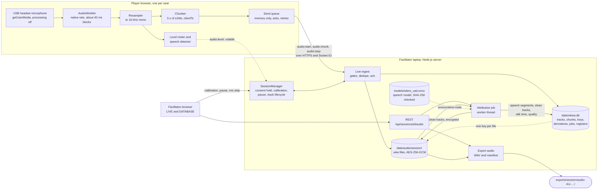

The browser side is a pure capture engine (`apps/client/src/audio/`) with no socket, UI or storage code: the clock, the senders and the browser APIs are injected, so it is unit-tested against a fake Web Audio environment. `RecordingController` (`apps/client/src/player/recording.ts`) connects it to the socket and to the facilitator's commands; its decisions are a pure state machine (`player/recordingMachine.ts`). On the server, `audio/live.ts` receives, `audio/fileStore.ts` stores, and `audio/attribution/` analyses. The analysis is pure functions with no file, database or network access; `audio/service.ts` and `audio/jobWorker.ts` feed it from the encrypted store. The speech model (Silero VAD 6.2.3, MIT licence, `apps/server/models/silero_vad.onnx`, about 2.3 MB) runs on `onnxruntime-node`, which only the job worker loads.

## 4. Capture in the browser

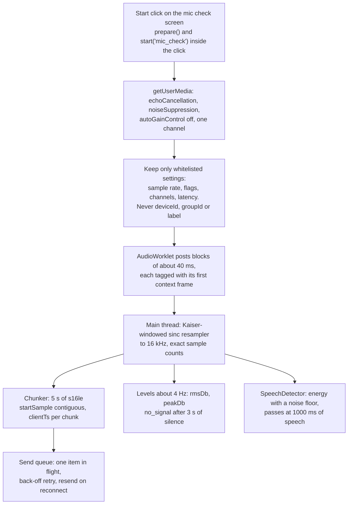

| Aspect | Value |
| --- | --- |
| Constraints | `echoCancellation`, `noiseSuppression`, `autoGainControl` off; `channelCount` 1 |
| Worklet | Inline source loaded from a Blob URL (a `data:` URL as fallback), so there is no separate asset in the build |
| Format | 16 kHz, mono, signed 16-bit little-endian; chunks of 5 s (80 000 samples); the server accepts up to 6 s (96 000 samples) |
| Resampler | Zero-phase Kaiser-windowed sinc, flat to 7 kHz, at least 88 dB down from 8.5 kHz; about 0.6 % of one core |
| Per chunk | `trackId`, `seq`, `startSample`, `sampleCount`, `clientTs`, `clockOffsetMs`, `rmsDb`, `peakDb`, `clippedSamples`, `pcm` |
| Track | One continuous capture run, with a random `trackId`. A new track starts after a pause, a reconnect, a reload, a lost permission, a suspended audio engine, a clock jump of more than 250 ms, or a gap or overlap of more than 1 s in the browser's audio. Smaller gaps are absorbed. |
| Send queue | In memory only, ordered, one item in flight, acknowledged. Capped at 30 minutes of audio: beyond that the oldest chunks are dropped and counted (`droppedChunks` in `audio:stop`). Start and stop markers are never dropped. |
| Levels | `audio:level` about 4 times a second, volatile, never stored. After a stop and once the queue has emptied, one last `audio:level` with `pendingChunks` 0 is sent, which the facilitator's wrap-up check relies on. |
| Errors | `classifyMicError` maps browser errors (denied, not found, in use, insecure page, unsupported, over-constrained, ended) to a title and fix steps for the browser and operating system. |

**Recording controller.** The browser starts and stops recording from what the server says (`PlayerView.audio.record`, with the reason in `notRecording`), never on its own. The controller is a small state machine with three states, *idle*, *running* and *failed*; the reason the next track will start with is part of the state. Every change of the player's view, the connection or the engine is one transition, which gives the next state and the track start or stop it causes (`player/recordingMachine.ts`):

| Event | Browser action | Track reason |
| --- | --- | --- |
| The player clicks Start on the mic check | Opens the mic | start `mic_check` |
| Facilitator pauses recording | Stops, lets the queue drain | stop `paused` |
| Facilitator resumes | Starts a new track | start `resume` |
| The socket drops and comes back | Resends the queue, stops the old track, starts a new one | stop `disconnect`, start `reconnect` |
| The page is reloaded | Starts again (shows **Resume recording** if the browser needs a click) | start `reload` |
| The mic is lost (unplugged, permission revoked) | Waits for **Try again** or a device change | stop `track_ended`, then start `permission_regained` |
| Game complete, seat withdrawn, mic check skipped | Stops, drains the queue | stop `game_complete`, `withdrawn` or `skipped` |
| The session is detached (the facilitator resumes another, an erasure reloads it); the seat is kept | Stops, keeps what is pending; resends it and starts again once the seat is re-claimed. A mic check in progress keeps listening: the player does not have to click Start again | stop `disconnect`, start `reconnect` |
| The seat is unbound | Stops and clears what is pending | stop `client_stop` |

Every start and stop reason, and every mic state, is defined once in the audio reason catalogue (`packages/shared/src/audioReasons.ts`), with its label and meaning; the schemas, the codebook and the facilitator's labels take their text from it. The generated lists are in [NETWORKING.md § 9](NETWORKING.md#9-message-catalogue) (`audio:start`, `audio:stop`) and [DATA-TYPES.md](DATA-TYPES.md#audiotrackstarted) (`AudioTrackStarted`, `AudioTrackStopped`).

## 5. Networking: upload, acknowledgements and retries

Audio uses the existing player socket (`/player`), so it needs no extra port or protocol. The message tables are generated: see [NETWORKING.md § 9](NETWORKING.md#9-message-catalogue).

| Message | Direction | Purpose |
| --- | --- | --- |
| `mic:check` | player to server | Result of the mic check (passed, attempts, level figures, processing flags) |
| `audio:start`, `audio:chunk`, `audio:stop` | player to server | Open a track, upload a chunk (binary PCM), close a track. Each is acknowledged. |
| `audio:level` | player to server | Volatile meter reading, not acknowledged |
| `calibration:start`, `calibration:redo`, `calibration:skip` | facilitator to server | Run, repeat or skip the calibration |
| `mic:skip` | facilitator to server | Skip one seat's mic check (that seat is then not recorded) |
| `recording:pause`, `recording:resume` | facilitator to server | Pause or resume recording for every seat |

Limits: a Socket.IO message may be 1 MB; a chunk is about 160 KB (at most 192 KB). Chunks travel as binary, not as base64.

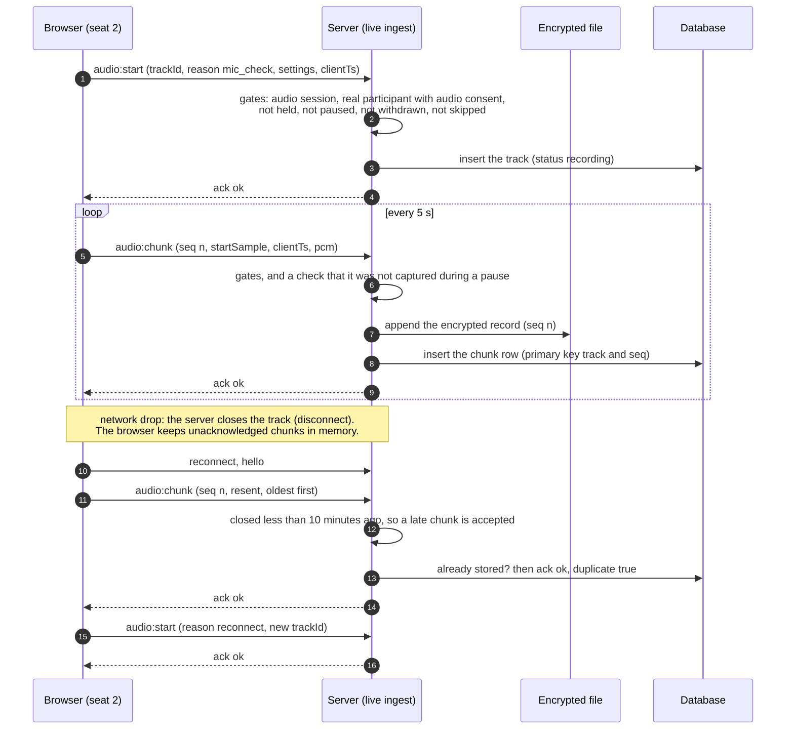

**Waiting for the seat.** Each upload attempt waits until the socket holds its seat again (`hello` answered) before it is emitted, so nothing is refused as "Not seated" after a reconnect. When the queue resends after a reconnect, an older attempt still waiting is cancelled, so an item is not sent twice.

**Acknowledgements.** Every ack is `{ ok: true }` (also for a duplicate) or `{ ok: false, error, retry }`. `retry: false` is a permanent refusal (for example a withdrawn seat): the browser drops the item and counts it. `retry: true` is a transient fault (a storage error): the browser sends it again with back-off. A missing or malformed ack counts as "send again". This is why the same `(trackId, seq)` can arrive twice and is still stored once.

**Late chunks.** The server closes a seat's track when its browser disconnects, when recording is paused, at game complete, and after a restart. A closed track still accepts chunks for 10 minutes after the close, or after the previous late chunk. Audio captured during a recording pause or after the game was complete is never stored, even late: a chunk that starts in such a stretch is refused, and one that runs into it is cut where it begins.

**HTTPS.** A browser exposes the microphone only on a secure page. Players open the laptop by its LAN address, so the server uses HTTPS with a self-signed certificate it makes itself. The certificate warning, the fingerprint check and what to do when the warning returns are in [NETWORKING.md § 11](NETWORKING.md#11-security-on-the-lan) and [SESSION-RUNBOOK.md § 10](SESSION-RUNBOOK.md#10-https-and-the-certificate-warning). Setup step 04 warns when the server runs on plain HTTP.

## 6. Timing model

Each chunk carries `clientTs`: when its first sample was captured, on the **server's clock**. The server stores it, plus the `clockOffsetMs` that was in use, for every chunk. Attribution later uses these timestamps to line the four microphones up.

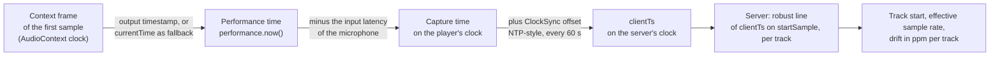

- **Three clocks.** The audio clock (frames counted by the audio engine), the browser's performance clock, and the server clock reached through `ClockSync` ([NETWORKING.md § 8](NETWORKING.md#8-clock-synchronisation)).
- **Two estimators** map audio frames to performance time. `getOutputTimestamp()` minus the base and output latency is used when the browser reports it (median of recent readings); otherwise `currentTime` (the minimum of recent readings, because it only errs one way). The method is chosen once per track and reported in the start message, so every timestamp of a track comes from the same estimator.
- **Per-chunk timestamps.** Each chunk's `clientTs` is computed on its own, so the server can see how the audio clock drifts against the server clock. Nothing is changed afterwards when `ClockSync` re-syncs; the offset in use is stored with the chunk.
- **Jumps.** If the estimate jumps by more than 250 ms (the audio clock stalled, for example after the computer slept), the browser starts a new track so that the sample timeline of a track always matches real time.
- **On the server**, one robust line of `clientTs` against `startSample` per track gives its start time and effective sample rate: the slope from the median of slopes between chunks half the series apart, then two rounds of least squares on the chunks within 3.5 σ. Tracks shorter than a minute keep the nominal rate (too few chunks to see drift). A slope beyond 1000 ppm is treated as a broken timestamp series and the nominal rate is used, with a warning.
- **Accuracy.** With timestamps good to about ±20 ms, the absolute drift is only known to about ±25 ppm on a five-minute session, and to about ±1 ppm on an hour-long one. The tracks of different devices line up to within a few tens of milliseconds, plus each device's constant input latency (typically 10 to 40 ms), which the audio cannot reveal. The engine does not refine this from the audio: the gate compares each mic with the others' peak level within ±60 ms (§ 10), and the smoothing works on 100 ms and longer, so this error does not change who spoke.

Server-side times (`server_ts` of a chunk's arrival) are stored too, but arrival time is not used for alignment: it depends on the network.

## 7. Storage and encryption

Audio is stored as **encrypted files** next to the encrypted database: `data/audio/<sessionId>/<random 16-byte hex>.wka`. File names never contain a participant code. Everything that links a file to a seat, a code and a key is in the database.

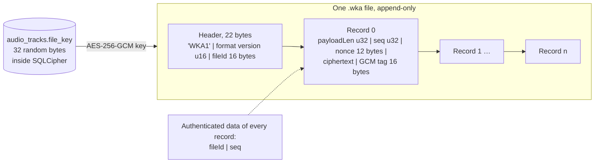

| Property | Design |
| --- | --- |
| Container | `WKA1` header, then one record per uploaded chunk. Integers are big-endian. Only `node:crypto` is used. |
| Cipher | AES-256-GCM, a fresh random 12-byte nonce per record, 16-byte tag. The authenticated data is the file id and the record number, so a record cannot be moved to another file or renumbered without the tag failing. |
| Keys | One random 32-byte key per file, kept only in the database (`audio_tracks.file_key`, `audio_derivatives.file_key`), never next to the file and never in a listing. |
| Appending | Appends to one file run one at a time and are flushed to disk. A crash that leaves a half-written last record is reported on reading and cut off at the next append. |
| Duplicates | The chunk row's primary key is `(track_id, seq)`. A crash between the file append and the row insert leaves a record without a row. The resend appends it again, and the reader keeps the first valid copy per `seq`, so nothing is lost or doubled. |
| Derived audio | A cleaned track is a new `.wka` file with its own key. Small results (speech segments, talk time, quality report, leakage matrix) are JSON inside the database, which is encrypted. |
| Erasure | Delete the key rows first, then unlink the files. A leftover copy of a file can no longer be decrypted (**crypto-shredding**). |
| Passphrase change | `rekey` needs no change to the files, because the keys are inside the database. |
| Backup | `backup` copies the database and the audio folder together. The files stay encrypted and need the keys of that database copy. |
| Integrity | `verify` checks every record's tag, that each chunk row has its record, that deleted audio has neither key nor file, orphan files, and that no name contains a participant code. |

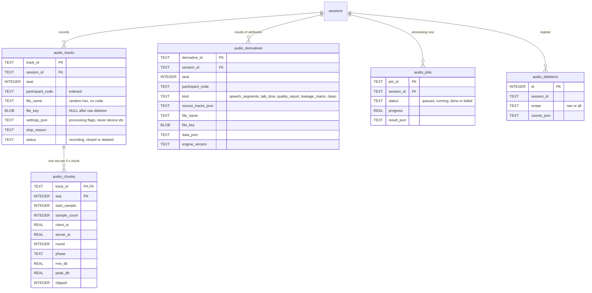

Field-level tables: [DATA-TYPES.md](DATA-TYPES.md#audio-storage).

## 8. Recording lifecycle

A seat is recorded only while its **recording verdict** (`recordingVerdict`, `packages/shared/src/recordingVerdict.ts`) says so: the session records audio, the seat is held by a **real participant** who gave the audio consent, has not withdrawn, has reached the mic check and not had it skipped, **no other real seat is still in consent** (the hold), recording is not paused, and the phase is onboarding, round active or round complete. Breaks and game pauses are recorded too.

When a seat is not recorded, the verdict names the **first** reason that applies, in a fixed order: first the reasons that concern the seat itself (audio off, no client, fake player or agent, withdrawn, consent declined, no audio consent, consent not finished, mic check skipped, no mic check step), then the moment (still in the lobby, game complete, session closed or aborted, the consent hold, the facilitator's pause). `paused` therefore means that the pause is the only thing stopping the seat. The player's view carries the reason (`PlayerView.audio.notRecording`); the browser takes the track's stop reason from it, and the facilitator's mic column and wrap-up check read the same verdict, so all three always agree.

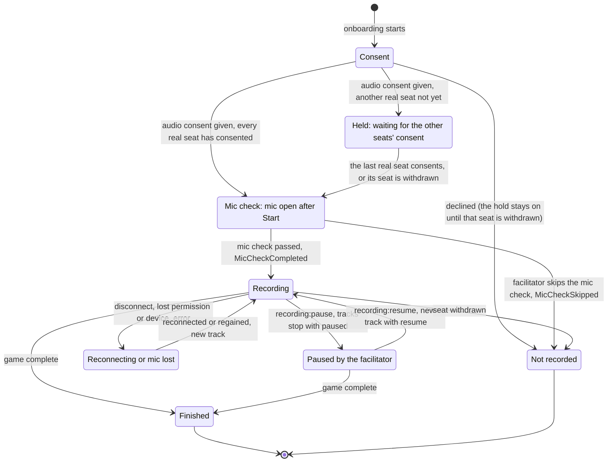

**The consent hold.** `micCheckHoldSeats` lists the bound, non-withdrawn real participants whose consent is not `given`. While the list is not empty, no seat may start its mic check, so no microphone opens anywhere; the player sees *waiting for the other seats*. The server enforces it in the ingest as well. A participant who declines keeps the hold until the facilitator withdraws that seat. Fake players and agents never count.

**Tracks.** A track is one continuous capture run of one seat. The reason it started and stopped is stored with it:

| Reason group | Start reasons | Stop reasons | Set by |
| --- | --- | --- | --- |
| Normal course | `mic_check`, `resume` | `paused`, `game_complete`, `closed`, `aborted` | Browser, or server for `closed` and `aborted` |
| Reconnection and reload | `reconnect`, `reload` | `disconnect` (the server closes the track when the socket drops), `interrupted` (the server found it still open after a restart, or the seat started another track) | Server |
| Microphone problems | `permission_regained` | `track_ended` (the device was unplugged or the permission revoked), `error`; `permission_lost` is accepted but not sent by the current browser code | Browser |
| Browser audio engine | `context_resumed`, `clock_jump`, `discontinuity` | `context_suspended`, `context_interrupted`, `clock_jump`, `discontinuity` | Browser |
| People | – | `withdrawn` (participant withdrawn), `skipped` (mic check skipped) | Server |
| Clean-up | `cleared` | `cleared`, `client_stop` | Browser |

A track shows as `interrupted` in the facilitator's views, the REST summary and the CSV when it ended with `disconnect`, `interrupted`, `permission_lost`, `error` or `track_ended`, so the wrap-up check can tell the facilitator that audio may be missing. The wrap-up check also flags `context_interrupted` (the system interrupted the browser's audio engine), without counting it as interrupted.

**Pause.** `recording:pause` is only for everyone at once; players have no mute. On a pause the server closes every open track at once (`paused`). Chunks that were in flight are kept up to the pause and nothing after it. `recording:resume` makes every recorded seat start a new track. The pauses and the moment the game was complete are part of the game state (`state.audio.pauses`, `state.audio.gameCompleteTs`), folded from the event log by the reducer, so a late chunk is cut in the same place after a server restart.

**Why pausing matters.** Every mic hears the room. If someone enters, or a withdrawn participant is still sitting there, pause recording and add a note (no names) so the time span can be left out of analysis.

## 9. Calibration

Calibration measures how loud each seat's voice is **on every other mic**: each seat in turn reads a fixed sentence aloud while the others stay quiet. From these turns, attribution learns the leakage between mics and the server can tell the facilitator within seconds whether the headsets separate the voices.

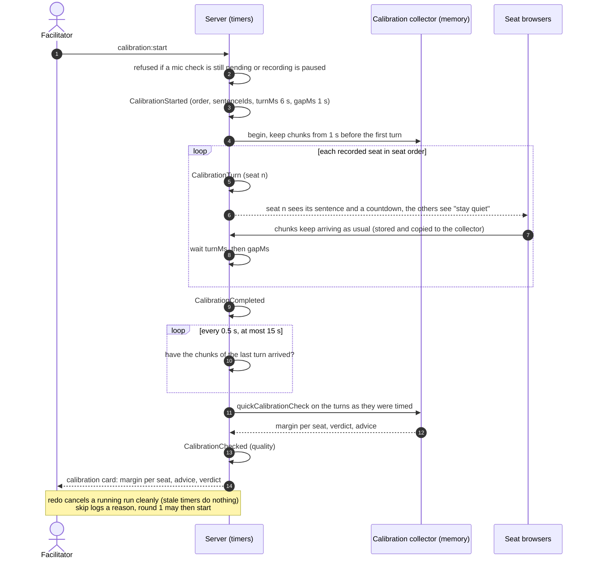

- **Sentences.** Each seat gets a different sentence from `config/audio.json` (public-domain Harvard sentences). A player sees only their own sentence, and only during their turn.
- **Timing is the server's.** The turns are timed by server timers and logged (`CalibrationTurn`), so the analysis later knows exactly when each seat was supposed to speak.
- **Leakage.** In seat *s*'s turn, only the frames where its own mic is at least 10 dB above its noise floor count. `L[s][j]` is the median, over those frames, of mic *j*'s level minus mic *s*'s level (negative: quieter). A leak below mic *j*'s noise floor reads as the floor, which only makes the gate stricter.
- **Quality check.** A seat's **margin** is the gain-invariant separation from every other mic: the smallest `−(L[s][j] + L[j][s]) / 2` over the other seats, so a difference in microphone gain cancels out. A seat passes at 12 dB or more (`CALIBRATION_MIN_MARGIN_DB`, shared by the server and the facilitator's card); headsets reach about 20 to 30 dB. A seat is also flagged for no audio, fewer than 1 s of clear speech, a voice less than 15 dB above its own noise, or clipping. Each problem comes with advice such as *check the headset is plugged in, chosen as microphone and its mic sits at the corner of the mouth*.
- **Gate.** With `audio.requireCalibration` on (the default), round 1 cannot start until the calibration is done or skipped. If the server stops a running calibration itself (recording paused, server restart), it logs `CalibrationSkipped` with `cancelled: true`, which puts the calibration back to pending, so the gate holds.
- **When.** After every seat has finished onboarding, or in a break between rounds (for example after someone put their headset back on or changed device).
- **Memory only.** The collector keeps at most about 4.5 MB for the length of one run. The chunks are stored by the normal ingest as well.

## 10. Speaker attribution

The facilitator starts attribution from the DATABASE tab, once the session is closed. It runs in a `worker_thread`, one job at a time, with at most one queued or running job per session. It decides, per 10 ms frame, which seats are speaking. Because every player wears a headset, each mic hears its own player 20 to 30 dB louder than anyone else, so attribution is a **gate**: seat *s* speaks in a frame when

1. its mic hears **speech** (the Silero VAD model; energy above the noise floor when the model cannot run), and
2. its level beats what every other seat's voice would leak onto it by a margin: `E_s ≥ E_j + L[j][s] + 6 dB` for every other mic *j*, where `E_j` is mic *j*'s peak level within ±60 ms and `L` is the leakage (§ 9).

Another player's voice leaking onto a mic fails the gate; two people talking at once both pass, so overlap is kept. The engine never computes embeddings, voiceprints, pitch or spectral profiles, and never tries to recognise whose voice it is. The speech model answers only "is this speech?".

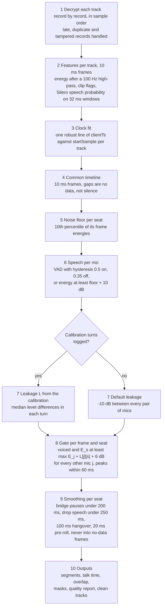

| Step | What it does |
| --- | --- |
| Features | Each track is reduced, chunk by chunk, to 10 ms frames: the energy after a 100 Hz high-pass (removes rumble and handling noise), a clip flag, and the speech probability from Silero VAD on 32 ms windows (about 12 s of CPU per hour of one seat). Only about one 5 s chunk of PCM is in memory at a time. A gap in a track is "no data", and the filter and the model start afresh after it. |
| Clock fit | Gives each track a start time and an effective sample rate on the server clock (§ 6). |
| Timeline | Every track is placed on one grid of 10 ms frames. A gap (no track, a lost chunk, a recording pause) is **no data**, never confused with silence. |
| Noise floor | The 10th percentile of each mic's frame energies, ignoring digital silence. Used for the energy fallback, the calibration and the quality report. |
| Speech per mic | With the model, a frame starts speech at a probability of 0.5 and stays speech while it is at least 0.35. Without it (the model file is missing or altered, or `WKWA_SPEECH_MODEL=off`), speech is energy at least 10 dB above the floor; the quality report then names the detector `energy` and adds a warning. |
| Leakage | `L[s][j]` from the calibration (§ 9). A pair the calibration could not measure, or a session without a calibration, uses a conservative −10 dB (laptop-like): leakage is then rarely mistaken for speech, but a quieter second voice in overlap is missed more often. |
| Gate | As above. Comparing with each other mic's peak within ±60 ms covers the timing error between devices (§ 6). A speech frame whose decision lies within 3 dB of the threshold counts as **ambiguous**. |
| Smoothing | Per seat: pauses under 200 ms are bridged (only where the seat has data), runs under 250 ms dropped, then each run is extended by 100 ms after and 20 ms before, never into frames without data. |

**Outputs.** One run replaces the previous run's results in one transaction, then removes the old files. If the source audio changed while the job ran (deleted or erased), nothing is stored.

One run stores a `speech_segments` row and a `clean` row for each recorded seat, plus the three session-wide rows: 11 rows for four seats.

| Result (`audio_derivatives.kind`) | Per | Content | Holds voice? |
| --- | --- | --- | --- |
| `speech_segments` | Seat | Start and end on the server clock, duration, round, phase, game paused, recording paused, mean level, confidence (mean speech probability, or share of gated frames with the energy fallback), overlap and who overlaps | No: timing only |
| `talk_time` | Session | Talk time and overlap per seat | No |
| `quality_report` | Session | Grade, speech detector, calibration per seat, ambiguous share, per-seat figures, warnings in plain English, and the alignment that raw exports use | No |
| `leakage_matrix` | Session | The 4 × 4 matrix and whether it was measured in the calibration or is the default | No |
| `clean` | Seat | A new encrypted track on the common timeline: frames not attributed to this seat are **turned down by 30 dB** with 10 ms fades; overlap frames stay at **full level** | **Yes** |

A cleaned track is the seat's own track, aligned and with the other voices turned down: quieter, **not removed**. Its source is **all** tracks, because the mask uses every seat and the other voices are still audible in it. That is why an erasure of any participant also removes every cleaned track (§ 11). The raw audio is never modified.

**Quality report.** It holds the engine version (`wkwa-gate-attribution/2.0.0`), the grade, which speech detector ran (`silero` or `energy`), the calibration verdict per seat (§ 9), the **ambiguous share** (speech frames whose gate decision was within 3 dB of the threshold) and, per seat, coverage (share of the session with usable audio), clipping, noise floor, speech level, signal-to-noise ratio, clock drift, talk time and overlap. Warnings are raised for: no calibration (default leakage), the energy fallback, a calibration problem of a seat, coverage under 95 %, clipping in more than 0.5 % of frames, and an ambiguous share over 10 %. The grade is **poor** when the mean coverage is under half, more than a quarter of the speech is ambiguous, or a calibrated margin is under 6 dB; **fair** with any other warning; **good** without warnings. The REST summary and the DATABASE popup show the grade, the detector, whether the session was calibrated, the ambiguous share, the warnings and margin, drift and coverage per seat.

**Measured on synthetic four-seat mixes** (`npx vitest run apps/server/test/attribution.accuracy.test.ts`, and the same generator with seeds 1 to 3): 4-minute sessions of speech-like noise with turn structure, about 10 % overlap, known leakage, ±100 ppm drift, 0 to 50 ms device latency, ±20 ms timestamp jitter, a 20 s dropout of one seat and one lost chunk; frames within 100 ms of a true speech boundary are not scored. The sources are not real voices, so speech is detected by energy here (the Silero model only fires on voices).

| Check | Headsets (−15 to −25 dB leakage), calibrated | Headsets, no calibration | Laptop-like (−4 to −10 dB), calibrated | Laptop-like, no calibration |
| --- | --- | --- | --- | --- |
| Single-speaker frame accuracy | 99.9 to 100 % (test: at least 98 %) | 99.96 to 100 % (test: at least 97 %) | 87 to 99 % | 55 to 66 % |
| Overlap recall | 98 to 100 % (test: at least 90 %) | 29 to 56 % | 21 to 27 % | 17 to 38 % |
| False talk on a silent seat | 1.1 to 2.4 % (test: under 3 %) | under 1 % | under 1 % | 10 to 12 % |
| Calibrated leakage error | at most 1.4 dB (test: under 2 dB) | – | at most 1.6 dB | – |
| Calibration margins | 16 to 22 dB, every seat passes | – | 4.6 to 8.2 dB, every seat flagged | – |
| Grade | fair (the dropout is warned about) | fair | poor | poor |

These are results on synthetic audio, not on recordings of people. They show that the method works when its assumption (a headset per player) holds, that the calibration matters for overlapping speech, and that a set-up without headsets is graded poor instead of passing silently. A pilot with real participants and a hand-checked sample is still needed ([DATA-MANAGEMENT.md § 14](DATA-MANAGEMENT.md#14-risk-assessment-dpia-style), #22).

## 11. Export and deletion

**Export audio** is the only way sound leaves the encrypted store. In DATABASE, the audio popup's **WAV** button (one seat) or the export form (all or one seat; raw, clean or both; an optional note) runs the registered action. There is no browser download: the popup shows the folder on the laptop.

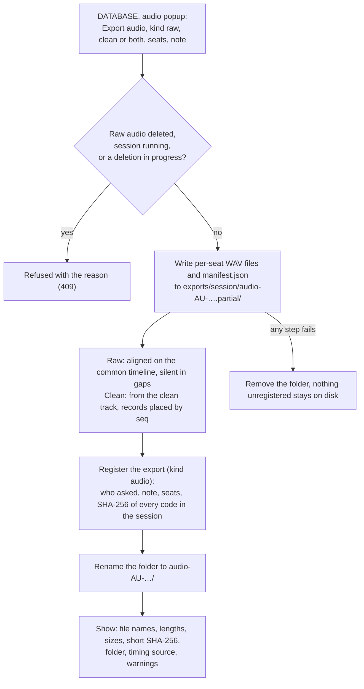

- **Files.** 16 kHz mono 16-bit WAV, one per seat and kind, named `<sessionId>_seat<N>_<raw|clean>.wav`. Names and the manifest hold no participant code. All files of one export have the same length, because they sit on the common timeline.
- **Timing of raw files.** Raw tracks are placed with the alignment stored by the latest attribution, but only if this engine version computed it from exactly the same tracks. Otherwise (no attribution yet, or one from an earlier engine) each track's clock is fitted from its chunk timestamps; the result then names the timing `timestamps` instead of `attribution`.
- **Clean files.** Record `seq` of a cleaned track holds a fixed 5 s block, so each record is written at its own place: a damaged record plays as silence there instead of shifting the rest of the track forward.
- **Half-written exports.** The files are written to `audio-<id>.partial` and the folder is renamed only after the export is registered. A crash therefore never leaves a complete-looking, unregistered folder of voice files, and the server removes `.partial` leftovers when it starts.
- **Register.** The export is recorded like any other (`exports` table, `kind = audio`, details in `details_json`), with the SHA-256 hashes of every code in the session, so a takedown finds it.
- **The WAV files are personal data** and plain, not encrypted. Move them to institutional storage and delete the local copy.
- **Standard and anonymised exports never contain WAV files.** They gain `audio_tracks.csv` (the index) and `speech_segments.csv` (timing). Both files are written for sessions without audio too, header only. After an erasure, the erased seat is also removed from the other seats' `overlap_with`.

**Deletion.** Three routes remove audio, with different reach:

| Action | Removes | Keeps | Register |
| --- | --- | --- | --- |
| **Delete raw audio** (`delete-audio --scope raw`, DATABASE) | Raw files and keys of every track, and every cleaned track | Track rows (marked deleted, with their timing), chunk rows (times and levels), speech segments, talk time, quality report, leakage matrix | `audio_deletions` |
| **Delete all audio** (`--scope all`) | Everything above plus the track and chunk rows, every derived result (speech segments included), the jobs, and the session's audio folder | Only the register entry | `audio_deletions` |
| **Erase a participant** (`erase`, DATABASE) | That participant's tracks, chunks and own derived results, and every result computed from their tracks: **every seat's cleaned track, talk time, quality report and leakage matrix** | The other seats' raw tracks and speech segments (without the erased seat as overlap partner) | `erasures` |
| **Delete the session** | All audio rows, jobs and the audio folder, with everything else of the session | – | `session_deletions` |

- Deleting raw audio and deleting all audio are refused while the session is running, while an attribution of it is queued or running, and while an audio export of it is being written. One guard decides all these refusals (`apps/server/src/session/sessionGuard.ts`), and every operation checks the running session first. Attribution is refused afterwards, because the source is gone.
- Erasing a participant and deleting a session from the manager are refused (409) while an attribution of that session is queued or running, or an audio export of it is being written. Try again when it has finished.
- **Exported WAV files are not deleted by any of these.** The command or popup lists the exports on disk; delete them by hand on every copy.
- After an erasure, the attribution result of the session is gone, so run the attribution again if it is needed. The other seats' speech segments are kept, but the erased seat is removed from their `overlapWith` (a segment with no partner left is no longer marked as overlap), and the session's job summaries (talk time and warnings per seat) are cleared. The other seats still hear the erased voice in their own raw recordings (crosstalk): see [DATA-MANAGEMENT.md § 10](DATA-MANAGEMENT.md#10-takedown-and-erasure-procedure).
- Keys are deleted first, then files are unlinked. A file that cannot be removed is reported; it is unreadable without its key.

## 12. Data types

How the pieces relate. Field-level tables are generated from the schemas: [DATA-TYPES.md](DATA-TYPES.md) (events `AudioTrackStarted`, `AudioTrackStopped`, `MicCheckCompleted`, `MicCheckSkipped`, `Calibration*`, `RecordingPaused`, `RecordingResumed`; telemetry `mic_permission`; the audio CSV files).

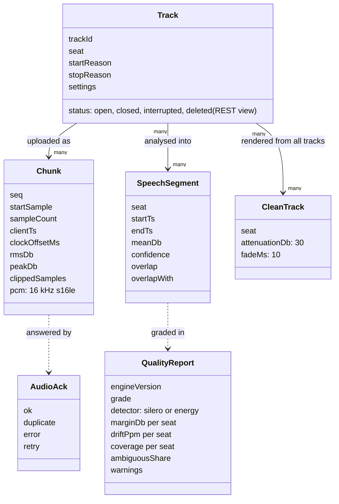

The stored `audio_tracks.status` is only `recording`, `closed` or `deleted`. The REST and CSV view derives `open`, `closed`, `interrupted` and `deleted` from it and from the stop reason. A track reads as `interrupted` when it stopped with `disconnect`, `interrupted` (the server found it still open after a restart), `permission_lost`, `error`, `track_ended` (the microphone went away) or an unknown reason; its stop reason is kept in the data. The status is worked out each time it is read, so tracks recorded before `track_ended` counted as interrupted read as `interrupted` too.

## 13. Known limits

- **Crosstalk remains in the raw audio.** Every mic hears the room. Cleaned tracks turn other voices down by 30 dB but do not remove them, and where two people speak at once both stay at full level.
- **The method assumes headsets.** With laptop microphones (3 to 10 dB separation) the gate misses quiet overlapping speech and short single-speaker stretches. The calibration flags such seats as low margin, and the quality report reads *poor*.
- **Without a calibration, overlap is under-reported.** The default leakage of −10 dB is conservative, so leakage is rarely taken for speech, but a quieter second voice in overlap is often missed (29 to 56 % overlap recall on the synthetic headset mixes, against 98 to 100 % with a calibration).
- **A mic that dropped out** while its participant speaks: that voice can only be compared with the mics that still have data, so a neighbour's mic may pick up its leak and be credited with it. The coverage warning flags such stretches.
- **Coughs, laughter and noises next to a mic.** The speech model ignores most non-speech sounds, but not all; with the energy fallback every loud sound near a mic counts. The 250 ms minimum and the per-segment confidence limit such false speech but do not remove it.
- **Absolute time** comes from the client timestamps (about ±20 ms, plus each device's input latency of typically 10 to 40 ms). This is below the smoothing and does not change who spoke, but word-level timing across mics is only good to a few tens of milliseconds. Short sessions also give rough absolute drift (about ±25 ppm over five minutes).
- **Bots and demos send voice-less synthetic audio**, which the speech model does not take for speech. Run the server with `WKWA_SPEECH_MODEL=off` for them ([NETWORKING.md § 4](NETWORKING.md#4-ports-interfaces-and-configuration)); the e2e test server does this already.
- **`dropped_chunks` is counted per recording time, not per track.** The browser credits a chunk it had to drop to the track that was recording when the drop happened. Drops only happen after more than 30 minutes of unsent audio, and if that backlog spans a track boundary, chunks of an older track are counted on the newer one (capped at the newer track's own chunk count). Treat per-track drop counts as approximate.
- **The wrap-up audio check** relies on the browser's final `audio:level` with `pendingChunks` 0. A browser that is closed before it sends it leaves the last reported backlog on screen.
- **Quality figures are from synthetic mixes.** A pilot with real participants is needed before results are relied on.
- **Retention and consent wording are placeholders.** `[placeholder: …]` entries in [DATA-MANAGEMENT.md](DATA-MANAGEMENT.md) and the audio section of `config/consent.md` wait for decisions by the researcher, the ethics committee and the data protection officer.

## 14. Code map and tests

| Area | Where |
| --- | --- |
| Shared contracts (config, events, messages, state, projections, REST types) | `packages/shared/src/audio.ts`, `state.ts`, `events.ts`, `protocol.ts`, `projections.ts`, `config.ts` |
| Recording verdict and reason catalogue | `packages/shared/src/recordingVerdict.ts`, `audioReasons.ts` |
| Browser capture engine | `apps/client/src/audio/` (`MicRecorder`, worklet, resampler, chunker, queue, speech detector, timing, errors) |
| Browser recording flow and screens | `apps/client/src/player/recording.ts`, `recordingMachine.ts` (the controller's states and transitions), `micCheckAttempt.ts` (one mic-check attempt), `MicCheckScreen.tsx`, `CalibrationScreen.tsx`, `RecordingIndicator.tsx` |
| Live ingest, consent hold, calibration, pause | `apps/server/src/audio/live.ts`, `calibration.ts`, `session/CalibrationRunner.ts` (timed turns, quick check), `session/SessionManager.ts` |
| Encrypted store | `apps/server/src/audio/crypto.ts`, `fileStore.ts`, `verify.ts`, `db/database.ts` (migrations 6 and 7) |
| Attribution | `apps/server/src/audio/attribution/` (overview in the header of `index.ts`; `features.ts`, `vad.ts`, `clock.ts`, `analyse.ts`, `smooth.ts`, `render.ts`, `annotate.ts`), `service.ts`, `jobs.ts`, `jobWorker.ts`, `wav.ts` |
| Speech model | `apps/server/models/silero_vad.onnx` (Silero VAD 6.2.3, MIT), checked against its SHA-256 in `vad.ts`; runtime `onnxruntime-node` |
| REST routes | `apps/server/src/api/audioRoutes.ts` (`GET /api/sessions/:id/audio`, `POST …/audio/attribution`, `GET /api/audio/jobs/:jobId`, `GET …/audio/segments`, `POST …/audio/export`, `POST …/audio/delete`) |
| Erasure and deletion | `apps/server/src/db/personalData.ts` (the personal-data map), `session/sessionGuard.ts` (when each operation is refused), `cli.ts` |
| Facilitator screens | `apps/client/src/facilitator/live/AudioPanels.tsx`, `AudioControls.tsx`, `seats.tsx`, `database/AudioPopup.tsx`, `setup/ConfigSteps.tsx` (step 04) |
| UI primitives | `apps/client/src/ui/audio.tsx`, `audioMeta.ts` ([AESTHETIC-RULES.md § 8.1](AESTHETIC-RULES.md#81-audio-indicators)) |
| Test bots | `npm run bots -- --count 4 --auto --audio` ([ARCHITECTURE.md § 13](ARCHITECTURE.md#13-testing-strategy-and-bots)) |

Tests: a table test of the recording verdict, checked against every combination of the fields it reads; a test of the reason catalogue against the schemas and the codebook; unit tests for the resampler, queue, recorder (against a fake Web Audio environment), file store (round trip, tampering, truncation, path tricks), attribution (synthetic headset and laptop-like mixes with known truth, with and without a calibration), live ingest (every gate, every lifecycle close), processing jobs, routes, exports and erasure; a Playwright flow with a fake microphone that plays a synthetic voice (`e2e/app-audio.spec.ts`), through consent hold, mic check, calibration, a round, pause and resume, and game complete.
