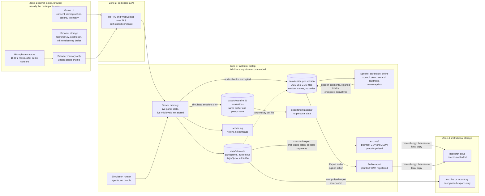
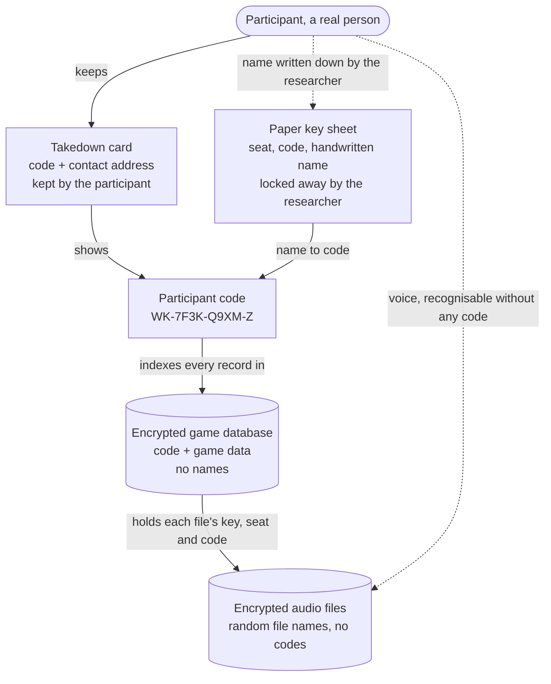
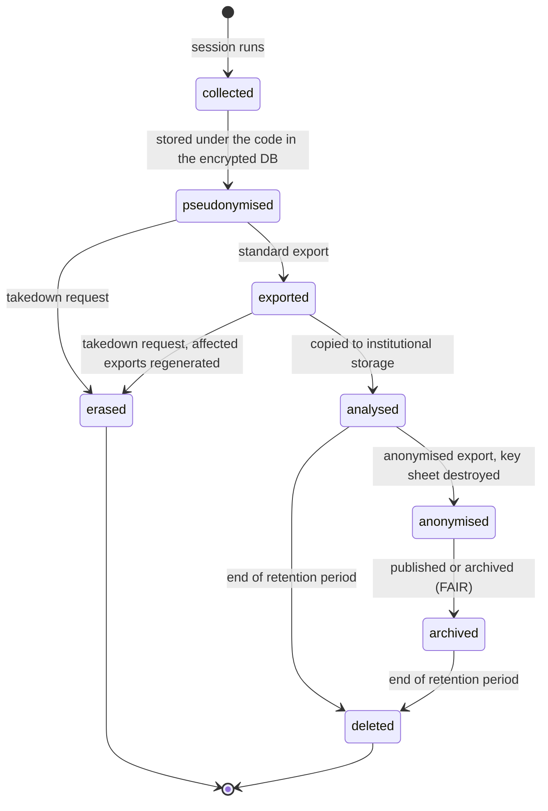
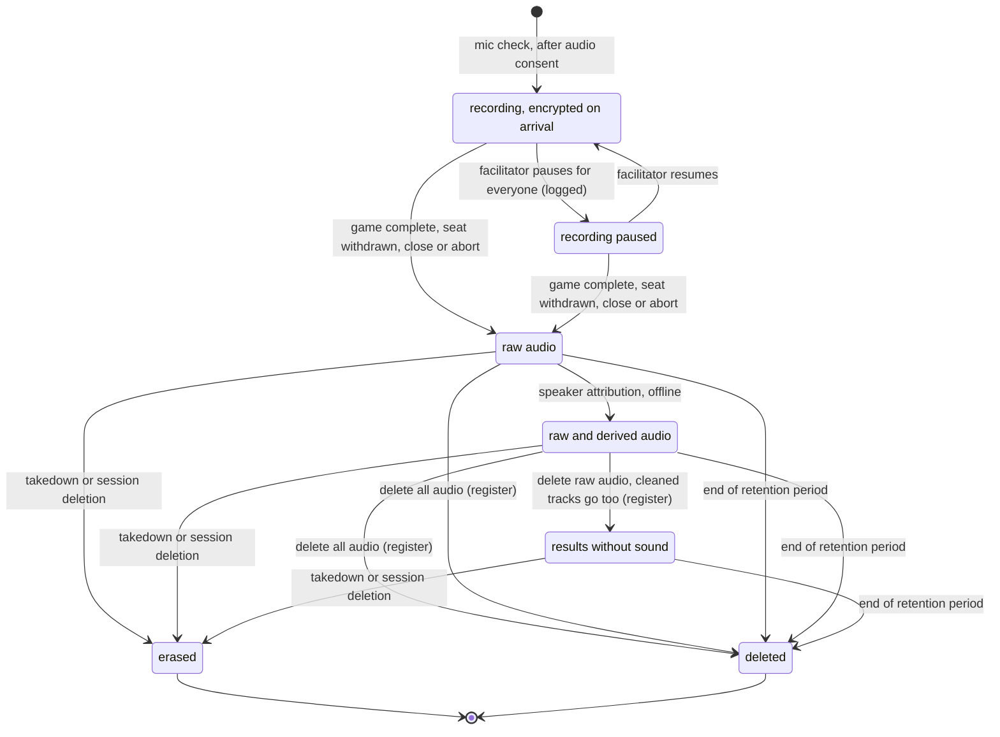
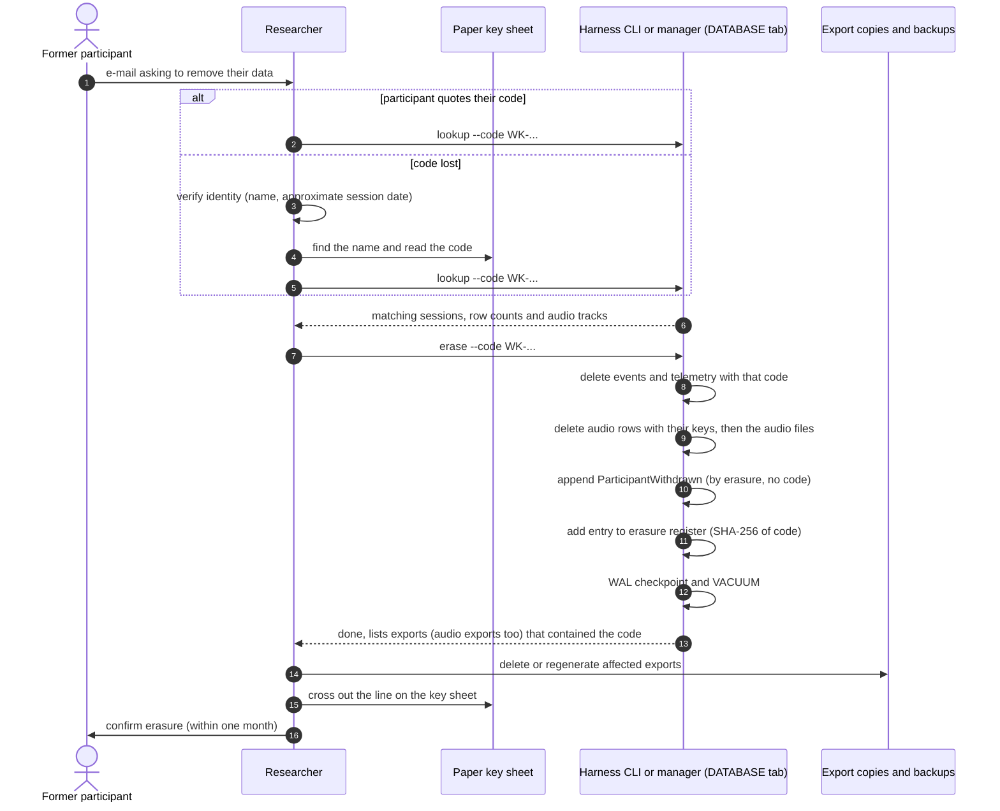
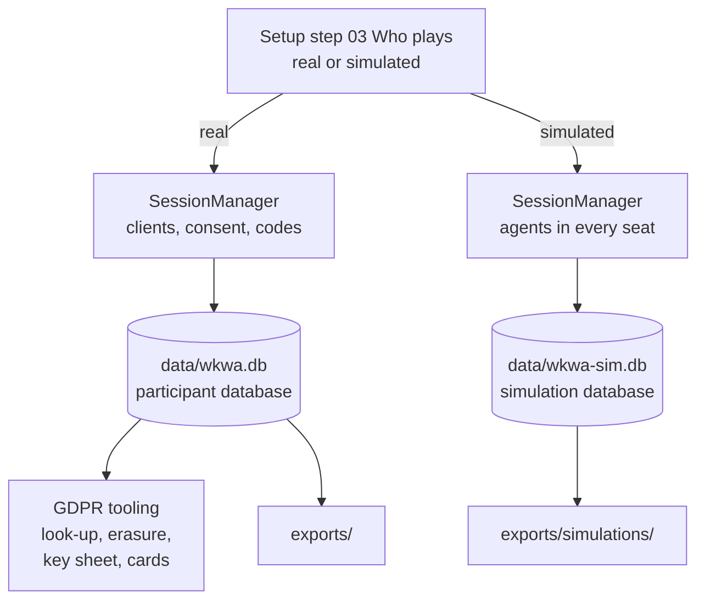

# Data management and data protection

*Change log: [DATA-MANAGEMENT-CHANGELOG.md](changelog/DATA-MANAGEMENT-CHANGELOG.md)*

This document explains what research data the harness collects, why, where it is stored, how participants are pseudonymised, how a takedown request is handled (even years later), and which risks remain. It is written to support a data management plan (DMP), an ethics application and the thesis methods chapter.

> **Guidance, not legal advice.** The design follows common GDPR practice for academic research. The legal basis, retention period and storage locations must be confirmed with your institution's ethics committee and privacy officer. See the [checklist](#15-checklist-for-the-ethics-committee--privacy-officer). Placeholders such as `[N years]` must be filled in in `config/study.json` and `config/consent.md`. Choices that have not been made yet, mostly about audio, are marked `[placeholder: …]`.

Field-level detail of every logged record is in [DATA-TYPES.md](DATA-TYPES.md).

## Contents

1. [Summary](#1-summary)
2. [Roles and legal basis](#2-roles-and-legal-basis)
3. [Data inventory](#3-data-inventory)
4. [Data flow and trust boundaries](#4-data-flow-and-trust-boundaries)
5. [Identity and pseudonymisation](#5-identity-and-pseudonymisation)
6. [Data lifecycle](#6-data-lifecycle)
7. [Consent design](#7-consent-design)
8. [Data minimisation decisions](#8-data-minimisation-decisions)
9. [Encryption and key management](#9-encryption-and-key-management)
10. [Takedown and erasure procedure](#10-takedown-and-erasure-procedure)
11. [Exports, codebook and anonymisation](#11-exports-codebook-and-anonymisation)
12. [Retention and deletion](#12-retention-and-deletion)
13. [Personal-data classes per record type](#13-personal-data-classes-per-record-type)
14. [Risk assessment (DPIA-style)](#14-risk-assessment-dpia-style)
15. [Checklist for the ethics committee / privacy officer](#15-checklist-for-the-ethics-committee--privacy-officer)
16. [Command reference](#16-command-reference)
17. [Simulated sessions and the simulation database](#17-simulated-sessions-and-the-simulation-database)
18. [Fake players in real sessions](#18-fake-players-in-real-sessions)

---

## 1. Summary

- **What:** in-game actions and their timing, fine-grained interface behaviour, a few bracketed demographic answers, consent records and, in sessions that record audio, **each participant's microphone audio**. All of it is linked to a **random participant code**, never to a name.
- **Audio:** players may talk during play (in English), and what they say is research data.
  - When a session records audio (off by default; setup step 05), each participant's browser records their own microphone: a wired single-ear USB headset that the participant wears, plugged into their device. Recording runs from their mic check, the last onboarding step, until the game is complete: the calibration, rounds, breaks and game pauses. The consent form, background questions and briefing come before the mic check, so they are **not recorded**.
  - It needs a separate, **required** consent item. Declining it means not taking part in that session (§ 7). **No microphone opens anywhere until every real seat has consented and finished the briefing** (the mic check hold).
  - The four players sit in one room, so every mic also hears the others. An offline step on the facilitator laptop works out **who spoke when**: a small model says whether each mic hears speech, and comparing loudness across the four mics says which seat it is. It never uses voiceprints and never tries to recognise whose voice it is (§ 2).
  - A voice can identify a person, so audio is never part of an anonymised export (§ 11).
  - Transcription is planned, on the laptop only, and not built yet ([AUDIO-TRANSCRIPTION.md](AUDIO-TRANSCRIPTION.md)).
- **Where:** one SQLite database on the facilitator's laptop, **encrypted at rest** (SQLCipher, AES-256), with a passphrase typed at start-up. Audio is kept in **encrypted files** next to it (AES-256-GCM, one random key per file, kept inside the database). Nothing goes to the internet during a session. Traffic on the LAN is encrypted with TLS (a self-signed certificate that participants accept once).
- **Who can link a code to a person:** only the researcher, through a **paper key sheet** kept physically separate from the data. The participant keeps a **takedown card** with their own code.
- **Takedown:** quoting the code (or giving a name, which is looked up on the key sheet) lets the researcher erase every record of that participant, **audio included**, with a single command.
- **Not collected:** names, e-mail addresses, IP addresses, device or browser details (including microphone names and ids), pointer traces, typed free text, video, voiceprints.
- **Publication:** only anonymised exports (codes replaced by unlinkable ids, after the key sheet is destroyed). They never contain audio.
- **Test sessions:** *fake players* (test clients the server creates) can fill seats of a real session; they are marked fake, get no code and no made-up consent or answers, and never record audio (§ 18).
- **Simulations:** sessions played by software agents instead of people go into a **separate database** (`data/wkwa-sim.db`, same encryption and passphrase). They contain no personal data and no audio, and never mix with participants' data (§ 17).

## 2. Roles and legal basis

| Role | Who (fill in) | Notes |
| --- | --- | --- |
| Controller | Usually the institution, e.g. `[University]` | Students usually act on behalf of their institution; confirm. |
| Researcher | `[Name]` | Runs sessions, holds the passphrase and key sheet. |
| Supervisor | `[Name]` | May need access to pseudonymised exports. Record this in the consent text. |
| Processors | none during collection | No cloud services are involved, also not for audio: speaker attribution and the planned transcription run on the facilitator laptop. Institutional storage (after the session) is governed by institutional agreements. |

**Legal basis (to confirm):** typically *consent* (GDPR Art. 6(1)(a)) for participation, or *public interest / scientific research* (Art. 6(1)(e)) with consent as an ethical safeguard. Demographic answers are not special-category data as designed (no health, ethnicity, religion and so on); do not add such questions without re-assessment. Research safeguards per Art. 89: pseudonymisation, minimisation, encryption, access control.

**Audio (to confirm with your DPO):**

- **Legal basis.** Recording rests on consent: a separate audio item on the consent screen, required for taking part in a session with audio (§ 7). If your institution uses Art. 6(1)(e) for the rest of the study, ask whether audio should still rest on consent. The item is needed as an ethical safeguard either way.
- **Required, yet freely given?** Consent must be freely given, and Art. 7(4) warns against making something conditional on consent to processing that it does not need (EDPB Guidelines 05/2020 on consent, § 3.1.2). Here the audio is part of what the study measures, so taking part without it would be a different study. Make sure declining costs the person nothing (no lost credit or payment, a neutral exit), and confirm this set-up with your ethics committee.
- **Personal data, not biometric by design.** A voice recording is personal data: anyone who knows the speaker may recognise them, and it carries more than the words (see EDPB Guidelines 02/2021 on virtual voice assistants).
  - It becomes *biometric* data only through specific technical processing that allows or confirms the unique identification of a person (Art. 4(14); compare Recital 51 on photographs). Art. 9(1) covers biometric data processed *for the purpose of* uniquely identifying someone.
  - The harness never computes voiceprints or speaker embeddings and never matches a voice to a person. It only asks whether a mic hears speech, and compares loudness across the four mics of one session to tell which seat is speaking (§ 8).
  - The speech detector (Silero VAD, an open-source model that runs on the laptop) gives one number per 32 ms: how likely that stretch is speech. It produces no embedding or other description of the voice, works the same for every speaker, and its numbers are not stored; only the resulting speech segments are, with their mean speech probability as confidence. It is a speech/non-speech decision, not biometric processing.
  - In our reading this is not Art. 9 processing. Adding speaker identification later would change that (§ 14, #26).
- **Incidental special-category content.** The recordings may still reveal health (a cough, a speech impairment), ethnic origin (an accent), or anything participants say about themselves. The CJEU reads "revealing" broadly (C-184/20, *OT*, 2022). Ask your DPO whether to word the audio item as explicit consent (Art. 9(2)(a)), or whether Art. 9(2)(j) with Art. 89 safeguards applies (in the Netherlands, see also Art. 24 UAVG).
- **Transcripts** (planned, [AUDIO-TRANSCRIPTION.md](AUDIO-TRANSCRIPTION.md)) are personal data too, and may contain names said aloud.
- **DPIA.** Systematic recording of voice likely calls for a DPIA (Art. 35; § 15).

## 3. Data inventory

| Data | Source | Purpose | Class | Stored in | Retention (proposal) |
| --- | --- | --- | --- | --- | --- |
| Participant code `WK-XXXX-XXXX-C` | Server, generated when the seat is bound | Link records of one person; enable takedown | Pseudonymous identifier | `events.participant_code`, `telemetry.participant_code`, `audio_tracks.participant_code`, `audio_derivatives.participant_code` (**never in audio file names**); takedown card; key sheet | Until anonymisation |
| Seat, client number (`terminal`) | Facilitator binding | Session logistics | Pseudonymous (in combination) | `events` | Research period |
| K/P labels, assigned view | Facilitator | Experimental manipulation | Pseudonymous (via seat) | `events` (`LabelsAssigned`) | Research period |
| Consent answers (including the audio item), form version, text hash, time on screen | Player | Proof of informed consent | Pseudonymous · sensitive | `events` (`ConsentRecorded`) | As long as the data it covers exist |
| Demographics (bracketed options) | Player | Describe the sample; covariates | Pseudonymous · sensitive | `events` (`DemographicsSubmitted`); hidden from the live dashboard | Research period |
| Proposals and decisions: target sub-square, quota position, prior actors, score changes | Player | **Primary research data** | Pseudonymous | `events` | Research period |
| Timings: server/client timestamps, durations, reaction times | Server/client | **Primary research data** | Pseudonymous | `events`, `telemetry` | Research period |
| UI telemetry: screen views, hover, inspect, pan/zoom, tool selection, confirm/cancel, focus/visibility, idle (**only after consent, never after a withdrawal**) | Player client | Behavioural research data | Pseudonymous | `telemetry` | Research period |
| **Raw audio**: 16 kHz mono PCM from each participant's own microphone, from their mic check (the last onboarding step, after consent, background questions and briefing) until the game is complete, including the calibration, rounds, breaks and game pauses; nothing while the facilitator has paused recording, and nothing of the consent form, questionnaire or briefing | Player's browser (sessions with audio on) | **Primary research data**: what is said during play, and who talks when | **Voice**: personal data that identifies a person even under a code | Encrypted files `data/audio/<sessionId>/<random id>.wka` (AES-256-GCM); key and metadata in `audio_tracks` | `[placeholder: raw-audio retention]`; can be deleted per session while derived data are kept (§ 12) |
| Track and chunk metadata: start and stop of each recording run and why it stopped (reload, pause, lost permission, end); per 5 s chunk the sample position, client and server time, clock offset, round, phase, level (RMS and peak dB) and clipped samples | Player's browser, server | Place every chunk on the session clock; data quality | Pseudonymous | `audio_tracks`, `audio_chunks`; `AudioTrackStarted`, `AudioTrackStopped` in `events` | Research period |
| Audio settings per track: the browser's processing flags (echo cancellation, noise suppression, automatic gain control, channels) and the capture sample rate; **never** the microphone's name or ids | Player's browser | Explain level and quality differences between seats | Pseudonymous | `audio_tracks.settings_json` | Research period |
| Mic check result: passed, or skipped by the facilitator (the check itself is the start of the recording) | Player, facilitator | Data quality: which seats had a working mic | Pseudonymous | `events` (`MicCheckCompleted`, `MicCheckSkipped`) | Research period |
| Calibration: when each seat said it was ready for it, when each seat read the fixed sentence aloud, and the quality check (how loud each voice is on each mic, a 4 × 4 leakage pattern) | Server (timed turns), computed from the audio | Calibrate the attribution; warn about weak mics during the session | Pseudonymous | `events` (`CalibrationRequested`, `CalibrationReady`, `CalibrationStarted`, `CalibrationTurn`, `CalibrationCompleted`, `CalibrationChecked`, `CalibrationSkipped`); the speech itself is in the raw audio | Research period |
| **Speech segments**: per seat, start and end on the server clock, round, phase, whether the game was paused, mean level, confidence, overlap; talk time per seat; a quality report | Speaker attribution, run offline on the facilitator laptop | **Research data**: who spoke when, turn-taking, overlap | Pseudonymous (behavioural; no voice content) | Derived results in the encrypted database (`audio_derivatives`, as JSON: speech segments, talk time, quality report, leakage matrix); run parameters in `audio_jobs`; `speech_segments.csv` in exports | Research period; kept when only the raw audio is deleted (`delete-audio --scope raw`). **Removed by `--scope all`**, by an erasure of that seat, and by session deletion (§ 10) |
| Cleaned per-seat tracks: each seat's audio aligned to the session clock, with frames where this seat is not speaking turned down by 30 dB (quieter, not removed); while two people speak at once, both stay at full level | Speaker attribution | Listening and (planned) transcription with less crosstalk; raw audio is never modified | **Voice** | Encrypted derivatives (`audio_derivatives`, files in `data/audio/<sessionId>/`) | `[placeholder: derived-audio retention]`; removed together with the raw audio by `delete-audio` (either scope) |
| Transcripts (**planned, not built**): what each participant said, with timestamps | Local transcription of the cleaned tracks ([AUDIO-TRANSCRIPTION.md](AUDIO-TRANSCRIPTION.md)) | Content analysis | Pseudonymous · may contain names and special-category content said aloud | `[placeholder: not built]` | `[placeholder: transcript retention]` |
| Connection events, clock sync | Server/client | Data-quality checks | Pseudonymous / non-personal | `events`, `telemetry` | Research period |
| Facilitator actions and notes, broadcasts, recording pauses | Facilitator | Audit trail, context | Non-personal (**must not contain names**) | `events` (incl. `RecordingPaused`, `RecordingResumed`) | Research period |
| Session config (incl. tags), scenario hash, software version | Facilitator/server | Reproducibility; tags describe the experimental condition | Non-personal (**tags must not contain names**) | `sessions`, `events` | Indefinitely (with the anonymised data) |
| Erasure register | Researcher | Accountability; re-apply erasure after restoring a backup | Pseudonymous (SHA-256 of the code) | `erasures` | As long as any copy/backup of the DB exists |
| Session-deletion register | Researcher | Re-apply a session deletion after restoring a backup | Pseudonymous (SHA-256 of the codes) | `session_deletions` | As long as any copy/backup of the DB exists |
| Audio-deletion register: session, scope (raw or all), date, counts | Researcher | Accountability; re-apply an audio deletion after restoring a backup | Pseudonymous (via the session id) | `audio_deletions` | As long as any copy/backup of the DB exists |
| Display settings chosen by a player: colours, font, text size, animations | Player | Accessibility (Latte / Mocha / High contrast · JetBrains Mono / OpenDyslexic / System font · Small / Large · animations on/off) | — (could hint at a visual impairment or dyslexia, i.e. health data) | **Not collected**: that browser's `localStorage` only, never sent or logged | — |
| Live microphone levels (about 4 per second) | Player's browser | Let the facilitator see in LIVE that every mic works | — | **Not stored**: shown in LIVE only | — |
| Export register / manifest (audio exports included) | Server | Know which exports contain a participant | Pseudonymous (hashes) | `exports`, `manifest.json` | As long as the exports exist |
| Server log | Server | Debugging | Non-personal (no IPs, no payloads, no query strings; a participant code in a request path is replaced by `:code`) | `data/logs/server.log` | Delete after the study |
| **Real name** | Researcher, by hand | Find the code if a participant loses their card | **Personal** | **Paper key sheet only** | Until the key destruction date |
| Fake players: which seats were played by a test client the server created, and their pace; their actions | Server (setup step 08) | Try a real session without a group of people | Non-personal (no human involved; **no code, no consent, no answers, no audio**) | Participant database, flagged: `SeatBound.fake`, `players.csv` `fake_player`, `session.json` `fakeSeats` | With the session it belongs to (§ 18) |
| Simulated sessions: agent policy, version, parameters and seed per seat; the agents' actions and timings | Server (simulation runner) | Test game rules and analyses on synthetic play | Non-personal (no human involved, no audio) | **Simulation database** `data/wkwa-sim.db` (`events`, `sessions`); exports in `exports/simulations/` | As the research needs (§ 17) |

## 4. Data flow and trust boundaries



| Boundary | Protection | Residual risk |
| --- | --- | --- |
| Browser → LAN | Data sent only to the server; nothing else leaves the browser. No third-party scripts. The mic is opened only in a session with audio, after audio consent. | Browser storage holds only random keys and the unsent telemetry buffer. Unsent audio stays in memory only, never in browser storage. On a participant's own device, extensions and remembered permissions are outside our control (§ 14, #23). |
| LAN | Dedicated network, no internet uplink. TLS by default, with a self-signed certificate the server generates; required for audio, because browsers allow the mic only on secure pages. The **welcome page** participants open first is plain HTTP, on purpose (it explains the warning before it appears); it carries no personal data, only whether a session is open, and opens no mic | Participants click through a certificate warning, so they cannot tell the server from an impostor unless the fingerprint is compared (§ 14, #21). With TLS switched off (development only) traffic is readable on the LAN, and browsers refuse the mic |
| Laptop at rest | Encrypted DB; audio files encrypted per file, with their keys inside the DB; passphrase never stored; full-disk encryption recommended | `exports/` is plaintext, and an audio export is plaintext WAV (voice): move it to institutional storage promptly and delete the local copy |
| Institutional storage | Institutional access control | Governed by institutional policy |

## 5. Identity and pseudonymisation



**How the code is made.** It is generated by the server when a seat is bound: 8 random Crockford-base32 characters (40 bits), plus a check character, e.g. `WK-7F3K-Q9XM-Z`. The alphabet avoids `I`, `L`, `O` and `U`, so it is easy to read and type. Typos are detected by the check character, and lowercase, spaces, `O`→`0` and `I/L`→`1` are accepted when the code is typed back. The code carries no information about the person or the session.

**Where the code exists:**

| Location | Contains | Held by |
| --- | --- | --- |
| Game database | code + all research data, **no name** | researcher (encrypted) |
| Audio tables in the game database (`audio_tracks`, `audio_derivatives`) | code + seat + each audio file's name and key. **Audio file names never contain the code** | researcher (encrypted) |
| End screen (shown after the last round or on withdrawal) | code + study contact address + takedown instructions, from `config/study.json` | participant (screen) |
| Takedown card (printed) | the same, on paper | participant |
| Key sheet (printed per session) | seat, code, *name written by hand* | researcher, stored physically separate (e.g. locked drawer) |

**Voice is identifying.** A code replaces a name, but not a voice. Anyone who knows a participant may recognise them in a recording, and a voice cannot be swapped for a code. So:

- Audio files get random names in a per-session folder (`data/audio/<sessionId>/`). Only the encrypted database links a file to a seat and a code. A copied audio folder shows neither who is in it nor what was said, because the keys are in the database.
- Audio stays personal data for as long as it exists, also after the key sheet is destroyed. It is never part of an anonymised export (§ 11).
- Derived data without voice content (speech segments: who spoke when) is pseudonymous, like the game actions.

**What changes when the key sheet is destroyed:**

| | Key sheet exists | Key sheet destroyed |
| --- | --- | --- |
| Researcher can find a person's data by name | yes | no |
| Participant can still request takedown with their card | yes | yes (as long as the coded data exist) |
| GDPR status of the coded data | pseudonymised (personal data) | still pseudonymised while participants hold cards. Only **anonymised exports** (codes replaced, mapping discarded) are anonymous. |
| GDPR status of audio recordings | personal data | still personal data: the voice itself can identify the person |

## 6. Data lifecycle



**Audio** of one seat has its own lifecycle inside the encrypted store. Chunks are encrypted as they arrive, and raw audio is never modified. Derived audio is written as new files. *Results without sound* are the speech segments, talk time, quality report and leakage matrix, which survive `delete-audio --scope raw`.



*Export audio* copies WAV files out of any stored state. Those copies are listed in the export register and, on a takedown, have to be deleted by hand like any other export (§ 10).

## 7. Consent design

- **In-game consent screen, in sections.** It shows the study details (title, researcher, contact, retention) and then `config/consent.md` (the information letter) as an accordion: one sub-section per `## ` heading. Each sub-section ends with the **one** statement from `config/consent.json` that confirms it (its `section` field names the heading). Ticking it closes the sub-section and opens the next; **Continue without** passes an optional one (e.g. reuse in future research). **I agree — continue** works only once every sub-section is passed and every required box is ticked.
  - The sections now are *What is this study about?*, *What data is collected?*, *Background questions*, *Audio recording* (audio sessions only), *Taking part and withdrawal* and *Future research* (optional).
  - When a session is created, the server checks that every section has exactly one statement and every statement names a section. A mismatch stops the session from being created, so a section can never go unconfirmed.
- **What is recorded** (`ConsentRecorded`): form `version`, **SHA-256 of the exact text shown**, the answer to every item, whether consent was given, and how long the screen was open. This proves which text each participant agreed to, even if the file is edited later.
- **Audio item.** In a session that records audio, the form gets an extra **required** item about recording the participant's voice (`[placeholder: approved wording]`), and the information letter gets an audio section.
  - Both appear only when audio is on (items marked `when: "audio"` in `consent.json`, `<!-- if audio -->` blocks in `consent.md`).
  - The text shown is composed per session, so the version and hash in `ConsentRecorded` prove exactly which text each participant agreed to, audio section included. Like the rest, it is versioned and hashed.
  - The answer is stored as `answers.audio_recording`.
- **Nothing behavioural before consent.** The client only switches on telemetry once consent is given, and the server *also* drops any telemetry batch from a seat whose consent status is not `given` (or `skipped`, if the consent step is disabled). Before consent, only operational events exist for a seat: `SeatBound`, `PlayerConnected` / `PlayerDisconnected`, plus the session-level `LabelsAssigned` and `OnboardingStarted`. The live hover signal (`presence`, never stored) follows the same rule: before consent and after a withdrawal it is not shown to the facilitator either.
- **No audio before consent either, anywhere in the room: the mic check hold.** The onboarding runs consent → background questions → briefing → mic check. The browser opens the mic only at the mic check, the last step, and only if the audio item was ticked. The server also refuses audio from any seat without audio consent. A `skipped` consent (consent step off, or a fake seat) **never** counts as audio consent. On top of that, **no seat may start its mic check until every real seat has consented and finished the briefing** (every step before the mic check): the players who finish early see *waiting for the other seats*, and no microphone is open while anyone is still reading the consent form, answering the questions or reading the briefing. Fake players, agents and withdrawn seats do not count. The server enforces the hold in the audio ingest as well. Sessions started before this order keep the order they logged (mic check right after consent), and only consent holds them.
- **Declining.** If any required item is unticked, the player sees a thank-you screen and cannot continue. The seat is flagged on the dashboard and round 1 cannot start. What remains for that code is the operational events above plus `ConsentRecorded` with `consented: false`. **Recommended:** after the session, erase the decliner's code (manager *DATABASE → 3 · Takedown / erasure*, or `npm run cli -- erase --code …`) unless your ethics committee wants decline records kept; then replace the participant or run the session with fewer seats. Declining the audio item is declining a required item: the person does not take part in that session, and their own mic is never opened. Because of the mic check hold, no other mic is open either, so a decliner's voice is not recorded on the other seats during consent. The hold stays on until the facilitator **withdraws the decliner's seat**, so nobody else starts recording while the decliner sits there.
- **Withdrawal during the session.** The facilitator marks the seat as withdrawn (`ParticipantWithdrawn`). From then on, the seat's intents are rejected, it is excluded from round completion, and no more telemetry of it is stored: the browser stops collecting it and drops what it had not sent yet, and the server discards any batch from a withdrawn seat that still arrives (it is not shown live either). Whether data collected *before* withdrawal is kept or erased follows the consent text. To erase it, run the erasure procedure.
  - **Their own recording stops at once.** The server ends the seat's recording and refuses further audio from it, and the browser releases the mic.
  - **The other mics still hear them** while they stay in the room. Ask them to leave quietly, or pause recording while they leave (**Pause recording** in TOOLS, with a logged reason).
  - If the person also withdraws their consent, and consent is the only legal basis, data processed on that basis normally has to be erased (Art. 7(3), Art. 17(1)(b)), unless an exception such as Art. 17(3)(d) applies. That holds for game data and audio alike; audio is just the most identifying part. Erasure always includes audio (§ 10). Confirm the policy with your DPO and state it in the consent text.
- **No individual mute.** Talk is part of the data, so a player cannot mute themselves. The facilitator can pause recording for everyone (`RecordingPaused`, `RecordingResumed`), for example when someone else enters the room.
- **What the audio section must explain:**
  - when recording runs (mic check to game complete: calibration, breaks and game pauses included; the form, questions and briefing before it are not recorded), and that no mic opens before everyone is ready
  - that every mic also picks up the others in the room (crosstalk), and what that means for erasure (§ 10)
  - the calibration, where each player reads a sentence aloud in turn, once everyone has said they are ready
  - that nobody can mute themselves, and when the facilitator pauses recording
  - the certificate warning, who may listen to the recordings, retention (`[placeholder: audio retention]`) and the planned local transcription
- **Fake players skip consent.** A fake player is a test client the server created itself (§ 18), not a person, so it gets no consent screen and no `ConsentRecorded` is made up for it. Only the server can create one: its client key is registered on the server before it connects, and a browser cannot claim to be fake. A real participant can therefore never be moved past the consent screen this way.
- **Changing the text:** edit `consent.md` / `consent.json` and **bump `version`**. A new `## ` section needs its own statement in `consent.json`, with `section` set to the exact heading.

## 8. Data minimisation decisions

| Deliberately **not** collected | Why not |
| --- | --- |
| Names, e-mail, student numbers | Not needed for analysis. Identity is only needed for takedown, which the code and key sheet cover. |
| IP addresses | Identify the PC, not useful for research. The server uses the remote address only for the localhost check of the facilitator page and never logs it (log serializers remove it). |
| User agent, OS, screen size, device ids | Optional "technical metadata" was declined in the design phase. Participants may bring their own laptops; their device details are still not recorded. |
| Pointer movement traces | Heavy, biometric-adjacent, and not needed: hover and inspect events capture attention at sub-square and square level. |
| Free-text input | Hard to anonymise. The player UI has no free-text fields. Speech is the exception: in a session with audio, what is said is recorded (§ 3). |
| Exact age / date of birth | Brackets (e.g. 25–34) are enough to describe the sample. |
| Video | Outside the harness. If you film separately, it needs its own consent and DMP entry. |
| Audio quality beyond speech | Audio is captured as **16 kHz mono**, 16-bit. That is enough for speech analysis and transcription: one channel at a third of a typical 48 kHz rate. |
| Microphone name, device id, group id | Only the browser's processing flags and the sample rate are stored per track, because they change the sound. A device label can contain a name ("Sam's headset"), and ids can follow a device. |
| Audio kept on the participant's device | Unsent chunks wait in browser memory only (capped at about 30 minutes), never in browser storage such as IndexedDB or `localStorage`. No voice stays on the participant's laptop after the tab closes, apart from whatever the operating system may page to a swap or hibernation file. |
| Live microphone levels | Shown in LIVE about 4 times a second, so the facilitator sees that every mic works; never stored. Only a level summary per 5 s chunk is kept, for data quality. |
| Voiceprints, speaker embeddings, speaker recognition | Not needed: who spoke when follows from a speech/non-speech decision per mic and from comparing loudness across the four mics, calibrated by each seat reading a sentence. Each player wears a headset, so their own mic hears them far louder than anyone else. Recognising people by their voice would be biometric processing (Art. 9; § 2). |
| Raw audio for longer than needed | `[placeholder: decide]`. After attribution, a session's raw audio can be deleted while the derived results are kept (§ 12), or it can be kept for the whole retention period. |
| Audio of test clients and agents | Simulated sessions, agents and fake players never record (§ 17, § 18). |
| Audio of the consent form, questionnaire and briefing | Not needed for the research. The mic check, and so the recording, comes after them, as the last onboarding step, and no mic opens until every seat has finished the briefing (§ 7). The room is recorded from the mic checks and the calibration on. |
| Keystrokes | Not needed. Keyboard shortcuts are logged only as their effect (e.g. `tool_select`). |
| Any telemetry before consent | No lawful basis yet. The client does not send it, and the server discards it if it arrives (§ 7). |
| Any telemetry after a withdrawal | The participant has left the study. The client stops sending it, and the server discards it if it arrives (§ 7). |

Facilitator notes and broadcasts are free text written by the researcher: **never type participants' names in them.**

## 9. Encryption and key management

| Aspect | Design |
| --- | --- |
| Algorithm | SQLCipher 4 format (AES-256, PBKDF2-HMAC-SHA512 key derivation), via `better-sqlite3-multiple-ciphers` (`cipher=sqlcipher`, `legacy=4`) |
| Scope | The whole database file, including the WAL journal. Telemetry, events, codes, audio keys and the server secret are all inside. The simulation database (`data/wkwa-sim.db`) is encrypted the same way. |
| Audio files | One file per recording run (track) in `data/audio/<sessionId>/`, with a random name and no code. Encrypted with **AES-256-GCM** under a random 32-byte key per file. Each 5 s chunk is a separate record with its own 12-byte nonce and authentication tag, so a damaged or altered chunk is detected. A cleaned track is a derived file encrypted the same way. Speech segments and the other small results are stored as JSON inside the encrypted database. |
| Audio keys | Stored in the encrypted database, never next to the files. Without the database and its passphrase the audio folder cannot be read. `rekey` has nothing to change in the audio files. |
| Passphrase entry | Typed at a hidden prompt on `npm start`. Never written to disk, logs or config. `WKWA_DB_PASSPHRASE` exists **only for development and automated tests**. One passphrase opens both databases: the participant database and the simulation database. |
| Deleted data | `PRAGMA secure_delete=ON` overwrites deleted content. Erasure also runs a WAL checkpoint and `VACUUM`. Audio is **crypto-shredded**: the key rows are deleted first, then the files. A leftover copy of a file (in free disk space, on an SSD) can then no longer be decrypted. A database *backup* still holds the keys, so backups need the procedure in § 10. |
| In transit | HTTPS and WebSocket over TLS by default, with a **self-signed certificate** that the server generates and keeps in `data/tls/`. Each participant accepts the browser warning once. TLS is required for audio, because browsers allow the mic only on secure pages. A clicked-through warning protects against eavesdropping, but against an impostor only if the fingerprint is compared (§ 14, #21; [NETWORKING.md § 11](NETWORKING.md#11-security-on-the-lan)). A certificate you supply (`TLS_CERT`/`TLS_KEY`) takes precedence. The welcome page (`LANDING_PORT`, default 8080) is plain HTTP: it sends only whether a session is open, a link to the game page and the certificate fingerprint, never anything a participant typed or said. |
| Wrong passphrase | The server refuses to start ("file is not a database"). |
| Change the passphrase | `npm run cli -- rekey` (asks for the old and the new passphrase). It changes **both** databases, so they keep sharing one passphrase; the server refuses to start if they differ. |
| Backups | `npm run cli -- backup --out FILE` writes an **encrypted** copy of the database (same passphrase) and copies the audio folder (the files stay encrypted). Keep both parts together: the files can only be read with the keys in that database copy. Store backups on institutional storage. |
| Integrity check | `npm run cli -- verify` (opens the DB, checks the schema and event sequences, checks the authentication tag of every audio chunk, and reports audio files that have no key) |
| **Lost passphrase** | **The data cannot be recovered, audio included. There is no backdoor.** Keep the passphrase in a password manager, and/or in a sealed envelope held by the supervisor. |

Choose a passphrase of at least 5 random words. Exports are **not** encrypted (they are meant for analysis software), so treat the `exports/` folder like any other pseudonymised dataset. An **audio export** is plaintext WAV, the most identifying data the harness produces: move it to institutional storage at once and delete the local copy.

## 10. Takedown and erasure procedure



**Step by step: "a participant e-mails years later"**

1. **Acknowledge** the request. GDPR requires an answer without undue delay, at the latest within one month.
2. **Find the code.**
   - *Code known:* normalise and check it: `npm run cli -- lookup --code "wk 7f3k q9xm z"`. The check character catches typos.
   - *Code lost:* verify the person's identity reasonably (e.g. name, session date, the reply goes to the address they used). Then find their name on that session's key sheet and read the code.
   - *Key sheet already destroyed and code lost:* the data can no longer be linked to the person. Explain this; it was stated in the consent text.
3. **Look up** what exists: `lookup` lists the sessions, the number of event and telemetry rows, and the audio tracks.
4. **Erase:** `npm run cli -- erase --code WK-… ` (asks for confirmation; `--yes` skips it), or use *DATABASE → 3 · Takedown / erasure* in the facilitator manager: look up the code, then confirm in a popup by typing the code again (refused while that participant's session is still running: end the session first; in the manager also while a speaker attribution or an audio export of one of their sessions is in progress, so no job reads audio that is being erased).
   - All `events` and `telemetry` rows with that code are deleted: actions, consent, demographics, connections, telemetry.
   - All audio of that code is deleted: first the rows in the audio tables, with the per-file keys, then the files in `data/audio/` (crypto-shredding, § 9). This covers the raw tracks and the speech segments of that seat, and **every result that was computed from their tracks**: the session's talk-time summary, quality report and leakage matrix, and **every seat's cleaned track** (a cleaned track is built from all four mics, so it still contains the erased voice). The other seats' raw tracks and their speech segments stay, but the erased seat is removed from their stored overlap partners (`overlapWith`; a segment with no partner left is no longer marked as overlap). The session's job summaries, which list talk time and warnings per seat, are cleared. Re-run the attribution afterwards if you still need it; the erased seat then no longer exists in it.
   - Each affected session gets a `ParticipantWithdrawn` event (`by: "erasure"`) **without** the code, so replays and exports show a withdrawn seat instead of silently missing data. A session whose seat was rebound to someone else since (a replaced player) gets none: the person in that seat now is not withdrawn.
   - An entry is added to the `erasures` register: SHA-256 of the code, date, sessions, row counts.
   - The database is checkpointed and vacuumed; secure-delete overwrites the freed pages. If the vacuum fails, the erasure still stands and the audio files are still removed; the result says so, and the next erasure or deletion compacts the file again.
5. **Exports.** The command lists every export whose manifest contains the hash of the code, audio exports included. Delete those folders on every copy (laptop, research drive) and re-run the export for the affected sessions.
6. **Backups.** Backups made before the erasure still contain the data. The audio in a backup also stays readable, because its database copy still holds the keys. Either delete or replace those backups, or keep them under the rule below.
7. **Key sheet:** strike through the line.
8. **Confirm** to the participant, and keep a note of the request date and completion date (no reasons needed).

**Why no table is missed.** Which database tables and columns hold participant codes, session ids and references to audio files is written down in one place, the personal-data map (`apps/server/src/db/personalData.ts`). The look-up, the erasure, session deletion and audio deletion all work from that list, and each runs as one database transaction with its register entry, followed by the vacuum and, only after the transaction succeeded, the removal of the audio files. A test checks that every table in the database is classified, that every table with a code, session id or audio-file column is on the list, and that after an erasure no column of any table still contains the code. A table added later without being put on the list makes that test fail. When the manager refuses one of these operations is decided in one place too, the session guard (`apps/server/src/session/sessionGuard.ts`): a session counts as running while the server has it attached and it is not yet game complete, closed or aborted.

**Deleting an entire session.** Use this for practice runs, aborted sessions, or a whole group withdrawing. Use *DATABASE → Delete* (type the session id to confirm) or `npm run cli -- delete-session --session S-…`.

- It removes all of the session's events, telemetry (consent and demographics included), audio (rows, keys, then files) and export-register rows, and the session itself.
- In the manager, running sessions are refused: close or abort first. It is also refused while a speaker attribution of the session is queued or running, or an audio export of it is being written. The command-line tool cannot see the running server, so it only warns when the session has not ended; delete a session the server has attached from the manager.
- Optionally it also deletes the session's export folders on this computer. Copies elsewhere must be deleted by hand.
- An entry in `session_deletions` keeps the session id, row counts and the SHA-256 of its codes, so the deletion can be re-applied after restoring a backup.

**Deleting a session's raw audio.** Use this once attribution is done and the retention decision allows it (§ 12). Use *DATABASE* (typed confirmation) or `npm run cli -- delete-audio <sessionId> --scope raw --confirm <sessionId>`.

- `--scope raw` deletes the session's raw recordings (keys first, then files) **and every cleaned track**, so no sound of that session remains in the store. It keeps the track rows (marked deleted, with their timing), the chunk rows (times and levels) and the results without sound: speech segments, talk time, quality report and leakage matrix. Attribution cannot be run again afterwards.
- `--scope all` deletes every audio row of the session (tracks, chunks, all derived results including the speech segments, jobs) and its audio folder. Only the register entry stays, and the game data.
- Exported WAV files are **not** deleted by either scope. DATABASE and the command list the audio exports still on disk; delete them by hand on every copy.
- In the manager, running sessions are refused (close or abort first), and so is a session whose speaker attribution is queued or running or whose audio export is being written. The command-line tool only warns when the session has not ended (game complete, closed or aborted), because it cannot see the running server.
- An entry in `audio_deletions` records the session, scope, date and counts (tracks, recorded time, chunks, derived results, jobs, files, bytes, seats as a bit mask), so the deletion can be re-applied after restoring a backup.

**After restoring a backup.** A backup can predate an erasure or a deletion. After any restore, re-apply the registers:

```bash
npm run cli -- erasures                    # list register entries (hashes, dates)
npm run cli -- deletions                   # deleted sessions: re-run delete-session for each
npm run cli -- erase --code WK-… --yes     # re-run for each code (codes come from your takedown correspondence)
npm run cli -- delete-audio S-… --scope raw|all --confirm S-…   # re-run each audio-deletion register entry, with its own scope
```

Register entries hold only hashes, so keep the takedown correspondence (or a list of erased codes) somewhere safe for as long as backups exist. As an alternative, delete all backups older than the latest erasure.

**Limits.**

- **Anonymised exports** that were already published cannot be traced back to a person. That is what makes them anonymous, so erasure no longer applies to them. Say so in the consent text.
- **Aggregated results** already published (thesis tables, figures) are not retracted.
- **Crosstalk.** Every mic hears the room, so a participant's voice is also on the other seats' recordings of the same session. Erasure removes the participant's own tracks and every result computed from them (including all cleaned tracks), but not the other seats' raw recordings. Those recordings are the requester's personal data too, and also the other participants' data, so deleting them affects people who did not ask for it. This needs a balanced decision. If a request covers their voice everywhere, there are two options:
  - Delete the session's raw audio (`delete-audio … --scope raw`). This removes all four raw recordings and the cleaned tracks, and keeps the timing results. It also removes the other participants' sound.
  - Delete all audio of that session (`--scope all`). The same, and the derived results go too.

  `[placeholder: crosstalk policy agreed with your DPO, and stated in the information letter]`.
- **Audio exports** (WAV) are copies outside the store. Delete them by hand on every copy, like other exports.
- Erasure may be refused where it would seriously impair the research (GDPR Art. 17(3)(d)). For a master's thesis, honouring every request is the simpler and recommended policy.

## 11. Exports, codebook and anonymisation

| Kind | Command | Location | Participant ids | Use |
| --- | --- | --- | --- | --- |
| Standard | `npm run cli -- export --session S-…` or *Export* button | `exports/<sessionId>/<exportId>/` | participant codes | Analysis by the research team |
| Anonymised | `npm run cli -- anonymise --session S-…` | `exports/<sessionId>/anon-<id>/` | random `A-XXXXXX`, **mapping discarded** | Archiving / open data / sharing |
| Simulation | `npm run cli -- export --sim --session SIM-…` or *Export* (DATABASE → Simulations) | `exports/simulations/<sessionId>/<exportId>/` | none (agents have no code; `players.csv` names the agent policy) | Testing rules and analysis scripts |
| Audio | *Export audio* in DATABASE (the **WAV** button of a seat, or the form for raw, clean or both): a separate, explicit action, listed in the export register | `exports/<sessionId>/audio-AU-…/`: one 16 kHz mono WAV per seat and kind, named `<sessionId>_seat<N>_<raw or clean>.wav`, and `manifest.json` (no participant codes in names or manifest) | participant codes in the register only (as hashes); the voice identifies the person anyway | Listening, manual coding and transcription by the research team |

Each export folder contains `session.json`, `players.csv`, `actions.csv`, `events.csv`, `telemetry.csv`, `consent.csv`, `demographics.csv`, `manifest.json` and a generated **`codebook.md`** that describes every file and column (see [DATA-TYPES.md § Export files](DATA-TYPES.md#export-files)). An export that fails part-way removes its folder, so no unregistered copy with participant codes is left behind. `events.csv` never contains demographic answers; those are only in `demographics.csv`, so the event log can be shared without them.

**Audio in exports:**

- The standard and anonymised exports also contain `audio_tracks.csv` and `speech_segments.csv`.
  - `audio_tracks.csv` is an index of the recordings: seat, times, duration, sample rate and processing flags, no audio.
  - `speech_segments.csv` says who spoke when, with no voice content. Speech segments are pseudonymous behavioural data, like the actions.
- **WAV files never leave the encrypted store with these exports.** Only the separate *Export audio* action writes them. The UI shows the folder on the laptop and offers no browser download.
  - Every audio export is listed in the export register (`kind` audio): who asked, the note, the seats and the kind (`details_json`), and the SHA-256 hash of every participant code of the session, so a takedown look-up finds it. The folder is written under a `.partial` name and renamed only after it is registered; a failed export removes it, and the server removes `.partial` leftovers of a crash when it starts. So no complete-looking, unregistered audio stays on disk.
  - Files are not deleted by *delete audio* or by an erasure. Delete the folder by hand on every copy.
  - Both audio CSV files are also written for sessions without audio (header only).
- **The anonymised export never contains audio.** A voice cannot be anonymised by replacing a code.

**Anonymisation procedure for publication (FAIR):**

1. Wait until the identifiable period ends (e.g. after the thesis is graded and the withdrawal deadline has passed).
2. Destroy the key sheets (shred them), and record the date.
3. Run `anonymise` for each session. Codes are replaced by fresh random ids, consistent within one export; the mapping is never written anywhere. The anonymised manifest lists no code hashes.
4. Review the result for indirect identifiers. Small samples plus demographic brackets plus exact session dates can single people out. Consider leaving out `demographics.csv`, coarsening the brackets, or shifting dates before publishing. Talk time and turn timing in `speech_segments.csv` can single people out in combination too.
5. Publish with the codebook and a licence (e.g. CC BY 4.0) in a repository approved by your institution. Audio is not published: quote what was said as text without names, never as audio clips. `[placeholder: whether audio may be shared outside the research team, e.g. with a second coder]`.
6. Only now can the pseudonymised originals, audio included, be deleted (or kept under the retention policy).

## 12. Retention and deletion

| Item | Proposed retention (confirm with policy) | Deletion method |
| --- | --- | --- |
| Encrypted DB + audio folder + backups | Until the end of the research period (e.g. thesis graded + `[N]` months) | Delete the files, the audio folder and every backup, after the anonymised export is archived |
| Raw audio | `[placeholder: until attribution (and transcription) are checked, or the whole research period]` | `delete-audio <sessionId> --scope raw` or DATABASE, recorded in `audio_deletions`; otherwise with the DB |
| Cleaned tracks (derived audio) | `[placeholder: derived-audio retention]` | `delete-audio <sessionId>` with either scope (`--scope raw` removes them with the raw audio), an erasure of any participant of the session, or with the DB |
| Speech segments and other results without sound | Research period, like the other pseudonymised data | With the DB; `--scope all`; an erasure removes that seat's segments; in exports, as for those |
| Audio exports (WAV) | `[placeholder: audio-export retention]`; institutional storage only, never left on the laptop | Delete the folders on every copy |
| Transcripts (planned) | `[placeholder: transcript retention]` | `[placeholder: not built]` |
| Standard exports | Research period, on institutional storage only | Delete the folders |
| Key sheets | Until the identifiable period ends | Shred |
| Anonymised exports | Per institutional policy (often 10 years) | Repository policy |
| Server log | End of the data collection period | Delete `data/logs/` |
| Erasure register | As long as any DB copy or backup exists | Deleted with the DB |
| Audio-deletion register | As long as any DB copy or backup exists | Deleted with the DB |
| Simulation database and its exports | As long as useful; no personal data, so no GDPR retention limit | Delete sessions in DATABASE → Simulations, or the file `data/wkwa-sim.db` |

**Raw audio: delete or keep?** Not decided yet, so the harness supports both:

- **Keep** raw audio for the whole retention period, so attribution or transcription can be re-run later.
- **Delete** it per session once attribution is checked, and keep the speech segments, talk time and quality report (`delete-audio --scope raw`, with a register entry). This removes the cleaned tracks too, because they are voice recordings as well. Attribution cannot be run again afterwards.

Record the decision here, in `config/consent.md` and in the DMP.

## 13. Personal-data classes per record type

Generated from the metadata of each record type (see [DATA-TYPES.md](DATA-TYPES.md) for definitions).

<!-- BEGIN GENERATED: data-class-summary -->
<!-- Generated by `npm run docs:generate` from packages/shared — do not edit by hand. -->

| Data class | Game events | Telemetry types |
| --- | --- | --- |
| voice · identifying | — | — |
| pseudonymous · sensitive | `ConsentRecorded`, `DemographicsSubmitted` | — |
| pseudonymous | `SeatBound`, `SeatUnbound`, `LabelsAssigned`, `MicCheckCompleted`, `MicCheckSkipped`, `BriefingAcknowledged`, `PlayerConnected`, `PlayerDisconnected`, `AudioTrackStarted`, `AudioTrackStopped`, `CalibrationReady`, `CalibrationTurn`, `CalibrationChecked`, `ProposalMade`, `DecisionMade`, `IntentRejected`, `ActionRevoked` | `screen_view`, `region_hover`, `region_inspect`, `map_view_change`, `tool_select`, `action_draft`, `focus_change`, `visibility_change`, `idle`, `state_received`, `mic_permission` |
| non-personal | `SessionCreated`, `SessionNote`, `AgentBound`, `OnboardingStarted`, `CalibrationRequested`, `CalibrationStarted`, `CalibrationCompleted`, `CalibrationSkipped`, `RoundStarted`, `RoundCompleted`, `GamePaused`, `GameResumed`, `RecordingPaused`, `RecordingResumed`, `FacilitatorBroadcast`, `ParticipantWithdrawn`, `GameCompleted`, `SessionClosed`, `SessionAborted` | `clock_sync` |

voice · identifying: recordings of a participant's voice. No event or telemetry payload carries voice: the audio is stored as encrypted files (`data/audio/<sessionId>/*.wka`, one key per file in the database) and is never part of an anonymised export.

<!-- END GENERATED: data-class-summary -->

## 14. Risk assessment (DPIA-style)

Likelihood (L) and impact (I): low / medium / high, after mitigation.

| # | Risk | L | I | Mitigation |
| --- | --- | --- | --- | --- |
| 1 | Laptop lost or stolen | L | M | DB encrypted (SQLCipher); full-disk encryption; exports moved to institutional storage and deleted locally |
| 2 | Passphrase disclosed or guessed | L | H | Long random passphrase; typed at start-up, never stored; not set as an environment variable on session days |
| 3 | Passphrase lost → data loss | L | H | Password manager + sealed copy with supervisor; regular encrypted backups |
| 4 | Re-identification through combination (session date + seat + demographic brackets, small N) | M | M | Brackets with "prefer not to say"; report only aggregates; review anonymised exports before publishing (§ 11) |
| 5 | Eavesdropping on the LAN | L | M | Dedicated network without uplink; WPA2/3 or cables; TLS by default, required for audio (see #21) |
| 6 | Player opens the facilitator dashboard / API | L | M | Localhost-only by default; `ADMIN_TOKEN` for remote access |
| 7 | Player sees other players' data in devtools (study integrity) | L | M | Server-side projections; automated leakage test |
| 8 | Research data accidentally committed to the **public** GitHub repository | L | H | `data/` (including `data/audio/`), `exports/`, `*.db`, `*.csv` and audio files git-ignored; test asserts this; data dirs configurable outside the repo |
| 9 | Uncontrolled copies of exports (USB sticks, e-mail) | M | M | Export register + manifest; policy: institutional storage only; delete local copies |
| 10 | Takedown impossible (card lost and key sheet destroyed) | M | L | Explained in consent text; key sheet kept until the stated date |
| 11 | Names typed into facilitator notes | L | M | UI warning; notes are short; review notes before exporting |
| 12 | Backup restore brings back erased data | L | M | Erasure register; re-apply procedure (§ 10); prefer deleting old backups |
| 13 | Logs leak personal data | L | L | Request serializer logs method and path only (no IP, host, query string, user agent), with the participant code in `/api/participants/:code` paths redacted; payloads never logged |
| 14 | Software bug corrupts or loses events | L | M | Append-only log; `verify` command; backups; tests of full games |
| 15 | Simulated data mistaken for, or mixed with, participant data (research validity) | L | H | Separate database file and export folder; `SIM-` session ids; `players` setting and `AgentBound` events in the log; agents cannot take a client's seat and browsers cannot take an agent's |
| 16 | A participant ends up in a simulated session (no consent shown) | L | M | Simulated seats are filled by agents at creation, so no client can be bound; the setup screen and LIVE show **SIMULATION**; `verify --sim` reports any participant code in the simulation database |
| 17 | Fake-player test data analysed as participant data (research validity) | L | H | Every fake seat is flagged in the log (`SeatBound.fake`), in `players.csv` (`fake_player`) and `session.json` (`fakeSeats`); fake seats have no participant code; DATABASE, LIVE and the CLI show the sessions and seats with fake players. Filter on `fake_player = 0`, or delete test sessions |
| 18 | Consent skipped for a real person by marking them fake | L | H | Only clients the server started itself count as fake (keys registered server-side); the flag can never come from a browser |
| 19 | Every mic also records the other three players (crosstalk), so each participant's voice is on the others' recordings | H | M | Every seat must give the required audio consent; no mic opens anywhere until every real seat has consented and finished the briefing, and a decliner's seat must be withdrawn before anyone records (the mic check hold, § 7); a withdrawn participant is asked to leave; the information letter explains crosstalk; a headset per player keeps each voice far louder on its own mic; cleaned tracks turn other voices down (by 30 dB, not removed, and not during overlap); the limits of erasure are stated (§ 10) |
| 20 | Bystanders or the facilitator recorded (someone enters the room; the facilitator speaks during briefing and calibration) | M | L | Closed room and a "recording" sign on the door; the facilitator pauses recording for everyone when someone else enters (logged); add a note (no names) so the time span can be left out of analysis and transcription; the facilitator is recorded knowingly |
| 21 | Participants click through a self-signed certificate warning, so an impostor on the LAN could present their own certificate (man-in-the-middle) and capture audio and game data | L | H | Isolated LAN (no uplink; WPA2/3 password known only to the team, or cables); compare the certificate fingerprint shown by the server with the browser's before accepting (NETWORKING.md § 11); never ask participants to install a root certificate on their own device; tell them the warning is expected for this address only (the welcome page says so before the warning appears; its copy of the fingerprint came over plain HTTP, so compare with the one in setup step 08) |
| 22 | Microphones differ (a headset not worn or not chosen as the microphone, a fallback to a laptop mic, Bluetooth headsets, browsers that ignore the processing settings), so attribution makes errors (research validity) | M | M | One wired single-ear USB headset per player, no Bluetooth; each player's own mic check, which tells them to wear it and choose it; calibration margins below 12 dB flagged with headset advice; the quality report flags laptop-like separation (low margins, many ambiguous frames) and lowers its grade; facilitator-led calibration with a quality check in LIVE; processing flags recorded per track; quality report and per-segment confidence; raw audio kept until attribution is checked; the attribution engine was measured only on synthetic mixes, so check a pilot sample by hand `[placeholder: validation sample]` |
| 23 | Participant's own browser: an extension with access to every page could read the game or the audio; the mic permission and the certificate exception stay in the browser afterwards | L | M | Suggest a private or guest window, where extensions are usually off and exceptions are forgotten on close `[placeholder: recommend or require]`; no third-party scripts on the page; the browser records only when the server starts recording for a seat with audio consent; show participants how to remove the permission afterwards |
| 24 | A voice is recognisable to anyone who knows the person: audio cannot be anonymised by replacing codes | L | H | Audio is never in anonymised exports; WAV only via the explicit, registered *Export audio*, kept on institutional storage; quotes reported as text without names, never as audio clips; access limited to the research team `[placeholder: who may listen]`; `speech_segments.csv` holds timing only |
| 25 | Audio reveals special-category information incidentally (health from a cough or a speech impairment, ethnic origin from an accent, anything participants mention) | M | M | The task is game-focused, and the information letter says that everything said is recorded; voices are never analysed for such traits; restricted access; erasure on request; ask the DPO whether explicit consent (Art. 9(2)(a)) is needed (§ 2) |
| 26 | Later analysis adds speaker identification (voiceprints, speaker embeddings, e.g. the diarisation step of some transcription tools), which may count as biometric processing (Art. 9; contested for clustering that names nobody) | L | H | The attribution engine only decides speech or non-speech per mic and compares loudness; this document records that decision; no speaker embeddings or diarisation models without a new assessment and approval |
| 27 | Automatic transcription (planned) makes more errors for non-native accents and less fluent speakers, which biases what is analysed | M | M | Not built yet; local tools only; measure the word error rate per speaker on a pilot sample; correct transcripts by hand before analysis; who spoke when does not depend on transcription ([AUDIO-TRANSCRIPTION.md](AUDIO-TRANSCRIPTION.md)) |
| 28 | Laptop lost or stolen with audio on it | L | H | Audio encrypted per file, with the keys only inside the encrypted DB; full-disk encryption; audio exports (plaintext WAV) moved to institutional storage at once and deleted locally; report a loss to your DPO at once: the 72-hour breach notification of Art. 33 may apply, and encryption may spare informing participants (Art. 34(3)(a)) |
| 29 | Audio still recorded or accepted after a withdrawal, a recording pause or the end of the game | L | M | The server ends the seat's track on withdrawal, game complete, close or abort, and refuses audio from withdrawn, paused, finished, non-consented, fake and agent seats; the browser releases the mic (its indicator goes off); integration tests; chunks carry server timestamps, so any audio from the seat's own mic after a withdrawal would be visible, and erasure removes it. The other mics still hear a withdrawn person who stays in the room: ask them to leave, or pause recording (#19) |
| 30 | Audio is large: about 115 MB per seat per hour raw, so roughly 0.5 GB per hour of session for four seats, twice that with cleaned tracks. Risks: a full disk during a session, or backups that copy the DB and the audio folder at different moments | M | M | Check free disk space before every session `[placeholder: minimum free space]`; `backup` copies the DB and the audio folder together; `verify` reports audio files that no database row refers to; delete raw audio after attribution if the retention decision allows; size institutional storage for audio |

## 15. Checklist for the ethics committee / privacy officer

*Guidance only. Use it to prepare the conversation; it is not legal advice.*

- [ ] Who is the **controller**, and is a master's student project covered by the institution's research privacy policy?
- [ ] **Legal basis:** consent (Art. 6(1)(a)) or public interest/research (Art. 6(1)(e))?
- [ ] Is an **in-game electronic consent** (checkboxes, text hash, timestamp) sufficient, or is a signed paper form also required?
- [ ] Approved **information letter** text → `config/consent.md` (and bump the version).
- [ ] **Retention period** of pseudonymised data, and of anonymised data.
- [ ] Approved **storage location** for exports and backups (institutional research drive).
- [ ] Who may access pseudonymised data (supervisor, second assessor)?
- [ ] **Key sheet:** storage location, and the date or event when it will be destroyed.
- [ ] Withdrawal policy: until when can participants withdraw, and is data collected before an in-session withdrawal kept?
- [ ] Is a full **DPIA** required? Without audio, usually not for low-risk pseudonymised research. **With audio, a DPIA is likely required:**
  - The study systematically records voice.
  - It probably meets two or more of the criteria in the EDPB-endorsed DPIA guidelines (WP248 rev.01), the usual threshold. Candidates: data of a highly personal nature (voice, and whatever people say), systematic observation of participants throughout the session, and new technology (automatic attribution, later transcription). Possibly also a power imbalance, if participants are students at the researcher's institution.
  - Also check your national supervisory authority's list of processing that always needs a DPIA (in the Netherlands: the Autoriteit Persoonsgegevens). Ask.
- [ ] Is a **data management plan** required, and which template?
- [ ] Publication of **anonymised data** (open data): allowed, and which repository?
- [ ] Participants are adults (18+); no vulnerable groups.
- [ ] **TLS** is now required: browsers allow the microphone only on secure pages, so the server uses TLS by default. Is a self-signed certificate acceptable, accepted once by each participant with a fingerprint check (§ 9, § 14 #21), or does your security officer require another set-up?
- [ ] The **ethics approval mentions audio**: the voice recording, crosstalk attribution, participants' own devices and the planned local transcription. An approval for the study without audio does not cover it.
- [ ] The **information letter** explains crosstalk (every mic hears the room, and what that means for erasure) and the calibration (each player reads a sentence aloud in turn), plus the other points in § 7.
- [ ] **Audio consent:** is a required audio item acceptable, where declining means not taking part? Should it be worded as explicit consent under Art. 9(2)(a), for incidental special-category content (§ 2)?
- [ ] **Audio retention:** keep raw audio for the whole retention period, or delete it after attribution and keep the derived results (§ 12)?
- [ ] **Crosstalk and erasure:** after an erasure, are the other seats' recordings of that session kept, or is the session's raw or all audio deleted (§ 10)? (A decliner's voice is not recorded during consent, because of the mic check hold.)
- [ ] **Who may listen** to audio and audio exports (supervisor, second coder)?

**Open `[placeholder: …]` decisions** (each one is marked where it is used):

| Placeholder | Where | Decides |
| --- | --- | --- |
| Approved audio consent wording | § 7, `config/consent.json`, `config/consent.md` | The text of the required audio item and information-letter section (version `PLACEHOLDER-v2+audio`) |
| Audio retention (raw, derived, exports, transcripts) | § 3, § 8, § 12, `config/consent.md` | How long each kind of audio is kept, and who deletes it |
| Crosstalk policy | § 10 | What happens to other seats' recordings after an erasure |
| Sharing audio outside the research team | § 11 | Second coder, repository |
| Who may listen | § 14 #24 | Access to recordings and exports |
| Validation sample | § 14 #22 | Hand-checking attribution on real recordings |
| Private or guest window | § 14 #23 | Whether participants are asked to use one |
| Minimum free disk space | § 14 #30 | The check before every session |
| Transcripts | § 3, § 12 | Not built; retention and deletion once they exist |

## 16. Command reference

All commands prompt for the database passphrase. Add `--sim` to work on the simulation database instead (`sessions`, `export`, `delete-session`, `deletions`, `backup`, `verify`); the participant commands (`lookup`, `erase`, `erasures`) refuse it. `lookup`, `erase`, `delete-session`, `backup` and `verify` cover audio too: the audio rows, their keys and the files in `data/audio/`.

| Command | Purpose |
| --- | --- |
| `npm run cli -- sessions [--sim]` | List sessions (of the simulation database with `--sim`) |
| `npm run cli -- lookup --code C` | Find sessions, row counts and audio tracks for a participant code |
| `npm run cli -- export --session S` | Standard (pseudonymised) export |
| `npm run cli -- anonymise --session S` | Anonymised export (never contains audio) |
| `npm run cli -- erase --code C [--yes]` | Erase all data of a participant, audio included (keys, then files) |
| `npm run cli -- erasures` | Show the erasure register |
| `npm run cli -- delete-session --session S [--yes] [--delete-exports]` | Delete an entire session, audio included (typed confirmation unless `--yes`) |
| `npm run cli -- deletions` | Show the session-deletion register |
| `npm run cli -- delete-audio <sessionId> --scope raw\|all --confirm <id> [--note TEXT]` | Delete a session's raw audio and cleaned tracks and keep the results without sound (`raw`), or delete every audio row, result and file of the session (`all`). `--confirm` takes the session id again. Refused while the session runs. Recorded in the audio-deletion register |
| `npm run cli -- audio-deletions` | Show the audio-deletion register |
| `npm run cli -- backup --out FILE` | Encrypted backup copy of the DB, plus a copy of the audio folder (files stay encrypted) |
| `npm run cli -- rekey` | Change the passphrase of both databases (audio keys live inside the DB, so the files need no change) |
| `npm run cli -- verify [--sim]` | Integrity check, including every audio chunk's authentication tag, orphan audio files (one that holds only a header, left by a crash at a track's start, is a warning), deleted audio that still has a key or file, and file names that contain a participant code (with `--sim`: also checks that no participant code is in the simulation database) |

## 17. Simulated sessions and the simulation database

The facilitator can choose **simulated players** in setup step 03. Software agents then play every seat (see [ARCHITECTURE.md § 14](ARCHITECTURE.md#14-simulated-players)). No person takes part, so a simulated session collects **no personal data**:

| Real session | Simulated session |
| --- | --- |
| Clients are bound to seats; each seat gets a participant code `WK-…` | Each seat gets an agent (`AgentBound`); no client, **no participant code** |
| Consent, demographics, briefing | None (the onboarding settings are switched off) |
| Key sheet, takedown cards, erasure | Not applicable (DATABASE hides them; the API refuses them) |
| UI telemetry from the browser | None: agents send no telemetry |
| Microphone audio, if the session records it | None: audio is switched off for simulated sessions, and agents have no microphone |
| `data/wkwa.db`, `exports/` | `data/wkwa-sim.db`, `exports/simulations/` |
| Session id `S-YYYYMMDD-XXXX` | Session id `SIM-YYYYMMDD-XXXX` |



Why a separate database, not a flag in the same one:

- **Research validity.** Synthetic sessions can never be counted as participant sessions by mistake: they are in another file, have another id prefix and are exported to another folder.
- **Data protection.** The participant database, its backups and its retention stay exactly as described in this document. The simulation database can be kept, shared or deleted without touching participants' data.
- **Same safeguards anyway.** The simulation database uses the same schema, encryption and passphrase, so the same tools work on it (`--sim`), and nothing changes if a simulation is ever run on a laptop that also holds real data.

The agents only see what a player of their seat would see (the same server-side projection), and every action they take is logged with the same event types as a person's. A simulated session can be replayed and exported like any other.

## 18. Fake players in real sessions

To try a session with real players when no group of people is present, the facilitator can let the server create **fake players** in setup step 08 (**Connect**: *Fake player* on an empty seat, one seat at a time; it always plays at the normal pace). A fake player is a test client: it connects to the server over the network exactly like a player's browser and proposes and decides at random. It is not a person:

- **Marked in the data.** Its seat is logged with `SeatBound.fake = true` (and the pace it played at). Exports carry the mark in `players.csv` (`fake_player = 1`) and `session.json` (`fakeSeats`); DATABASE shows the session with a `fake ×N` tag, the CLI's `sessions` lists the fake seats, and LIVE shows **FAKE PLAYERS ×N**.
- **No participant code.** It never appears in a participant look-up, an erasure or on a takedown card. The key sheet lists the seat as *FAKE PLAYER* with no name.
- **No made-up consent or answers.** Onboarding is skipped for its seat, so the participant database never holds a consent record or demographic answers of someone who does not exist.
- **No telemetry.** Fake players send no interface telemetry.
- **No audio.** A fake player never records or sends audio, and its seat's `skipped` consent never counts as audio consent (§ 7). In a session with audio, only the real participants' seats are recorded.
- **Same database.** The session stays in the participant database: it is a real session, possibly with real participants in the other seats. Delete pure test sessions afterwards (DATABASE → Delete), or leave the marked rows out of analyses.

Only the server can make a client fake (see § 7), so a participant's browser can never be treated as one.