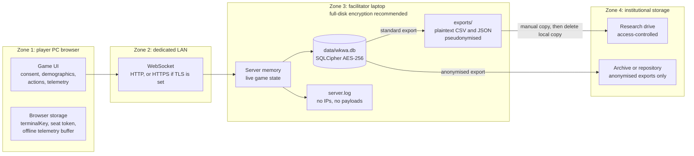
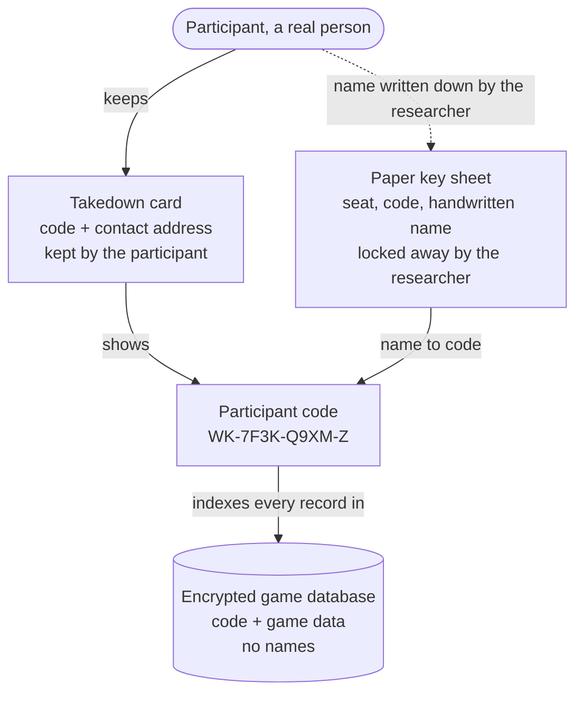
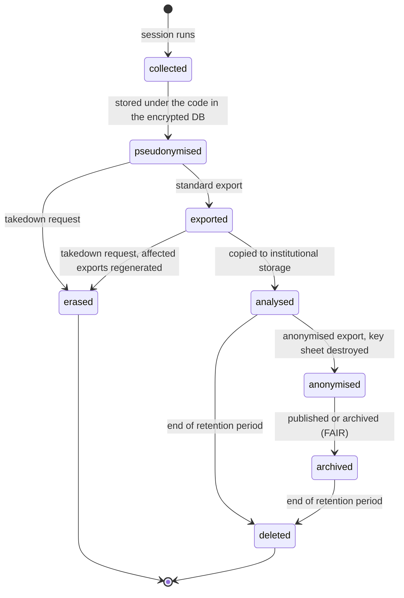
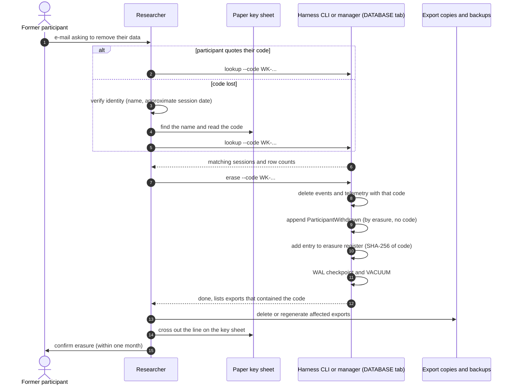

# Data management and data protection

This document explains what research data the harness collects, why, where it is stored, how participants are pseudonymised, how a takedown request is handled (even years later), and which risks remain. It is written to support a data management plan (DMP), an ethics application and the thesis methods chapter.

> **Guidance, not legal advice.** The design follows common GDPR practice for academic research. The legal basis, retention period and storage locations must be confirmed with your institution's ethics committee and privacy officer. See the [checklist](#15-checklist-for-the-ethics-committee--privacy-officer). Placeholders such as `[N years]` must be filled in in `config/study.json` and `config/consent.md`.

Field-level detail of every logged record is in [DATA-TYPES.md](DATA-TYPES.md).

## Contents

1. [Summary](#1-summary)
2. [Roles and legal basis](#2-roles-and-legal-basis)
3. [Data inventory](#3-data-inventory)
4. [Data flow and trust boundaries](#4-data-flow-and-trust-boundaries)
5. [Identity and pseudonymisation](#5-identity-and-pseudonymisation)
6. [Data lifecycle](#6-data-lifecycle)
7. [Consent design](#7-consent-design)
8. [Data minimisation decisions](#8-data-minimisation-decisions)
9. [Encryption and key management](#9-encryption-and-key-management)
10. [Takedown and erasure procedure](#10-takedown-and-erasure-procedure)
11. [Exports, codebook and anonymisation](#11-exports-codebook-and-anonymisation)
12. [Retention and deletion](#12-retention-and-deletion)
13. [Personal-data classes per record type](#13-personal-data-classes-per-record-type)
14. [Risk assessment (DPIA-style)](#14-risk-assessment-dpia-style)
15. [Checklist for the ethics committee / privacy officer](#15-checklist-for-the-ethics-committee--privacy-officer)
16. [Command reference](#16-command-reference)

---

## 1. Summary

- **What:** in-game actions and their timing, fine-grained interface behaviour, a few bracketed demographic answers, and consent records. All of it is linked to a **random participant code**, never to a name.
- **Where:** one SQLite database on the facilitator's laptop, **encrypted at rest** (SQLCipher, AES-256), with a passphrase typed at start-up. Nothing goes to the internet during a session.
- **Who can link a code to a person:** only the researcher, through a **paper key sheet** kept physically separate from the data. The participant keeps a **takedown card** with their own code.
- **Takedown:** quoting the code (or giving a name, which is looked up on the key sheet) lets the researcher erase every record of that participant with a single command.
- **Not collected:** names, e-mail addresses, IP addresses, device or browser details, pointer traces, free text, audio/video.
- **Publication:** only anonymised exports (codes replaced by unlinkable ids, after the key sheet is destroyed).

## 2. Roles and legal basis

| Role | Who (fill in) | Notes |
| --- | --- | --- |
| Controller | Usually the institution, e.g. `[University]` | Students usually act on behalf of their institution; confirm. |
| Researcher | `[Name]` | Runs sessions, holds the passphrase and key sheet. |
| Supervisor | `[Name]` | May need access to pseudonymised exports. Record this in the consent text. |
| Processors | none during collection | No cloud services are involved. Institutional storage (after the session) is governed by institutional agreements. |

**Legal basis (to confirm):** typically *consent* (GDPR Art. 6(1)(a)) for participation, or *public interest / scientific research* (Art. 6(1)(e)) with consent as an ethical safeguard. Demographic answers are not special-category data as designed (no health, ethnicity, religion and so on); do not add such questions without re-assessment. Research safeguards per Art. 89: pseudonymisation, minimisation, encryption, access control.

## 3. Data inventory

| Data | Source | Purpose | Class | Stored in | Retention (proposal) |
| --- | --- | --- | --- | --- | --- |
| Participant code `WK-XXXX-XXXX-C` | Server, generated when the seat is bound | Link records of one person; enable takedown | Pseudonymous identifier | `events.participant_code`, `telemetry.participant_code`; takedown card; key sheet | Until anonymisation |
| Seat, terminal number | Facilitator binding | Session logistics | Pseudonymous (in combination) | `events` | Research period |
| K/P labels, assigned view | Facilitator | Experimental manipulation | Pseudonymous (via seat) | `events` (`LabelsAssigned`) | Research period |
| Consent answers, form version, text hash, time on screen | Player | Proof of informed consent | Pseudonymous · sensitive | `events` (`ConsentRecorded`) | As long as the data it covers exist |
| Demographics (bracketed options) | Player | Describe the sample; covariates | Pseudonymous · sensitive | `events` (`DemographicsSubmitted`); hidden from the live dashboard | Research period |
| Proposals and decisions: region, quota position, prior actors | Player | **Primary research data** | Pseudonymous | `events` | Research period |
| Timings: server/client timestamps, durations, reaction times | Server/client | **Primary research data** | Pseudonymous | `events`, `telemetry` | Research period |
| UI telemetry: screen views, hover, inspect, pan/zoom, tool selection, confirm/cancel, focus/visibility, idle (**only after consent**) | Player client | Behavioural research data | Pseudonymous | `telemetry` | Research period |
| Connection events, clock sync | Server/client | Data-quality checks | Pseudonymous / non-personal | `events`, `telemetry` | Research period |
| Facilitator actions and notes, broadcasts | Facilitator | Audit trail, context | Non-personal (**must not contain names**) | `events` | Research period |
| Session config (incl. tags and the player-screen appearance: theme and CRT effects), scenario hash, software version | Facilitator/server | Reproducibility; tags and appearance describe the experimental condition | Non-personal (**tags must not contain names**) | `sessions`, `events` | Indefinitely (with the anonymised data) |
| Erasure register | Researcher | Accountability; re-apply erasure after restoring a backup | Pseudonymous (SHA-256 of the code) | `erasures` | As long as any copy/backup of the DB exists |
| Export register / manifest | Server | Know which exports contain a participant | Pseudonymous (hashes) | `exports`, `manifest.json` | As long as the exports exist |
| Server log | Server | Debugging | Non-personal (no IPs, no payloads, no query strings) | `data/logs/server.log` | Delete after the study |
| **Real name** | Researcher, by hand | Find the code if a participant loses their card | **Personal** | **Paper key sheet only** | Until the key destruction date |

## 4. Data flow and trust boundaries



| Boundary | Protection | Residual risk |
| --- | --- | --- |
| Browser → LAN | Data sent only to the server; nothing else leaves the browser. No third-party scripts. | Browser storage holds only random keys and the unsent telemetry buffer. |
| LAN | Dedicated network, no internet uplink, optional TLS | Without TLS, traffic is readable by devices on the same LAN |
| Laptop at rest | Encrypted DB; passphrase never stored; full-disk encryption recommended | `exports/` is plaintext: move it to institutional storage promptly and delete the local copy |
| Institutional storage | Institutional access control | Governed by institutional policy |

## 5. Identity and pseudonymisation



**How the code is made.** It is generated by the server when a seat is bound: 8 random Crockford-base32 characters (40 bits), plus a check character, e.g. `WK-7F3K-Q9XM-Z`. The alphabet avoids `I`, `L`, `O` and `U`, so it is easy to read and type. Typos are detected by the check character, and lowercase, spaces, `O`→`0` and `I/L`→`1` are accepted when the code is typed back. The code carries no information about the person or the session.

**Where the code exists:**

| Location | Contains | Held by |
| --- | --- | --- |
| Game database | code + all research data, **no name** | researcher (encrypted) |
| End screen (shown after the last round or on withdrawal) | code + study contact address + takedown instructions, from `config/study.json` | participant (screen) |
| Takedown card (printed) | the same, on paper | participant |
| Key sheet (printed per session) | seat, code, *name written by hand* | researcher, stored physically separate (e.g. locked drawer) |

**What changes when the key sheet is destroyed:**

| | Key sheet exists | Key sheet destroyed |
| --- | --- | --- |
| Researcher can find a person's data by name | yes | no |
| Participant can still request takedown with their card | yes | yes (as long as the coded data exist) |
| GDPR status of the coded data | pseudonymised (personal data) | still pseudonymised while participants hold cards. Only **anonymised exports** (codes replaced, mapping discarded) are anonymous. |

## 6. Data lifecycle



## 7. Consent design

- **In-game consent screen.** It shows `config/consent.md` (the information letter) and the statements from `config/consent.json`. Each statement is a checkbox, marked *required* or *optional* (e.g. reuse in future research).
- **What is recorded** (`ConsentRecorded`): form `version`, **SHA-256 of the exact text shown**, the answer to every item, whether consent was given, and how long the screen was open. This proves which text each participant agreed to, even if the file is edited later.
- **Nothing behavioural before consent.** The client only switches on telemetry once consent is given, and the server *also* drops any telemetry batch from a seat whose consent status is not `given` (or `skipped`, if the consent step is disabled). Before consent, only operational events exist for a seat: `SeatBound`, `PlayerConnected` / `PlayerDisconnected`, plus the session-level `LabelsAssigned` and `OnboardingStarted`.
- **Declining.** If any required item is unticked, the player sees a thank-you screen and cannot continue. The seat is flagged on the dashboard and round 1 cannot start. What remains for that code is the operational events above plus `ConsentRecorded` with `consented: false`. **Recommended:** after the session, erase the decliner's code (manager *DATABASE → 3 · Takedown / erasure*, or `npm run cli -- erase --code …`) unless your ethics committee wants decline records kept; then replace the participant or run the session with fewer seats.
- **Withdrawal during the session.** The facilitator marks the seat as withdrawn (`ParticipantWithdrawn`). From then on, the seat's intents are rejected and it is excluded from round completion. Whether data collected *before* withdrawal is kept or erased follows the consent text. To erase it, run the erasure procedure.
- **Changing the text:** edit `consent.md` / `consent.json` and **bump `version`**.

## 8. Data minimisation decisions

| Deliberately **not** collected | Why not |
| --- | --- |
| Names, e-mail, student numbers | Not needed for analysis. Identity is only needed for takedown, which the code and key sheet cover. |
| IP addresses | Identify the PC, not useful for research. The server uses the remote address only for the localhost check of the facilitator page and never logs it (log serializers remove it). |
| User agent, OS, screen size, device ids | Optional "technical metadata" was declined in the design phase. The lab PCs are known anyway. |
| Pointer movement traces | Heavy, biometric-adjacent, and not needed: hover and inspect events capture attention at region level. |
| Free-text input | Hard to anonymise. The player UI has no free-text fields. |
| Exact age / date of birth | Brackets (e.g. 25–34) are enough to describe the sample. |
| Audio / video | Outside the harness. If you record separately, it needs its own consent and DMP entry. |
| Keystrokes | Not needed. Keyboard shortcuts are logged only as their effect (e.g. `tool_select`). |
| Any telemetry before consent | No lawful basis yet. The client does not send it, and the server discards it if it arrives (§ 7). |

Facilitator notes and broadcasts are free text written by the researcher: **never type participants' names in them.**

## 9. Encryption and key management

| Aspect | Design |
| --- | --- |
| Algorithm | SQLCipher 4 format (AES-256, PBKDF2-HMAC-SHA512 key derivation), via `better-sqlite3-multiple-ciphers` (`cipher=sqlcipher`, `legacy=4`) |
| Scope | The whole database file, including the WAL journal. Telemetry, events, codes and the server secret are all inside. |
| Passphrase entry | Typed at a hidden prompt on `npm start`. Never written to disk, logs or config. `WKWA_DB_PASSPHRASE` exists **only for development and automated tests**. |
| Deleted data | `PRAGMA secure_delete=ON` overwrites deleted content. Erasure also runs a WAL checkpoint and `VACUUM`. |
| Wrong passphrase | The server refuses to start ("file is not a database"). |
| Change the passphrase | `npm run cli -- rekey` (asks for the old and the new passphrase) |
| Backups | `npm run cli -- backup --out FILE` writes an **encrypted** copy (same passphrase). Store backups on institutional storage. |
| Integrity check | `npm run cli -- verify` (opens the DB, checks the schema and event sequences) |
| **Lost passphrase** | **The data cannot be recovered. There is no backdoor.** Keep the passphrase in a password manager, and/or in a sealed envelope held by the supervisor. |

Choose a passphrase of at least 5 random words. Exports are **not** encrypted (they are meant for analysis software), so treat the `exports/` folder like any other pseudonymised dataset.

## 10. Takedown and erasure procedure



**Step by step: "a participant e-mails years later"**

1. **Acknowledge** the request. GDPR requires an answer without undue delay, at the latest within one month.
2. **Find the code.**
   - *Code known:* normalise and check it: `npm run cli -- lookup --code "wk 7f3k q9xm z"`. The check character catches typos.
   - *Code lost:* verify the person's identity reasonably (e.g. name, session date, the reply goes to the address they used). Then find their name on that session's key sheet and read the code.
   - *Key sheet already destroyed and code lost:* the data can no longer be linked to the person. Explain this; it was stated in the consent text.
3. **Look up** what exists: `lookup` lists the sessions and the number of event and telemetry rows.
4. **Erase:** `npm run cli -- erase --code WK-… ` (asks for confirmation; `--yes` skips it), or use *DATABASE → 3 · Takedown / erasure* in the facilitator manager: look up the code, then confirm in a popup by typing the code again (refused while that participant's session is still running: end the session first).
   - All `events` and `telemetry` rows with that code are deleted: actions, consent, demographics, connections, telemetry.
   - Each affected session gets a `ParticipantWithdrawn` event (`by: "erasure"`) **without** the code, so replays and exports show a withdrawn seat instead of silently missing data.
   - An entry is added to the `erasures` register: SHA-256 of the code, date, sessions, row counts.
   - The database is checkpointed and vacuumed; secure-delete overwrites the freed pages.
5. **Exports.** The command lists every export whose manifest contains the hash of the code. Delete those folders on every copy (laptop, research drive) and re-run the export for the affected sessions.
6. **Backups.** Backups made before the erasure still contain the data. Either delete or replace them, or keep them under the rule below.
7. **Key sheet:** strike through the line.
8. **Confirm** to the participant, and keep a note of the request date and completion date (no reasons needed).

**After restoring a backup.** A backup can predate an erasure. After any restore, re-apply the register:

```bash
npm run cli -- erasures                    # list register entries (hashes, dates)
npm run cli -- erase --code WK-… --yes     # re-run for each code (codes come from your takedown correspondence)
```

Register entries hold only hashes, so keep the takedown correspondence (or a list of erased codes) somewhere safe for as long as backups exist. As an alternative, delete all backups older than the latest erasure.

**Limits.**

- **Anonymised exports** that were already published cannot be traced back to a person. That is what makes them anonymous, so erasure no longer applies to them. Say so in the consent text.
- **Aggregated results** already published (thesis tables, figures) are not retracted.
- Erasure may be refused where it would seriously impair the research (GDPR Art. 17(3)(d)). For a master's thesis, honouring every request is the simpler and recommended policy.

## 11. Exports, codebook and anonymisation

| Kind | Command | Location | Participant ids | Use |
| --- | --- | --- | --- | --- |
| Standard | `npm run cli -- export --session S-…` or *Export* button | `exports/<sessionId>/<exportId>/` | participant codes | Analysis by the research team |
| Anonymised | `npm run cli -- anonymise --session S-…` | `exports/<sessionId>/anon-<id>/` | random `A-XXXXXX`, **mapping discarded** | Archiving / open data / sharing |

Each export folder contains `session.json`, `players.csv`, `actions.csv`, `events.csv`, `telemetry.csv`, `consent.csv`, `demographics.csv`, `manifest.json` and a generated **`codebook.md`** that describes every file and column (see [DATA-TYPES.md § Export files](DATA-TYPES.md#export-files)). `events.csv` never contains demographic answers; those are only in `demographics.csv`, so the event log can be shared without them.

**Anonymisation procedure for publication (FAIR):**

1. Wait until the identifiable period ends (e.g. after the thesis is graded and the withdrawal deadline has passed).
2. Destroy the key sheets (shred them), and record the date.
3. Run `anonymise` for each session. Codes are replaced by fresh random ids, consistent within one export; the mapping is never written anywhere. The anonymised manifest lists no code hashes.
4. Review the result for indirect identifiers. Small samples plus demographic brackets plus exact session dates can single people out. Consider leaving out `demographics.csv`, coarsening the brackets, or shifting dates before publishing.
5. Publish with the codebook and a licence (e.g. CC BY 4.0) in a repository approved by your institution.
6. Only now can the pseudonymised originals be deleted (or kept under the retention policy).

## 12. Retention and deletion

| Item | Proposed retention (confirm with policy) | Deletion method |
| --- | --- | --- |
| Encrypted DB + backups | Until the end of the research period (e.g. thesis graded + `[N]` months) | Delete the files and every backup, after the anonymised export is archived |
| Standard exports | Research period, on institutional storage only | Delete the folders |
| Key sheets | Until the identifiable period ends | Shred |
| Anonymised exports | Per institutional policy (often 10 years) | Repository policy |
| Server log | End of the data collection period | Delete `data/logs/` |
| Erasure register | As long as any DB copy or backup exists | Deleted with the DB |

## 13. Personal-data classes per record type

Generated from the metadata of each record type (see [DATA-TYPES.md](DATA-TYPES.md) for definitions).

<!-- BEGIN GENERATED: data-class-summary -->
<!-- Generated by `npm run docs:generate` from packages/shared — do not edit by hand. -->

| Data class | Game events | Telemetry types |
| --- | --- | --- |
| pseudonymous · sensitive | `ConsentRecorded`, `DemographicsSubmitted` | — |
| pseudonymous | `SeatBound`, `SeatUnbound`, `LabelsAssigned`, `BriefingAcknowledged`, `PlayerConnected`, `PlayerDisconnected`, `ProposalMade`, `DecisionMade`, `IntentRejected`, `ActionRevoked` | `screen_view`, `region_hover`, `region_inspect`, `map_view_change`, `tool_select`, `action_draft`, `focus_change`, `visibility_change`, `idle`, `state_received` |
| non-personal | `SessionCreated`, `SessionNote`, `OnboardingStarted`, `RoundStarted`, `RoundCompleted`, `GamePaused`, `GameResumed`, `FacilitatorBroadcast`, `ParticipantWithdrawn`, `GameCompleted`, `SessionClosed`, `SessionAborted` | `clock_sync` |

<!-- END GENERATED: data-class-summary -->

## 14. Risk assessment (DPIA-style)

Likelihood (L) and impact (I): low / medium / high, after mitigation.

| # | Risk | L | I | Mitigation |
| --- | --- | --- | --- | --- |
| 1 | Laptop lost or stolen | L | M | DB encrypted (SQLCipher); full-disk encryption; exports moved to institutional storage and deleted locally |
| 2 | Passphrase disclosed or guessed | L | H | Long random passphrase; typed at start-up, never stored; not set as an environment variable on session days |
| 3 | Passphrase lost → data loss | L | H | Password manager + sealed copy with supervisor; regular encrypted backups |
| 4 | Re-identification through combination (session date + seat + demographic brackets, small N) | M | M | Brackets with "prefer not to say"; report only aggregates; review anonymised exports before publishing (§ 11) |
| 5 | Eavesdropping on the LAN | L | L | Dedicated network without uplink; WPA2/3 or cables; optional TLS |
| 6 | Player opens the facilitator dashboard / API | L | M | Localhost-only by default; `ADMIN_TOKEN` for remote access |
| 7 | Player sees other players' data in devtools (study integrity) | L | M | Server-side projections; automated leakage test |
| 8 | Research data accidentally committed to the **public** GitHub repository | L | H | `data/`, `exports/`, `*.db`, `*.csv` git-ignored; test asserts this; data dirs configurable outside the repo |
| 9 | Uncontrolled copies of exports (USB sticks, e-mail) | M | M | Export register + manifest; policy: institutional storage only; delete local copies |
| 10 | Takedown impossible (card lost and key sheet destroyed) | M | L | Explained in consent text; key sheet kept until the stated date |
| 11 | Names typed into facilitator notes | L | M | UI warning; notes are short; review notes before exporting |
| 12 | Backup restore brings back erased data | L | M | Erasure register; re-apply procedure (§ 10); prefer deleting old backups |
| 13 | Logs leak personal data | L | L | Request serializer logs method and path only (no IP, host, query string, user agent); payloads never logged |
| 14 | Software bug corrupts or loses events | L | M | Append-only log; `verify` command; backups; tests of full games |

## 15. Checklist for the ethics committee / privacy officer

*Guidance only. Use it to prepare the conversation; it is not legal advice.*

- [ ] Who is the **controller**, and is a master's student project covered by the institution's research privacy policy?
- [ ] **Legal basis:** consent (Art. 6(1)(a)) or public interest/research (Art. 6(1)(e))?
- [ ] Is an **in-game electronic consent** (checkboxes, text hash, timestamp) sufficient, or is a signed paper form also required?
- [ ] Approved **information letter** text → `config/consent.md` (and bump the version).
- [ ] **Retention period** of pseudonymised data, and of anonymised data.
- [ ] Approved **storage location** for exports and backups (institutional research drive).
- [ ] Who may access pseudonymised data (supervisor, second assessor)?
- [ ] **Key sheet:** storage location, and the date or event when it will be destroyed.
- [ ] Withdrawal policy: until when can participants withdraw, and is data collected before an in-session withdrawal kept?
- [ ] Is a full **DPIA** required? (Usually not for low-risk pseudonymised research; ask.)
- [ ] Is a **data management plan** required, and which template?
- [ ] Publication of **anonymised data** (open data): allowed, and which repository?
- [ ] Participants are adults (18+); no vulnerable groups.
- [ ] Is HTTP on an isolated LAN acceptable, or is TLS required?

## 16. Command reference

All commands prompt for the database passphrase.

| Command | Purpose |
| --- | --- |
| `npm run cli -- sessions` | List sessions |
| `npm run cli -- lookup --code C` | Find sessions and row counts for a participant code |
| `npm run cli -- export --session S` | Standard (pseudonymised) export |
| `npm run cli -- anonymise --session S` | Anonymised export |
| `npm run cli -- erase --code C [--yes]` | Erase all data of a participant |
| `npm run cli -- erasures` | Show the erasure register |
| `npm run cli -- backup --out FILE` | Encrypted backup copy of the DB |
| `npm run cli -- rekey` | Change the DB passphrase |
| `npm run cli -- verify` | Integrity check |
