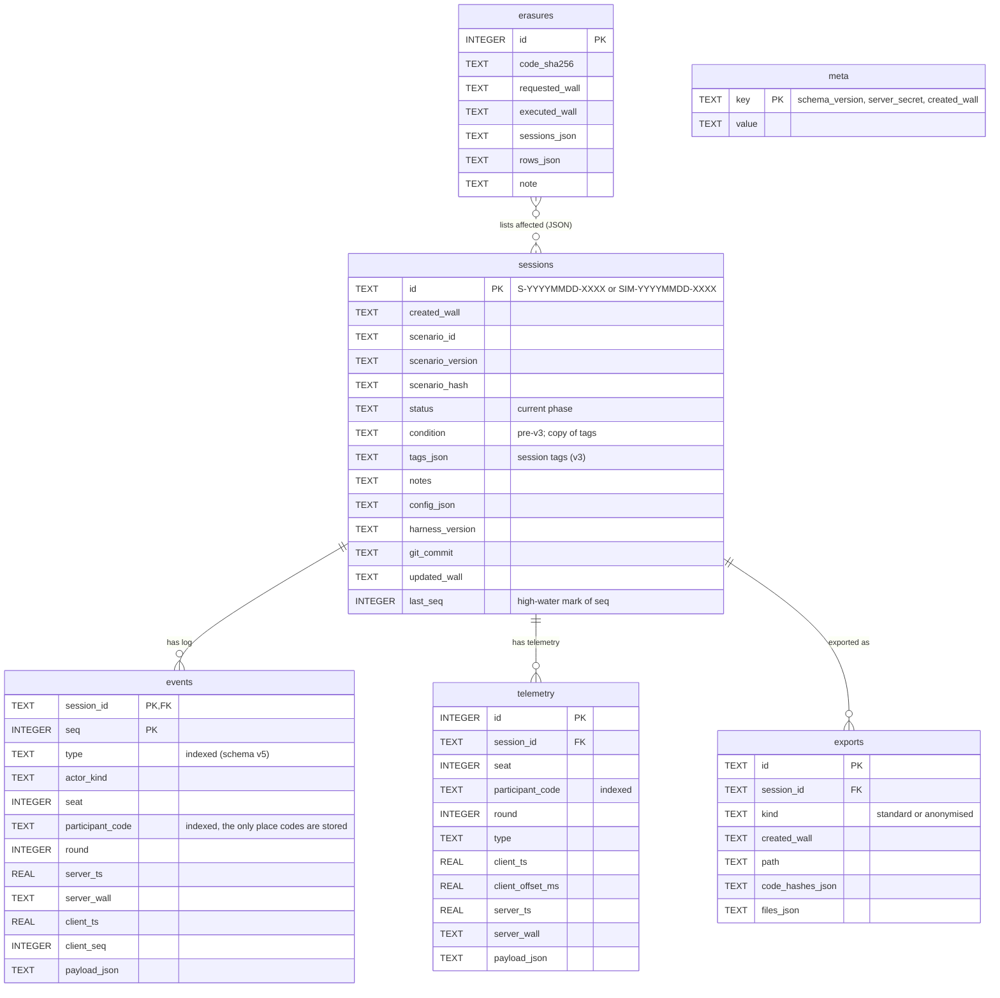
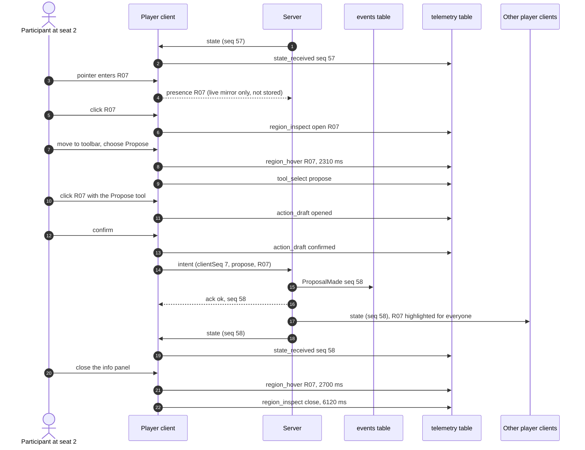

# Data types: everything the server logs

*Change log: [DATA-TYPES-CHANGELOG.md](changelog/DATA-TYPES-CHANGELOG.md)*

This is the field-level catalogue of every record the harness stores. It answers **"what exactly is being recorded, when, and about whom?"** Use it when writing the ethics application, the analysis scripts or the methods chapter.

Most tables below are **generated from the schemas** in `packages/shared` (`npm run docs:generate`). The same definitions validate the data at runtime and produce the `codebook.md` inside every export, so this document cannot silently drift from what is actually logged. A test fails if it is out of date.

Related documents: [DATA-MANAGEMENT.md](DATA-MANAGEMENT.md) (why the data is collected and how it is protected), [ARCHITECTURE.md](ARCHITECTURE.md), [NETWORKING.md](NETWORKING.md).

## Contents

1. [How to read this document](#how-to-read-this-document)
2. [Overview of record kinds](#overview-of-record-kinds)
3. [Storage model](#storage-model)
4. [Game events](#game-events)
5. [Telemetry types](#telemetry-types)
6. [One action, all its traces](#one-action-all-its-traces)
7. [Session configuration](#session-configuration)
8. [Label pairings](#label-pairings)
9. [Other tables](#other-tables)
10. [Export files](#export-files)

---

## How to read this document

- **Envelope vs payload.** Every stored record has fixed *envelope* columns (who, when, which session) plus a type-specific *payload*, stored as JSON.
- **Data class.** Each type is marked as *non-personal*, *pseudonymous* (linked to a participant code, and therefore personal data under GDPR) or *pseudonymous · sensitive* (consent and demographics). See [DATA-MANAGEMENT.md § 13](DATA-MANAGEMENT.md#13-personal-data-classes-per-record-type).
- **Participant codes appear in exactly one column** (`participant_code`) of the `events` and `telemetry` tables, and **never inside a payload**. Inside a session, players are referred to by seat number. This is what makes erasure complete.
- **Time.** `server_ts` is epoch milliseconds with sub-millisecond precision (authoritative order). `client_ts` is the player PC's time, corrected to the server clock. See [ARCHITECTURE.md § 10](ARCHITECTURE.md#10-timing-model).
- **No telemetry before consent.** Telemetry rows exist only for seats whose consent status is `given` (or `skipped`, if the consent step is disabled). The server drops earlier batches. Before consent, a seat has only operational events (`SeatBound`, `PlayerConnected` / `PlayerDisconnected`); a participant who declines additionally has `ConsentRecorded` with `consented: false`.
- **Not logged anywhere:** names, e-mail addresses, IP addresses, user agents/device data, pointer coordinates, keystrokes, free text typed by players.

## Overview of record kinds

| Record kind | Stored in | Triggered by | Typical volume per session | Data class |
| --- | --- | --- | --- | --- |
| Game events: actions (`ProposalMade`, `DecisionMade`, `IntentRejected`) | `events` | Player confirms a propose or decide | ≈ 120 (4 players × 10 × 3 rounds) + rejections | pseudonymous |
| Game events: session flow (`SessionCreated`, `RoundStarted`, `RoundCompleted`, `GameCompleted`, …) | `events` | Facilitator or system | ≈ 10–20 | non-personal |
| Seat and label records (`SeatBound`, `SeatUnbound`, `LabelsAssigned`) | `events` | Facilitator in the lobby | ≈ 5–10 | pseudonymous |
| Consent records (`ConsentRecorded`) | `events` | Player submits the consent screen | 4 | pseudonymous · sensitive |
| Demographics records (`DemographicsSubmitted`) | `events` (payload redacted in `events.csv` and the live log) | Player submits the questionnaire | 4 | pseudonymous · sensitive |
| Briefing acknowledgements | `events` | Player confirms the briefing | 4 | pseudonymous |
| Connection events (`PlayerConnected`, `PlayerDisconnected`) | `events` | Browser connects/disconnects | ≈ 4 + reconnects | pseudonymous |
| Facilitator / audit events (`SessionNote`, `FacilitatorBroadcast`, `ActionRevoked`, `GamePaused`, `GameResumed`, `ParticipantWithdrawn`, `SessionClosed`, `SessionAborted`) | `events` | Facilitator (or system on disconnect/erasure) | 0–20 | mostly non-personal |
| UI telemetry (hover, inspect, pan/zoom, tool, confirm, focus, visibility, idle, screen) | `telemetry` | Player's interface use, **after consent only** | hundreds to a few thousand | pseudonymous |
| Delivery acks and clock sync (`state_received`, `clock_sync`) | `telemetry` | Every state push / every 60 s | hundreds | pseudonymous / non-personal |
| Session row | `sessions` | Session created/updated | 1 | non-personal |
| Erasure register entry | `erasures` | Erasure executed | 0–n (whole DB) | pseudonymous (hash of code) |
| Export register entry + `manifest.json` | `exports` + export folder | Export written | 1 per export | pseudonymous (hashes of codes) |
| Database metadata | `meta` | DB creation | constant | non-personal |

## Storage model

All tables live in one SQLCipher-encrypted SQLite file per kind of session: **`data/wkwa.db`** for sessions with participants and **`data/wkwa-sim.db`** for simulated sessions (agents instead of people; see [ARCHITECTURE.md § 14](ARCHITECTURE.md#14-simulated-players)). Both files have exactly the schema below and the same passphrase. In the simulation database, `participant_code` is always empty, the `telemetry` and `erasures` tables stay empty, and session ids start with `SIM-`.



Consent and demographics are not separate tables. They are **events** (`ConsentRecorded`, `DemographicsSubmitted`), so they share the envelope, the ordering and the erasure path of all other data.

## Game events

The `events` table is the authoritative, append-only log of a session. Game state is derived from it (see [ARCHITECTURE.md § 5](ARCHITECTURE.md#5-event-sourcing-from-click-to-data)).

### Event envelope

Columns shared by every event row:

<!-- BEGIN GENERATED: event-envelope -->
<!-- Generated by `npm run docs:generate` from packages/shared — do not edit by hand. -->

| SQLite column | JSON field | Type | Description |
| --- | --- | --- | --- |
| `session_id` | `sessionId` | `string` | Session id, e.g. S-20261116-7KQ2 |
| `seq` | `seq` | `integer ≥ 1` | Position in the session's event log (1, 2, 3, …; gaps only after erasure) |
| `type` | `type` | `"SessionCreated" \| "SessionNote" \| "SeatBound" \| "SeatUnbound" \| "AgentBound" \| "LabelsAssigned" \| "OnboardingStarted" \| "ConsentRecorded" \| "DemographicsSubmitted" \| "BriefingAcknowledged" \| "PlayerConnected" \| "PlayerDisconnected" \| "RoundStarted" \| "ProposalMade" \| "DecisionMade" \| "IntentRejected" \| "ActionRevoked" \| "RoundCompleted" \| "GamePaused" \| "GameResumed" \| "FacilitatorBroadcast" \| "ParticipantWithdrawn" \| "GameCompleted" \| "SessionClosed" \| "SessionAborted"` | Event type |
| `actor_kind` | `actorKind` | `"player" \| "facilitator" \| "system"` | Who caused the event |
| `seat` | `seat` | `integer 1–4 \| null` | Seat the event is about/caused by (null for session-level events) |
| `participant_code` | `participantCode` | `string \| null` | Pseudonymous participant code of that seat — the ONLY place codes are stored |
| `round` | `round` | `integer ≥ 0` | Current round when the event happened (0 = before round 1) |
| `server_ts` | `serverTs` | `number` | Server timestamp, Unix epoch milliseconds with sub-ms precision (monotonic within a server run) |
| `server_wall` | `serverWall` | `string` | Server wall-clock time, ISO-8601 UTC (human-readable copy of serverTs) |
| `client_ts` | `clientTs` | `number \| null` | Client timestamp corrected to server time (epoch ms) for player-initiated events, else null |
| `client_seq` | `clientSeq` | `integer \| null` | Client-side sequence number of the intent (idempotency on reconnect), else null |
| `payload_json` | `payload` | `object` | Type-specific payload (see the event sections below) |

<!-- END GENERATED: event-envelope -->

### Event index

<!-- BEGIN GENERATED: event-index -->
<!-- Generated by `npm run docs:generate` from packages/shared — do not edit by hand. -->

| Type | Summary | Caused by | Changes state | Data class | Typical frequency |
| --- | --- | --- | --- | --- | --- |
| [`SessionCreated`](#sessioncreated) | A new session was created with a scenario and configuration. | facilitator | yes | non-personal | 1 per session |
| [`SessionNote`](#sessionnote) | Facilitator annotation (e.g. 'fire alarm', 'participant asked a question'), or a system note in a simulated session (e.g. an agent that stopped after errors). | facilitator, system | no | non-personal | 0–n per session |
| [`SeatBound`](#seatbound) | A client (player browser) was assigned to a seat and a participant code was generated. For a fake player (a test client the server created) no code is generated. | facilitator | yes | pseudonymous | 1 per seat (more if re-bound) |
| [`SeatUnbound`](#seatunbound) | A seat binding was removed before the game started. | facilitator | yes | pseudonymous | rare |
| [`AgentBound`](#agentbound) | A simulated player (agent) took a seat. Simulated sessions only: the seat gets no participant code and no client. | system | yes | non-personal | 1 per seat (simulated sessions only) |
| [`LabelsAssigned`](#labelsassigned) | Knowledge-type, power-type and map view were (re)assigned to seats, with the K–P pairing used. | facilitator | yes | pseudonymous | 1–n per session |
| [`OnboardingStarted`](#onboardingstarted) | Seats are locked; players move to the consent / demographics / briefing screens. | facilitator | yes | non-personal | 1 per session |
| [`ConsentRecorded`](#consentrecorded) | Participant answered the in-game consent form. | player | yes | pseudonymous · sensitive | 1 per seat |
| [`DemographicsSubmitted`](#demographicssubmitted) | Participant submitted the demographics questionnaire. | player | yes | pseudonymous · sensitive | 1 per seat |
| [`BriefingAcknowledged`](#briefingacknowledged) | Participant confirmed they read the briefing / instructions. | player | yes | pseudonymous | 1 per seat |
| [`PlayerConnected`](#playerconnected) | A bound player's browser (re)connected. | system | yes | pseudonymous | 1 + number of reconnects per seat |
| [`PlayerDisconnected`](#playerdisconnected) | A bound player's browser disconnected. | system | yes | pseudonymous | 0–n per seat |
| [`RoundStarted`](#roundstarted) | A round began; players may now propose/decide. | facilitator, system | yes | non-personal | roundCount per session (default 3) |
| [`ProposalMade`](#proposalmade) | A player proposed a region (highlighted for all players). | player | yes | pseudonymous | ≤ quota.propose × seats × rounds (default 60) |
| [`DecisionMade`](#decisionmade) | A player decided on a region (highlighted in the decision colour for all players). | player | yes | pseudonymous | ≤ quota.decide × seats × rounds (default 60) |
| [`IntentRejected`](#intentrejected) | A player's propose/decide attempt was refused by the rules. | player | no | pseudonymous | rare |
| [`ActionRevoked`](#actionrevoked) | Facilitator undid a proposal/decision (e.g. misclick). The original event is kept. | facilitator | yes | pseudonymous | rare |
| [`RoundCompleted`](#roundcompleted) | A round ended. | system, facilitator | yes | non-personal | roundCount per session |
| [`GamePaused`](#gamepaused) | The game was paused; actions are refused until resumed. | facilitator, system | yes | non-personal | 0–n |
| [`GameResumed`](#gameresumed) | The game was resumed after a pause. | facilitator | yes | non-personal | 0–n |
| [`FacilitatorBroadcast`](#facilitatorbroadcast) | Facilitator sent a message shown on every player's screen. | facilitator | yes | non-personal | 0–n |
| [`ParticipantWithdrawn`](#participantwithdrawn) | A participant withdrew (during the session) or their data was erased afterwards. | facilitator, system | yes | non-personal | rare |
| [`GameCompleted`](#gamecompleted) | The last round finished (or the facilitator ended the game early). | system, facilitator | yes | non-personal | 1 per session |
| [`SessionClosed`](#sessionclosed) | Session archived; no further events except erasure markers. | facilitator | yes | non-personal | 1 per session |
| [`SessionAborted`](#sessionaborted) | Session abandoned before completion (data kept, marked as aborted). | facilitator | yes | non-personal | rare |

<!-- END GENERATED: event-index -->

<!-- BEGIN GENERATED: event-sections -->
<!-- Generated by `npm run docs:generate` from packages/shared — do not edit by hand. -->

### `SessionCreated`

A new session was created with a scenario and configuration.

|  |  |
| --- | --- |
| **Trigger** | Facilitator clicks 'Create session' on the setup screen. |
| **Caused by** | facilitator |
| **Changes game state** | yes |
| **Visible to** | Facilitator |
| **Data class** | non-personal |
| **Typical frequency** | 1 per session |

**Payload**

| Field | Type | Description |
| --- | --- | --- |
| `config` | `SessionConfig` | Full effective session configuration |
| `scenario` | `object` | Scenario used in this session |
| `scenario.id` | `string` | Scenario id |
| `scenario.title` | `string` | Scenario title |
| `scenario.version` | `string` | Scenario version |
| `scenario.hash` | `string` | SHA-256 of the loaded scenario (map + views) |
| `regionIds` | `array<string>` | All region ids in the map outline |
| `viewIds` | `array<string>` | All view ids available in the scenario |
| `harness` | `object` | Software version, for reproducibility |
| `harness.version` | `string` | Harness package version |
| `harness.gitCommit` | `string` | Git commit of the harness code ('unknown' if not a git checkout) |
| `notes` | `string` | Researcher notes entered at creation (no personal data) |

<details><summary>Example row</summary>

```json
{
  "sessionId": "S-20261116-7KQ2",
  "seq": 42,
  "type": "SessionCreated",
  "actorKind": "facilitator",
  "seat": null,
  "participantCode": null,
  "round": 0,
  "serverTs": 1794826000000.512,
  "serverWall": "2026-11-16T10:46:40.000Z",
  "clientTs": null,
  "clientSeq": null,
  "payload": {
    "config": {
      "players": "real",
      "simulation": {
        "policy": "random",
        "seatPolicies": {},
        "params": {},
        "seed": null,
        "minDelayMs": 800,
        "maxDelayMs": 2500
      },
      "seatCount": 4,
      "roundCount": 3,
      "defaultRound": {
        "rule": "quota",
        "quota": {
          "propose": 5,
          "decide": 5
        },
        "timeLimitSec": null
      },
      "roundOverrides": {},
      "roundAdvance": "facilitator",
      "autoAdvanceDelaySec": 10,
      "viewAssignment": "byKnowledgeType",
      "clearHighlightsEachRound": true,
      "pauseOnDisconnect": true,
      "onboarding": {
        "consent": true,
        "demographics": true,
        "briefing": true
      },
      "visibility": {
        "showActorToPlayers": true,
        "showOwnLabels": true,
        "showOtherLabelsToPlayers": false,
        "showOthersProgress": true
      },
      "tags": []
    },
    "scenario": {
      "id": "demo",
      "title": "Demo archipelago",
      "version": "1",
      "hash": "9f2c…"
    },
    "regionIds": [
      "R01",
      "R02"
    ],
    "viewIds": [
      "Ka",
      "Kb",
      "Kc",
      "Kd"
    ],
    "harness": {
      "version": "0.1.0",
      "gitCommit": "3e1a9c2"
    },
    "notes": "Pilot session"
  }
}
```

</details>

### `SessionNote`

Facilitator annotation (e.g. 'fire alarm', 'participant asked a question'), or a system note in a simulated session (e.g. an agent that stopped after errors).

|  |  |
| --- | --- |
| **Trigger** | Facilitator adds a note on the dashboard; the simulation runner when an agent policy fails. |
| **Caused by** | facilitator, system |
| **Changes game state** | no |
| **Visible to** | Facilitator |
| **Data class** | non-personal |
| **Typical frequency** | 0–n per session |

**Payload**

| Field | Type | Description |
| --- | --- | --- |
| `text` | `string (≤ 500 chars)` | Note text — must not contain names or other identifying information |

<details><summary>Example row</summary>

```json
{
  "sessionId": "S-20261116-7KQ2",
  "seq": 42,
  "type": "SessionNote",
  "actorKind": "facilitator",
  "seat": null,
  "participantCode": null,
  "round": 0,
  "serverTs": 1794826000000.512,
  "serverWall": "2026-11-16T10:46:40.000Z",
  "clientTs": null,
  "clientSeq": null,
  "payload": {
    "text": "Seat 3 asked how to zoom; explained."
  }
}
```

</details>

### `SeatBound`

A client (player browser) was assigned to a seat and a participant code was generated. For a fake player (a test client the server created) no code is generated.

|  |  |
| --- | --- |
| **Trigger** | Facilitator binds a connected client to a seat in the lobby (setup step 07), or adds a fake player to a seat there. |
| **Caused by** | facilitator |
| **Changes game state** | yes |
| **Visible to** | Facilitator; the bound player sees their seat |
| **Data class** | pseudonymous |
| **Typical frequency** | 1 per seat (more if re-bound) |

**Payload**

| Field | Type | Description |
| --- | --- | --- |
| `seat` | `integer 1–4` | Seat number (1–4) within the session |
| `terminal` | `integer ≥ 1` | Client number displayed on the player's screen (field kept as `terminal` for compatibility) |
| `bindingId` | `string` | Random id of this binding (used to derive the reconnect token) |
| `fake` | `boolean` | True if the client is a fake player: a test client the server created itself (no participant, no code, no onboarding). Absent in sessions recorded before fake players existed (= false) |
| `fakePace` | `"normal" \| "fast"` | Fake players only: pause between their actions ('normal' 1–4 s, 'fast' 0.1–0.3 s) |

<details><summary>Example row</summary>

```json
{
  "sessionId": "S-20261116-7KQ2",
  "seq": 42,
  "type": "SeatBound",
  "actorKind": "facilitator",
  "seat": 2,
  "participantCode": "WK-7F3K-Q9XM-Z",
  "round": 0,
  "serverTs": 1794826000000.512,
  "serverWall": "2026-11-16T10:46:40.000Z",
  "clientTs": null,
  "clientSeq": null,
  "payload": {
    "seat": 2,
    "terminal": 3,
    "bindingId": "b-7KQ2M9",
    "fake": false
  }
}
```

</details>

### `SeatUnbound`

A seat binding was removed before the game started.

|  |  |
| --- | --- |
| **Trigger** | Facilitator unbinds a seat (wrong PC, participant left before onboarding). |
| **Caused by** | facilitator |
| **Changes game state** | yes |
| **Visible to** | Facilitator |
| **Data class** | pseudonymous |
| **Typical frequency** | rare |

**Payload**

| Field | Type | Description |
| --- | --- | --- |
| `seat` | `integer 1–4` | Seat number (1–4) within the session |
| `reason` | `string (≤ 200 chars)` | Short reason |

<details><summary>Example row</summary>

```json
{
  "sessionId": "S-20261116-7KQ2",
  "seq": 42,
  "type": "SeatUnbound",
  "actorKind": "facilitator",
  "seat": 2,
  "participantCode": "WK-7F3K-Q9XM-Z",
  "round": 0,
  "serverTs": 1794826000000.512,
  "serverWall": "2026-11-16T10:46:40.000Z",
  "clientTs": null,
  "clientSeq": null,
  "payload": {
    "seat": 2,
    "reason": "bound wrong client"
  }
}
```

</details>

### `AgentBound`

A simulated player (agent) took a seat. Simulated sessions only: the seat gets no participant code and no client.

|  |  |
| --- | --- |
| **Trigger** | Server, right after SessionCreated, once per seat of a simulated session. |
| **Caused by** | system |
| **Changes game state** | yes |
| **Visible to** | Facilitator |
| **Data class** | non-personal |
| **Typical frequency** | 1 per seat (simulated sessions only) |

**Payload**

| Field | Type | Description |
| --- | --- | --- |
| `seat` | `integer 1–4` | Seat number (1–4) within the session |
| `policy` | `string` | Id of the agent policy that plays this seat |
| `policyVersion` | `string` | Version of that policy's code (bumped whenever its behaviour changes) |
| `params` | `object` | Effective policy parameters for this seat, defaults filled in |
| `seed` | `string` | Seed of this agent's random number generator (session seed + seat number) |

<details><summary>Example row</summary>

```json
{
  "sessionId": "S-20261116-7KQ2",
  "seq": 42,
  "type": "AgentBound",
  "actorKind": "system",
  "seat": 1,
  "participantCode": null,
  "round": 0,
  "serverTs": 1794826000000.512,
  "serverWall": "2026-11-16T10:46:40.000Z",
  "clientTs": null,
  "clientSeq": null,
  "payload": {
    "seat": 1,
    "policy": "random",
    "policyVersion": "1",
    "params": {
      "proposeBias": 0.5
    },
    "seed": "7KQ2M9AB:1"
  }
}
```

</details>

### `LabelsAssigned`

Knowledge-type, power-type and map view were (re)assigned to seats, with the K–P pairing used.

|  |  |
| --- | --- |
| **Trigger** | Facilitator saves labels (K per seat + pairing) or shuffles K across seats, in setup step 08 or between rounds. P always follows from the pairing. Not allowed during an active round. |
| **Caused by** | facilitator |
| **Changes game state** | yes |
| **Visible to** | Facilitator; each player sees own labels (configurable) |
| **Data class** | pseudonymous |
| **Typical frequency** | 1–n per session |

**Payload**

| Field | Type | Description |
| --- | --- | --- |
| `assignments` | `array<object>` | Complete assignment for every seat |
| `assignments[].seat` | `integer 1–4` | Seat number (1–4) within the session |
| `assignments[].k` | `"Ka" \| "Kb" \| "Kc" \| "Kd"` | Knowledge-type label (Ka–Kd) |
| `assignments[].p` | `"Pa" \| "Pb" \| "Pc" \| "Pd"` | Power-type label (Pa–Pd) |
| `assignments[].view` | `string` | Id of the map view (dataset) shown to a seat, e.g. 'Ka' |
| `method` | `"manual" \| "random"` | How the assignment was produced |
| `seed` | `string \| null` | Seed of the random part of the assignment (null for manual) |
| `pairing` | `object` | K–P pairing used for this label assignment |
| `pairing.mode` | `"aligned" \| "dissociated"` | aligned (Ka–Pa …) or fully dissociated |
| `pairing.id` | `integer 1–6 \| null` | Number (1–6) of the fully dissociative pairing in the pairing table; null when aligned |

<details><summary>Example row</summary>

```json
{
  "sessionId": "S-20261116-7KQ2",
  "seq": 42,
  "type": "LabelsAssigned",
  "actorKind": "facilitator",
  "seat": null,
  "participantCode": null,
  "round": 0,
  "serverTs": 1794826000000.512,
  "serverWall": "2026-11-16T10:46:40.000Z",
  "clientTs": null,
  "clientSeq": null,
  "payload": {
    "assignments": [
      {
        "seat": 1,
        "k": "Ka",
        "p": "Pd",
        "view": "Ka"
      },
      {
        "seat": 2,
        "k": "Kb",
        "p": "Pc",
        "view": "Kb"
      }
    ],
    "method": "random",
    "seed": "4QX9T2",
    "pairing": {
      "mode": "dissociated",
      "id": 6
    }
  }
}
```

</details>

### `OnboardingStarted`

Seats are locked; players move to the consent / demographics / briefing screens.

|  |  |
| --- | --- |
| **Trigger** | Facilitator clicks 'Start onboarding' once all seats are bound and labelled. |
| **Caused by** | facilitator |
| **Changes game state** | yes |
| **Visible to** | Everyone |
| **Data class** | non-personal |
| **Typical frequency** | 1 per session |

**Payload**

| Field | Type | Description |
| --- | --- | --- |
| `steps` | `array<"consent" \| "demographics" \| "briefing">` | Onboarding steps enabled for this session |

<details><summary>Example row</summary>

```json
{
  "sessionId": "S-20261116-7KQ2",
  "seq": 42,
  "type": "OnboardingStarted",
  "actorKind": "facilitator",
  "seat": null,
  "participantCode": null,
  "round": 0,
  "serverTs": 1794826000000.512,
  "serverWall": "2026-11-16T10:46:40.000Z",
  "clientTs": null,
  "clientSeq": null,
  "payload": {
    "steps": [
      "consent",
      "demographics",
      "briefing"
    ]
  }
}
```

</details>

### `ConsentRecorded`

Participant answered the in-game consent form.

|  |  |
| --- | --- |
| **Trigger** | Player submits the consent screen (agree or decline). |
| **Caused by** | player |
| **Changes game state** | yes |
| **Visible to** | Facilitator (consent status only) |
| **Data class** | pseudonymous · sensitive |
| **Typical frequency** | 1 per seat |

**Payload**

| Field | Type | Description |
| --- | --- | --- |
| `formVersion` | `string` | Version of the consent form shown |
| `textSha256` | `string` | SHA-256 of the exact consent text shown |
| `answers` | `map<string, boolean>` | Answer per consent item id |
| `consented` | `boolean` | True if all required items were accepted |
| `durationMs` | `number ≥ 0` | Time the consent screen was open (milliseconds) |

<details><summary>Example row</summary>

```json
{
  "sessionId": "S-20261116-7KQ2",
  "seq": 42,
  "type": "ConsentRecorded",
  "actorKind": "player",
  "seat": 2,
  "participantCode": "WK-7F3K-Q9XM-Z",
  "round": 0,
  "serverTs": 1794826000000.512,
  "serverWall": "2026-11-16T10:46:40.000Z",
  "clientTs": 1794825999995.8,
  "clientSeq": null,
  "payload": {
    "formVersion": "2026-11-v1",
    "textSha256": "a3f1…",
    "answers": {
      "participate": true,
      "data_use": true,
      "future_research": false
    },
    "consented": true,
    "durationMs": 84213
  }
}
```

</details>

### `DemographicsSubmitted`

Participant submitted the demographics questionnaire.

|  |  |
| --- | --- |
| **Trigger** | Player submits the demographics screen. |
| **Caused by** | player |
| **Changes game state** | yes |
| **Visible to** | Nobody live (facilitator sees 'submitted ✓' only); exported to demographics.csv only |
| **Data class** | pseudonymous · sensitive |
| **Typical frequency** | 1 per seat |

**Payload**

| Field | Type | Description |
| --- | --- | --- |
| `formVersion` | `string` | Version of the demographics form |
| `answers` | `map<string, string>` | Selected option value per question id |
| `durationMs` | `number ≥ 0` | Time the questionnaire was open (milliseconds) |

<details><summary>Example row</summary>

```json
{
  "sessionId": "S-20261116-7KQ2",
  "seq": 42,
  "type": "DemographicsSubmitted",
  "actorKind": "player",
  "seat": 2,
  "participantCode": "WK-7F3K-Q9XM-Z",
  "round": 0,
  "serverTs": 1794826000000.512,
  "serverWall": "2026-11-16T10:46:40.000Z",
  "clientTs": 1794825999995.8,
  "clientSeq": null,
  "payload": {
    "formVersion": "2026-11-v1",
    "answers": {
      "age_bracket": "25_34",
      "field": "design",
      "games_experience": "weekly"
    },
    "durationMs": 41022
  }
}
```

</details>

### `BriefingAcknowledged`

Participant confirmed they read the briefing / instructions.

|  |  |
| --- | --- |
| **Trigger** | Player presses 'I'm ready' on the briefing screen. |
| **Caused by** | player |
| **Changes game state** | yes |
| **Visible to** | Facilitator |
| **Data class** | pseudonymous |
| **Typical frequency** | 1 per seat |

**Payload**

| Field | Type | Description |
| --- | --- | --- |
| `textSha256` | `string` | SHA-256 of the briefing text shown |
| `durationMs` | `number ≥ 0` | Time the briefing was open (milliseconds) |

<details><summary>Example row</summary>

```json
{
  "sessionId": "S-20261116-7KQ2",
  "seq": 42,
  "type": "BriefingAcknowledged",
  "actorKind": "player",
  "seat": 2,
  "participantCode": "WK-7F3K-Q9XM-Z",
  "round": 0,
  "serverTs": 1794826000000.512,
  "serverWall": "2026-11-16T10:46:40.000Z",
  "clientTs": 1794825999995.8,
  "clientSeq": null,
  "payload": {
    "textSha256": "77be…",
    "durationMs": 120400
  }
}
```

</details>

### `PlayerConnected`

A bound player's browser (re)connected.

|  |  |
| --- | --- |
| **Trigger** | Socket connects and authenticates with its seat token. |
| **Caused by** | system |
| **Changes game state** | yes |
| **Visible to** | Facilitator; other players see connection status |
| **Data class** | pseudonymous |
| **Typical frequency** | 1 + number of reconnects per seat |

**Payload**

| Field | Type | Description |
| --- | --- | --- |
| `seat` | `integer 1–4` | Seat number (1–4) within the session |
| `reconnect` | `boolean` | True if this seat had connected before in this session |

<details><summary>Example row</summary>

```json
{
  "sessionId": "S-20261116-7KQ2",
  "seq": 42,
  "type": "PlayerConnected",
  "actorKind": "system",
  "seat": 2,
  "participantCode": "WK-7F3K-Q9XM-Z",
  "round": 0,
  "serverTs": 1794826000000.512,
  "serverWall": "2026-11-16T10:46:40.000Z",
  "clientTs": null,
  "clientSeq": null,
  "payload": {
    "seat": 2,
    "reconnect": false
  }
}
```

</details>

### `PlayerDisconnected`

A bound player's browser disconnected.

|  |  |
| --- | --- |
| **Trigger** | Socket disconnects (tab closed, network drop, reload). |
| **Caused by** | system |
| **Changes game state** | yes |
| **Visible to** | Facilitator; other players see connection status |
| **Data class** | pseudonymous |
| **Typical frequency** | 0–n per seat |

**Payload**

| Field | Type | Description |
| --- | --- | --- |
| `seat` | `integer 1–4` | Seat number (1–4) within the session |
| `reason` | `string` | Socket.IO disconnect reason, e.g. 'transport close' |

<details><summary>Example row</summary>

```json
{
  "sessionId": "S-20261116-7KQ2",
  "seq": 42,
  "type": "PlayerDisconnected",
  "actorKind": "system",
  "seat": 2,
  "participantCode": "WK-7F3K-Q9XM-Z",
  "round": 0,
  "serverTs": 1794826000000.512,
  "serverWall": "2026-11-16T10:46:40.000Z",
  "clientTs": null,
  "clientSeq": null,
  "payload": {
    "seat": 2,
    "reason": "transport close"
  }
}
```

</details>

### `RoundStarted`

A round began; players may now propose/decide.

|  |  |
| --- | --- |
| **Trigger** | Facilitator clicks 'Start round' (or auto-advance timer fires). |
| **Caused by** | facilitator, system |
| **Changes game state** | yes |
| **Visible to** | Everyone |
| **Data class** | non-personal |
| **Typical frequency** | roundCount per session (default 3) |

**Payload**

| Field | Type | Description |
| --- | --- | --- |
| `round` | `integer ≥ 1` | Round number (1-based) |
| `spec` | `object` | Effective round definition |
| `spec.rule` | `"quota" \| "manual"` | Round-completion rule: 'quota' = round ends when every active player has used all quotas; 'manual' = only the facilitator (or the time limit) ends the round |
| `spec.quota` | `object` | Per-player action quotas for the round |
| `spec.quota.propose` | `integer ≥ 0 \| null` | Max proposals per player in this round (null = unlimited) |
| `spec.quota.decide` | `integer ≥ 0 \| null` | Max decisions per player in this round (null = unlimited) |
| `spec.timeLimitSec` | `integer > 0 \| null` | Optional time limit in seconds; the round ends automatically when it elapses |
| `startedBy` | `"facilitator" \| "auto"` | Started by the facilitator, or automatically (roundAdvance = auto) |

<details><summary>Example row</summary>

```json
{
  "sessionId": "S-20261116-7KQ2",
  "seq": 42,
  "type": "RoundStarted",
  "actorKind": "facilitator",
  "seat": null,
  "participantCode": null,
  "round": 1,
  "serverTs": 1794826000000.512,
  "serverWall": "2026-11-16T10:46:40.000Z",
  "clientTs": null,
  "clientSeq": null,
  "payload": {
    "round": 1,
    "spec": {
      "rule": "quota",
      "quota": {
        "propose": 5,
        "decide": 5
      },
      "timeLimitSec": null
    },
    "startedBy": "facilitator"
  }
}
```

</details>

### `ProposalMade`

A player proposed a region (highlighted for all players).

|  |  |
| --- | --- |
| **Trigger** | Player confirms a 'propose' on a region and the server accepts it. |
| **Caused by** | player |
| **Changes game state** | yes |
| **Visible to** | Everyone (actor seat visible to players if showActorToPlayers) |
| **Data class** | pseudonymous |
| **Typical frequency** | ≤ quota.propose × seats × rounds (default 60) |

**Payload**

| Field | Type | Description |
| --- | --- | --- |
| `regionId` | `string` | Target region id |
| `quotaUsed` | `integer ≥ 1` | Proposals this seat has made this round, including this one |
| `quotaLimit` | `integer \| null` | Proposal quota this round (null = unlimited) |
| `priorProposals` | `array<integer 1–4>` | Seats that had already proposed this region this round |
| `priorDecisions` | `array<integer 1–4>` | Seats that had already decided this region this round |
| `msSinceRoundStart` | `number ≥ 0` | Active (un-paused) server time since the round started (milliseconds) |

<details><summary>Example row</summary>

```json
{
  "sessionId": "S-20261116-7KQ2",
  "seq": 42,
  "type": "ProposalMade",
  "actorKind": "player",
  "seat": 2,
  "participantCode": "WK-7F3K-Q9XM-Z",
  "round": 1,
  "serverTs": 1794826000000.512,
  "serverWall": "2026-11-16T10:46:40.000Z",
  "clientTs": 1794825999995.8,
  "clientSeq": 7,
  "payload": {
    "regionId": "R07",
    "quotaUsed": 2,
    "quotaLimit": 5,
    "priorProposals": [
      3
    ],
    "priorDecisions": [],
    "msSinceRoundStart": 51234
  }
}
```

</details>

### `DecisionMade`

A player decided on a region (highlighted in the decision colour for all players).

|  |  |
| --- | --- |
| **Trigger** | Player confirms a 'decide' on a region and the server accepts it. |
| **Caused by** | player |
| **Changes game state** | yes |
| **Visible to** | Everyone (actor seat visible to players if showActorToPlayers) |
| **Data class** | pseudonymous |
| **Typical frequency** | ≤ quota.decide × seats × rounds (default 60) |

**Payload**

| Field | Type | Description |
| --- | --- | --- |
| `regionId` | `string` | Target region id |
| `quotaUsed` | `integer ≥ 1` | Decisions this seat has made this round, including this one |
| `quotaLimit` | `integer \| null` | Decision quota this round (null = unlimited) |
| `priorProposals` | `array<integer 1–4>` | Seats that had proposed this region this round before this decision |
| `priorDecisions` | `array<integer 1–4>` | Seats that had already decided this region this round |
| `msSinceRoundStart` | `number ≥ 0` | Active (un-paused) server time since the round started (milliseconds) |

<details><summary>Example row</summary>

```json
{
  "sessionId": "S-20261116-7KQ2",
  "seq": 42,
  "type": "DecisionMade",
  "actorKind": "player",
  "seat": 2,
  "participantCode": "WK-7F3K-Q9XM-Z",
  "round": 1,
  "serverTs": 1794826000000.512,
  "serverWall": "2026-11-16T10:46:40.000Z",
  "clientTs": 1794825999995.8,
  "clientSeq": 7,
  "payload": {
    "regionId": "R07",
    "quotaUsed": 1,
    "quotaLimit": 5,
    "priorProposals": [
      3,
      2
    ],
    "priorDecisions": [],
    "msSinceRoundStart": 73410
  }
}
```

</details>

### `IntentRejected`

A player's propose/decide attempt was refused by the rules.

|  |  |
| --- | --- |
| **Trigger** | Server validation fails (not active, paused, quota used up, unknown region, …). |
| **Caused by** | player |
| **Changes game state** | no |
| **Visible to** | Facilitator; the acting player gets an error message |
| **Data class** | pseudonymous |
| **Typical frequency** | rare |

**Payload**

| Field | Type | Description |
| --- | --- | --- |
| `kind` | `"propose" \| "decide"` | Map interaction: 'propose' or 'decide' |
| `regionId` | `string` | Region the player tried to act on |
| `reason` | `"round_not_active" \| "paused" \| "seat_inactive" \| "unknown_region" \| "quota_exhausted" \| "rule"` | Machine-readable rejection reason |
| `detail` | `string` | Human-readable explanation |

<details><summary>Example row</summary>

```json
{
  "sessionId": "S-20261116-7KQ2",
  "seq": 42,
  "type": "IntentRejected",
  "actorKind": "player",
  "seat": 2,
  "participantCode": "WK-7F3K-Q9XM-Z",
  "round": 1,
  "serverTs": 1794826000000.512,
  "serverWall": "2026-11-16T10:46:40.000Z",
  "clientTs": 1794825999995.8,
  "clientSeq": 7,
  "payload": {
    "kind": "decide",
    "regionId": "R02",
    "reason": "quota_exhausted",
    "detail": "No decisions left this round"
  }
}
```

</details>

### `ActionRevoked`

Facilitator undid a proposal/decision (e.g. misclick). The original event is kept.

|  |  |
| --- | --- |
| **Trigger** | Facilitator clicks 'Revoke' on an action during the active round. |
| **Caused by** | facilitator |
| **Changes game state** | yes |
| **Visible to** | Everyone (highlight disappears) |
| **Data class** | pseudonymous |
| **Typical frequency** | rare |

**Payload**

| Field | Type | Description |
| --- | --- | --- |
| `targetSeq` | `integer` | seq of the ProposalMade/DecisionMade being revoked |
| `targetType` | `"ProposalMade" \| "DecisionMade"` | Type of the revoked event |
| `targetSeat` | `integer 1–4` | Seat whose action was revoked |
| `regionId` | `string` | Region of the revoked action |
| `reason` | `string (≤ 200 chars)` | Facilitator's reason (free text, no personal data) |

<details><summary>Example row</summary>

```json
{
  "sessionId": "S-20261116-7KQ2",
  "seq": 42,
  "type": "ActionRevoked",
  "actorKind": "facilitator",
  "seat": 4,
  "participantCode": "WK-7F3K-Q9XM-Z",
  "round": 1,
  "serverTs": 1794826000000.512,
  "serverWall": "2026-11-16T10:46:40.000Z",
  "clientTs": null,
  "clientSeq": null,
  "payload": {
    "targetSeq": 57,
    "targetType": "DecisionMade",
    "targetSeat": 4,
    "regionId": "R11",
    "reason": "misclick"
  }
}
```

</details>

### `RoundCompleted`

A round ended.

|  |  |
| --- | --- |
| **Trigger** | All quotas used (rule 'quota'), time limit elapsed, or facilitator force-ended the round. |
| **Caused by** | system, facilitator |
| **Changes game state** | yes |
| **Visible to** | Everyone |
| **Data class** | non-personal |
| **Typical frequency** | roundCount per session |

**Payload**

| Field | Type | Description |
| --- | --- | --- |
| `round` | `integer ≥ 1` | Round that ended (1-based) |
| `reason` | `"quota_met" \| "time_limit" \| "facilitator"` | Why the round ended: all quotas used, time limit elapsed, or facilitator force-ended it |
| `durationMs` | `number ≥ 0` | Wall-clock server time from RoundStarted to RoundCompleted, pauses included (milliseconds) |
| `pausedMs` | `number ≥ 0` | Total time paused during the round (milliseconds) |
| `actionCounts` | `map<string, { propose: integer, decide: integer }>` | Non-revoked actions per seat in this round |

<details><summary>Example row</summary>

```json
{
  "sessionId": "S-20261116-7KQ2",
  "seq": 42,
  "type": "RoundCompleted",
  "actorKind": "system",
  "seat": null,
  "participantCode": null,
  "round": 1,
  "serverTs": 1794826000000.512,
  "serverWall": "2026-11-16T10:46:40.000Z",
  "clientTs": null,
  "clientSeq": null,
  "payload": {
    "round": 1,
    "reason": "quota_met",
    "durationMs": 612000,
    "pausedMs": 0,
    "actionCounts": {
      "1": {
        "propose": 5,
        "decide": 5
      },
      "2": {
        "propose": 5,
        "decide": 5
      }
    }
  }
}
```

</details>

### `GamePaused`

The game was paused; actions are refused until resumed.

|  |  |
| --- | --- |
| **Trigger** | Facilitator presses pause, or a player disconnects during a round (pauseOnDisconnect). |
| **Caused by** | facilitator, system |
| **Changes game state** | yes |
| **Visible to** | Everyone |
| **Data class** | non-personal |
| **Typical frequency** | 0–n |

**Payload**

| Field | Type | Description |
| --- | --- | --- |
| `reason` | `"facilitator" \| "disconnect"` | Paused by the facilitator, or automatically because a player disconnected |
| `seat` | `integer 1–4 \| null` | Seat that disconnected (reason = disconnect) |

<details><summary>Example row</summary>

```json
{
  "sessionId": "S-20261116-7KQ2",
  "seq": 42,
  "type": "GamePaused",
  "actorKind": "facilitator",
  "seat": 3,
  "participantCode": null,
  "round": 1,
  "serverTs": 1794826000000.512,
  "serverWall": "2026-11-16T10:46:40.000Z",
  "clientTs": null,
  "clientSeq": null,
  "payload": {
    "reason": "disconnect",
    "seat": 3
  }
}
```

</details>

### `GameResumed`

The game was resumed after a pause.

|  |  |
| --- | --- |
| **Trigger** | Facilitator presses resume. |
| **Caused by** | facilitator |
| **Changes game state** | yes |
| **Visible to** | Everyone |
| **Data class** | non-personal |
| **Typical frequency** | 0–n |

**Payload**

| Field | Type | Description |
| --- | --- | --- |
| `pausedMs` | `number ≥ 0` | Length of the pause (milliseconds) |

<details><summary>Example row</summary>

```json
{
  "sessionId": "S-20261116-7KQ2",
  "seq": 42,
  "type": "GameResumed",
  "actorKind": "facilitator",
  "seat": null,
  "participantCode": null,
  "round": 1,
  "serverTs": 1794826000000.512,
  "serverWall": "2026-11-16T10:46:40.000Z",
  "clientTs": null,
  "clientSeq": null,
  "payload": {
    "pausedMs": 45000
  }
}
```

</details>

### `FacilitatorBroadcast`

Facilitator sent a message shown on every player's screen.

|  |  |
| --- | --- |
| **Trigger** | Facilitator uses 'Broadcast'. |
| **Caused by** | facilitator |
| **Changes game state** | yes |
| **Visible to** | Everyone |
| **Data class** | non-personal |
| **Typical frequency** | 0–n |

**Payload**

| Field | Type | Description |
| --- | --- | --- |
| `text` | `string (≤ 300 chars)` | Message text |

<details><summary>Example row</summary>

```json
{
  "sessionId": "S-20261116-7KQ2",
  "seq": 42,
  "type": "FacilitatorBroadcast",
  "actorKind": "facilitator",
  "seat": null,
  "participantCode": null,
  "round": 1,
  "serverTs": 1794826000000.512,
  "serverWall": "2026-11-16T10:46:40.000Z",
  "clientTs": null,
  "clientSeq": null,
  "payload": {
    "text": "Five minutes left in this round."
  }
}
```

</details>

### `ParticipantWithdrawn`

A participant withdrew (during the session) or their data was erased afterwards.

|  |  |
| --- | --- |
| **Trigger** | Facilitator marks a participant as withdrawn, or an erasure request is executed. |
| **Caused by** | facilitator, system |
| **Changes game state** | yes |
| **Visible to** | Facilitator; other players see the seat as inactive |
| **Data class** | non-personal |
| **Typical frequency** | rare |

**Payload**

| Field | Type | Description |
| --- | --- | --- |
| `seat` | `integer 1–4` | Seat number (1–4) within the session |
| `by` | `"facilitator" \| "erasure"` | How the withdrawal was recorded |
| `phase` | `string` | Session phase when the withdrawal was recorded |

<details><summary>Example row</summary>

```json
{
  "sessionId": "S-20261116-7KQ2",
  "seq": 42,
  "type": "ParticipantWithdrawn",
  "actorKind": "facilitator",
  "seat": 3,
  "participantCode": null,
  "round": 0,
  "serverTs": 1794826000000.512,
  "serverWall": "2026-11-16T10:46:40.000Z",
  "clientTs": null,
  "clientSeq": null,
  "payload": {
    "seat": 3,
    "by": "facilitator",
    "phase": "round_active"
  }
}
```

</details>

### `GameCompleted`

The last round finished (or the facilitator ended the game early).

|  |  |
| --- | --- |
| **Trigger** | RoundCompleted for the final round, or facilitator clicks 'End game'. |
| **Caused by** | system, facilitator |
| **Changes game state** | yes |
| **Visible to** | Everyone (players see the end screen with their takedown code) |
| **Data class** | non-personal |
| **Typical frequency** | 1 per session |

**Payload**

| Field | Type | Description |
| --- | --- | --- |
| `roundsPlayed` | `integer ≥ 0` | Number of rounds started |
| `reason` | `"all_rounds" \| "facilitator"` | All rounds were played, or the facilitator ended the game early |

<details><summary>Example row</summary>

```json
{
  "sessionId": "S-20261116-7KQ2",
  "seq": 42,
  "type": "GameCompleted",
  "actorKind": "system",
  "seat": null,
  "participantCode": null,
  "round": 3,
  "serverTs": 1794826000000.512,
  "serverWall": "2026-11-16T10:46:40.000Z",
  "clientTs": null,
  "clientSeq": null,
  "payload": {
    "roundsPlayed": 3,
    "reason": "all_rounds"
  }
}
```

</details>

### `SessionClosed`

Session archived; no further events except erasure markers.

|  |  |
| --- | --- |
| **Trigger** | Facilitator clicks 'Close session'. |
| **Caused by** | facilitator |
| **Changes game state** | yes |
| **Visible to** | Facilitator |
| **Data class** | non-personal |
| **Typical frequency** | 1 per session |

**Payload**

_No payload fields._

<details><summary>Example row</summary>

```json
{
  "sessionId": "S-20261116-7KQ2",
  "seq": 42,
  "type": "SessionClosed",
  "actorKind": "facilitator",
  "seat": null,
  "participantCode": null,
  "round": 0,
  "serverTs": 1794826000000.512,
  "serverWall": "2026-11-16T10:46:40.000Z",
  "clientTs": null,
  "clientSeq": null,
  "payload": {}
}
```

</details>

### `SessionAborted`

Session abandoned before completion (data kept, marked as aborted).

|  |  |
| --- | --- |
| **Trigger** | Facilitator clicks 'Abort session'. |
| **Caused by** | facilitator |
| **Changes game state** | yes |
| **Visible to** | Everyone |
| **Data class** | non-personal |
| **Typical frequency** | rare |

**Payload**

| Field | Type | Description |
| --- | --- | --- |
| `reason` | `string (≤ 200 chars)` | Facilitator's reason (free text, no personal data) |

<details><summary>Example row</summary>

```json
{
  "sessionId": "S-20261116-7KQ2",
  "seq": 42,
  "type": "SessionAborted",
  "actorKind": "facilitator",
  "seat": null,
  "participantCode": null,
  "round": 0,
  "serverTs": 1794826000000.512,
  "serverWall": "2026-11-16T10:46:40.000Z",
  "clientTs": null,
  "clientSeq": null,
  "payload": {
    "reason": "network failure"
  }
}
```

</details>

<!-- END GENERATED: event-sections -->

## Telemetry types

Telemetry is fine-grained interface behaviour. It **never changes game state** and is **recorded only after the participant has consented**: the client enables it then, and the server discards batches from seats without consent. The client batches it (every 2 s or 20 items) and buffers it while offline, so rows can arrive a few seconds after the moment they describe; `client_ts` records when the behaviour actually happened.

### Telemetry envelope

<!-- BEGIN GENERATED: telemetry-envelope -->
<!-- Generated by `npm run docs:generate` from packages/shared — do not edit by hand. -->

| SQLite column | JSON field | Type | Description |
| --- | --- | --- | --- |
| `id` | `id` | `integer` | Auto-increment row id |
| `session_id` | `sessionId` | `string` | Session id |
| `seat` | `seat` | `integer 1–4` | Seat that produced the telemetry |
| `participant_code` | `participantCode` | `string` | Pseudonymous participant code of that seat |
| `round` | `round` | `integer ≥ 0` | Round when the batch was received (0 = before round 1) |
| `type` | `type` | `"screen_view" \| "region_hover" \| "region_inspect" \| "map_view_change" \| "tool_select" \| "action_draft" \| "focus_change" \| "visibility_change" \| "idle" \| "state_received" \| "clock_sync"` | Telemetry type |
| `client_ts` | `clientTs` | `number` | Client timestamp corrected to server time (epoch ms) |
| `client_offset_ms` | `clientOffsetMs` | `number` | Clock offset applied by the client when correcting clientTs (ms) |
| `server_ts` | `serverTs` | `number` | Server receive time, epoch ms |
| `server_wall` | `serverWall` | `string` | Server receive time, ISO-8601 UTC |
| `payload_json` | `payload` | `object` | Type-specific payload (see the telemetry sections below) |

<!-- END GENERATED: telemetry-envelope -->

### Telemetry index

<!-- BEGIN GENERATED: telemetry-index -->
<!-- Generated by `npm run docs:generate` from packages/shared — do not edit by hand. -->

| Type | Summary | Caused by | Changes state | Data class | Typical frequency |
| --- | --- | --- | --- | --- | --- |
| [`screen_view`](#screen_view) | The player's client showed a new screen. | player | no | pseudonymous | ~10 per seat |
| [`region_hover`](#region_hover) | The pointer rested on a region (recorded when it leaves). | player | no | pseudonymous | tens to hundreds per seat per round |
| [`region_inspect`](#region_inspect) | The player opened or closed the info panel of a region. | player | no | pseudonymous | tens per seat per round |
| [`map_view_change`](#map_view_change) | The player panned or zoomed the map. | player | no | pseudonymous | 0–tens per seat per round |
| [`tool_select`](#tool_select) | The player selected the propose or decide tool (or deselected). | player | no | pseudonymous | tens per seat per round |
| [`action_draft`](#action_draft) | Confirmation step of a propose/decide: opened, cancelled or confirmed. | player | no | pseudonymous | ≥ number of actions |
| [`focus_change`](#focus_change) | The game window gained or lost keyboard focus. | player | no | pseudonymous | 0–n |
| [`visibility_change`](#visibility_change) | The game tab became hidden or visible (tab switch, minimise). | player | no | pseudonymous | 0–n |
| [`idle`](#idle) | No pointer/keyboard input for 30 s (start), or input resumed (end). | player | no | pseudonymous | 0–n |
| [`state_received`](#state_received) | Acknowledgement that the client received and rendered a state update. | player | no | pseudonymous | 1 per state push (hundreds per seat) |
| [`clock_sync`](#clock_sync) | Result of a clock synchronisation between client and server. | player | no | non-personal | ~1 per minute per seat |

<!-- END GENERATED: telemetry-index -->

<!-- BEGIN GENERATED: telemetry-sections -->
<!-- Generated by `npm run docs:generate` from packages/shared — do not edit by hand. -->

### `screen_view`

The player's client showed a new screen.

|  |  |
| --- | --- |
| **Trigger** | Client switches screen. Telemetry is only stored after consent, so pre-consent screens (waiting, lobby, consent, declined) never appear in the data. |
| **Caused by** | player |
| **Changes game state** | no |
| **Visible to** | Facilitator |
| **Data class** | pseudonymous |
| **Typical frequency** | ~10 per seat |

**Payload**

| Field | Type | Description |
| --- | --- | --- |
| `screen` | `"waiting" \| "lobby" \| "consent" \| "declined" \| "demographics" \| "briefing" \| "ready" \| "game" \| "round_break" \| "paused" \| "end" \| "withdrawn"` | Screen now shown |

<details><summary>Example row</summary>

```json
{
  "id": 1234,
  "sessionId": "S-20261116-7KQ2",
  "seat": 2,
  "participantCode": "WK-7F3K-Q9XM-Z",
  "round": 1,
  "type": "screen_view",
  "clientTs": 1794825998799.6,
  "clientOffsetMs": -12.4,
  "serverTs": 1794826000000.9,
  "serverWall": "2026-11-16T10:46:40.000Z",
  "payload": {
    "screen": "consent"
  }
}
```

</details>

### `region_hover`

The pointer rested on a region (recorded when it leaves).

|  |  |
| --- | --- |
| **Trigger** | Pointer leaves a region after ≥150 ms on it (shorter passes are ignored as noise). |
| **Caused by** | player |
| **Changes game state** | no |
| **Visible to** | Facilitator (live hover indicator + log) |
| **Data class** | pseudonymous |
| **Typical frequency** | tens to hundreds per seat per round |

**Payload**

| Field | Type | Description |
| --- | --- | --- |
| `regionId` | `string` | Hovered region |
| `durationMs` | `number ≥ 0` | Hover duration (milliseconds) |

<details><summary>Example row</summary>

```json
{
  "id": 1234,
  "sessionId": "S-20261116-7KQ2",
  "seat": 2,
  "participantCode": "WK-7F3K-Q9XM-Z",
  "round": 1,
  "type": "region_hover",
  "clientTs": 1794825998799.6,
  "clientOffsetMs": -12.4,
  "serverTs": 1794826000000.9,
  "serverWall": "2026-11-16T10:46:40.000Z",
  "payload": {
    "regionId": "R04",
    "durationMs": 1840
  }
}
```

</details>

### `region_inspect`

The player opened or closed the info panel of a region.

|  |  |
| --- | --- |
| **Trigger** | Player clicks a region (open) or closes/replaces the panel (close). |
| **Caused by** | player |
| **Changes game state** | no |
| **Visible to** | Facilitator |
| **Data class** | pseudonymous |
| **Typical frequency** | tens per seat per round |

**Payload**

| Field | Type | Description |
| --- | --- | --- |
| `regionId` | `string` | Inspected region |
| `action` | `"open" \| "close"` | Panel opened or closed |
| `durationMs` | `number ≥ 0 \| null` | How long the panel was open (close only) (milliseconds) |

<details><summary>Example row</summary>

```json
{
  "id": 1234,
  "sessionId": "S-20261116-7KQ2",
  "seat": 2,
  "participantCode": "WK-7F3K-Q9XM-Z",
  "round": 1,
  "type": "region_inspect",
  "clientTs": 1794825998799.6,
  "clientOffsetMs": -12.4,
  "serverTs": 1794826000000.9,
  "serverWall": "2026-11-16T10:46:40.000Z",
  "payload": {
    "regionId": "R04",
    "action": "close",
    "durationMs": 5320
  }
}
```

</details>

### `map_view_change`

The player panned or zoomed the map.

|  |  |
| --- | --- |
| **Trigger** | Pan/zoom settles (debounced 500 ms) or the player presses 'reset view'. |
| **Caused by** | player |
| **Changes game state** | no |
| **Visible to** | Facilitator |
| **Data class** | pseudonymous |
| **Typical frequency** | 0–tens per seat per round |

**Payload**

| Field | Type | Description |
| --- | --- | --- |
| `x` | `number` | viewBox x (map units) |
| `y` | `number` | viewBox y (map units) |
| `w` | `number` | viewBox width (map units) |
| `h` | `number` | viewBox height (map units) |
| `zoom` | `number` | Zoom factor relative to the full map (1 = whole map) |

<details><summary>Example row</summary>

```json
{
  "id": 1234,
  "sessionId": "S-20261116-7KQ2",
  "seat": 2,
  "participantCode": "WK-7F3K-Q9XM-Z",
  "round": 1,
  "type": "map_view_change",
  "clientTs": 1794825998799.6,
  "clientOffsetMs": -12.4,
  "serverTs": 1794826000000.9,
  "serverWall": "2026-11-16T10:46:40.000Z",
  "payload": {
    "x": 120,
    "y": 80,
    "w": 500,
    "h": 350,
    "zoom": 2
  }
}
```

</details>

### `tool_select`

The player selected the propose or decide tool (or deselected).

|  |  |
| --- | --- |
| **Trigger** | Player clicks a tool button or presses its keyboard shortcut. |
| **Caused by** | player |
| **Changes game state** | no |
| **Visible to** | Facilitator |
| **Data class** | pseudonymous |
| **Typical frequency** | tens per seat per round |

**Payload**

| Field | Type | Description |
| --- | --- | --- |
| `tool` | `"propose" \| "decide" \| null` | Selected tool (null = none) |

<details><summary>Example row</summary>

```json
{
  "id": 1234,
  "sessionId": "S-20261116-7KQ2",
  "seat": 2,
  "participantCode": "WK-7F3K-Q9XM-Z",
  "round": 1,
  "type": "tool_select",
  "clientTs": 1794825998799.6,
  "clientOffsetMs": -12.4,
  "serverTs": 1794826000000.9,
  "serverWall": "2026-11-16T10:46:40.000Z",
  "payload": {
    "tool": "propose"
  }
}
```

</details>

### `action_draft`

Confirmation step of a propose/decide: opened, cancelled or confirmed.

|  |  |
| --- | --- |
| **Trigger** | Player clicks a region with a tool selected (opened), then confirms or cancels. |
| **Caused by** | player |
| **Changes game state** | no |
| **Visible to** | Facilitator |
| **Data class** | pseudonymous |
| **Typical frequency** | ≥ number of actions |

**Payload**

| Field | Type | Description |
| --- | --- | --- |
| `kind` | `"propose" \| "decide"` | Map interaction: 'propose' or 'decide' |
| `regionId` | `string` | Region of the drafted action |
| `outcome` | `"opened" \| "cancelled" \| "confirmed"` | Confirmation step opened, cancelled, or confirmed (confirmed → intent sent) |

<details><summary>Example row</summary>

```json
{
  "id": 1234,
  "sessionId": "S-20261116-7KQ2",
  "seat": 2,
  "participantCode": "WK-7F3K-Q9XM-Z",
  "round": 1,
  "type": "action_draft",
  "clientTs": 1794825998799.6,
  "clientOffsetMs": -12.4,
  "serverTs": 1794826000000.9,
  "serverWall": "2026-11-16T10:46:40.000Z",
  "payload": {
    "kind": "propose",
    "regionId": "R07",
    "outcome": "cancelled"
  }
}
```

</details>

### `focus_change`

The game window gained or lost keyboard focus.

|  |  |
| --- | --- |
| **Trigger** | Browser window focus/blur. |
| **Caused by** | player |
| **Changes game state** | no |
| **Visible to** | Facilitator (player card shows focus state) |
| **Data class** | pseudonymous |
| **Typical frequency** | 0–n |

**Payload**

| Field | Type | Description |
| --- | --- | --- |
| `focused` | `boolean` | True = window has focus |

<details><summary>Example row</summary>

```json
{
  "id": 1234,
  "sessionId": "S-20261116-7KQ2",
  "seat": 2,
  "participantCode": "WK-7F3K-Q9XM-Z",
  "round": 1,
  "type": "focus_change",
  "clientTs": 1794825998799.6,
  "clientOffsetMs": -12.4,
  "serverTs": 1794826000000.9,
  "serverWall": "2026-11-16T10:46:40.000Z",
  "payload": {
    "focused": false
  }
}
```

</details>

### `visibility_change`

The game tab became hidden or visible (tab switch, minimise).

|  |  |
| --- | --- |
| **Trigger** | document.visibilitychange. |
| **Caused by** | player |
| **Changes game state** | no |
| **Visible to** | Facilitator (player card shows visibility) |
| **Data class** | pseudonymous |
| **Typical frequency** | 0–n |

**Payload**

| Field | Type | Description |
| --- | --- | --- |
| `visible` | `boolean` | True = tab is visible |

<details><summary>Example row</summary>

```json
{
  "id": 1234,
  "sessionId": "S-20261116-7KQ2",
  "seat": 2,
  "participantCode": "WK-7F3K-Q9XM-Z",
  "round": 1,
  "type": "visibility_change",
  "clientTs": 1794825998799.6,
  "clientOffsetMs": -12.4,
  "serverTs": 1794826000000.9,
  "serverWall": "2026-11-16T10:46:40.000Z",
  "payload": {
    "visible": true
  }
}
```

</details>

### `idle`

No pointer/keyboard input for 30 s (start), or input resumed (end).

|  |  |
| --- | --- |
| **Trigger** | Inactivity timer on the client. |
| **Caused by** | player |
| **Changes game state** | no |
| **Visible to** | Facilitator |
| **Data class** | pseudonymous |
| **Typical frequency** | 0–n |

**Payload**

| Field | Type | Description |
| --- | --- | --- |
| `state` | `"start" \| "end"` | Idle period started or ended |
| `durationMs` | `number ≥ 0 \| null` | Length of the idle period (end only) (milliseconds) |

<details><summary>Example row</summary>

```json
{
  "id": 1234,
  "sessionId": "S-20261116-7KQ2",
  "seat": 2,
  "participantCode": "WK-7F3K-Q9XM-Z",
  "round": 1,
  "type": "idle",
  "clientTs": 1794825998799.6,
  "clientOffsetMs": -12.4,
  "serverTs": 1794826000000.9,
  "serverWall": "2026-11-16T10:46:40.000Z",
  "payload": {
    "state": "end",
    "durationMs": 47210
  }
}
```

</details>

### `state_received`

Acknowledgement that the client received and rendered a state update.

|  |  |
| --- | --- |
| **Trigger** | Every state push from the server (lets you compute exact 'saw it → acted' reaction times). |
| **Caused by** | player |
| **Changes game state** | no |
| **Visible to** | Facilitator (not shown in the live log) |
| **Data class** | pseudonymous |
| **Typical frequency** | 1 per state push (hundreds per seat) |

**Payload**

| Field | Type | Description |
| --- | --- | --- |
| `seq` | `integer ≥ 0` | seq of the last event included in the state |

<details><summary>Example row</summary>

```json
{
  "id": 1234,
  "sessionId": "S-20261116-7KQ2",
  "seat": 2,
  "participantCode": "WK-7F3K-Q9XM-Z",
  "round": 1,
  "type": "state_received",
  "clientTs": 1794825998799.6,
  "clientOffsetMs": -12.4,
  "serverTs": 1794826000000.9,
  "serverWall": "2026-11-16T10:46:40.000Z",
  "payload": {
    "seq": 58
  }
}
```

</details>

### `clock_sync`

Result of a clock synchronisation between client and server.

|  |  |
| --- | --- |
| **Trigger** | On connect and every 60 s (5 ping/pong samples, best round trip used). |
| **Caused by** | player |
| **Changes game state** | no |
| **Visible to** | Facilitator (player card shows latency) |
| **Data class** | non-personal |
| **Typical frequency** | ~1 per minute per seat |

**Payload**

| Field | Type | Description |
| --- | --- | --- |
| `offsetMs` | `number` | Estimated server clock minus client clock (ms) |
| `rttMs` | `number ≥ 0` | Round-trip time of the best sample (milliseconds) |
| `samples` | `integer ≥ 1` | Number of ping/pong samples |

<details><summary>Example row</summary>

```json
{
  "id": 1234,
  "sessionId": "S-20261116-7KQ2",
  "seat": 2,
  "participantCode": "WK-7F3K-Q9XM-Z",
  "round": 1,
  "type": "clock_sync",
  "clientTs": 1794825998799.6,
  "clientOffsetMs": -12.4,
  "serverTs": 1794826000000.9,
  "serverWall": "2026-11-16T10:46:40.000Z",
  "payload": {
    "offsetMs": -12.4,
    "rttMs": 3.1,
    "samples": 5
  }
}
```

</details>

<!-- END GENERATED: telemetry-sections -->

## One action, all its traces

What is stored when seat 2 looks at region **R07**, opens its info panel, selects the *Propose* tool and proposes it. Telemetry rows reach the `telemetry` table through the server in batches; the diagram shows the logical order.



The resulting rows, ordered by client time (t = 0 at the first `state_received`). Envelope columns repeated on every row (`session_id`, `seat` = 2, `participant_code`, `round` = 1) are omitted:

| t (ms) | Table | seq / id | Type | Payload | Notes |
| ---: | --- | --- | --- | --- | --- |
| 0 | telemetry | id 1201 | `state_received` | `{"seq":57}` | Player's screen now shows state 57 |
| 2100 | telemetry | id 1202 | `region_inspect` | `{"regionId":"R07","action":"open","durationMs":null}` | Info panel opened (own view's data for R07) |
| 3810 | telemetry | id 1203 | `region_hover` | `{"regionId":"R07","durationMs":2310}` | Pointer had rested on R07 since t = 1500 |
| 4050 | telemetry | id 1204 | `tool_select` | `{"tool":"propose"}` | |
| 5600 | telemetry | id 1205 | `action_draft` | `{"kind":"propose","regionId":"R07","outcome":"opened"}` | Confirmation popover shown |
| 6900 | telemetry | id 1206 | `action_draft` | `{"kind":"propose","regionId":"R07","outcome":"confirmed"}` | |
| 6903 | **events** | **seq 58** | **`ProposalMade`** | `{"regionId":"R07","quotaUsed":2,"quotaLimit":5,"priorProposals":[3],"priorDecisions":[],"msSinceRoundStart":51234}` | `client_ts` = t 6900, `client_seq` = 7, `actor_kind` = player |
| 6910 | telemetry | id 1207 | `state_received` | `{"seq":58}` | The other three clients send their own `state_received` 58 rows |
| 7900 | telemetry | id 1208 | `region_hover` | `{"regionId":"R07","durationMs":2700}` | Second hover, from t = 5200 |
| 8220 | telemetry | id 1209 | `region_inspect` | `{"regionId":"R07","action":"close","durationMs":6120}` | |

In `actions.csv` this becomes one row with `reaction_ms` = 6903 (from seeing state 57 to the accepted proposal), `ms_since_prev_own_action` measured from this seat's previous action in the round, and `prior_proposals` = `3`.

## Session configuration

Stored verbatim in `SessionCreated.config` and in `sessions.config_json`. Defaults come from `config/session.default.json` and can be changed per session on the facilitator's setup screen.

<!-- BEGIN GENERATED: session-config -->
<!-- Generated by `npm run docs:generate` from packages/shared — do not edit by hand. -->

| Setting | Type | Default | Description |
| --- | --- | --- | --- |
| `players` | `"real" \| "simulated"` | `"real"` | Who plays: 'real' = participants on player PCs (consent, codes, client binding; participant database); 'simulated' = in-process agents (no consent, codes or clients; simulation database) |
| `simulation` | `object` | — | Simulated players (used only when players = 'simulated') |
| `simulation.policy` | `string (≤ 40 chars, pattern)` | `"random"` | Agent policy every simulated seat uses unless overridden (see ARCHITECTURE.md § Simulated players) |
| `simulation.seatPolicies` | `map<string, string (≤ 40 chars, pattern)>` | — | Per-seat policy overrides keyed by seat number, e.g. { '2': 'idle' } |
| `simulation.params` | `map<string, object>` | — | Policy parameters keyed by policy id, e.g. { 'random': { 'proposeBias': 0.7 } }; each policy checks and completes its own |
| `simulation.seed` | `string (≤ 40 chars) \| null` | `null` | Seed for the agents' random choices; null = a random seed is drawn when the session is created and stored here |
| `simulation.minDelayMs` | `integer 0–600000` | `800` | Shortest pause before an agent's turn (ms); 0 and 0 = as fast as possible |
| `simulation.maxDelayMs` | `integer 0–600000` | `2500` | Longest pause before an agent's turn (ms) |
| `seatCount` | `integer 1–4` | `4` | Number of player seats (4 for real sessions; fewer for pilots) |
| `roundCount` | `integer 1–20` | `3` | Number of rounds in the game |
| `defaultRound` | `object` | — | Round definition used for every round unless overridden |
| `defaultRound.rule` | `"quota" \| "manual"` | `"quota"` | Round-completion rule: 'quota' = round ends when every active player has used all quotas; 'manual' = only the facilitator (or the time limit) ends the round |
| `defaultRound.quota` | `object` | — | Per-player action quotas for the round |
| `defaultRound.quota.propose` | `integer ≥ 0 \| null` | `5` | Max proposals per player in this round (null = unlimited) |
| `defaultRound.quota.decide` | `integer ≥ 0 \| null` | `5` | Max decisions per player in this round (null = unlimited) |
| `defaultRound.timeLimitSec` | `integer > 0 \| null` | `null` | Optional time limit in seconds; the round ends automatically when it elapses |
| `roundOverrides` | `map<string, { rule?: "quota" \| "manual", quota?: { propose?: integer ≥ 0 \| null, decide?: integer ≥ 0 \| null }, timeLimitSec?: integer > 0 \| null }>` | — | Per-round overrides keyed by round number, e.g. { '3': { ... } } |
| `roundAdvance` | `"facilitator" \| "auto"` | `"facilitator"` | Who starts the next round after one completes |
| `autoAdvanceDelaySec` | `integer ≥ 0` | `10` | Delay before the next round starts when roundAdvance = 'auto' |
| `viewAssignment` | `"byKnowledgeType" \| "manual"` | `"byKnowledgeType"` | How a seat's map view is chosen: from its K label, or set manually by the facilitator |
| `clearHighlightsEachRound` | `boolean` | `true` | If true, players only see the current round's proposals/decisions |
| `pauseOnDisconnect` | `boolean` | `true` | Automatically pause the game when a player disconnects during a round |
| `onboarding` | `object` | — | Onboarding steps each player completes before round 1 |
| `onboarding.consent` | `boolean` | `true` | Show the in-game consent screen (keep ON for real sessions) |
| `onboarding.demographics` | `boolean` | `true` | Show the demographics questionnaire |
| `onboarding.briefing` | `boolean` | `true` | Show the briefing / instructions screen |
| `visibility` | `object` | — | What players can see about each other |
| `visibility.showActorToPlayers` | `boolean` | `true` | Players see which seat made each proposal/decision |
| `visibility.showOwnLabels` | `boolean` | `true` | Players see their own K/P labels |
| `visibility.showOtherLabelsToPlayers` | `boolean` | `false` | Players see other seats' K/P labels |
| `visibility.showOthersProgress` | `boolean` | `true` | Players see other seats' quota progress |
| `tags` | `array<string (≤ 40 chars, pattern)>` | — | Researcher-entered session tags, e.g. ['pilot', 'condition-A'] (entered comma-separated; no personal data) |

<!-- END GENERATED: session-config -->

## Label pairings

Every seat holds one knowledge type (K) and one power type (P). The facilitator chooses which seat gets which K (setup step 08); **P is never chosen freely**. It follows from one of two kinds of **pairing**:

- **Aligned**: each seat holds the same letter for K and P (Ka–Pa, Kb–Pb, Kc–Pc, Kd–Pd).
- **Fully dissociated**: no seat holds the same letter for K and P, **and** no two seats mirror each other. A "player pair" such as Ka–Pd plus Kd–Pa is excluded. Following the links K → P → (same letter as K) visits all four letters in one loop. There are exactly **3! = 6** such pairings, numbered **D1–D6** in the order below.

  Of the 9 pairings without a same-letter seat, the other 3 (Ka–Pb + Kb–Pa with Kc–Pd + Kd–Pc, and so on) consist of two player pairs and are not allowed.

The pairing is stored with every `LabelsAssigned` event as `pairing: { mode, id }`. `id` is the number in this table; it is `null` for aligned. Exports carry it as `players.csv.pairing` (`aligned` / `D1`…`D6`) and `session.json.labelPairing`. With fewer than four seats, the seats hold the pairs of their K labels only.

<!-- BEGIN GENERATED: label-pairings -->
<!-- Generated by `npm run docs:generate` from packages/shared — do not edit by hand. -->

| Pairing | Stored as | Ka → | Kb → | Kc → | Kd → | Cycle |
| --- | --- | --- | --- | --- | --- | --- |
| **aligned** | `{"mode":"aligned","id":null}` | Pa | Pb | Pc | Pd | — |
| **D1** | `{"mode":"dissociated","id":1}` | Pb | Pc | Pd | Pa | a→b→c→d→a |
| **D2** | `{"mode":"dissociated","id":2}` | Pb | Pd | Pa | Pc | a→b→d→c→a |
| **D3** | `{"mode":"dissociated","id":3}` | Pc | Pa | Pd | Pb | a→c→d→b→a |
| **D4** | `{"mode":"dissociated","id":4}` | Pc | Pd | Pb | Pa | a→c→b→d→a |
| **D5** | `{"mode":"dissociated","id":5}` | Pd | Pa | Pb | Pc | a→d→c→b→a |
| **D6** | `{"mode":"dissociated","id":6}` | Pd | Pc | Pa | Pb | a→d→b→c→a |

Matrices (rows = knowledge type, columns = power type, ■ = held by the same seat):

**aligned**

| aligned | Pa | Pb | Pc | Pd |
| --- | --- | --- | --- | --- |
| Ka | ■ | · | · | · |
| Kb | · | ■ | · | · |
| Kc | · | · | ■ | · |
| Kd | · | · | · | ■ |

**D1**

| D1 | Pa | Pb | Pc | Pd |
| --- | --- | --- | --- | --- |
| Ka | · | ■ | · | · |
| Kb | · | · | ■ | · |
| Kc | · | · | · | ■ |
| Kd | ■ | · | · | · |

**D2**

| D2 | Pa | Pb | Pc | Pd |
| --- | --- | --- | --- | --- |
| Ka | · | ■ | · | · |
| Kb | · | · | · | ■ |
| Kc | ■ | · | · | · |
| Kd | · | · | ■ | · |

**D3**

| D3 | Pa | Pb | Pc | Pd |
| --- | --- | --- | --- | --- |
| Ka | · | · | ■ | · |
| Kb | ■ | · | · | · |
| Kc | · | · | · | ■ |
| Kd | · | ■ | · | · |

**D4**

| D4 | Pa | Pb | Pc | Pd |
| --- | --- | --- | --- | --- |
| Ka | · | · | ■ | · |
| Kb | · | · | · | ■ |
| Kc | · | ■ | · | · |
| Kd | ■ | · | · | · |

**D5**

| D5 | Pa | Pb | Pc | Pd |
| --- | --- | --- | --- | --- |
| Ka | · | · | · | ■ |
| Kb | ■ | · | · | · |
| Kc | · | ■ | · | · |
| Kd | · | · | ■ | · |

**D6**

| D6 | Pa | Pb | Pc | Pd |
| --- | --- | --- | --- | --- |
| Ka | · | · | · | ■ |
| Kb | · | · | ■ | · |
| Kc | ■ | · | · | · |
| Kd | · | ■ | · | · |

<!-- END GENERATED: label-pairings -->

## Other tables

| Table | Column | Type | Description |
| --- | --- | --- | --- |
| `meta` | `key`, `value` | TEXT | `schema_version` (DB migrations), `server_secret` (random, used to derive seat reconnect tokens), `created_wall` |
| `sessions` | `id` | TEXT | Session id `S-YYYYMMDD-XXXX` |
| | `created_wall`, `updated_wall` | TEXT | ISO-8601 UTC |
| | `scenario_id`, `scenario_version`, `scenario_hash` | TEXT | Scenario used (hash = SHA-256 of the loaded map and views) |
| | `status` | TEXT | Current phase (`lobby` … `closed` / `aborted`), a cache of the reduced state |
| | `tags_json` | TEXT | Session tags as a JSON list, e.g. `["pilot","A"]` (schema v3; entered comma-separated in setup) |
| | `condition` | TEXT | Before schema v3: a single free-text condition label. Since v3 it holds a readable copy of the tags; migration 3 converted old values to tags |
| | `notes` | TEXT | Researcher-entered notes (no personal data) |
| | `config_json` | TEXT | Effective session configuration (see above) |
| | `harness_version`, `git_commit` | TEXT | Software version |
| | `last_seq` | INTEGER | Highest `seq` ever assigned in the session, so seq numbers are never reused after an erasure (schema v2) |
| `erasures` | `code_sha256` | TEXT | SHA-256 of the erased participant code (not the code itself) |
| | `requested_wall`, `executed_wall` | TEXT | When the request was made and executed |
| | `sessions_json` | TEXT | Sessions in which data was found |
| | `rows_json` | TEXT | Rows deleted per table (`{"events":…,"telemetry":…}`) |
| | `note` | TEXT | Free note (no names) |
| `session_deletions` | `session_id`, `deleted_wall`, `created_wall` | TEXT | Which session was deleted, and when it was deleted and created (schema v4) |
| | `rows_json` | TEXT | Rows deleted (`{"events":…,"telemetry":…,"exports":…}`) |
| | `code_hashes_json` | TEXT | SHA-256 of the participant codes the session contained (to re-apply the deletion after a backup restore) |
| | `exports_json`, `note` | TEXT | Export folders known for the session; free note |
| `exports` | `id`, `session_id`, `kind` | TEXT | Export id, session, `standard` / `anonymised` |
| | `created_wall`, `path` | TEXT | When and where it was written |
| | `code_hashes_json` | TEXT | SHA-256 of every participant code contained (lets you find affected exports after an erasure) |
| | `files_json` | TEXT | Files with row counts and SHA-256 checksums |

## Export files

Every export folder (`exports/<sessionId>/<exportId>/`, or `anon-<id>/` for anonymised exports) contains the files below. CSV conventions: UTF-8, comma-separated, RFC 4180 quoting, header row, empty cell = null, booleans `0`/`1`, `*_ts` = epoch ms, `*_wall` = ISO-8601 UTC, seat lists space-separated. In anonymised exports, `participant_code` holds a random `A-XXXXXX` id instead.

<!-- BEGIN GENERATED: export-columns -->
<!-- Generated by `npm run docs:generate` from packages/shared — do not edit by hand. -->

#### `session.json`

Session metadata: configuration, scenario, software version and a per-round summary. _Unit:_ one document per export. _Data class:_ non-personal.

| Key | Type | Description | Source |
| --- | --- | --- | --- |
| `exportId` | string | Id of this export | generated at export time |
| `kind` | string | 'standard' (pseudonymised) or 'anonymised' | export request |
| `exportedWall` | iso-datetime | When the export was made | server clock |
| `sessionId` | string | Session id | sessions.id |
| `status` | string | Session phase at export time | reduced state.phase |
| `createdWall` | iso-datetime | Session creation time | SessionCreated |
| `scenario` | json | { id, title, version, hash } of the scenario used | SessionCreated.scenario |
| `config` | json | Full effective session configuration | SessionCreated.config |
| `tags` | json | Session tags (list of strings), e.g. ["pilot", "condition-A"] | SessionCreated.config.tags |
| `notes` | string | Researcher notes at creation | SessionCreated.notes |
| `harness` | json | { version, gitCommit } of the harness software | SessionCreated.harness |
| `rounds` | json | [{ round, startedWall, endedWall, reason, durationMs, pausedMs }] per played round | RoundStarted + RoundCompleted |
| `labelPairing` | json | { mode, id, name, pairs } of the final label assignment: aligned, or fully dissociated D1–D6 (see the pairing table), e.g. { mode: 'dissociated', id: 6, name: 'D6', pairs: 'Ka–Pd Kb–Pc Kc–Pa Kd–Pb' } | last LabelsAssigned.pairing |
| `fakeSeats` | json | Seats played by fake players (test clients the server created, not participants), e.g. [1, 3]; [] when every seat was a participant or an agent | SeatBound.fake |
| `counts` | json | { events, telemetry, actions, players } row counts in this export | computed |

#### `players.csv`

Who sat where, with which labels, and their onboarding status; which seats were fake players; which agent policy played each seat in a simulated session. _Unit:_ one row per seat that was bound at the end of the session. _Data class:_ pseudonymous.

| Column | Type | Description | Source |
| --- | --- | --- | --- |
| `session_id` | string | Session id, e.g. S-20261116-7KQ2 | envelope.sessionId |
| `seat` | integer | Seat number (1–4) | envelope.seat / SeatBound.seat |
| `participant_code` | string | Pseudonymous participant code (anonymised export: random A-XXXXXX id) | envelope.participantCode |
| `terminal` | integer | Client number of the browser bound to the seat (column name kept as terminal) | SeatBound.terminal |
| `k_label` | string | Knowledge type (Ka–Kd) | last LabelsAssigned |
| `p_label` | string | Power type (Pa–Pd) | last LabelsAssigned |
| `view` | string | Map view id shown to the seat | last LabelsAssigned |
| `consent_status` | string | pending \| given \| declined \| skipped | ConsentRecorded (skipped if consent step disabled) |
| `consent_version` | string | Consent form version answered | ConsentRecorded.formVersion |
| `demographics_submitted` | bool01 | 1 if the questionnaire was submitted | DemographicsSubmitted |
| `briefing_acknowledged` | bool01 | 1 if the briefing was confirmed | BriefingAcknowledged |
| `withdrawn` | bool01 | 1 if the participant withdrew | ParticipantWithdrawn |
| `reconnects` | integer | Number of reconnections during the session | PlayerConnected.reconnect |
| `rejections` | integer | Number of rejected propose/decide attempts | IntentRejected |
| `pairing` | string | K–P pairing in force at the end: 'aligned' or 'D1'…'D6' (fully dissociated, see the pairing table) | last LabelsAssigned.pairing |
| `agent_policy` | string | Simulated sessions: id of the agent policy that played the seat (version, parameters and seed are in AgentBound). Empty for real participants | AgentBound.policy |
| `fake_player` | bool01 | 1 if the seat was played by a fake player: a test client the server created (not a participant; no code, no onboarding). Leave these rows out of analyses of participants | SeatBound.fake |

#### `actions.csv`

Analysis-ready table of every map interaction with labels, timings and context. _Unit:_ one row per ProposalMade / DecisionMade event (revoked ones included, flagged). _Data class:_ pseudonymous.

| Column | Type | Description | Source |
| --- | --- | --- | --- |
| `session_id` | string | Session id, e.g. S-20261116-7KQ2 | envelope.sessionId |
| `seq` | integer | Event seq of the action | envelope.seq |
| `round` | integer | Round number | envelope.round |
| `seat` | integer | Seat number (1–4) | envelope.seat / SeatBound.seat |
| `participant_code` | string | Pseudonymous participant code (anonymised export: random A-XXXXXX id) | envelope.participantCode |
| `k_label` | string | Knowledge type of the seat at action time | state |
| `p_label` | string | Power type of the seat at action time | state |
| `view` | string | View of the seat at action time | state |
| `kind` | string | propose \| decide | event type |
| `region_id` | string | Target region id | payload.regionId |
| `region_name` | string | Target region name | scenario regions |
| `server_ts` | epoch-ms | Server time the action was accepted | envelope |
| `server_wall` | iso-datetime | Same as server_ts, human-readable | envelope |
| `client_ts` | epoch-ms | Client time of the confirm click, corrected to server time | envelope.clientTs |
| `client_seq` | integer | Client intent counter | envelope.clientSeq |
| `ms_since_round_start` | number | Active (un-paused) server ms since the round started | payload.msSinceRoundStart |
| `ms_since_prev_own_action` | number | Server ms since this seat's previous action in the same round (empty for the first) | derived from server_ts |
| `reaction_ms` | number | server_ts minus clientTs of this seat's latest state_received telemetry before the action (time from seeing the latest state to acting); empty if none | derived: telemetry state_received |
| `quota_used` | integer | Actions of this kind used by the seat this round, incl. this one | payload.quotaUsed |
| `quota_limit` | integer | Quota for this kind this round (empty = unlimited) | payload.quotaLimit |
| `prior_proposals` | seat-list | Seats that had proposed this region earlier this round | payload.priorProposals |
| `prior_decisions` | seat-list | Seats that had decided this region earlier this round | payload.priorDecisions |
| `revoked` | bool01 | 1 if the facilitator revoked the action | ActionRevoked |
| `revoked_by_seq` | integer | seq of the ActionRevoked event (empty if not revoked) | ActionRevoked.seq |

#### `events.csv`

The complete event log (envelope + JSON payload). DemographicsSubmitted payloads are redacted here — answers are only in demographics.csv. _Unit:_ one row per stored event. _Data class:_ pseudonymous.

| Column | Type | Description | Source |
| --- | --- | --- | --- |
| `session_id` | string | Session id, e.g. S-20261116-7KQ2 | envelope.sessionId |
| `seq` | integer | Position in the event log | envelope.seq |
| `type` | string | Event type (see DATA-TYPES.md) | envelope.type |
| `actor_kind` | string | player \| facilitator \| system | envelope.actorKind |
| `seat` | integer | Seat (empty for session-level events) | envelope.seat |
| `participant_code` | string | Pseudonymous participant code (anonymised export: random A-XXXXXX id) | envelope.participantCode |
| `round` | integer | Round at the time (0 = before round 1) | envelope.round |
| `server_ts` | epoch-ms | Server timestamp | envelope.serverTs |
| `server_wall` | iso-datetime | Server wall-clock time | envelope.serverWall |
| `client_ts` | epoch-ms | Corrected client timestamp (player events only) | envelope.clientTs |
| `client_seq` | integer | Client intent counter | envelope.clientSeq |
| `payload_json` | json | Event payload as JSON (DemographicsSubmitted → {"redacted":true}) | events.payload_json |

#### `telemetry.csv`

Fine-grained UI behaviour (hover, inspect, pan/zoom, focus, idle, acks, clock sync). _Unit:_ one row per stored telemetry item. _Data class:_ pseudonymous.

| Column | Type | Description | Source |
| --- | --- | --- | --- |
| `id` | integer | Telemetry row id | telemetry.id |
| `session_id` | string | Session id, e.g. S-20261116-7KQ2 | envelope.sessionId |
| `seat` | integer | Seat number (1–4) | envelope.seat / SeatBound.seat |
| `participant_code` | string | Pseudonymous participant code (anonymised export: random A-XXXXXX id) | envelope.participantCode |
| `round` | integer | Round when received | telemetry.round |
| `type` | string | Telemetry type (see DATA-TYPES.md) | telemetry.type |
| `client_ts` | epoch-ms | Corrected client timestamp | telemetry.client_ts |
| `client_offset_ms` | number | Clock offset the client applied | telemetry.client_offset_ms |
| `server_ts` | epoch-ms | Server receive time | telemetry.server_ts |
| `server_wall` | iso-datetime | Server receive time, human-readable | telemetry.server_wall |
| `payload_json` | json | Telemetry payload as JSON | telemetry.payload_json |

#### `consent.csv`

Consent answers per participant, one column per consent item. _Unit:_ one row per ConsentRecorded event. _Data class:_ pseudonymous · sensitive.

| Column | Type | Description | Source |
| --- | --- | --- | --- |
| `session_id` | string | Session id, e.g. S-20261116-7KQ2 | envelope.sessionId |
| `seq` | integer | Event seq | envelope.seq |
| `seat` | integer | Seat number (1–4) | envelope.seat / SeatBound.seat |
| `participant_code` | string | Pseudonymous participant code (anonymised export: random A-XXXXXX id) | envelope.participantCode |
| `form_version` | string | Consent form version | payload.formVersion |
| `text_sha256` | string | SHA-256 of the exact consent text shown | payload.textSha256 |
| `consented` | bool01 | 1 if all required items were accepted | payload.consented |
| `duration_ms` | number | Time on the consent screen | payload.durationMs |
| `server_wall` | iso-datetime | When consent was recorded | envelope |

Plus one column `answer_<id>` (bool01) per consent item in `config/consent.json`: Answer to consent item <id>.

#### `demographics.csv`

Questionnaire answers (option values), one column per question. _Unit:_ one row per DemographicsSubmitted event. _Data class:_ pseudonymous · sensitive.

| Column | Type | Description | Source |
| --- | --- | --- | --- |
| `session_id` | string | Session id, e.g. S-20261116-7KQ2 | envelope.sessionId |
| `seat` | integer | Seat number (1–4) | envelope.seat / SeatBound.seat |
| `participant_code` | string | Pseudonymous participant code (anonymised export: random A-XXXXXX id) | envelope.participantCode |
| `form_version` | string | Questionnaire version | payload.formVersion |
| `duration_ms` | number | Time on the questionnaire | payload.durationMs |
| `server_wall` | iso-datetime | When submitted | envelope |

Plus one column `q_<id>` (string) per question in `config/demographics.json`: Selected option value for question <id> ('prefer_not_to_say' allowed).

#### `manifest.json`

Inventory of the export, used to trace which exports contain a participant after an erasure request. _Unit:_ one document per export. _Data class:_ pseudonymous.

| Key | Type | Description | Source |
| --- | --- | --- | --- |
| `exportId` | string | Id of this export | generated |
| `sessionId` | string | Session exported | sessions.id |
| `kind` | string | 'standard' \| 'anonymised' | export request |
| `createdWall` | iso-datetime | When the export was made | server clock |
| `files` | json | [{ name, rows, sha256 }] for every file in the folder (integrity check) | computed |
| `codeHashes` | json | SHA-256 of every participant code contained (standard exports only; empty list in anonymised exports) | computed |

#### `codebook.md`

Human-readable data dictionary for this export (generated from the same definitions as this table). _Unit:_ one document per export. _Data class:_ non-personal.

<!-- END GENERATED: export-columns -->
