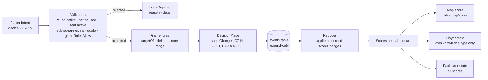

# Game rules

*Change log: [GAME-RULES-CHANGELOG.md](changelog/GAME-RULES-CHANGELOG.md)*

What players act on, what their actions do to the map, and how the rules are kept separate from the rest of the harness so they can change without breaking anything else. The rules themselves are code in [`packages/shared/src/game/rules.ts`](../packages/shared/src/game/rules.ts); the table in [§ 9](#9-rule-sets-and-versions) is generated from it.

## 1. The map

The map is a grid of **squares**: columns lettered `A`, `B`, `C`, …, rows numbered `1`, `2`, `3`, …. Every square holds four **sub-squares**, one per knowledge type, always in the same place:

```
┌────┬────┐
│ Ka │ Kb │
├────┼────┤
│ Kc │ Kd │
└────┴────┘
```

A sub-square is the unit players act on and the unit that has a **score**. Its id is the *region id* used in every event, telemetry record and export: `<square>-<K>`, e.g. `C7-Kb` (column C, row 7, knowledge type Kb). Telemetry about the info panel (`region_inspect`) uses the square id alone (`C7`), because the panel shows all four sub-squares.

| Scenario | Board | Squares | Sub-squares |
| --- | --- | --- | --- |
| `demo` | 10 × 10 | 100 | 400 |
| `demo-small` | 5 × 5 | 25 | 100 |

The board size comes from the scenario (§ 11), up to 26 × 26.

The look follows an election tile map: a base grid of outlined squares, each sub-square outlined in the colour of its knowledge type. A **proposed** sub-square is **hatched** in that colour and a **decided** one is **filled** (a decision wins over a proposal). The same colour-and-pattern code is used in the timeline, the legends and every label swatch ([AESTHETIC-RULES.md § 2.2](AESTHETIC-RULES.md#22-reserved-meanings)).

## 2. Who sees which scores

| | Player | Facilitator |
| --- | --- | --- |
| Grid, marks (hatched / filled) | ✓ | ✓ |
| Scores of the player's own knowledge type | ✓ (written in the sub-squares) | ✓ |
| Scores of the other three knowledge types | ✗ never sent | ✓ (composite map, all or one type) |
| Map score (§ 5) | ✓ | ✓ |

A player *knows* one knowledge type: the view of their seat, which by default is their K label (setup step 04 can switch to choosing views by hand, per seat, in the **Labels** step 09). The server filters the scores before it sends the state, so a player's browser never receives the scores of another type. A sub-square whose score a player does not know shows no number, and its hover text says "score unknown to you". There is no toggle: the knowledge split is the point of the game.

## 3. What a player can act on

Each seat has a **power type** (P label). A player's proposals and decisions always land on the sub-square of the knowledge type with the **same letter as their power type**: Pa → Ka, Pb → Kb, Pc → Kc, Pd → Kd.

- The player picks a **square** (click it with the Propose or Decide tool, or open its panel and use the buttons there). The screen turns that into the sub-square of their power type and outlines it with a dashed border before they confirm.
- In an **associated** pairing (K and P share the letter) a player acts on the sub-squares whose scores they know. In a **dissociated** pairing they act on sub-squares whose scores they cannot see, and someone else knows them. This is the research question in game form: who knows, who acts?
- The server checks the target again. An intent for any other sub-square is rejected with reason `rule` ("You can only act on Kb sub-squares (your power type)").

Quotas (how many proposals and decisions per seat per round) are round rules, set in setup step 02; they are separate from these game rules.

## 4. Proposals and decisions

Both actions pass through a confirmation step and are visible to everyone at once.

| Action | Mark on the map | Effect on scores |
| --- | --- | --- |
| **Propose** | the sub-square is hatched | none |
| **Decide** | the sub-square is filled | **+4** on the decided sub-square, **−1** on each of the other three sub-squares of the same square |

Scores always stay within **0–10**. A change that would go past a limit stops at the limit, and only real changes are recorded. Example: square A1 holds Ka 5, Kb 9, Kc 0, Kd 1, and a Pa player decides A1:

| Sub-square | Before | Rule | After | Recorded |
| --- | --- | --- | --- | --- |
| A1-Ka | 5 | +4 | 9 | ✓ |
| A1-Kb | 9 | −1 | 8 | ✓ |
| A1-Kc | 0 | −1 (already 0) | 0 | — |
| A1-Kd | 1 | −1 | 0 | ✓ |

A decision does not need an earlier proposal, and a sub-square can be decided more than once. Each decision applies the rule again.

## 5. The map score

The **map score** is the average of every sub-square's score, shown with two decimals (`MAP SCORE ▰▰▰▰▰▱▱▱▱▱ 4.72/10`). Every player and the facilitator see it, also when the player does not know most of the scores it is made of. Setup step 01 shows the starting map score of the chosen scenario.

## 6. Rounds

Scores carry over from round to round. The setup option **Clear map marks at the start of each round** (on by default) only clears the hatching and fills. The marks then show the current round's actions, while the scores keep every round's effect.

## 7. Revoking an action

The facilitator can revoke a proposal or decision of the current round (a misclick, for example). The seat gets its quota back, the mark disappears, and the scores are put back **as if the action had never happened**. The server replays every remaining action from the starting scores and records the difference in the `ActionRevoked` event. Because of the 0–10 limits, this is not always the same as subtracting the action's own changes. Example: a sub-square at 9 is decided twice (9 → 10 → 10); revoking the first decision leaves it at 10, because the second decision alone also reaches 10.

## 8. How the rules are applied

The rules run **once, on the server, when it accepts an action**. The score changes they produce are stored in the event (`scoreChanges: [{ regionId, from, to }]`). Everything else (the state on every screen, replay, exports) only replays those recorded changes. So the scores of a past session never change, even after the rules in the code have changed.



| Piece | File | Job |
| --- | --- | --- |
| Board geometry and ids | `packages/shared/src/board.ts` | squares, sub-squares, `C7-Kb` ids, starting-score matrices; no rules |
| Rule sets | `packages/shared/src/game/rules.ts` | `targetOf`, `deltas`, `mapScore`, score range, optional validators; the registry `GAME_RULES` |
| Glue | `packages/shared/src/game/scoring.ts` | the session's rule set, score changes for an intent or a revoke, map score of a state |
| Rule check on intents | `packages/shared/src/rules/validators.ts` (`gameRulesAllow`) | rejects a sub-square the rules do not give the seat, then runs the rule set's own validators |
| Recording | `apps/server/src/session/SessionManager.ts` | puts `scoreChanges` into `ProposalMade`, `DecisionMade` and `ActionRevoked` |
| Replay | `packages/shared/src/rules/reducer.ts` | applies recorded changes; never calls the rules |

The harness (server, network, UI, data pipeline) only calls these functions. A rule change therefore never touches the network protocol, the database or the export pipeline.

## 9. Rule sets and versions

<!-- BEGIN GENERATED: game-rules -->
<!-- Generated by `npm run docs:generate` from packages/shared — do not edit by hand. -->

| Rules (`rules`) | Version | Name | Score range | What it does |
| --- | --- | --- | --- | --- |
| `standard` (default) | 1 | Standard | 0–10 | A player acts on the sub-square of their power type (Pa → Ka, Pb → Kb, …) in the square they pick. A decision adds 4 to that sub-square and takes 1 from each of the other three sub-squares of the square; a proposal changes no scores. Scores stay between 0 and 10. The map score is the average of all sub-square scores. |

**`standard` numbers** (`packages/shared/src/game/rules.ts`):

| Parameter | Value |
| --- | --- |
| scoreRange | `0–10` |
| decide: decided sub-square | `4` |
| decide: other sub-squares of the square | `-1` |
| propose: proposed sub-square | `0` |
| propose: other sub-squares of the square | `0` |
| target | `sub-square of the actor's power type` |
| mapScore | `average of all sub-squares` |

<!-- END GENERATED: game-rules -->

- Every session records the id and version of its rule set in `SessionCreated.rules`. The rule set is chosen in setup step 01 (the choice is disabled while there is only one).
- **Bump `version`** whenever a rule set's behaviour changes, even if only one number changes. **Add a new rule set** (a new `id`) for a different game variant that should stay selectable next to the old one.
- When a stored session is opened with a different version, the server logs a warning: recorded scores stay as they were, and any new actions use the current rules.
- Do not remove a rule set that stored sessions used. Their map score and setup summary look it up by id.

## 10. Changing the rules

All game behaviour is in `packages/shared/src/game/rules.ts`.

1. **Numbers** (score range, +4, −1, proposal effect): edit `STANDARD` at the top of the file.
2. **Behaviour**: edit `standardRules`:
   - `targetOf(actor, kind)`: which sub-square an actor's action lands on (null = cannot act).
   - `deltas(action, board, scores)`: score change per sub-square for one accepted action, before the range is applied. It must be pure (no clock, no randomness), because the server and the tests must get the same answer.
   - `mapScore(scores, board)`: the single score of the map.
   - `validators`: extra restrictions, e.g. "decide only on proposed sub-squares". Return `{ ok: false, reason: "rule", detail }` to reject.
3. Bump `version`, update `summary` and `params` (they feed the table in § 9 and the setup summary).
4. Update the tests in `packages/shared/test/gameRules.test.ts`, then run `npm test` and `npm run docs:generate`.
5. Update this document, sections 3–7.

**A variant** next to the standard game: write another `defineGameRules({ … })` and add it to `GAME_RULES`. It shows up in setup step 01 and in § 9. The first entry of `GAME_RULES` is the default.

## 11. Starting scores and scenarios

A scenario folder `scenarios/<id>/` holds:

```
scenario.json   { id, title, version, description,
                  board: { cols, rows },
                  views: { "Ka": { name, description }, "Kb": …, "Kc": …, "Kd": … },
                  scores: "scores.json" }          (or the matrices inline)
scores.json     { "Ka": [[3, 5, …], …], "Kb": …, "Kc": …, "Kd": … }
```

- `views` names the four knowledge types (shown to players, e.g. *Hydrology*). Every K label needs one.
- `scores` holds one matrix per knowledge type: `rows` arrays of `cols` numbers, top row first, column A first. Each number is the starting score of that knowledge type's sub-square in that square.
- The server checks the sizes when it loads the scenario; a broken scenario is listed with its error in setup step 01 and cannot be chosen. When a session is created, the server also checks that every starting score is inside the chosen rule set's range.
- The demo scores are a fixed-seed pattern: `node scripts/demo-scores.mjs` rewrites `scenarios/demo/scores.json` and `scenarios/demo-small/scores.json`, always with the same values.
- Starting scores are stored with the session (`SessionCreated.initialScores`), together with the board size and a hash of the scenario. A session replays the same, even if the scenario files change later.

## 12. Where the rules show up in the data

| Where | What | Reference |
| --- | --- | --- |
| `SessionCreated` | `board`, `initialScores`, `rules { id, version }` | [DATA-TYPES.md](DATA-TYPES.md) |
| `ProposalMade`, `DecisionMade` | `regionId` (the sub-square), `scoreChanges` | [DATA-TYPES.md](DATA-TYPES.md) |
| `ActionRevoked` | `scoreChanges` that undo the action | [DATA-TYPES.md](DATA-TYPES.md) |
| `IntentRejected` | reason `rule` for a sub-square outside the player's power type | [DATA-TYPES.md](DATA-TYPES.md) |
| `actions.csv` export | `square_id`, `target_k`, `score_changes`, `map_score_after` | [DATA-TYPES.md](DATA-TYPES.md) |

Scores and the map score are game data, not personal data. They are pseudonymous only in the sense that every action is tied to a seat ([DATA-MANAGEMENT.md](DATA-MANAGEMENT.md)).
