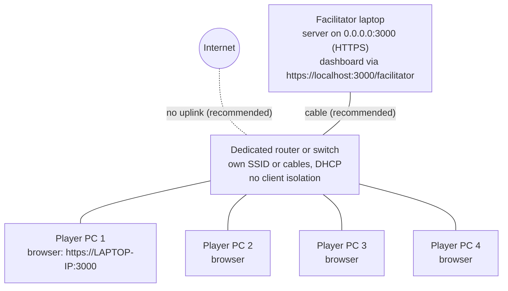
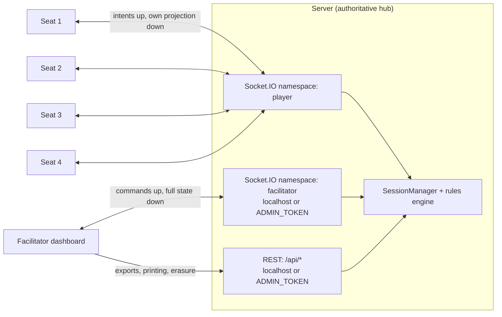
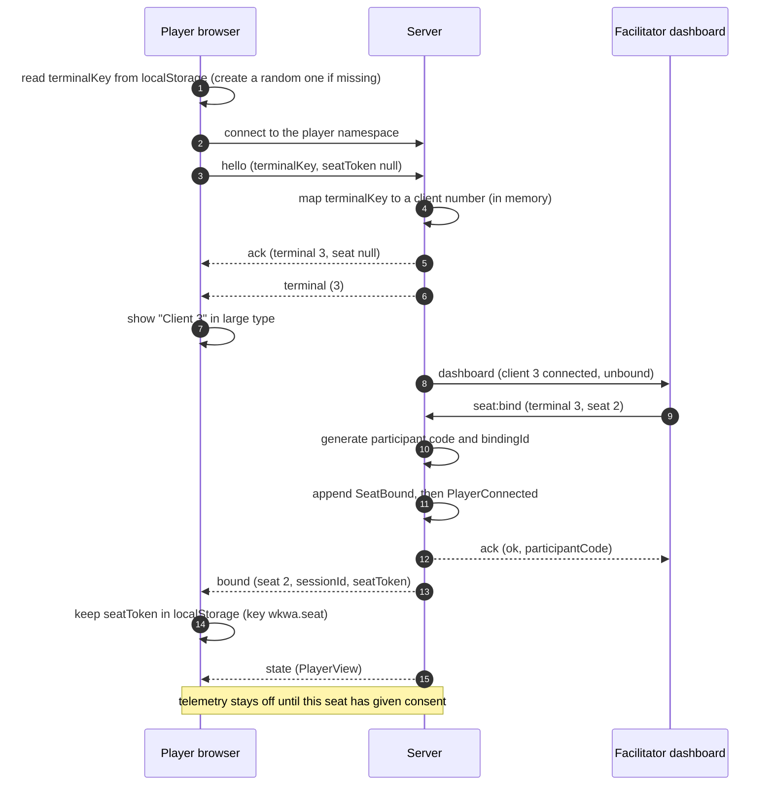
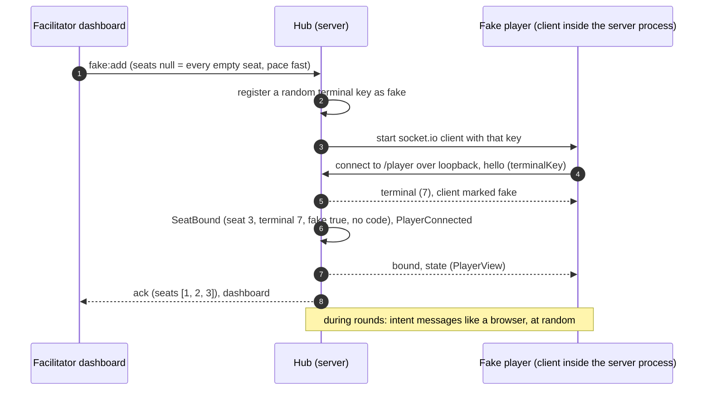
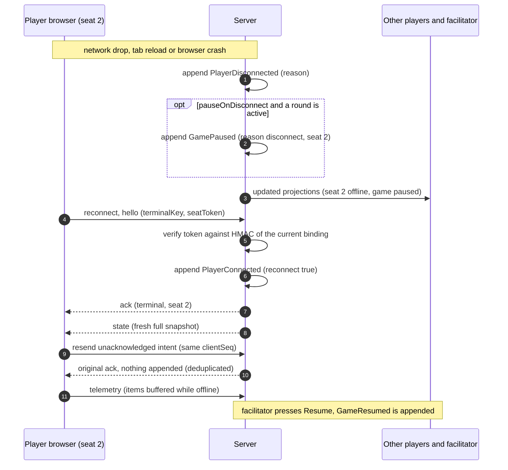
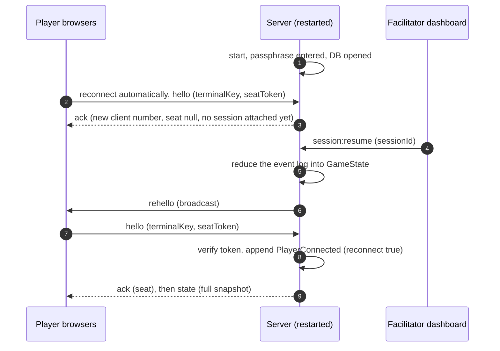
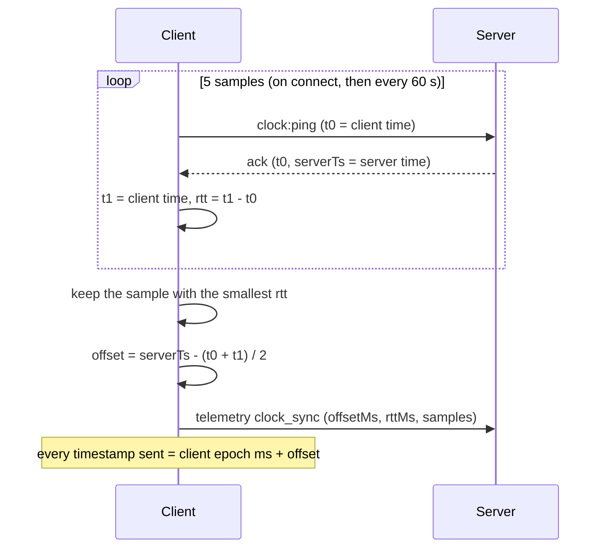
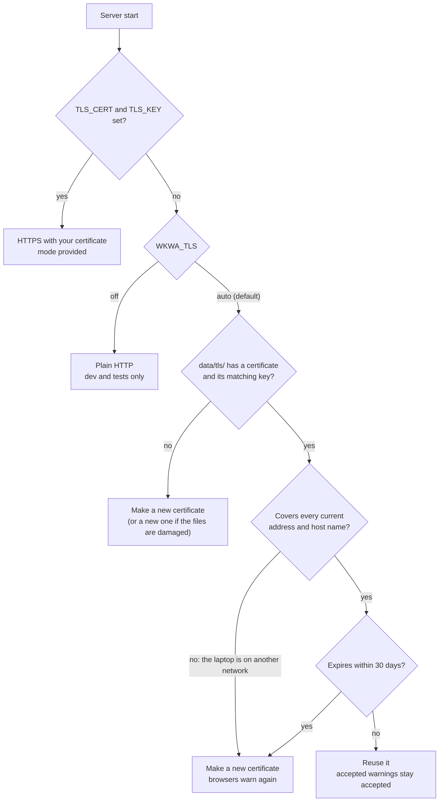

# Networking

*Change log: [NETWORKING-CHANGELOG.md](changelog/NETWORKING-CHANGELOG.md)*

This document covers how the harness uses the network: the physical setup on session day, the logical hub-and-spoke design, how browsers are identified and reconnect, how clocks are synchronised, every message that crosses the wire, and how the LAN is secured.

Related documents: [ARCHITECTURE.md](ARCHITECTURE.md), [DATA-MANAGEMENT.md](DATA-MANAGEMENT.md), [DATA-TYPES.md](DATA-TYPES.md).

## Contents

1. [Overview](#1-overview)
2. [Physical topology](#2-physical-topology)
3. [Logical topology: hub and spoke](#3-logical-topology-hub-and-spoke)
4. [Ports, interfaces and configuration](#4-ports-interfaces-and-configuration)
5. [Connecting and binding a seat](#5-connecting-and-binding-a-seat)
6. [Browser identity: terminal key and seat token](#6-browser-identity-terminal-key-and-seat-token)
7. [Disconnects and reconnects](#7-disconnects-and-reconnects)
8. [Clock synchronisation](#8-clock-synchronisation)
9. [Message catalogue](#9-message-catalogue)
10. [REST API](#10-rest-api)
11. [Security on the LAN](#11-security-on-the-lan)
12. [Session-day network checklist](#12-session-day-network-checklist)
13. [Troubleshooting](#13-troubleshooting)

---

## 1. Overview

- **One server, five browsers.** The facilitator laptop runs a single Node.js process. It serves the web pages, the WebSocket endpoints and the REST API on one port (default `3000`). Four player PCs and the facilitator open it in a browser. Nothing is installed on the player PCs.
- **Hub and spoke.** Players never talk to each other directly. Every message goes to the server, which validates it, records it and sends each recipient **its own projection** of the state.
- **Low data rate.** The game is turn-based. A full player state is a few tens of kilobytes and is re-sent on every change. That is simpler and more robust than sending deltas, and amounts to well under 1 Mbit/s in total.
- **Offline by design.** All assets are bundled with the app (no CDNs, no web fonts, no analytics), so the LAN does not need an internet connection, and it is recommended not to have one.
- **Transport:** Socket.IO 4 (WebSocket, with HTTP long-polling as automatic fallback) on Fastify 5, over **HTTPS** with a certificate the server makes itself ([§ 11](#11-security-on-the-lan)). Browsers only allow the microphone on a secure page.

## 2. Physical topology

Recommendations:

| Item | Recommendation | Why |
| --- | --- | --- |
| Network | A **dedicated** small router or switch that you control | Venue and university Wi-Fi (e.g. eduroam) often isolates clients, so the PCs cannot reach the laptop. It also keeps research traffic off shared networks. |
| Uplink | None (unplug the WAN port) | Nothing in the harness needs the internet; this removes a whole class of risk. |
| Laptop connection | Ethernet cable | Stable, and keeps the laptop's IP address predictable. |
| Laptop IP | Fixed or DHCP-reserved (e.g. `192.168.1.10`) | Player PCs can bookmark the URL, and the server's certificate stays the same, so browsers that accepted it once are not warned again ([§ 11](#11-security-on-the-lan)). |
| Player PCs | Any modern browser (Chromium/Firefox/Edge), full-screen (F11), notifications off | Fewer distractions; focus and visibility telemetry stays meaningful. |

## 3. Logical topology: hub and spoke

There is **no player-to-player channel**. Even the "mark for all players" effect of a proposal (the hatched sub-square) works this way: the server records the event, then pushes each player an updated projection that contains the mark.

| Namespace | Clients | Receives | May send |
| --- | --- | --- | --- |
| `/player` | the 4 player browsers (and unbound clients) | own `PlayerView` only | `hello`, `clock:ping`, onboarding submissions, `intent`, `telemetry`, `presence` |
| `/facilitator` | the dashboard | full `GameState` of all seats (incl. participant codes), all views, live telemetry | session and seat commands, round control, revoke, broadcast, notes |

## 4. Ports, interfaces and configuration

The server binds to `HOST:PORT` (default `0.0.0.0:3000`, i.e. all interfaces) and speaks **HTTPS and secure WebSockets (WSS)** on that one port. On start it prints the URLs of all non-internal IPv4 interfaces, e.g. `https://192.168.1.10:3000/   (eth0)`, and the SHA-256 fingerprint of its certificate (see [§ 11](#11-security-on-the-lan)).

| Variable | Default | Purpose |
| --- | --- | --- |
| `PORT` | `3000` | TCP port for HTTPS (or HTTP) and WebSocket |
| `HOST` | `0.0.0.0` | Interface to bind. Set it to the LAN address to avoid exposing other interfaces. |
| `WKWA_DATA_DIR` | `./data` | Encrypted databases (`wkwa.db`, `wkwa-sim.db`), logs (`logs/server.log`) and the self-signed certificate (`tls/`) |
| `WKWA_EXPORTS_DIR` | `./exports` | Export output folder |
| `WKWA_DB_PASSPHRASE` | — | **Development and tests only.** On session day, type the passphrase at the hidden prompt instead. |
| `ADMIN_TOKEN` | — | Enables remote facilitator access with a bearer token (otherwise the facilitator is localhost-only) |
| `WKWA_TLS` | `auto` | `auto`: HTTPS with a **self-signed certificate** the server makes and keeps in `data/tls/` ([§ 11](#11-security-on-the-lan)). **Required for sessions with audio**: browsers only allow the microphone on a secure page. `off`: plain HTTP. `npm run dev`, the Playwright server and the unit tests use `off`; they run on `localhost`/`127.0.0.1`, which browsers treat as secure anyway. |
| `TLS_CERT`, `TLS_KEY` | — | Your own certificate and unencrypted key (PEM files), instead of the self-signed one. Set both or neither (one alone stops the server). When both are set they are used whatever `WKWA_TLS` says (mode `provided`). |
| `HTTP_REDIRECT_PORT` | — | Optional second, plain-HTTP port that answers every request with `301` to `https://<same host>:PORT<same path>`, so that a typed `http://` address still arrives. E.g. `8080`, or `80` so players can type just `http://LAPTOP-IP` (port 80 needs administrator rights on Linux). Ignored when TLS is off. |

| URL | Who |
| --- | --- |
| `https://LAPTOP-IP:3000/` | Player PCs (each browser accepts the certificate warning once) |
| `https://localhost:3000/facilitator` | Facilitator, on the laptop itself (accept the warning once there too) |
| `https://localhost:3000/api/…` | Dashboard / scripts (see [§ 10](#10-rest-api)) |

With `WKWA_TLS=off` the same URLs start with `http://`.

## 5. Connecting and binding a seat

The facilitator matches the **Client N** shown on each physical screen to a seat on the dashboard. Binding generates the participant code; it is shown to the facilitator immediately (for the key sheet) and to the player only on the end screen.

**Fake players.** In setup step 07 the facilitator can let the server create *fake players* for empty seats (`fake:add`). The server starts a socket.io client inside its own process, which connects to its own `/player` namespace over the loopback interface (or the configured `HOST`) and goes through exactly the steps in the diagram above. Before that client connects, the server registers its random terminal key, so the hub marks its client as fake (the dashboard's client list shows `fake: true`) and its `SeatBound` carries `fake: true` and no participant code. Fake players skip onboarding and send no telemetry. After a server restart the server starts them again; they re-claim their seats with their seat tokens, like a reloaded browser.

A **simulated session** has no binding at all: its seats are taken by agents that run inside the server (`AgentBound`, see [ARCHITECTURE.md § 14](ARCHITECTURE.md#14-simulated-players)). They send no messages over the network, and `seat:bind` is refused. Player browsers that connect meanwhile stay on the waiting screen. The facilitator starts the game with `simulation:start` instead of `onboarding:start`.

## 6. Browser identity: terminal key and seat token

| Value | Created by | Stored in | Lifetime | Contains personal data? |
| --- | --- | --- | --- | --- |
| `terminalKey` (32 hex chars) | browser, random | `localStorage` of that PC's browser | until browser data is cleared | No. It identifies the *PC/browser*, never logged with game data. |
| Client number (`terminal`) | server | server memory only | while the server runs (numbers may change after a restart) | No |
| `seatToken` | server: `HMAC-SHA256(server_secret, "sessionId:seat:bindingId")` | `localStorage` key `wkwa.seat` (survives reloads and closed tabs) | while the binding exists | No. It is a capability, not an identifier. |
| `server_secret` | server, random at DB creation | `meta` table of the encrypted DB | lifetime of the DB | No |

The seat token is **derived, not stored**, so it stays valid across a server restart (same DB, same secret). Re-binding a seat creates a new `bindingId`, which invalidates the old token immediately.

**Seat re-claim is token-only.** Client numbers only help the facilitator match screens to seats in the lobby. They are kept in server memory and can differ after a restart, so a browser gets its seat back solely by presenting a valid seat token.

## 7. Disconnects and reconnects

- Socket.IO reconnects automatically with back-off. The player sees a "Reconnecting…" overlay.
- Telemetry produced while offline is buffered in the browser and sent after reconnecting. Its `clientTs` keeps the original timing.
- A reload, or even closing and reopening the tab, keeps the seat, because the token is in `localStorage` (`wkwa.seat`). Clearing the browser's site data, or using a different browser profile, loses it.

### After a server restart

The game state is rebuilt from the event log, so a restart loses nothing that was acknowledged. When the facilitator re-attaches the session (*Resume* on the dashboard), the server broadcasts `rehello` to every player browser. Each one re-sends `hello` with its stored seat token and gets its seat back:

- The game never resumes automatically. The facilitator decides when to press *Resume*, and the pause duration is logged.

## 8. Clock synchronisation

Player PCs' clocks are not trusted. Each client estimates the offset between its clock and the server clock, NTP-style:

$$\text{offset} = t_{server} - \frac{t_0 + t_1}{2}, \qquad \text{error} \le \frac{\text{rtt}}{2}$$

On a wired LAN the RTT is typically 1–5 ms, so corrected client timestamps are accurate to a few milliseconds. The offset used is stored with every telemetry row (`client_offset_ms`), and each re-sync is logged as `clock_sync`, so corrections can be audited or redone later.

## 9. Message catalogue

Every client→server payload is validated with the zod schema listed here. Invalid messages are dropped with an error acknowledgement, and no client input is trusted. The tables are generated from `packages/shared/src/protocol.ts`. `Ack` means `{ ok: true, data? } | { ok: false, error }`.

<!-- BEGIN GENERATED: message-catalogue -->
<!-- Generated by `npm run docs:generate` from packages/shared — do not edit by hand. -->

#### `/player` — client→server

| Message | Payload | Ack (callback) | Logged as | Description |
| --- | --- | --- | --- | --- |
| `hello` | `{ terminalKey: string (pattern), seatToken: string \| null }` | `{ terminal: number, seat: number \| null }` | PlayerConnected (only if the seat token is valid) | First message after connecting. Identifies the browser (client) and, if present, re-claims a seat. |
| `clock:ping` | `{ t0: number }` | `{ t0: number, serverTs: number }` | Result stored by the client as telemetry 'clock_sync' | Clock synchronisation sample (NTP-style). Sent 5× on connect and every 60 s. |
| `consent:submit` | `{ formVersion: string, textSha256: string (pattern), answers: map<string, boolean>, durationMs: number 0–86400000, clientTs: number }` | `Ack` | ConsentRecorded | Answers of the consent form. |
| `demographics:submit` | `{ formVersion: string, answers: map<string, string (≤ 64 chars)>, durationMs: number 0–86400000, clientTs: number }` | `Ack` | DemographicsSubmitted | Answers of the demographics questionnaire. |
| `mic:check` | `{ passed: boolean, attempts: integer 1–100, durationMs: number 0–86400000, settings: { sampleRate?: integer 8000–384000, echoCancellation?: boolean \| string (≤ 40 chars), noiseSuppression?: boolean, autoGainControl?: boolean, channelCount?: integer 1–32 }, noiseFloorDb: number -120–0, speechDb: number -120–0, speechMs: number ≥ 0, contextSampleRate?: integer 8000–384000, clientTs: number }` | `Ack` | MicCheckCompleted | Result of the player's own mic check (sessions that record audio; the onboarding step after consent). Refused while PlayerView.audio.micCheckHeld (another seat is still in consent). Only processing flags and the sample rate are sent, never the device name or id. |
| `briefing:ack` | `{ textSha256: string (pattern), durationMs: number 0–86400000, clientTs: number }` | `Ack` | BriefingAcknowledged | Player confirms having read the briefing. |
| `intent` | `{ clientSeq: integer ≥ 1, kind: "propose" \| "decide", regionId: string (≤ 64 chars), clientTs: number }` | `{ ok: true, seq } \| { ok: false, reason, detail }` | ProposalMade / DecisionMade, or IntentRejected | Request to propose or decide a region. Validated by the rules engine. |
| `telemetry` | `{ clockOffsetMs: number, items: array<TelemetryItem> }` | `{ stored: number }` | telemetry table (one row per valid item) | Batch of UI telemetry items (every 2 s or 20 items). |
| `presence` | `{ regionId: string (≤ 64 chars) \| null }` | — (no ack) | Not stored (ephemeral). The persisted record is telemetry 'region_hover'. | Volatile 'currently hovering' signal for the facilitator's live mirrors. |
| `audio:start` | `{ trackId: string (uuid), reason: "mic_check" \| "resume" \| "reconnect" \| "reload" \| "permission_regained" \| "context_resumed" \| "clock_jump" \| "discontinuity" \| "cleared", sampleRate: 16000, chunkSamples?: integer 1–96000, clientTs: number, clockOffsetMs: number, inputLatencyMs?: number 0–10000, settings: { sampleRate?: integer 8000–384000, echoCancellation?: boolean \| string (≤ 40 chars), noiseSuppression?: boolean, autoGainControl?: boolean, channelCount?: integer 1–32 }, context?: { sampleRate: integer 8000–384000, baseLatencyMs: number \| null, outputLatencyMs: number \| null, timingMethod: string (≤ 40 chars) } }` | `AudioAck (ok, or refused with retry true = send again later / false = drop)` | AudioTrackStarted (the track is opened in the encrypted audio store) | A new audio track starts (one continuous capture run). Accepted only while the seat should record (PlayerView.audio.record: audio consent given, every seat done with consent, mic check reached and not skipped, recording not paused, game not complete, not a fake player or agent). A refused start is permanent (retry false): the browser drops the track's chunks too. |
| `audio:chunk` | `{ trackId: string (uuid), seq: integer ≥ 0, startSample: integer ≥ 0, sampleCount: integer 1–96000, clientTs: number, clockOffsetMs: number, rmsDb: number -120–0, peakDb: number -120–0, clippedSamples: integer ≥ 0, pcm: binary }` | `AudioAck<{ trackId, seq }>` | Encrypted audio store only (audio_chunks + the track's .wka file), never the event log | About 5 s of audio of an open track (16 kHz mono s16le, binary). The browser keeps unacknowledged chunks in memory only and resends them in order after a reconnect; a resend with the same trackId and seq is stored once (ack ok, duplicate true). Late chunks of a closed track (the server closes it on a disconnect, restart, recording pause or at game complete) are accepted for 10 minutes after the close or the previous late chunk; audio captured while recording was paused or after the game was complete is never stored (a chunk that starts before such a moment is cut there, one that starts after it is refused). |
| `audio:stop` | `{ trackId: string (uuid), reason: "paused" \| "game_complete" \| "closed" \| "aborted" \| "withdrawn" \| "disconnect" \| "permission_lost" \| "error" \| "client_stop" \| "skipped" \| "interrupted" \| "context_suspended" \| "context_interrupted" \| "clock_jump" \| "discontinuity" \| "track_ended" \| "cleared", chunks: integer ≥ 0, samples: integer ≥ 0, droppedChunks?: integer ≥ 0, clientTs: number, clockOffsetMs?: number }` | `AudioAck` | AudioTrackStopped | The browser stopped capturing a track (pause, game complete, unload, permission lost, error). Always accepted for the seat's own tracks, also after the server closed the track itself. |
| `audio:level` | `{ state: "recording" \| "no_signal" \| "denied" \| "error" \| "idle" \| "paused" \| "requesting", rmsDb: number -120–0, peakDb: number -120–0, pendingChunks: integer ≥ 0, pendingBytes: integer ≥ 0 }` | — (no ack) | Not stored (ephemeral). | Volatile microphone meter reading (about 4 Hz) for the facilitator's LIVE mic column; dropped when the network is busy. |

#### `/player` — server→client

| Message | Payload | Logged as | Description |
| --- | --- | --- | --- |
| `terminal` | `{ terminal: number }` | — | Client number assigned to this browser (shown in large type while unassigned). |
| `bound` | `{ seat: number, sessionId: string, seatToken: string }` | — (SeatBound is logged when the facilitator binds) | This browser was bound to a seat; carries the reconnect token. |
| `unbound` | `{ reason: string }` | — | The seat binding was removed (or the session ended); return to the waiting screen. |
| `rehello` | `{}` | — | A session was (re)attached on the server; the client re-sends `hello` with its stored seat token so its seat is re-claimed. |
| `state` | `PlayerView` | Client acknowledges with telemetry 'state_received' | Full projected state for this player (PlayerView): phase, round, own labels and quotas, the grid (board size, knowledge-type names), the scores of the OWN knowledge type only, the map score, which knowledge type the player acts on, and the marks (proposals and decisions). |

#### `/facilitator` — client→server

| Message | Payload | Ack (callback) | Logged as | Description |
| --- | --- | --- | --- | --- |
| `session:create` | `{ scenarioId: string, config: SessionConfig, notes?: string (≤ 1000 chars) }` | `Ack<{ sessionId }>` | SessionCreated [+ AgentBound per seat when simulated] | Create a new session from a scenario and config. With players = 'simulated' it goes into the simulation database and every seat gets an agent. |
| `session:resume` | `{ sessionId: string }` | `Ack` | — | Re-open an unfinished session (e.g. after a server restart). |
| `seat:bind` | `{ terminal: integer ≥ 1, seat: integer 1–4 }` | `Ack<{ participantCode }>` | SeatBound, PlayerConnected | Bind a connected client to a seat; generates the participant code (real sessions only: simulated seats are taken by agents). |
| `fake:add` | `{ seats?: array<integer 1–4> \| null, pace?: "normal" \| "fast" }` | `Ack<{ seats }>` | SeatBound (fake = true), PlayerConnected | Real sessions, lobby only: the server starts fake players (test clients that connect over the network like a browser) and binds them to the given seats. They skip onboarding, get no participant code and propose/decide at random. |
| `seat:unbind` | `{ seat: integer 1–4, reason?: string (≤ 200 chars) }` | `Ack` | SeatUnbound | Remove a seat binding (lobby only). |
| `labels:set` | `{ assignments: array<{ seat: integer 1–4, k: "Ka" \| "Kb" \| "Kc" \| "Kd", view?: string }>, pairing?: { mode: "aligned" \| "dissociated", id: integer 1–6 \| null } }` | `Ack` | LabelsAssigned (method = manual) | Set the K label of every seat (and view when viewAssignment = manual) plus the K–P pairing (aligned or dissociated D1–D6); the server derives each P. |
| `labels:randomise` | `{ pairing?: { mode: "aligned" \| "dissociated", id: integer 1–6 \| null }, shuffleK?: boolean }` | `Ack` | LabelsAssigned (method = random, with seed) | Shuffle which seat gets which K (optional) and apply a pairing; dissociated without a number picks D1–D6 at random. |
| `onboarding:start` | `{}` | `Ack` | OnboardingStarted | Lock seats and send players to consent / demographics / briefing. |
| `simulation:start` | `{}` | `Ack` | OnboardingStarted (no steps), RoundStarted | Simulated sessions only: start the game with the agents (no onboarding) and begin round 1; the agents then play by their policies. |
| `calibration:start` | `{}` | `Ack` | CalibrationStarted, then CalibrationTurn per seat, CalibrationCompleted and CalibrationChecked | Sessions that record audio: start the calibration once every seat is ready. The server then times the turns (each seat reads a sentence aloud while the others stay quiet) and runs a quick quality check. |
| `calibration:redo` | `{}` | `Ack` | CalibrationStarted, then as calibration:start | Run the calibration again (e.g. after a seat moved closer to its microphone). |
| `calibration:skip` | `{ reason?: string (≤ 200 chars) }` | `Ack` | CalibrationSkipped | Skip (or cancel) the calibration, after confirmation; round 1 may then start without it. |
| `mic:skip` | `{ seat: integer 1–4, reason?: string (≤ 200 chars) }` | `Ack` | MicCheckSkipped | Skip a seat's mic check (e.g. no working microphone): the player continues onboarding and the seat is not recorded. |
| `recording:pause` | `{ reason?: string (≤ 200 chars) }` | `Ack` | RecordingPaused (+ AudioTrackStopped per recording seat) | Pause audio recording for every seat, after confirmation (players cannot mute themselves). The game goes on. |
| `recording:resume` | `{}` | `Ack` | RecordingResumed (+ AudioTrackStarted per recording seat) | Resume audio recording; every recorded seat starts a new track. |
| `round:start` | `{}` | `Ack` | RoundStarted | Start the next round. |
| `round:end` | `{}` | `Ack` | RoundCompleted (reason = facilitator) [+ GameCompleted after the last round] | Force-end the current round. |
| `game:pause` | `{}` | `Ack` | GamePaused | Pause the active round. |
| `game:resume` | `{}` | `Ack` | GameResumed | Resume after a pause. |
| `action:revoke` | `{ seq: integer ≥ 1, reason?: string (≤ 200 chars) }` | `Ack` | ActionRevoked | Undo a proposal/decision of the current round. |
| `broadcast` | `{ text: string (≤ 300 chars) }` | `Ack` | FacilitatorBroadcast | Show a message on every player's screen. |
| `note` | `{ text: string (≤ 500 chars) }` | `Ack` | SessionNote | Add a facilitator annotation to the log. |
| `participant:withdraw` | `{ seat: integer 1–4 }` | `Ack` | ParticipantWithdrawn | Mark a participant as withdrawn during the session. |
| `game:end` | `{}` | `Ack` | [RoundCompleted] + GameCompleted (reason = facilitator) | End the game early. |
| `session:close` | `{}` | `Ack` | SessionClosed | Archive the session; players return to the waiting screen. |
| `session:abort` | `{ reason?: string (≤ 200 chars) }` | `Ack` | SessionAborted | Abandon the session (data kept, marked aborted). |

#### `/facilitator` — server→client

| Message | Payload | Logged as | Description |
| --- | --- | --- | --- |
| `dashboard` | `DashboardMsg` | — | Full session state (all seats incl. participant codes), connected clients and live per-seat statistics. |
| `scenario` | `Scenario \| null` | — | The loaded scenario with ALL views (for the composite map). Sent when a session is loaded. |
| `events` | `{ events: StoredEvent[], reset: boolean }` | — | New events for the live log (demographic answers redacted). The backlog is sent on connect. |
| `telemetry:live` | `{ items: StoredTelemetry[] }` | — | Newly stored telemetry rows (chatty types such as state_received are omitted). |
| `presence:live` | `{ seat: number, regionId: string \| null }` | — | Relayed hover presence of a seat for the live mirrors. |

<!-- END GENERATED: message-catalogue -->

Server→client payload types are TypeScript interfaces in `packages/shared/src/projections.ts` (`PlayerView`) and `protocol.ts` (`DashboardMsg`, `TerminalInfo`, `SeatLiveStats`). Stored event and telemetry rows are described in [DATA-TYPES.md](DATA-TYPES.md).

## 10. REST API

Used by the dashboard's data pages and by scripts. **Localhost-only** unless `ADMIN_TOKEN` is set; then send `Authorization: Bearer <token>`. Routes with `:id` find the session in whichever database holds it. Participant look-up and erasure only search the participant database.

| Method | Path | Purpose |
| --- | --- | --- |
| `GET` | `/api/health` | Liveness check (no data) |
| `GET` | `/api/scenarios` | Available scenarios |
| `GET` | `/api/scenarios/:id` | Full scenario (board, all views and starting scores) for the setup preview |
| `GET` | `/api/server-info` | Player URLs on this machine's LAN interfaces (setup step "Connect & bind"), and `tls: { enabled, mode: "auto" \| "provided" \| "off", fingerprintSha256, sans, expires }` (see [§ 11](#11-security-on-the-lan)) |
| `GET` | `/api/config/session-defaults` | Default session configuration for the setup form (`config/session.default.json`, validated) |
| `GET` | `/api/sessions` | All sessions of both databases with status, newest first; `players` is `"real"` (participant database) or `"simulated"` (simulation database); `fakeSeats` lists seats played by fake players |
| `GET` | `/api/sessions/:id` | One session (metadata + reduced state + `players`) |
| `GET` | `/api/sessions/:id/events` | Full event log (for replay); demographic answers redacted |
| `GET` | `/api/sessions/:id/telemetry` | Telemetry rows of the session (`?afterId=&limit=` for paging) |
| `GET` | `/api/sessions/:id/scenario` | Scenario of the session (all views) + whether its files still match the recorded hash (replay) |
| `POST` | `/api/sessions/:id/export` | Write a standard (pseudonymised) export to `exports/` (simulated sessions: to `exports/simulations/`) |
| `POST` | `/api/sessions/:id/anonymise` | Write an anonymised export to `exports/` |
| `GET` | `/api/sessions/:id/print/keysheet` | Printable key sheet (seat → code, blank name column). 400 for a simulated session. |
| `GET` | `/api/sessions/:id/cards` | Seats that have a takedown card. 400 for a simulated session. |
| `GET` | `/api/sessions/:id/cards/:seat` | One takedown card as a PDF (A6, JetBrains Mono), downloaded as `takedown-card-<session>-seat<n>.pdf` |
| `POST` | `/api/sessions/:id/delete` | Delete the entire session. Body `{ "confirm": "<session id>", "deleteExports"?: true }`. Refused (409) while it is running. |
| `GET` | `/api/session-deletions` | Session-deletion registers of both databases (`players` per entry) |
| `GET` | `/api/participants/:code` | Look up a participant code (typos tolerated): sessions and row counts, exports containing it, earlier erasures |
| `POST` | `/api/participants/:code/erase` | Erase all data of a code. Body `{ "confirm": "<code>", "note"?: "…" }` must repeat the code. Refused (409) while the participant is in a session that is still running. |
| `GET` | `/api/erasures` | Erasure register |
| `GET` | `/api/exports` | Export registers of both databases (`players` per entry) |

## 11. Security on the LAN

| Threat | Control |
| --- | --- |
| A player opens the facilitator dashboard or the API from their PC | `/facilitator` page, `/facilitator` namespace and `/api/*` accept only loopback connections (`127.0.0.1`, `::1`) unless `ADMIN_TOKEN` is set. The remote address is used **only** for this check; it is never logged or stored. |
| Remote facilitator access needed (e.g. a second laptop) | Set a long random `ADMIN_TOKEN`. The dashboard sends it as a bearer header and in the socket `auth` payload. Do not put it in URLs (URLs can end up in logs and browser history). |
| A player reads other players' data via browser devtools | Not possible: the server never sends another view's content to a player (see [ARCHITECTURE.md § 8](ARCHITECTURE.md#8-projections-who-sees-what)). |
| A player forges messages (e.g. acting for another seat) | The seat comes from the server-side socket binding, never from the payload. Every payload is schema-validated, and rules are enforced on the server. |
| A browser pretends to be a fake player to skip consent | Not possible: a client is fake only if the server registered its terminal key before starting it. Nothing a client sends can set the flag. |
| Eavesdropping on the LAN | HTTPS is on by default (`WKWA_TLS=auto`), so game actions, consent and demographic answers (all pseudonymised) and any microphone audio are **encrypted** on the LAN. Only with `WKWA_TLS=off` do they cross it in plaintext; use that for development and tests on `localhost` only. |
| A device on the LAN poses as the server (man in the middle) | The certificate is self-signed, so a browser cannot tell by itself that it is talking to the real laptop: it warns, and the participant accepts the warning. A rogue device would show a warning too, for a certificate with a **different fingerprint**. Controls: a dedicated network that only you control, the address taken from the facilitator, and the fingerprint compared in setup step 07 ([SESSION-RUNBOOK.md § 10](SESSION-RUNBOOK.md#10-https-and-the-certificate-warning)). |
| Someone copies the certificate's private key | `data/tls/self-signed-key.pem` is readable only by the laptop user (mode `0600` on Linux and macOS), lives in the git-ignored `data/` folder, and is never sent anywhere. On Windows, and on FAT/exFAT drives, file modes do not apply: the key has the folder's permissions, so keep `data/` in your own user profile on a laptop no one else logs in to. Delete `data/tls/` to make a new key at the next start (participants then accept a new warning). |
| Rogue devices on the network | Use WPA2/3 with a password only you know, or wired connections; switch off the router's WAN. |

**HTTPS with a self-signed certificate (default).** Browsers only give a page the microphone (`getUserMedia`) in a *secure context*: a page loaded over HTTPS, or from `localhost`. Player PCs open the server by its LAN address, so the server must speak HTTPS. A closed LAN has no internet and no public domain name, so no publicly trusted certificate is possible, and the participants' own laptops cannot have a local certificate authority (such as [mkcert](https://github.com/FiloSottile/mkcert)'s) installed beforehand. The server therefore makes its own certificate at start-up (`apps/server/src/tls.ts`, with the [`selfsigned`](https://www.npmjs.com/package/selfsigned) library; no `openssl` needed, so it works on every OS):

| Property | Value |
| --- | --- |
| Key | ECDSA P-256, made on the laptop, never leaves it |
| Validity | 397 days (from one day in the past, so a PC whose clock is slightly behind still accepts it) |
| Extensions | `basicConstraints CA:false` (it cannot sign other certificates), `keyUsage digitalSignature`, `extKeyUsage serverAuth` |
| Names (SANs) | DNS `localhost`, the laptop's host name and `<host name>.local`; IP `127.0.0.1`, `::1` and **every non-internal IPv4 address** of the laptop |
| Files | `data/tls/self-signed-cert.pem`, `data/tls/self-signed-key.pem` (mode `0600`), and `data/tls/meta.json` (`sans`, `created`, `expires`, `fingerprintSha256`) |
| Fingerprint | SHA-256 of the certificate, as `AB:CD:…` (32 pairs). Printed at start-up, shown in setup step 07 and returned by `GET /api/server-info`. Browsers show the same value in their certificate viewer (some with spaces instead of colons). |

The certificate is **reused across restarts**, so a browser that accepted it once is not warned again. Addresses that have gone away (e.g. Wi-Fi switched off) do not count: only a *new* address or host name, near expiry (or a certificate that is not valid yet because the clock was set back), or missing or damaged files make a new one. A new certificate keeps the names of the old one as well, so a laptop that moves between two networks (lab and home) settles on one certificate that covers both. Virtual network adapters count too (VPN, Docker, WSL or Hyper-V adapters): switch on the ones you need *before* the first start, because one that comes up with a new address later makes a new certificate. The start-up banner says which case applied, and names the missing addresses; the server log only records the case, never addresses or host names. Each new certificate has a new fingerprint and makes every browser warn once more, so keep the laptop's IP address fixed ([§ 2](#2-physical-topology)).

Each participant accepts the warning **once per browser**, talked through it by the facilitator: [SESSION-RUNBOOK.md § 10](SESSION-RUNBOOK.md#10-https-and-the-certificate-warning) has the steps for Chrome, Edge, Firefox and Safari. The facilitator accepts it once too, for `https://localhost:3000/facilitator`. Fake players and `npm run bots` connect to the server without checking its certificate: they are the server's own test clients, over loopback. For bots against another machine, `--insecure` must be given explicitly.

**Your own certificate.** If you have a certificate the player PCs trust (for example from a university CA, or mkcert where you control the PCs), start with `TLS_CERT=… TLS_KEY=… npm start`. It takes precedence over `WKWA_TLS`, its fingerprint is shown in the same places, and the browsers show no warning.

**Plain HTTP** (`WKWA_TLS=off`) is meant for development and tests on the laptop itself. Browsers on other PCs then have no microphone, and traffic crosses the LAN unencrypted. Record the TLS set-up in your data management plan.

**Firewall.** The laptop must accept incoming TCP connections on `PORT` (and on `HTTP_REDIRECT_PORT`, if you set it):

| OS | Command / action |
| --- | --- |
| Linux (ufw) | `sudo ufw allow 3000/tcp` |
| Linux (firewalld) | `sudo firewall-cmd --add-port=3000/tcp` |
| Windows | Allow Node.js on *private* networks when prompted, or add an inbound rule for TCP 3000 |
| macOS | System Settings → Network → Firewall → allow incoming connections for `node` |

## 12. Session-day network checklist

- [ ] Router powered on, WAN unplugged, SSID/password known only to the research team
- [ ] Laptop connected (cable) and has its expected IP (`ip addr` / `ipconfig`)
- [ ] Firewall allows TCP `3000`
- [ ] `npm start` → passphrase entered → server prints the `https://` player URL and the certificate fingerprint (and *reusing* the certificate, if the laptop's address has not changed)
- [ ] Facilitator dashboard opens at `https://localhost:3000/facilitator` (certificate warning accepted once)
- [ ] Each player PC opens the player URL, accepts the certificate warning ([SESSION-RUNBOOK.md § 10](SESSION-RUNBOOK.md#10-https-and-the-certificate-warning)) and shows **Client N**, and all 4 clients appear on the dashboard
- [ ] Optional: run `npm run bots -- --count 4` *before* participants arrive, for a full rehearsal on the real network
- [ ] Player browsers in full-screen, notifications and screen savers off, power-saving sleep disabled

## 13. Troubleshooting

| Symptom | Likely cause | Fix |
| --- | --- | --- |
| Player PC: "This site can't be reached" | Wrong IP, firewall, or the server is bound to another interface | Check the `https://` URL printed by the server; open the firewall port; set `HOST=0.0.0.0` |
| Works on the laptop, not on PCs | Wi-Fi client isolation (common on venue/guest networks) | Use your own router; disable "AP/client isolation" |
| Client never appears on the dashboard | Page loaded from a cached or old URL; JavaScript blocked | Hard-reload (Ctrl+Shift+R); check the browser console |
| Two PCs show the same client number | Same browser profile synced or copied (identical `localStorage`) | Clear site data on one PC and reload |
| Repeated "Reconnecting…" | Wi-Fi power saving, weak signal | Use cables; disable power saving on the network adapter |
| Large `rttMs` / clock offset jumps on the dashboard | Congested Wi-Fi, PC under load | Move closer to the router or use cables; close other apps |
| Facilitator page says "forbidden" | Opened from another machine without `ADMIN_TOKEN` | Open it on the laptop via `https://localhost:3000/facilitator`, or set `ADMIN_TOKEN` |
| "Your connection is not private" (Chrome, Edge), "Warning: Potential Security Risk Ahead" (Firefox), "This Connection Is Not Private" (Safari) | Expected: the server's certificate is self-signed | Accept it once per browser: [SESSION-RUNBOOK.md § 10](SESSION-RUNBOOK.md#10-https-and-the-certificate-warning). Compare the fingerprint with setup step 07 if in doubt. |
| The warning is back on a PC that had accepted it | The server made a new certificate (new LAN address or host name, near expiry, or `data/tls/` deleted; the start-up banner says which), or another browser, profile or private window is used | Accept it again. Keep the laptop's IP address fixed (DHCP reservation) so the certificate stays the same. |
| `NET::ERR_CERT_COMMON_NAME_INVALID` (Chrome, Edge) or `SSL_ERROR_BAD_CERT_DOMAIN` (Firefox) | The address in the URL is not in the certificate: the laptop got a new address while the server was running, or the page was opened by another name | Restart the server (it makes a certificate that covers the current addresses) and open one of the URLs it prints |
| `NET::ERR_CERT_DATE_INVALID` | The PC's clock is more than a day off, or the certificate expired while the server kept running | Set the PC's clock right; restart the server |
| "didn't send any data" (`ERR_EMPTY_RESPONSE`), "the connection was reset" or "the server unexpectedly dropped the connection" | The URL starts with `http://`, but the server speaks HTTPS on that port | Type `https://`. Or start the server with `HTTP_REDIRECT_PORT` (e.g. `80`) so plain-HTTP addresses are redirected. |
| No "Proceed"/"Accept the risk" link on the warning page | The browser is managed (company or school policy forbids certificate exceptions) | Use another browser on that PC, or another device |
| Safari: the page loads but stays on "Reconnecting…", or reacts slowly | Safari may refuse secure WebSockets to a self-signed server; Socket.IO then falls back to HTTP long-polling | Usually it still works, just more slowly. Otherwise use Chrome, Edge or Firefox on that Mac. |
| Server stops at start with "Set both TLS_CERT and TLS_KEY" or "TLS_KEY does not belong…" | Only one of the two is set, or they are not a pair | Set both to a matching pair, or unset both to use the self-signed certificate |
| Server stops at start with "WKWA_TLS must be…" or "HTTP_REDIRECT_PORT must be…" | A typo in the environment | Use `auto` or `off`, and a port number (the data CLI, `npm run cli`, still works meanwhile) |
| A new certificate at every start, although the laptop stays on the same network | A virtual adapter (VPN, Docker, WSL, Hyper-V) gets a new address each time | Switch that adapter off before starting the server for sessions. The start-up banner names the address that was missing. |
