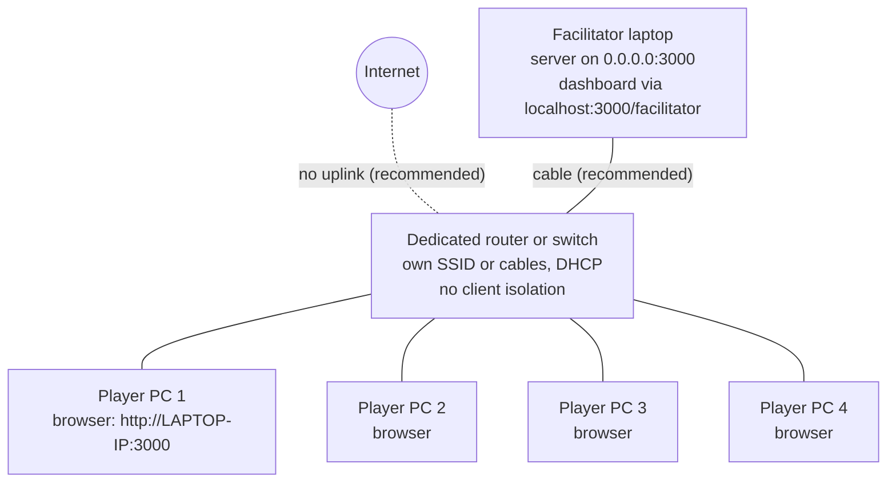
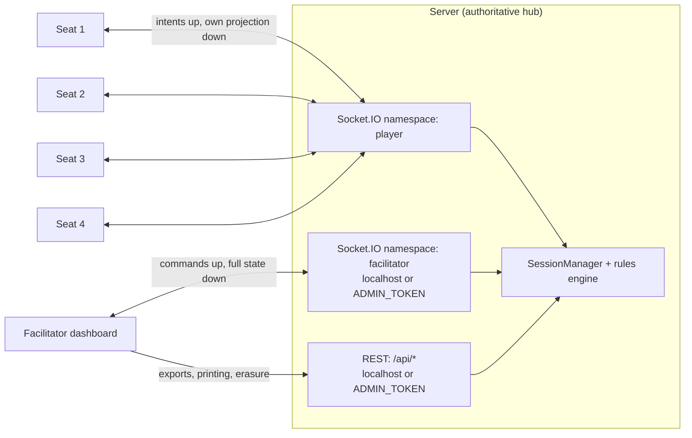
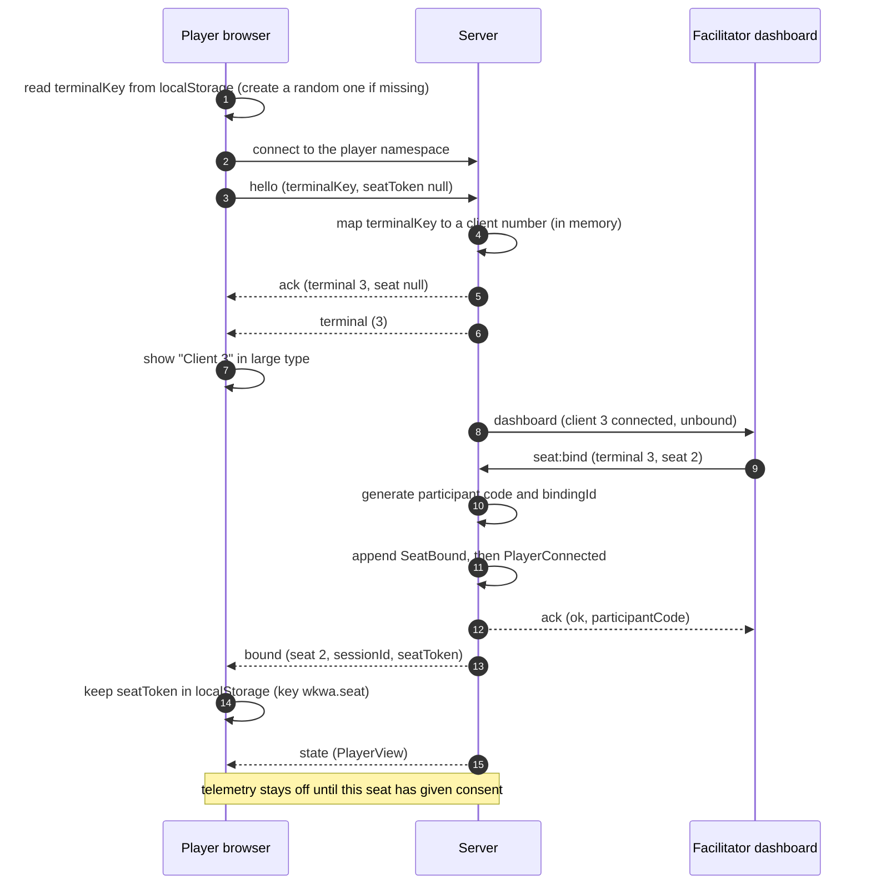
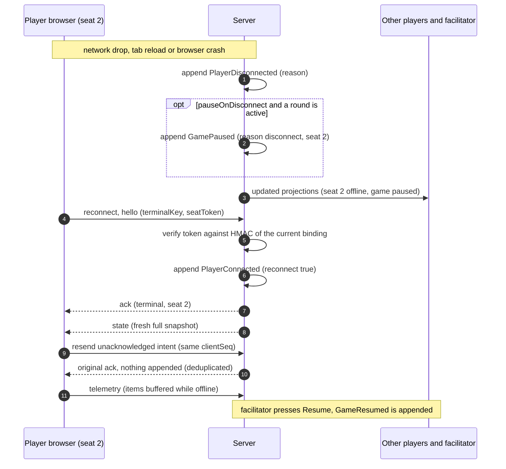
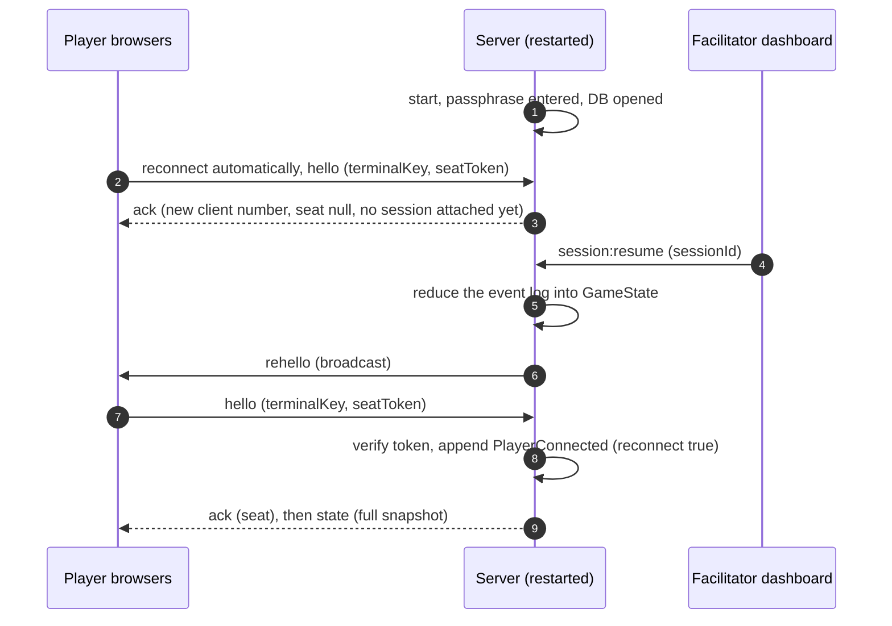
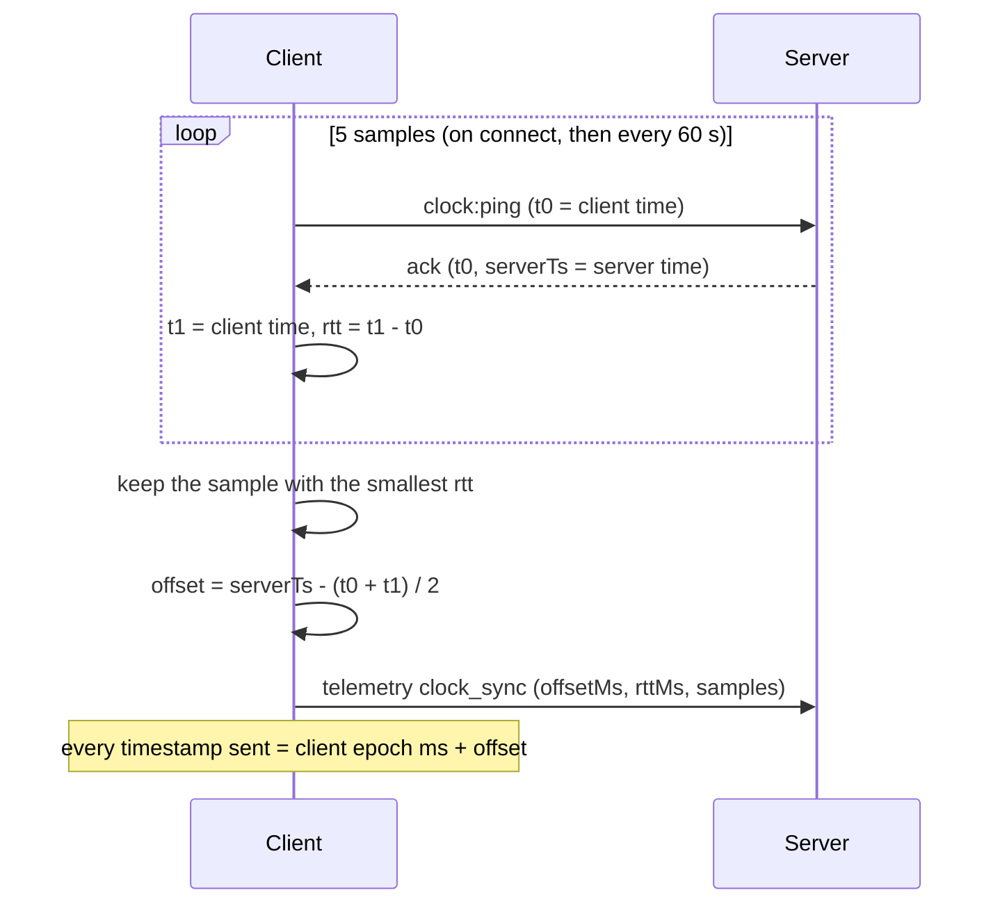

# Networking

This document covers how the harness uses the network: the physical setup on session day, the logical hub-and-spoke design, how browsers are identified and reconnect, how clocks are synchronised, every message that crosses the wire, and how the LAN is secured.

Related documents: [ARCHITECTURE.md](ARCHITECTURE.md), [DATA-MANAGEMENT.md](DATA-MANAGEMENT.md), [DATA-TYPES.md](DATA-TYPES.md).

## Contents

1. [Overview](#1-overview)
2. [Physical topology](#2-physical-topology)
3. [Logical topology: hub and spoke](#3-logical-topology-hub-and-spoke)
4. [Ports, interfaces and configuration](#4-ports-interfaces-and-configuration)
5. [Connecting and binding a seat](#5-connecting-and-binding-a-seat)
6. [Browser identity: terminal key and seat token](#6-browser-identity-terminal-key-and-seat-token)
7. [Disconnects and reconnects](#7-disconnects-and-reconnects)
8. [Clock synchronisation](#8-clock-synchronisation)
9. [Message catalogue](#9-message-catalogue)
10. [REST API](#10-rest-api)
11. [Security on the LAN](#11-security-on-the-lan)
12. [Session-day network checklist](#12-session-day-network-checklist)
13. [Troubleshooting](#13-troubleshooting)

---

## 1. Overview

- **One server, five browsers.** The facilitator laptop runs a single Node.js process. It serves the web pages, the WebSocket endpoints and the REST API on one port (default `3000`). Four player PCs and the facilitator open it in a browser. Nothing is installed on the player PCs.
- **Hub and spoke.** Players never talk to each other directly. Every message goes to the server, which validates it, records it and sends each recipient **its own projection** of the state.
- **Low data rate.** The game is turn-based. A full player state is a few tens of kilobytes and is re-sent on every change. That is simpler and more robust than sending deltas, and amounts to well under 1 Mbit/s in total.
- **Offline by design.** All assets are bundled with the app (no CDNs, no web fonts, no analytics), so the LAN does not need an internet connection, and it is recommended not to have one.
- **Transport:** Socket.IO 4 (WebSocket, with HTTP long-polling as automatic fallback) on Fastify 5.

## 2. Physical topology



Recommendations:

| Item | Recommendation | Why |
| --- | --- | --- |
| Network | A **dedicated** small router or switch that you control | Venue and university Wi-Fi (e.g. eduroam) often isolates clients, so the PCs cannot reach the laptop. It also keeps research traffic off shared networks. |
| Uplink | None (unplug the WAN port) | Nothing in the harness needs the internet; this removes a whole class of risk. |
| Laptop connection | Ethernet cable | Stable, and keeps the laptop's IP address predictable. |
| Laptop IP | Fixed or DHCP-reserved (e.g. `192.168.1.10`) | Player PCs can bookmark the URL. |
| Player PCs | Any modern browser (Chromium/Firefox/Edge), full-screen (F11), notifications off | Fewer distractions; focus and visibility telemetry stays meaningful. |

## 3. Logical topology: hub and spoke



There is **no player-to-player channel**. Even the "highlight for all players" effect of a proposal works this way: the server records the event, then pushes each player an updated projection that contains the highlight.

| Namespace | Clients | Receives | May send |
| --- | --- | --- | --- |
| `/player` | the 4 player browsers (and unbound clients) | own `PlayerView` only | `hello`, `clock:ping`, onboarding submissions, `intent`, `telemetry`, `presence` |
| `/facilitator` | the dashboard | full `GameState` of all seats (incl. participant codes), all views, live telemetry | session and seat commands, round control, revoke, broadcast, notes |

## 4. Ports, interfaces and configuration

The server binds to `HOST:PORT` (default `0.0.0.0:3000`, i.e. all interfaces). On start it prints the URLs of all non-internal IPv4 interfaces, e.g. `Players: http://192.168.1.10:3000`.

| Variable | Default | Purpose |
| --- | --- | --- |
| `PORT` | `3000` | TCP port for HTTP and WebSocket |
| `HOST` | `0.0.0.0` | Interface to bind. Set it to the LAN address to avoid exposing other interfaces. |
| `WKWA_DATA_DIR` | `./data` | Encrypted database (`wkwa.db`) and logs (`logs/server.log`) |
| `WKWA_EXPORTS_DIR` | `./exports` | Export output folder |
| `WKWA_DB_PASSPHRASE` | — | **Development and tests only.** On session day, type the passphrase at the hidden prompt instead. |
| `ADMIN_TOKEN` | — | Enables remote facilitator access with a bearer token (otherwise the facilitator is localhost-only) |
| `TLS_CERT`, `TLS_KEY` | — | Paths to a certificate and key; when both are set the server speaks HTTPS/WSS |

| URL | Who |
| --- | --- |
| `http://LAPTOP-IP:3000/` | Player PCs |
| `http://localhost:3000/facilitator` | Facilitator, on the laptop itself |
| `http://localhost:3000/api/…` | Dashboard / scripts (see [§ 10](#10-rest-api)) |

## 5. Connecting and binding a seat



The facilitator matches the **Client N** shown on each physical screen to a seat on the dashboard. Binding generates the participant code; it is shown to the facilitator immediately (for the key sheet) and to the player only on the end screen.

## 6. Browser identity: terminal key and seat token

| Value | Created by | Stored in | Lifetime | Contains personal data? |
| --- | --- | --- | --- | --- |
| `terminalKey` (32 hex chars) | browser, random | `localStorage` of that PC's browser | until browser data is cleared | No. It identifies the *PC/browser*, never logged with game data. |
| Client number (`terminal`) | server | server memory only | while the server runs (numbers may change after a restart) | No |
| `seatToken` | server: `HMAC-SHA256(server_secret, "sessionId:seat:bindingId")` | `localStorage` key `wkwa.seat` (survives reloads and closed tabs) | while the binding exists | No. It is a capability, not an identifier. |
| `server_secret` | server, random at DB creation | `meta` table of the encrypted DB | lifetime of the DB | No |

The seat token is **derived, not stored**, so it stays valid across a server restart (same DB, same secret). Re-binding a seat creates a new `bindingId`, which invalidates the old token immediately.

**Seat re-claim is token-only.** Client numbers only help the facilitator match screens to seats in the lobby. They are kept in server memory and can differ after a restart, so a browser gets its seat back solely by presenting a valid seat token.

## 7. Disconnects and reconnects



- Socket.IO reconnects automatically with back-off. The player sees a "Reconnecting…" overlay.
- Telemetry produced while offline is buffered in the browser and sent after reconnecting. Its `clientTs` keeps the original timing.
- A reload, or even closing and reopening the tab, keeps the seat, because the token is in `localStorage` (`wkwa.seat`). Clearing the browser's site data, or using a different browser profile, loses it.

### After a server restart

The game state is rebuilt from the event log, so a restart loses nothing that was acknowledged. When the facilitator re-attaches the session (*Resume* on the dashboard), the server broadcasts `rehello` to every player browser. Each one re-sends `hello` with its stored seat token and gets its seat back:


- The game never resumes automatically. The facilitator decides when to press *Resume*, and the pause duration is logged.

## 8. Clock synchronisation

Player PCs' clocks are not trusted. Each client estimates the offset between its clock and the server clock, NTP-style:



$$\text{offset} = t_{server} - \frac{t_0 + t_1}{2}, \qquad \text{error} \le \frac{\text{rtt}}{2}$$

On a wired LAN the RTT is typically 1–5 ms, so corrected client timestamps are accurate to a few milliseconds. The offset used is stored with every telemetry row (`client_offset_ms`), and each re-sync is logged as `clock_sync`, so corrections can be audited or redone later.

## 9. Message catalogue

Every client→server payload is validated with the zod schema listed here. Invalid messages are dropped with an error acknowledgement, and no client input is trusted. The tables are generated from `packages/shared/src/protocol.ts`. `Ack` means `{ ok: true, data? } | { ok: false, error }`.

<!-- BEGIN GENERATED: message-catalogue -->
<!-- Generated by `npm run docs:generate` from packages/shared — do not edit by hand. -->

#### `/player` — client→server

| Message | Payload | Ack (callback) | Logged as | Description |
| --- | --- | --- | --- | --- |
| `hello` | `{ terminalKey: string (pattern), seatToken: string \| null }` | `{ terminal: number, seat: number \| null }` | PlayerConnected (only if the seat token is valid) | First message after connecting. Identifies the browser (client) and, if present, re-claims a seat. |
| `clock:ping` | `{ t0: number }` | `{ t0: number, serverTs: number }` | Result stored by the client as telemetry 'clock_sync' | Clock synchronisation sample (NTP-style). Sent 5× on connect and every 60 s. |
| `consent:submit` | `{ formVersion: string, textSha256: string (pattern), answers: map<string, boolean>, durationMs: number 0–86400000, clientTs: number }` | `Ack` | ConsentRecorded | Answers of the consent form. |
| `demographics:submit` | `{ formVersion: string, answers: map<string, string (≤ 64 chars)>, durationMs: number 0–86400000, clientTs: number }` | `Ack` | DemographicsSubmitted | Answers of the demographics questionnaire. |
| `briefing:ack` | `{ textSha256: string (pattern), durationMs: number 0–86400000, clientTs: number }` | `Ack` | BriefingAcknowledged | Player confirms having read the briefing. |
| `intent` | `{ clientSeq: integer ≥ 1, kind: "propose" \| "decide", regionId: string (≤ 64 chars), clientTs: number }` | `{ ok: true, seq } \| { ok: false, reason, detail }` | ProposalMade / DecisionMade, or IntentRejected | Request to propose or decide a region. Validated by the rules engine. |
| `telemetry` | `{ clockOffsetMs: number, items: array<TelemetryItem> }` | `{ stored: number }` | telemetry table (one row per valid item) | Batch of UI telemetry items (every 2 s or 20 items). |
| `presence` | `{ regionId: string (≤ 64 chars) \| null }` | — (no ack) | Not stored (ephemeral). The persisted record is telemetry 'region_hover'. | Volatile 'currently hovering' signal for the facilitator's live mirrors. |

#### `/player` — server→client

| Message | Payload | Logged as | Description |
| --- | --- | --- | --- |
| `terminal` | `{ terminal: number }` | — | Client number assigned to this browser (shown in large type while unassigned). |
| `bound` | `{ seat: number, sessionId: string, seatToken: string }` | — (SeatBound is logged when the facilitator binds) | This browser was bound to a seat; carries the reconnect token. |
| `unbound` | `{ reason: string }` | — | The seat binding was removed (or the session ended); return to the waiting screen. |
| `rehello` | `{}` | — | A session was (re)attached on the server; the client re-sends `hello` with its stored seat token so its seat is re-claimed. |
| `state` | `PlayerView` | Client acknowledges with telemetry 'state_received' | Full projected state for this player (PlayerView): phase, round, own labels and quotas, map geometry, OWN view content only, highlights. |

#### `/facilitator` — client→server

| Message | Payload | Ack (callback) | Logged as | Description |
| --- | --- | --- | --- | --- |
| `session:create` | `{ scenarioId: string, config: SessionConfig, notes?: string (≤ 1000 chars) }` | `Ack<{ sessionId }>` | SessionCreated | Create a new session from a scenario and config. |
| `session:resume` | `{ sessionId: string }` | `Ack` | — | Re-open an unfinished session (e.g. after a server restart). |
| `seat:bind` | `{ terminal: integer ≥ 1, seat: integer 1–4 }` | `Ack<{ participantCode }>` | SeatBound, PlayerConnected | Bind a connected client to a seat; generates the participant code. |
| `seat:unbind` | `{ seat: integer 1–4, reason?: string (≤ 200 chars) }` | `Ack` | SeatUnbound | Remove a seat binding (lobby only). |
| `labels:set` | `{ assignments: array<{ seat: integer 1–4, k: "Ka" \| "Kb" \| "Kc" \| "Kd", view?: string }>, pairing?: { mode: "aligned" \| "dissociated", id: integer 1–6 \| null } }` | `Ack` | LabelsAssigned (method = manual) | Set the K label of every seat (and view when viewAssignment = manual) plus the K–P pairing (aligned or dissociated D1–D6); the server derives each P. |
| `labels:randomise` | `{ pairing?: { mode: "aligned" \| "dissociated", id: integer 1–6 \| null }, shuffleK?: boolean }` | `Ack` | LabelsAssigned (method = random, with seed) | Shuffle which seat gets which K (optional) and apply a pairing; dissociated without a number picks D1–D6 at random. |
| `onboarding:start` | `{}` | `Ack` | OnboardingStarted | Lock seats and send players to consent / demographics / briefing. |
| `round:start` | `{}` | `Ack` | RoundStarted | Start the next round. |
| `round:end` | `{}` | `Ack` | RoundCompleted (reason = facilitator) [+ GameCompleted after the last round] | Force-end the current round. |
| `game:pause` | `{}` | `Ack` | GamePaused | Pause the active round. |
| `game:resume` | `{}` | `Ack` | GameResumed | Resume after a pause. |
| `action:revoke` | `{ seq: integer ≥ 1, reason?: string (≤ 200 chars) }` | `Ack` | ActionRevoked | Undo a proposal/decision of the current round. |
| `broadcast` | `{ text: string (≤ 300 chars) }` | `Ack` | FacilitatorBroadcast | Show a message on every player's screen. |
| `note` | `{ text: string (≤ 500 chars) }` | `Ack` | SessionNote | Add a facilitator annotation to the log. |
| `participant:withdraw` | `{ seat: integer 1–4 }` | `Ack` | ParticipantWithdrawn | Mark a participant as withdrawn during the session. |
| `game:end` | `{}` | `Ack` | [RoundCompleted] + GameCompleted (reason = facilitator) | End the game early. |
| `session:close` | `{}` | `Ack` | SessionClosed | Archive the session; players return to the waiting screen. |
| `session:abort` | `{ reason?: string (≤ 200 chars) }` | `Ack` | SessionAborted | Abandon the session (data kept, marked aborted). |

#### `/facilitator` — server→client

| Message | Payload | Logged as | Description |
| --- | --- | --- | --- |
| `dashboard` | `DashboardMsg` | — | Full session state (all seats incl. participant codes), connected clients and live per-seat statistics. |
| `scenario` | `Scenario \| null` | — | The loaded scenario with ALL views (for the composite map). Sent when a session is loaded. |
| `events` | `{ events: StoredEvent[], reset: boolean }` | — | New events for the live log (demographic answers redacted). The backlog is sent on connect. |
| `telemetry:live` | `{ items: StoredTelemetry[] }` | — | Newly stored telemetry rows (chatty types such as state_received are omitted). |
| `presence:live` | `{ seat: number, regionId: string \| null }` | — | Relayed hover presence of a seat for the live mirrors. |

<!-- END GENERATED: message-catalogue -->

Server→client payload types are TypeScript interfaces in `packages/shared/src/projections.ts` (`PlayerView`) and `protocol.ts` (`DashboardMsg`, `TerminalInfo`, `SeatLiveStats`). Stored event and telemetry rows are described in [DATA-TYPES.md](DATA-TYPES.md).

## 10. REST API

Used by the dashboard's data pages and by scripts. **Localhost-only** unless `ADMIN_TOKEN` is set; then send `Authorization: Bearer <token>`.

| Method | Path | Purpose |
| --- | --- | --- |
| `GET` | `/api/health` | Liveness check (no data) |
| `GET` | `/api/scenarios` | Available scenarios |
| `GET` | `/api/scenarios/:id` | Full scenario (outline + all views) for the setup preview |
| `GET` | `/api/server-info` | Player URLs on this machine's LAN interfaces (setup step "Connect & bind") |
| `GET` | `/api/config/session-defaults` | Default session configuration for the setup form (`config/session.default.json`, validated) |
| `GET` | `/api/sessions` | All sessions with status |
| `GET` | `/api/sessions/:id` | One session (metadata + reduced state) |
| `GET` | `/api/sessions/:id/events` | Full event log (for replay); demographic answers redacted |
| `GET` | `/api/sessions/:id/telemetry` | Telemetry rows of the session (`?afterId=&limit=` for paging) |
| `GET` | `/api/sessions/:id/scenario` | Scenario of the session (all views) + whether its files still match the recorded hash (replay) |
| `POST` | `/api/sessions/:id/export` | Write a standard (pseudonymised) export to `exports/` |
| `POST` | `/api/sessions/:id/anonymise` | Write an anonymised export to `exports/` |
| `GET` | `/api/sessions/:id/print/keysheet` | Printable key sheet (seat → code, blank name column) |
| `GET` | `/api/sessions/:id/print/cards` | Printable takedown cards (one per seat) |
| `GET` | `/api/participants/:code` | Look up a participant code (typos tolerated): sessions and row counts, exports containing it, earlier erasures |
| `POST` | `/api/participants/:code/erase` | Erase all data of a code. Body `{ "confirm": "<code>", "note"?: "…" }` must repeat the code. Refused (409) while the participant is in a session that is still running. |
| `GET` | `/api/erasures` | Erasure register |
| `GET` | `/api/exports` | Export register |

## 11. Security on the LAN

| Threat | Control |
| --- | --- |
| A player opens the facilitator dashboard or the API from their PC | `/facilitator` page, `/facilitator` namespace and `/api/*` accept only loopback connections (`127.0.0.1`, `::1`) unless `ADMIN_TOKEN` is set. The remote address is used **only** for this check; it is never logged or stored. |
| Remote facilitator access needed (e.g. a second laptop) | Set a long random `ADMIN_TOKEN`. The dashboard sends it as a bearer header and in the socket `auth` payload. Do not put it in URLs (URLs can end up in logs and browser history). |
| A player reads other players' data via browser devtools | Not possible: the server never sends another view's content to a player (see [ARCHITECTURE.md § 8](ARCHITECTURE.md#8-projections-who-sees-what)). |
| A player forges messages (e.g. acting for another seat) | The seat comes from the server-side socket binding, never from the payload. Every payload is schema-validated, and rules are enforced on the server. |
| Eavesdropping on the LAN | Without TLS, traffic (game actions, consent and demographic answers, all pseudonymised) crosses the LAN **in plaintext**. Mitigate with a dedicated network you control, and/or enable TLS. |
| Rogue devices on the network | Use WPA2/3 with a password only you know, or wired connections; switch off the router's WAN. |

**Enabling TLS (optional).** Create a locally trusted certificate with [mkcert](https://github.com/FiloSottile/mkcert):

```bash
mkcert -install                                   # once, on the laptop
mkcert -cert-file data/tls.pem -key-file data/tls-key.pem 192.168.1.10 localhost
TLS_CERT=data/tls.pem TLS_KEY=data/tls-key.pem npm start
```

The player PCs must trust the mkcert root CA (`mkcert -CAROOT` shows where it is; import it into each browser or OS), or they will show a certificate warning. For a closed LAN with your own router, plain HTTP is usually an acceptable residual risk. Record the choice in your data management plan.

**Firewall.** The laptop must accept incoming TCP connections on `PORT`:

| OS | Command / action |
| --- | --- |
| Linux (ufw) | `sudo ufw allow 3000/tcp` |
| Linux (firewalld) | `sudo firewall-cmd --add-port=3000/tcp` |
| Windows | Allow Node.js on *private* networks when prompted, or add an inbound rule for TCP 3000 |
| macOS | System Settings → Network → Firewall → allow incoming connections for `node` |

## 12. Session-day network checklist

- [ ] Router powered on, WAN unplugged, SSID/password known only to the research team
- [ ] Laptop connected (cable) and has its expected IP (`ip addr` / `ipconfig`)
- [ ] Firewall allows TCP `3000`
- [ ] `npm start` → passphrase entered → server prints the player URL
- [ ] Facilitator dashboard opens at `http://localhost:3000/facilitator`
- [ ] Each player PC opens the player URL and shows **Client N**, and all 4 clients appear on the dashboard
- [ ] Optional: run `npm run bots -- --count 4` *before* participants arrive, for a full rehearsal on the real network
- [ ] Player browsers in full-screen, notifications and screen savers off, power-saving sleep disabled

## 13. Troubleshooting

| Symptom | Likely cause | Fix |
| --- | --- | --- |
| Player PC: "This site can't be reached" | Wrong IP, firewall, or the server is bound to another interface | Check the URL printed by the server; open the firewall port; set `HOST=0.0.0.0` |
| Works on the laptop, not on PCs | Wi-Fi client isolation (common on venue/guest networks) | Use your own router; disable "AP/client isolation" |
| Client never appears on the dashboard | Page loaded from a cached or old URL; JavaScript blocked | Hard-reload (Ctrl+Shift+R); check the browser console |
| Two PCs show the same client number | Same browser profile synced or copied (identical `localStorage`) | Clear site data on one PC and reload |
| Repeated "Reconnecting…" | Wi-Fi power saving, weak signal | Use cables; disable power saving on the network adapter |
| Large `rttMs` / clock offset jumps on the dashboard | Congested Wi-Fi, PC under load | Move closer to the router or use cables; close other apps |
| Facilitator page says "forbidden" | Opened from another machine without `ADMIN_TOKEN` | Open it on the laptop via `localhost`, or set `ADMIN_TOKEN` |
| Certificate warning on player PCs | TLS enabled, but the mkcert CA is not trusted on that PC | Import the root CA, or disable TLS on a closed LAN |
