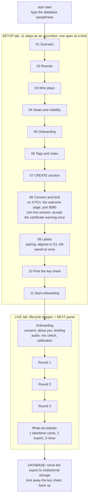
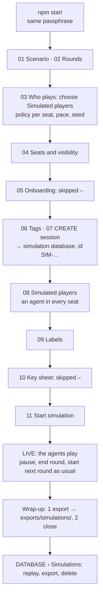
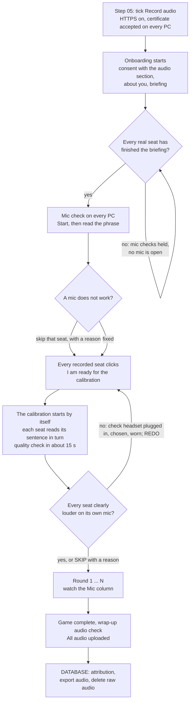

# Session runbook

*Change log: [SESSION-RUNBOOK-CHANGELOG.md](changelog/SESSION-RUNBOOK-CHANGELOG.md)*

Step by step for running a *Who Knows, Who Acts?* session: one facilitator laptop as the server and four player PCs on the same local network. It covers preparation, the session itself, wrap-up, and what to do when something goes wrong.

Background: [ARCHITECTURE.md](ARCHITECTURE.md) (how it works) · [NETWORKING.md](NETWORKING.md) (network set-up and troubleshooting) · [DATA-MANAGEMENT.md](DATA-MANAGEMENT.md) (GDPR and takedown) · [DATA-TYPES.md](DATA-TYPES.md) (what is logged) · [AUDIO.md](AUDIO.md) (how microphone recording works) · [AESTHETIC-RULES.md](AESTHETIC-RULES.md) (UI conventions and keyboard shortcuts).

## Contents

1. [Overview](#1-overview)
2. [Once, before the study](#2-once-before-the-study)
3. [The day before a session](#3-the-day-before-a-session)
4. [Session day](#4-session-day)
5. [After the session](#5-after-the-session)
6. [When something goes wrong](#6-when-something-goes-wrong)
7. [Printable checklist](#7-printable-checklist)
8. [Simulated sessions](#8-simulated-sessions)
9. [Testing without people: fake players](#9-testing-without-people-fake-players)
10. [HTTPS and the certificate warning](#10-https-and-the-certificate-warning)
11. [Sessions with audio](#11-sessions-with-audio)

## 1. Overview

The facilitator manager has three tabs, in order of use:

| Tab | What it is for |
| --- | --- |
| **[1] SETUP / LIVE** | One tab with two faces. **SETUP** walks you through eleven steps, stacked as collapsible panels (an accordion): the current step is open, finished steps collapse into a one-line summary. After *Start onboarding* the tab flips to **LIVE**, and a green **● LIVE** indicator appears in the top bar; click it to come back from any tab. |
| **[2] REPLAY** | Watch any recorded session again. Play shows every propose/decide action for 1 s and pauses at the end of each round (about 2 minutes for a default session of 3 × 4 × 10 actions); the slider and ⏮/⏭ move event by event or action by action. |
| **[3] DATABASE** | Sessions (resume, replay, export, key sheet, takedown-card PDFs, **delete**), exports, takedown/erasure, erasure and deletion registers. A switch at the top picks **Participants** (`data/wkwa.db`) or **Simulations** (`data/wkwa-sim.db`). Hover any button to see what it does. |

**Wayfinding.** In SETUP, a blue bar pinned to the top of the page shows the current step (`▶ STEP 04/11 · SEATS & VISIBILITY`), the hint "01–07 configure · 08–11 prepare the room" and a strip of all eleven steps, even when you scroll; click a finished step to reopen it. Each step's header shows `✓` done · `▶` current · `·` upcoming · `■` locked · `–` skipped (simulated sessions) plus a one-line summary of that step; the two commit points, create session (07) and start onboarding (11), are coloured lavender. Wrap-up popups show `STEP nn/NN`. In LIVE, the **NEXT** panel always shows the single next action, and `N` does it.

**Keyboard.** `1` `2` `3` switch tabs, `N` next action, `P` pause/resume, `D` display settings, `T` colours (Latte → Mocha → High contrast), `F` font (JetBrains Mono → OpenDyslexic → System font), `S` text size (Small ↔ Large), `A` animations on/off, `?` help. In a setup step `Enter` moves to the next step; in popups `Enter` is the primary action and `Esc` closes. The setup draft is kept in your browser.

Approximate timing: 30 min setup, about 10 min onboarding, the rounds, 10 min wrap-up.

## 2. Once, before the study

- [ ] **Ethics approval** obtained, with the approved texts in place:
  - `config/consent.md` (information letter) and `config/consent.json` (checkbox statements). **Bump `version`** whenever the text changes. Each `## ` section of `consent.md` becomes one fold-out sub-section of the consent screen, and needs **exactly one** statement in `consent.json` whose `"section"` is that heading. Creating a session checks this: a section without exactly one statement, or a statement without a section, is an error.
  - `config/demographics.json` (questions; every question offers `prefer_not_to_say`)
  - `config/briefing.md` (game instructions)
  - `config/study.json`: title, researcher, contact e-mail, retention statement and takedown text. These are shown on the consent screen, the end screen and the takedown cards.
- [ ] **Scenario** ready in `scenarios/<id>/`: `scenario.json` (board size and one view per K label `Ka`–`Kd`) and `scores.json` (the starting score of every sub-square, 0–10). The demos are `demo` (10 × 10 squares) and `demo-small` (5 × 5). Setup step 01 shows a preview of the starting scores, and lists errors under the scenario. Format: [GAME-RULES.md § 11](GAME-RULES.md#11-starting-scores-and-scenarios).
- [ ] **Audio texts, if you record audio** (see [§ 11](#11-sessions-with-audio)): the audio section of `config/consent.md` and its required audio item in `config/consent.json` (`"section": "Audio recording"`) approved by your ethics committee, and the mic-check phrase and calibration sentences in `config/audio.json`. The retention and withdrawal wording is still a `[placeholder]` until decided.
- [ ] **Default session settings** in `config/session.default.json`: rounds, quotas, visibility, onboarding, `audio` (off by default). They pre-fill the setup wizard and can be changed per session.
- [ ] **Software installed** on the facilitator laptop: `npm install && npm run build`. Run `npm test` once; it should be all green.
- [ ] **Database passphrase chosen**, at least 5 random words. Store it in a password manager and/or a sealed envelope held by your supervisor. A lost passphrase means lost data: there is no recovery.
- [ ] **Dry run** with bots: `npm start`, then `npm run bots -- --count 3` in a second terminal (for an audio session add `--audio`, which makes the bots pass the mic check and upload synthetic audio; start the server with `WKWA_SPEECH_MODEL=off npm start` then, because the speech model finds no speech in the bots' synthetic sound). Play the fourth seat yourself on another device. Tag practice sessions `pilot` (step 06), or use a separate data directory (`WKWA_DATA_DIR=data-pilot npm start`).
- [ ] **Network** planned: ideally a dedicated router/switch without internet, with Wi-Fi "client isolation" off, and a **fixed (DHCP-reserved) IP address** for the laptop, so its certificate stays the same from session to session. See [NETWORKING.md](NETWORKING.md).
- [ ] **HTTPS tried out:** `npm start` makes the laptop's self-signed certificate. Open `https://localhost:3000/facilitator`, accept the warning ([§ 10](#10-https-and-the-certificate-warning)) and create a test session (tag it `pilot`). Then, on a second computer, open the welcome page (`http://<laptop-ip>:8080/`), click **Join live session** and accept the warning there too, in each browser you expect participants to bring (Chrome, Edge, Firefox, Safari). **Discard session** afterwards.
- [ ] **Printer** reachable from the laptop. The key sheet and the takedown cards (one PDF per participant) are printed per session from the manager.

## 3. The day before a session

- [ ] Laptop charged, OS updates done (so nothing restarts during the session), sleep disabled.
- [ ] Router/switch and cables tested; a test computer on the session network can open the welcome page `http://<laptop-ip>:8080/` and the game page `https://<laptop-ip>:3000/` (after accepting the certificate warning, [§ 10](#10-https-and-the-certificate-warning)).
- [ ] Firewall on the laptop allows incoming TCP 3000 (game) and TCP 8080 (welcome page) (see NETWORKING.md § troubleshooting).
- [ ] Encrypted backup of the database: `npm run cli -- backup --out /path/to/backup/wkwa-YYYYMMDD.db` (this copies the audio folder to `<out>.audio/` as well).
- [ ] **Audio sessions:** free disk space on the laptop (about 0.5 GB per hour of session for four seats, twice that with cleaned tracks; `[placeholder: minimum free space]`), **one wired single-ear USB headset per player** plus a spare, with a USB-C plug or adapter for tablets and phones (no Bluetooth headsets), and a room that can be closed ([§ 11](#11-sessions-with-audio)).

## 4. Session day

### 4.1 Start the server (about 30 minutes before)

1. Connect the laptop and the player PCs to the session network.
2. On the laptop, run `npm start` and type the database passphrase. The terminal prints the **welcome page** URL(s) first (`http://<laptop-ip>:8080/`, the address participants open), then the **game page** URL(s) it links to (`https://<laptop-ip>:3000/`), the **manager** URL (`https://localhost:3000/facilitator`; open it on the laptop) and the certificate's **SHA-256 fingerprint**. It also says whether it is *reusing* the certificate (browsers that accepted it before are not warned again) or made a new one (everyone accepts the warning once more; [§ 10](#10-https-and-the-certificate-warning)).
3. The browser warns about the certificate the first time; accept it ([§ 10](#10-https-and-the-certificate-warning)). The manager opens on **SETUP** with step **01 SCENARIO** expanded.
4. Optional: open the welcome page on each player PC now. It says the session has not started yet, and shows **Join live session** by itself once you create the session (step 07).

> If the server was restarted mid-session, the most recent unfinished session is resumed automatically, browsers re-claim their seats on their own, and the tab shows LIVE again.

### 4.2 SETUP steps 01–07: configure

| Step | What to check |
| --- | --- |
| **01 Scenario** | The map (board size) and its starting scores. Use the preview's knowledge-type selector to check each type's scores; **Start** is the map score before any action. **Game rules** names the rule set ([GAME-RULES.md](GAME-RULES.md)); it can only be changed when more than one exists. |
| **02 Rounds** | Number of rounds, rule (quotas or facilitator-ended), quotas per player, optional time limit, how the next round starts, per-round overrides. |
| **03 Who plays** | *Real participants* (the normal case) or *Simulated players* (agents). For simulated players this step also holds the agents' policy, pace and seed; see [§ 8](#8-simulated-sessions). |
| **04 Seats & visibility** | The number of seats, how map views are assigned (*follows the K label*, or *chosen per seat* in step 09) and what players see about each other. Display settings (colours, font, text size, animations) are **not** set here: each participant chooses them with the **DISPLAY** button on their screen, and they are not recorded. |
| **05 Onboarding** | Consent, demographics, briefing. Turning consent off asks for confirmation: only for tests without participants. **Record audio** (needs consent, and turns itself off with it) adds the audio section to the consent form and the **Mic check & calibration** step after the briefing. It warns when the server runs plain HTTP, because browsers then block the microphone. See [§ 11](#11-sessions-with-audio). |
| **06 Tags & notes** | Comma-separated **tags** (e.g. `pilot, condition-A`). They label the session in DATABASE and the exports. **Never use names.** |
| **07 Create session** | Check the one-line summaries of the collapsed steps above (click a step to change it). **CREATE SESSION** writes the settings into `SessionCreated`; steps 01–07 are then locked (■). An error in the settings (for example in the consent texts) shows here instead. |

The draft is kept in your browser until you create the session, so a reload loses nothing.

### 4.3 SETUP steps 08–11: prepare the room (about 15 minutes before)

| Step | What to do |
| --- | --- |
| **08 Connect & bind** | On each PC, open the **welcome page** `http://<laptop-ip>:8080/` (the step lists the addresses) in full-screen (F11) and click **Join live session**. It leads to the game page `https://<laptop-ip>:3000/` (also listed). The browser shows a **certificate warning** there once; the welcome page has already told the participant what to click, so just help if needed ([§ 10](#10-https-and-the-certificate-warning)). The step shows the certificate fingerprint to compare. Each screen then shows **CLIENT N**. Bind each client to a seat. The step is done when it shows `[4/4 seats bound]`. For a test without people, click **Fake player** next to a seat instead ([§ 9](#9-testing-without-people-fake-players)). |
| **09 Labels** | Each seat keeps its **K**: seat 1 holds Ka, seat 2 Kb, and so on. You only choose the **K–P pairing**: *Aligned* (Ka–Pa, Kb–Pb …) or *Dissociated*, one of the six fully dissociative pairings D1–D6 (no seat holds the same letter, no two seats mirror each other). Choosing *Dissociated* draws one of D1–D6 at random (seed logged); a dropdown then lets you pick a specific one. Every choice is **saved at once** (`LabelsAssigned`): there is no save button. The K×P matrix shows the result, with the seat (seat dot and **SEAT n**) and its map view on each K row; when views are chosen per seat, pick each seat's view in its row (the labels are saved once every seat has one). **P is derived from the pairing**, never chosen per seat. The pairing number is stored with the labels and in the exports; see [DATA-TYPES.md § Label pairings](DATA-TYPES.md#label-pairings). With view assignment "follows K", the K label also selects which scores the seat sees. The P label decides which sub-square the seat acts on (Pa → Ka …; [GAME-RULES.md § 3](GAME-RULES.md#3-what-a-player-can-act-on)). |
| **10 Key sheet** | *Print key sheet*, then tick "printed and stored separately". Write names on it **by hand** as participants arrive; names never go into the software. |
| **11 Start onboarding** | A final checklist. **Seat the participants first**, then *START ONBOARDING*. Seats lock, players go to consent → about you → briefing (→ mic check & calibration in audio sessions), and the tab flips to **LIVE**. |

Reopen a finished step by clicking its header (steps 01–07 are locked once the session exists). `N` jumps back to the current step. To throw a lobby session away and start over, use **Discard session**.

### 4.4 LIVE: onboarding and rounds

**What players see in onboarding.** The **consent** screen shows the study and contact details, then the information letter as fold-out sections, one at a time, each confirmed by one statement. Ticking a section's box confirms it, folds it up and opens the next; a participant can reopen any section. The optional section (*Future research*) also has **Continue without**. **I agree — continue** only becomes available once every section has been gone through and every required box is ticked. Then come **about you** (the questionnaire), the **briefing** and, in audio sessions, **mic check & calibration** ([§ 11.2](#112-onboarding-mic-check-hold-mic-check-calibration)).

The top of LIVE shows the **lifecycle**: `ONBOARDING ─ ROUND 1 ─ ROUND 2 ─ ROUND 3 ─ WRAP-UP`. Below it, **NEXT** always says what happens next:

| NEXT says | Do |
| --- | --- |
| "Waiting for onboarding: seat 2 (consent), …" | Wait. The Seats panel shows each seat's onboarding step. |
| "Seat 3 declined consent" | **Withdraw** that seat (Seats panel) to continue with fewer players, or abort and set up again. In an audio session the mic checks stay on hold until you do. |
| "Waiting for the mic check of seat 3", or a hint that the mic checks are held | Audio sessions: nobody can start a mic check until every real seat has finished the briefing. Wait, or withdraw a decliner ([§ 11](#11-sessions-with-audio)). |
| "Waiting for seat 2 to say they are ready for the calibration", with "Ready for the calibration: seat n ✓ ready / waiting" | Audio sessions: every mic check is done, and each recorded player clicks **I'm ready for the calibration** on their screen. The calibration then **starts by itself**; there is no start button ([§ 11](#11-sessions-with-audio)). |
| "Everyone is ready" → **START ROUND 1** (`N`) | Start the round. |
| "Round 1 of 3 in progress · 14/40 actions · 4:12" | Monitor. **PAUSE** (`P`) if needed; *End round now* forces the end. |
| "Round 1 complete" → **START ROUND 2** (`N`) | Start the next round (or it starts automatically if auto-advance is on). |
| "Game complete" → **WRAP UP SESSION** (`N`) | Go to § 4.5. |

While a round runs, watch:

- **Seats**: quota bars `▰▰▱▱▱`, `[UNFOCUSED]`, `[TAB HIDDEN]`, `[IDLE]`, latency, reconnects. In audio sessions also the **Mic** column and the status bar's `mics 3/4` ([§ 11](#11-sessions-with-audio)).
- **Composite map**: every sub-square's score (or one knowledge type's, or none), the marks of all seats and the **map score**. Click a square to compare its four sub-squares: score now and at the start, which seat sees and which seat acts on each, and the actions on it.
- **Player views**: exactly what each player sees, with their live hover position.
- **Timeline**, **Event log** (filter by type or seat; click a row for the full event) and **Live telemetry**.

**Tools:**

- **Broadcast** a message to every screen.
- **Add note** for anything noteworthy. **Never type names.**
- **Pause recording** (audio sessions): stops every microphone for everyone until you resume ([§ 11](#11-sessions-with-audio)).
- **Edit labels** (only during onboarding and between rounds): the same pairing editor as step 09. Each change is saved at once; **Done** closes the popup.
- **End game early** and **Abort session**.
- **Revoke** an action from the event log or the square panel (current round only). The seat gets its quota back and the scores are put back as if the action had never happened; the original event stays in the log.

Every destructive action asks for confirmation in a popup.

### 4.5 Wrap-up (three popups)

0. **Audio check (audio sessions):** the top of every wrap-up step says *All audio uploaded*, or which seat is still uploading, which track was interrupted, or that no audio was recorded ([§ 11](#11-sessions-with-audio)). Keep those browsers open until it is clear.
1. **Takedown cards:** every player's screen shows their participant code. Download each seat's **Card PDF** (A6), print it and give it to that participant, then tick "Cards are handed out". Delete the downloaded PDFs after printing (they contain the codes).
2. **Export:** *Export session* writes the pseudonymised export; the path is shown.
3. **Close:** archives the session (the button reads *Close anyway* while uploads are still pending). The tab flips back to **SETUP** for the next session, and the finished session appears in DATABASE and REPLAY.

Debrief participants as your protocol requires.

## 5. After the session

- [ ] Move the export folder (`exports/<sessionId>/…`) to **institutional storage** and delete the local copy.
- [ ] Lock the **key sheet** away, separate from any data, with the planned destruction date written on it.
- [ ] **Decliners or withdrawn participants:** erase their data if your protocol says so. Use *DATABASE → 3 · Takedown / erasure* (look up the code, then type it again to confirm) or `npm run cli -- erase --code WK-…`.
- [ ] **Audio:** in *DATABASE → Audio* run the attribution, check it, export what you need, and delete raw audio if your retention rule says so ([§ 11](#11-sessions-with-audio)). Move any audio export to institutional storage and delete the local copy.
- [ ] **Backup:** `npm run cli -- backup --out …` to institutional storage (the audio folder is copied with it: keep both parts together).
- [ ] Stop the server with `Ctrl+C`.
- [ ] Optional: `npm run cli -- verify` (integrity check).

**Practice or failed sessions:** delete them entirely in *DATABASE → Delete* (you type the session id to confirm), optionally with their export folders.

**Takedown requests later on:** follow [DATA-MANAGEMENT.md § 10](DATA-MANAGEMENT.md#10-takedown-and-erasure-procedure).

## 6. When something goes wrong

| Situation | What happens | What to do |
| --- | --- | --- |
| A player's browser was **reloaded or closed** | The seat is kept (the browser holds a reconnect token). During a round the game auto-pauses. | Re-open the player URL on the same PC; it re-joins the same seat. Then **RESUME** (`P`). |
| A player PC **lost the network** | `PlayerDisconnected` and an auto-pause; the player sees "Connection lost" | Fix the connection; the page reconnects by itself. Then **RESUME**. |
| **Wrong client** bound (step 08) | — | **Unbind** it and bind the right one. Harmless before onboarding. |
| A participant **leaves** mid-game | — | **Withdraw** their seat (Seats panel). Rounds complete without them. |
| **Misclick** by a player | Visible to everyone | **Revoke** it (event log or square panel, current round only). |
| **Server crashed** or laptop restarted | Events up to the crash are stored | `npm start` again and type the passphrase. The session resumes, browsers re-claim their seats, and the tab shows LIVE. Then **RESUME**. A round time limit keeps counting the downtime; end the round if needed. |
| **"Wrong passphrase"** at start | The server refuses to open the database | Retype it, paying attention to keyboard layout and caps lock. |
| Welcome page or game page **does not load** | — | See [NETWORKING.md § troubleshooting](NETWORKING.md#13-troubleshooting): firewall (TCP 8080 and 3000), wrong IP, Wi-Fi client isolation, `http://` typed instead of `https://` for the game page (the welcome page is plain `http://…:8080`). Step 08 lists the URLs of every network interface. |
| Welcome page shows no **Join live session** button | No session with real participants is open yet (it appears from the lobby to the last round) | Create the session (step 07); the page checks every 2 s and shows the button by itself. A simulated session never shows it. |
| Player PC shows a **security warning** ("not private", "potential security risk") | Expected: the server's certificate is self-signed. The welcome page explains it just before | Help the participant accept it if needed: [§ 10](#10-https-and-the-certificate-warning). |
| Player PC shows **"opened in another window"** | The same seat was opened twice | Close the extra tab; the newest window holds the seat. |
| Manager says **ACCESS DENIED** | It was opened from another PC | Use `https://localhost:3000/facilitator` on the laptop, or start with `ADMIN_TOKEN=…` and open `/facilitator?token=…`. |
| Animations are distracting / slow, or text is hard to read | Display settings | Manager: `D` (or the DISPLAY segment in the status bar), or directly `A` animations, `T` colours (incl. High contrast), `F` font (incl. OpenDyslexic), `S` text size. Players: the **DISPLAY** button in the bottom-right corner of their screen has the same four settings; show the participant where it is. Anyone whose OS requests reduced motion never gets animations. |
| A **microphone fails** during the session | The seat's Mic column shows `[NO SIGNAL]`, `[MIC DENIED]` or `[MIC ERROR]`; the game goes on | Ask the participant to follow the fix steps on their screen (unmute, replug, **Try again**). If it cannot be fixed, carry on without that seat's audio and add a note. Before round 1 you can skip the seat's mic check ([§ 11](#11-sessions-with-audio)). |
| The calibration flags a seat (**low margin**, below 12 dB) | That seat's voice is nearly as loud on another microphone; usually the device records from its built-in mic, not the headset | Check that the wired USB headset is plugged in (not a Bluetooth one), chosen as the microphone if the device asked, and worn with its mic at the corner of the mouth. Then **REDO** the calibration ([§ 11](#11-sessions-with-audio)). |
| A participant **withdraws** during an audio session | Their own recording stops at once, but the other mics still hear them | Withdraw the seat, then ask them to leave the room quietly, or **Pause recording** while they leave ([§ 11](#11-sessions-with-audio)) |
| Someone **enters the room** | Every mic records them | **Pause recording**, resume when they have gone, and add a note (no names) |
| Browser says the **microphone is blocked** | Not a secure page, or permission refused | Open the `https://` URL and accept the warning ([§ 10](#10-https-and-the-certificate-warning)); then the fix steps on the player's screen |
| Everything is broken, you must stop | — | *Tools → Abort session* (with a reason). Data is kept and marked aborted; players see the end screen with their code. |

## 7. Printable checklist

**Before participants arrive**
- [ ] Network up; `npm start`; passphrase entered
- [ ] Steps 01–07 done (scenario, rounds, who plays, seats, onboarding, tags) → session created
- [ ] Audio sessions: Record audio ticked in step 05, room closed and a sign on the door, free disk space checked, a wired USB headset plugged into every player device
- [ ] Step 08: welcome page → **Join live session** on each PC, 4 clients bound (certificate warning accepted on each) · Step 09: pairing chosen · Step 10: key sheet printed

**With participants**
- [ ] Names written on the key sheet (by hand)
- [ ] Step 11: onboarding started (tab shows LIVE)
- [ ] Audio sessions: headsets on → everyone through the briefing → all mic checks done → everyone clicked *I'm ready for the calibration* → calibration done, every margin 12 dB or more (or skipped with a reason) → *mics 4/4*
- [ ] All seats ready → round 1 … round N
- [ ] Wrap-up 1: takedown cards handed out

**Wrap-up**
- [ ] Audio sessions: wrap-up audio check says *All audio uploaded*
- [ ] Wrap-up 2: export → moved to institutional storage → local copy deleted
- [ ] Wrap-up 3: session closed; server stopped
- [ ] Key sheet locked away; backup made; decliners erased (if applicable)
- [ ] Audio sessions: attribution run and checked; audio exports moved and deleted locally; raw audio deleted if the retention rule says so

## 8. Simulated sessions

A simulated session is played by **agents** (software players) instead of participants. Use it to try out rules, round settings and analysis scripts without people. The agents' rules are their *policies* (see [ARCHITECTURE.md § 14](ARCHITECTURE.md#14-simulated-players)); for now there are two baselines, `random` and `idle`. Nobody needs to be in the room and no player PCs are needed.

| Step | What is different |
| --- | --- |
| **03 Who plays** | Choose **Simulated players**. Pick the **policy** for every seat (and, if you like, a different one per seat), the **pause** before each agent's turn (*Watchable* 0.8–2.5 s, *Quick*, *As fast as possible*, or custom), and a **seed**. Leave the seed empty to draw one; it is logged either way. Policy parameters go in the JSON box (the table under it lists them). The collapsed step reads *simulated · policy · pause*. |
| **04 Seats & visibility** | As usual: seats, map views, what the agents see. |
| **05 Onboarding** | Skipped (`–`): agents have no consent, demographics or briefing. |
| **07 Create session** | Creates the session in the *simulation database*. The session id starts with `SIM-`. |
| **08 Simulated players** | Nothing to do: every seat already has an agent. No URLs, clients or participant codes. |
| **09 Labels** | As usual. The agents see their own K/P labels only if the session shows them to players. |
| **10 Key sheet** | Skipped (`–`): no participants. |
| **11 Start simulation** | Locks the seats and starts round 1 at once; the tab flips to **LIVE**, with a **SIMULATION** tag in the top bar. |

In **LIVE** everything works as in a real session: the composite map, the mirrors (what each agent sees), pause/resume, end round, revoke, withdraw a seat (the agent stops), edit labels between rounds. The next round starts by your click or automatically, as set in step 02. If a policy keeps failing, its agent stops and a note in the event log says why. **Wrap-up** has two popups: export (to `exports/simulations/`) and close. There are no takedown cards.

**Repeating a run.** With the pause set to *As fast as possible* (0 s), the same seed, settings and policy versions repeat exactly the same game. With longer pauses the agents' choices still follow the seed, but who acts first can vary slightly.

**Afterwards.** Simulated sessions hold no personal data. Find them under *DATABASE → Simulations*; erasure, key sheets and cards do not exist there. From the command line, add `--sim`: `npm run cli -- sessions --sim`, `npm run cli -- export --sim --session SIM-…`.

`npm run bots` is something else: bots are test players for **real** sessions. They connect like browsers, go through binding and consent, and are stored in the participant database.

## 9. Testing without people: fake players

To try a **real** session (consent screens, binding, LIVE, wrap-up, exports) without a group of people, let the server create **fake players**. A fake player is a test client that connects to the server like a player's browser and proposes and decides at random. You can mix them with real browsers, for example three fake players and yourself on the fourth seat.

| Step | What to do |
| --- | --- |
| **03 Who plays** | Keep *Real participants*. |
| **08 Connect & bind** | Click **Fake player** next to each seat you want filled. Fake players always play at the normal pace (1–4 s between actions). Fake seats show `[FAKE]` and *none (fake player)* instead of a code. Bind any real browsers as usual. |
| **10 Key sheet** | Fake seats are printed as *FAKE PLAYER*, with no name. If every seat is fake, the step is skipped (`–`). |
| **11 Start onboarding** | Fake players skip consent, demographics and briefing and are ready at once. Real players onboard as usual. |
| **LIVE** | The top bar shows **FAKE PLAYERS ×N**; seats and mirrors show `[FAKE]`. Start the rounds as usual; fake players act on their own. |
| **Wrap-up** | Takedown cards only for real participants (no card step at all if every seat is fake). Export and close as usual. |

What the data says:

- The session is stored in the participant database, like any real session. DATABASE shows it with a `fake ×N` tag, and `npm run cli -- sessions` lists the fake seats.
- In the log, each fake seat's `SeatBound` has `fake: true`. In exports, `players.csv` has `fake_player = 1` for those seats and `session.json` has `fakeSeats`.
- Fake players have **no participant code**, no consent record, no demographic answers and no telemetry. Nothing about them is made up.
- **Delete pure test sessions** afterwards (*DATABASE → Delete*), or leave out the rows with `fake_player = 1` in analyses.

Fake players can only be added in the lobby, and only in sessions with real players (a simulated session already has agents). Unbinding a fake seat ends that fake player. After a server restart, the fake players come back by themselves and re-claim their seats. If a round was paused because they lost the connection, press **RESUME**.

`npm run bots` still exists, but its bots go through consent and the questionnaire with made-up answers and are **not** marked in the data. Use fake players instead.

## 10. HTTPS and the certificate warning

Browsers only allow the microphone on secure pages, so the server speaks **HTTPS**, with a certificate it makes itself: a *self-signed* certificate, kept in `data/tls/` and reused at every start ([NETWORKING.md § 11](NETWORKING.md#11-security-on-the-lan)). No browser knows this certificate, so the first time a browser opens the game page it shows a full-page security warning. On this closed network that is expected. Each participant accepts it **once**, in their own browser. Nothing is installed on their laptop.

**The welcome page explains it first.** Participants do not type the HTTPS address. They open the **welcome page**, `http://<laptop-ip>:8080/` (plain HTTP on `LANDING_PORT`, so it opens without any warning). It shows the title and a welcome text, and, while a session with real participants is open, a **Join live session** button to the game page. Above the button a note says that the next page shows a browser security warning, what to click (**Advanced** → **Proceed to …**, or **Accept the risk and continue**) and why: the game runs on this room's network without the internet, so the laptop makes its own certificate; the connection is still encrypted, and browsers require that before they allow the microphone. A fold-out shows the certificate's SHA-256 fingerprint. The welcome page only asks the server whether a session is open (`GET /api/landing`): no session id, no names. Another port: `LANDING_PORT=8081 npm start`; `LANDING_PORT=off` turns the welcome page off, and participants then open the game page directly. The same page is also at `/landing` on the game server.

Most participants manage on their own; stay close in case a browser looks different. If you need words: *"Your browser warns because this is a private server on this room's network, without a certificate from the internet. That is expected here. Please click …"*

| Browser | The warning says | Steps |
| --- | --- | --- |
| **Chrome** (Windows, macOS, Linux) | "Your connection is not private" (`NET::ERR_CERT_AUTHORITY_INVALID`) | **Advanced** → **Proceed to 192.168.1.10 (unsafe)** |
| **Edge** (Windows, macOS) | "Your connection isn't private" | **Advanced** → **Continue to 192.168.1.10 (unsafe)** |
| **Firefox** (Windows, macOS, Linux) | "Warning: Potential Security Risk Ahead" (`MOZILLA_PKIX_ERROR_SELF_SIGNED_CERT`) | **Advanced…** → **Accept the Risk and Continue** |
| **Safari** (macOS) | "This Connection Is Not Private" | **Show Details** → the link **visit this website** → **Visit Website** in the dialog. macOS may then ask for the Mac's password (or Touch ID) to save the exception: the participant types it, never you. |

The page then loads and shows **CLIENT N**. The address bar keeps a "Not secure" sign or a struck-through lock; that is normal for a self-signed certificate.

**Checking the fingerprint** (recommended at the first session, and whenever something looks odd). Setup step 08, the terminal and the welcome page's fold-out show the certificate's SHA-256 fingerprint, e.g. `0D:83:76:C9:…:15:A3:51:0C`. The browser shows the same value:

- Chrome, Edge: click **Not secure** in the address bar → the certificate details → *SHA-256 fingerprint* of the **certificate** (not of the public key).
- Firefox: on the warning page, **Advanced…** → **View Certificate** → *Fingerprints* → *SHA-256*.
- Safari: **Show Details** → **view the certificate** → **Details** → *Fingerprints* → *SHA-256*.

Some browsers show spaces instead of colons. Compare at least the first four and the last four pairs. If they differ, **stop**: that browser is not talking to this laptop (a wrong address, or another device on the network). Check the URL and the network before going on.

**The facilitator** opens `https://localhost:3000/facilitator` on the laptop and accepts the same warning once (the certificate also names `localhost`, but the browser does not know it either). While HTTPS is on, `http://localhost:3000` does not answer.

**When the warning comes back:**

- The server made a **new certificate**: the laptop has a new IP address or host name (another network, or the router gave it another address), the certificate expires within 30 days, or `data/tls/` was deleted. The start-up banner says why, and step 08 shows the new fingerprint. Everyone accepts the warning once more. A fixed (DHCP-reserved) IP address for the laptop avoids this.
- The participant uses another browser, browser profile or a private window, or has cleared the browser's data.
- Chrome and Edge may ask again after some days; Firefox and Safari keep the exception until it is removed.

**Afterwards** (offer it in the debrief), participants can remove the exception again:

- Safari: *Keychain Access* → *login* → *Certificates* → "Who Knows, Who Acts? LAN server" → delete.
- Firefox: *Settings* → *Privacy & Security* → *Certificates* → *View Certificates…* → *Servers* → the laptop's address → delete.
- Chrome, Edge: the exception lapses by itself.

Other symptoms (no "Proceed" link on a managed laptop, `http://` typed instead of `https://`, a wrong-name or date error, Safari reconnecting): see [NETWORKING.md § 13](NETWORKING.md#13-troubleshooting).

## 11. Sessions with audio

In an audio session every participant's own microphone is recorded, from their mic check until the game is complete, and everything said is research data. The mic check comes after the consent, the questionnaire and the briefing, so those are not recorded. How it works: [AUDIO.md](AUDIO.md). The consent and erasure rules: [DATA-MANAGEMENT.md § 7](DATA-MANAGEMENT.md#7-consent-design) and [§ 10](DATA-MANAGEMENT.md#10-takedown-and-erasure-procedure).

### 11.1 Before the session

- **Ethics and consent.** The ethics approval must mention audio, and the audio texts must be the approved ones ([§ 2](#2-once-before-the-study)). Tell participants beforehand, in the information letter, that all four microphones record the whole room, that they cannot mute themselves, and about the calibration.
- **Headsets.** Every player wears a **wired single-ear USB headset**, plugged into the device they play on (USB-C on tablets and phones). Bluetooth headsets are not suitable: in call mode their sound is compressed and their delay varies. The attribution relies on each headset hearing its own player far louder than the others (20 to 30 dB); a built-in laptop microphone gives only 3 to 10 dB, and the calibration flags it. Plug each headset in before the player opens the page, so the browser offers it.
- **Room.** A closed room with a sign on the door ("recording in progress"). Every microphone also hears the other three players, the facilitator and anyone who enters, only much more quietly than its own player.
- **HTTPS.** Browsers allow the microphone only on `https://` pages. Every PC accepts the certificate warning once ([§ 10](#10-https-and-the-certificate-warning)). If setup step 05 shows a plain-HTTP warning, restart the server without `WKWA_TLS=off`.
- **Disk space and backup.** Check the free space ([§ 3](#3-the-day-before-a-session)).
- **Dry run.** `npm run bots -- --count 4 --auto --audio` plays a whole audio session, calibration included. Start the server with `WKWA_SPEECH_MODEL=off` for it: the bots' synthetic sound is no real voice, so the speech model would find no speech and the attribution would come out empty.
- **Setup step 05.** Tick **Record audio**. The collapsed step then reads *… mic check & calibration (audio)*. Fake players and simulated sessions never record.

### 11.2 Onboarding: mic check hold, mic check, calibration

1. **Hold until everyone has finished the briefing.** Players confirm the **Audio recording** section on the consent screen, then do the questionnaire and the briefing. Those who finish early see that they are waiting for the other seats. No microphone is open, and no mic check starts, until the last real seat has finished the briefing. NEXT says which seats it waits for. If a participant declines, the hold stays on: **withdraw that seat** (Seats panel) to release it, or abort the session.
2. **Mic check** (part 1 of the player's **Mic check & calibration** step). The screen tells each player to wear the headset with its microphone at the corner of the mouth (about two fingers away), and to choose the headset if the device asks which microphone to use. The player clicks **Start** (the browser asks for permission: *Allow*), sees a level meter and reads a short phrase aloud. It passes after about one second of speech. Recording starts here and runs until the game is complete. If the player has no working microphone, use **Skip mic check** on that seat in NEXT (it asks for a reason, which is logged); that seat is then not recorded.
3. **Ready for the calibration** (part 2). After their own mic check, each player sees a screen that explains the calibration, with a level meter and an **I'm ready for the calibration** button (logged as `CalibrationReady`). NEXT shows *Ready for the calibration: seat n ✓ ready / waiting*, and the calibration tag reads, for example, *waiting · seat 2 not ready yet*. A seat that is not recorded (no audio permission, mic check skipped) only waits.
4. **Calibration.** It **starts by itself** (by the server, not by you) once every seat is through its mic check and every recorded seat has said it is ready. There is no start button. Each recorded seat in turn reads a sentence aloud (about 6 s, then 1 s of silence) while the others stay quiet, so tell the room to keep silent. The facilitator's card shows the running turn, then *checking…*, then a table per seat: own level, loudest other mic, margin in dB and a verdict, with advice such as *Seat 3: own voice only +4.1 dB over the others. Check the headset is plugged in, chosen as microphone and its mic sits at the corner of the mouth*. A seat passes at a margin of 12 dB or more; headsets reach about 20 to 30 dB.
   - **Redo** after fixing a problem (the previous run is cancelled cleanly). It asks every recorded seat again to click **I'm ready for the calibration** (`CalibrationRequested`), then starts by itself. **Skip** asks for a reason: without the calibration the attribution assumes a conservative leakage between the microphones, so overlapping speech (two people at once) is missed more often.
   - Round 1 cannot start until the calibration is done or skipped (`requireCalibration`). The calibration can also be run again between rounds with **Redo**: the players' screens then show the ready button again.
   - It cannot run while recording is paused: resume first.

Sessions created before this order was introduced keep the onboarding order they logged (there, the mic check came right after the consent).

### 11.3 During the rounds

- **Seats panel, Mic column.** A `[REC]` tag and a level meter per seat. `[PAUSED]`, `[NO SIGNAL]`, `[MIC DENIED]`, `[MIC ERROR]`, `[MIC SKIPPED]` and `[NOT RECORDING]` (audio off, fake player, no audio consent) say what is wrong; hover for the full meaning. `↑ n` is the number of chunks waiting to upload (warn at 3 or more), and a clock icon shows when the last stored chunk is more than 15 s old.
- **Status bar.** `mics 3/4` is seats recording out of seats that should record, and turns to a warning when fewer record. While recording is paused it reads **RECORDING PAUSED**.
- **Pause recording** (TOOLS, `P` is for the game, not for recording). Opens a confirmation with an optional reason (no names) and warns if a calibration is running. It stops every microphone for everyone; the game itself carries on. **Resume recording** starts a new track for every seat. Use it when someone enters the room, or while a withdrawn participant leaves. Pause is for everyone: players have no mute.
- **A microphone fails.** The game goes on and the participant sees a banner with fix steps and **Try again**. If it comes back, the browser starts a new track by itself. If it cannot be fixed, note it and carry on: the other seats are still recorded.
- **A participant withdraws.** Withdraw the seat: their own recording stops at once and the server refuses further audio from it. The other microphones still hear them while they stay, so ask them to leave quietly or pause recording while they leave. If they also ask for their data to be erased, follow [§ 5](#5-after-the-session) (erasure includes their audio).
- **A reload or a lost connection** costs no audio: the browser keeps unsent chunks (for up to 30 minutes), resends them after reconnecting and starts a new track.
- **Timeline and event log** show the recording spans (green), the recording pauses (striped) and the calibration, and one line for every audio event.

### 11.4 Wrap-up and after the session

- **Wrap-up audio check.** Every wrap-up step starts with a callout, refreshed every 5 seconds: *All audio uploaded*, or *Seat 2 still uploading 3 chunks: keep that browser open*, *Seat 3 offline: audio it still holds arrives when it reconnects*, *Seat 4: track interrupted (disconnected)*, missing chunks, or *no audio recorded*. It does not block closing, but the close button reads *Close anyway* while uploads are pending. It relies on the browser's last report and its connection, so a seat whose browser was closed early reads *offline* until it reconnects.
- **DATABASE → Audio** (the Audio column of the sessions list, for participant sessions). The popup has:
  - **Seats:** tracks, recorded time, gaps and breaks per seat, with `[RAW]`, `[CLEAN]` and `[RAW DELETED]` tags.
  - **Speaker attribution:** *Run* (or *Re-run*, which asks first because the new result replaces the old one). Disabled while the session is running, while a job is active, or when the raw audio is deleted. It shows progress, then the grade, calibration status, talk time per seat, overlap, the share of ambiguous speech, the quality warnings and a margin, drift and coverage table. The line under the grade names the speech detector: *Silero VAD*, or *energy (fallback)* when the model could not run or the server ran with `WKWA_SPEECH_MODEL=off`. A *poor* grade means treat the speaker timeline with care.
  - **Speech timeline:** who spoke when, one row per seat.
  - **Export audio:** raw, clean or both, all seats or one, with an optional note. The **WAV** button of a seat exports that seat. The result lists each file, its length, size and a short checksum, and the folder on the laptop; there is no browser download. The files are personal data and not encrypted: move them to institutional storage and delete the local copy. The export is recorded in the export register.
  - **Delete audio…:** type the session id, then choose *Raw audio, keep derived* (removes raw recordings **and cleaned tracks**, keeps the timing results) or *All audio* (removes everything audio of the session). Exported WAV files are **not** deleted: delete them by hand. The popup shows the register entry and any files that could not be removed.
- **Erasure.** The takedown lookup lists the audio tracks of a code. The confirmation says that the session's attribution results and every seat's cleaned tracks go with it, so the attribution has to be run again. Erasure and session deletion are refused while an attribution or an audio export of that session is still running: wait until it has finished.
- **Backup.** `npm run cli -- backup --out …` copies the audio folder with the database. `npm run cli -- verify` checks every audio chunk.

### 11.5 What the quality depends on

- A headset worn properly gives a calibration margin of about 20 to 30 dB. Below 12 dB the seat is flagged: usually the headset is not chosen as the microphone (the device fell back to its built-in mic), or its mic is far from the mouth. With laptop microphones the result is graded *fair* or *poor* and overlapping speech is mostly missed.
- Run the calibration: without it, overlapping speech is missed much more often.
- If a seat's microphone drops out while that player talks, a neighbour's microphone may be credited with their voice for that stretch. The quality report warns about seats with gaps (coverage).
- Laughter, coughs and noises right next to a microphone can still count as speech. A very short session gives only a rough estimate of the clock drift between devices; this does not change who spoke.
- Cleaned tracks turn other voices down by 30 dB but do not remove them, and overlapping speech stays at full level.
