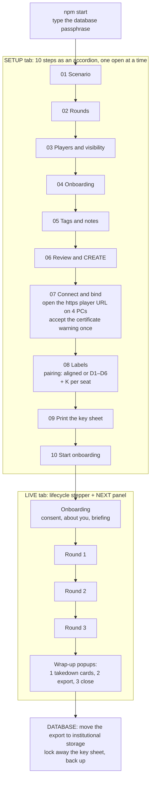
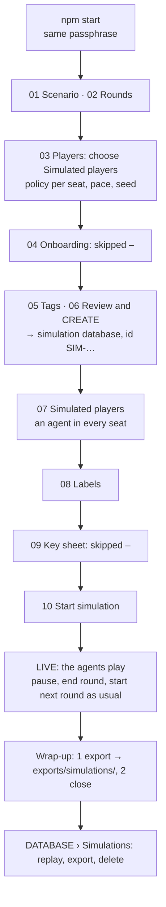

# Session runbook

*Change log: [SESSION-RUNBOOK-CHANGELOG.md](changelog/SESSION-RUNBOOK-CHANGELOG.md)*

Step by step for running a *Who Knows, Who Acts?* session: one facilitator laptop as the server and four player PCs on the same local network. It covers preparation, the session itself, wrap-up, and what to do when something goes wrong.

Background: [ARCHITECTURE.md](ARCHITECTURE.md) (how it works) · [NETWORKING.md](NETWORKING.md) (network set-up and troubleshooting) · [DATA-MANAGEMENT.md](DATA-MANAGEMENT.md) (GDPR and takedown) · [DATA-TYPES.md](DATA-TYPES.md) (what is logged) · [AESTHETIC-RULES.md](AESTHETIC-RULES.md) (UI conventions and keyboard shortcuts).

## Contents

1. [Overview](#1-overview)
2. [Once, before the study](#2-once-before-the-study)
3. [The day before a session](#3-the-day-before-a-session)
4. [Session day](#4-session-day)
5. [After the session](#5-after-the-session)
6. [When something goes wrong](#6-when-something-goes-wrong)
7. [Printable checklist](#7-printable-checklist)
8. [Simulated sessions](#8-simulated-sessions)
9. [Testing without people: fake players](#9-testing-without-people-fake-players)
10. [HTTPS and the certificate warning](#10-https-and-the-certificate-warning)

## 1. Overview

The facilitator manager has three tabs, in order of use:

| Tab | What it is for |
| --- | --- |
| **[1] SETUP / LIVE** | One tab with two faces. **SETUP** walks you through ten steps, stacked as collapsible panels (an accordion): the current step is open, finished steps collapse into a one-line summary. After *Start onboarding* the tab flips to **LIVE**, and a green **● LIVE** indicator appears in the top bar; click it to come back from any tab. |
| **[2] REPLAY** | Watch any recorded session again. Play shows every propose/decide action for 1 s and pauses at the end of each round (about 2 minutes for a default session of 3 × 4 × 10 actions); the slider and ⏮/⏭ move event by event or action by action. |
| **[3] DATABASE** | Sessions (resume, replay, export, key sheet, takedown-card PDFs, **delete**), exports, takedown/erasure, erasure and deletion registers. A switch at the top picks **Participants** (`data/wkwa.db`) or **Simulations** (`data/wkwa-sim.db`). Hover any button to see what it does. |

**Wayfinding.** In SETUP, a blue bar pinned to the top of the page shows the current step (`▶ STEP 03/10 · PLAYERS & VISIBILITY`) and a strip of all ten steps, even when you scroll; click a finished step to reopen it. Each step's header shows `✓` done · `▶` current · `·` upcoming · `■` locked · `–` skipped (simulated sessions) plus a summary; the two commit points, review & create (06) and start onboarding (10), are coloured lavender. Wrap-up popups show `STEP nn/NN`. In LIVE, the **NEXT** panel always shows the single next action, and `N` does it.

**Keyboard.** `1` `2` `3` switch tabs, `N` next action, `P` pause/resume, `D` display settings, `T` colours (Latte → Mocha → High contrast), `F` font (JetBrains Mono → OpenDyslexic → System font), `S` text size (Small ↔ Large), `A` animations on/off, `?` help. In a setup step `Enter` moves to the next step; in popups `Enter` is the primary action and `Esc` closes. The setup draft is kept in your browser.

Approximate timing: 30 min setup, about 10 min onboarding, the rounds, 10 min wrap-up.

## 2. Once, before the study

- [ ] **Ethics approval** obtained, with the approved texts in place:
  - `config/consent.md` (information letter) and `config/consent.json` (checkbox statements). **Bump `version`** whenever the text changes.
  - `config/demographics.json` (questions; every question offers `prefer_not_to_say`)
  - `config/briefing.md` (game instructions)
  - `config/study.json`: title, researcher, contact e-mail, retention statement and takedown text. These are shown on the consent screen, the end screen and the takedown cards.
- [ ] **Scenario** ready in `scenarios/<id>/`: `scenario.json` (board size and one view per K label `Ka`–`Kd`) and `scores.json` (the starting score of every sub-square, 0–10). The demos are `demo` (10 × 10 squares) and `demo-small` (5 × 5). Setup step 01 shows a preview of the starting scores, and lists errors under the scenario. Format: [GAME-RULES.md § 11](GAME-RULES.md#11-starting-scores-and-scenarios).
- [ ] **Default session settings** in `config/session.default.json`: rounds, quotas, visibility, onboarding. They pre-fill the setup wizard and can be changed per session.
- [ ] **Software installed** on the facilitator laptop: `npm install && npm run build`. Run `npm test` once; it should be all green.
- [ ] **Database passphrase chosen**, at least 5 random words. Store it in a password manager and/or a sealed envelope held by your supervisor. A lost passphrase means lost data: there is no recovery.
- [ ] **Dry run** with bots: `npm start`, then `npm run bots -- --count 3` in a second terminal. Play the fourth seat yourself on another device. Tag practice sessions `pilot` (step 05), or use a separate data directory (`WKWA_DATA_DIR=data-pilot npm start`).
- [ ] **Network** planned: ideally a dedicated router/switch without internet, with Wi-Fi "client isolation" off, and a **fixed (DHCP-reserved) IP address** for the laptop, so its certificate stays the same from session to session. See [NETWORKING.md](NETWORKING.md).
- [ ] **HTTPS tried out:** `npm start` makes the laptop's self-signed certificate. Open `https://localhost:3000/facilitator`, accept the warning ([§ 10](#10-https-and-the-certificate-warning)), then open the player URL on a second computer and accept it there too, in each browser you expect participants to bring (Chrome, Edge, Firefox, Safari).
- [ ] **Printer** reachable from the laptop. The key sheet and the takedown cards (one PDF per participant) are printed per session from the manager.

## 3. The day before a session

- [ ] Laptop charged, OS updates done (so nothing restarts during the session), sleep disabled.
- [ ] Router/switch and cables tested; a test computer on the session network can open `https://<laptop-ip>:3000/` (after accepting the certificate warning, [§ 10](#10-https-and-the-certificate-warning)).
- [ ] Firewall on the laptop allows incoming TCP 3000 (see NETWORKING.md § troubleshooting).
- [ ] Encrypted backup of the database: `npm run cli -- backup --out /path/to/backup/wkwa-YYYYMMDD.db`.

## 4. Session day

### 4.1 Start the server (about 30 minutes before)

1. Connect the laptop and the player PCs to the session network.
2. On the laptop, run `npm start` and type the database passphrase. The terminal prints the **manager** URL (`https://localhost:3000/facilitator`; open it on the laptop), the **player** URL(s) (`https://<laptop-ip>:3000/`) and the certificate's **SHA-256 fingerprint**. It also says whether it is *reusing* the certificate (browsers that accepted it before are not warned again) or made a new one (everyone accepts the warning once more; [§ 10](#10-https-and-the-certificate-warning)).
3. The browser warns about the certificate the first time; accept it ([§ 10](#10-https-and-the-certificate-warning)). The manager opens on **SETUP** with step **01 SCENARIO** expanded.

> If the server was restarted mid-session, the most recent unfinished session is resumed automatically, browsers re-claim their seats on their own, and the tab shows LIVE again.

### 4.2 SETUP steps 01–06: configure

| Step | What to check |
| --- | --- |
| **01 Scenario** | The map (board size) and its starting scores. Use the preview's knowledge-type selector to check each type's scores; **Start** is the map score before any action. **Game rules** names the rule set ([GAME-RULES.md](GAME-RULES.md)); it can only be changed when more than one exists. |
| **02 Rounds** | Number of rounds, rule (quotas or facilitator-ended), quotas per player, optional time limit, how the next round starts, per-round overrides. |
| **03 Players & visibility** | **Who plays:** *Real participants* (the normal case) or *Simulated players* (agents; see [§ 8](#8-simulated-sessions)). Then seats, how map views are assigned and what players see about each other. Display settings (colours, font, text size, animations) are **not** set here: each participant chooses them with the **DISPLAY** button on their screen, and they are not recorded. |
| **04 Onboarding** | Consent, demographics, briefing. Turning consent off asks for confirmation: only for tests without participants. |
| **05 Tags & notes** | Comma-separated **tags** (e.g. `pilot, condition-A`). They label the session in DATABASE and the exports. **Never use names.** |
| **06 Review & create** | One summary of everything, with *Edit* links. **CREATE SESSION** writes it into `SessionCreated`; steps 01–06 are then locked (■). |

The draft is kept in your browser until you create the session, so a reload loses nothing.

### 4.3 SETUP steps 07–10: prepare the room (about 15 minutes before)

| Step | What to do |
| --- | --- |
| **07 Connect & bind** | The step shows the player URL(s) and the certificate fingerprint. Open the URL on each PC; the browser shows a **certificate warning** once, so talk the participant through accepting it ([§ 10](#10-https-and-the-certificate-warning)). Then full-screen (F11); each screen shows **CLIENT N**. Bind each client to a seat. The step is done when it shows `[4/4 seats bound]`. For a test without people, use **Fake player** or **Fill empty seats with fake players** instead ([§ 9](#9-testing-without-people-fake-players)). |
| **08 Labels** | 1 · Choose the **K–P pairing**: *Aligned* (Ka–Pa, Kb–Pb …) or *Dissociated* — one of the six fully dissociative pairings D1–D6 (no seat holds the same letter, no two seats mirror each other), or *random* (seed logged). The 4×4 matrix shows the result. 2 · Choose which seat gets which **K** (seat order by default, or *Shuffle K across seats*). **P is derived from the pairing**, never chosen per seat. *Save labels*. The pairing number is stored with the labels and in the exports; see [DATA-TYPES.md § Label pairings](DATA-TYPES.md#label-pairings). With view assignment "follows K", the K label also selects which scores the seat sees. The P label decides which sub-square the seat acts on (Pa → Ka …; [GAME-RULES.md § 3](GAME-RULES.md#3-what-a-player-can-act-on)). |
| **09 Key sheet** | *Print key sheet*, then tick "printed and stored separately". Write names on it **by hand** as participants arrive; names never go into the software. |
| **10 Start onboarding** | A final checklist. **Seat the participants first**, then *START ONBOARDING*. Seats lock, players go to consent → about you → briefing, and the tab flips to **LIVE**. |

Reopen a finished step by clicking its header (steps 01–06 are locked once the session exists). `N` jumps back to the current step. To throw a lobby session away and start over, use **Discard session**.

### 4.4 LIVE: onboarding and rounds

The top of LIVE shows the **lifecycle**: `ONBOARDING ─ ROUND 1 ─ ROUND 2 ─ ROUND 3 ─ WRAP-UP`. Below it, **NEXT** always says what happens next:

| NEXT says | Do |
| --- | --- |
| "Waiting for onboarding: seat 2 (consent), …" | Wait. The Seats panel shows each seat's onboarding step. |
| "Seat 3 declined consent" | **Withdraw** that seat (Seats panel) to continue with fewer players, or abort and set up again. |
| "Everyone is ready" → **START ROUND 1** (`N`) | Start the round. |
| "Round 1 of 3 in progress · 14/40 actions · 4:12" | Monitor. **PAUSE** (`P`) if needed; *End round now* forces the end. |
| "Round 1 complete" → **START ROUND 2** (`N`) | Start the next round (or it starts automatically if auto-advance is on). |
| "Game complete" → **WRAP UP SESSION** (`N`) | Go to § 4.5. |

While a round runs, watch:

- **Seats**: quota bars `▰▰▱▱▱`, `[UNFOCUSED]`, `[TAB HIDDEN]`, `[IDLE]`, latency, reconnects.
- **Composite map**: every sub-square's score (or one knowledge type's, or none), the marks of all seats and the **map score**. Click a square to compare its four sub-squares: score now and at the start, which seat sees and which seat acts on each, and the actions on it.
- **Player views**: exactly what each player sees, with their live hover position.
- **Timeline**, **Event log** (filter by type or seat; click a row for the full event) and **Live telemetry**.

**Tools:**

- **Broadcast** a message to every screen.
- **Add note** for anything noteworthy. **Never type names.**
- **Edit labels** (only during onboarding and between rounds).
- **End game early** and **Abort session**.
- **Revoke** an action from the event log or the square panel (current round only). The seat gets its quota back and the scores are put back as if the action had never happened; the original event stays in the log.

Every destructive action asks for confirmation in a popup.

### 4.5 Wrap-up (three popups)

1. **Takedown cards:** every player's screen shows their participant code. Download each seat's **Card PDF** (A6), print it and give it to that participant, then tick "Cards are handed out". Delete the downloaded PDFs after printing (they contain the codes).
2. **Export:** *Export session* writes the pseudonymised export; the path is shown.
3. **Close:** archives the session. The tab flips back to **SETUP** for the next session, and the finished session appears in DATABASE and REPLAY.

Debrief participants as your protocol requires.

## 5. After the session

- [ ] Move the export folder (`exports/<sessionId>/…`) to **institutional storage** and delete the local copy.
- [ ] Lock the **key sheet** away, separate from any data, with the planned destruction date written on it.
- [ ] **Decliners or withdrawn participants:** erase their data if your protocol says so. Use *DATABASE → 3 · Takedown / erasure* (look up the code, then type it again to confirm) or `npm run cli -- erase --code WK-…`.
- [ ] **Backup:** `npm run cli -- backup --out …` to institutional storage.
- [ ] Stop the server with `Ctrl+C`.
- [ ] Optional: `npm run cli -- verify` (integrity check).

**Practice or failed sessions:** delete them entirely in *DATABASE → Delete* (you type the session id to confirm), optionally with their export folders.

**Takedown requests later on:** follow [DATA-MANAGEMENT.md § 10](DATA-MANAGEMENT.md#10-takedown-and-erasure-procedure).

## 6. When something goes wrong

| Situation | What happens | What to do |
| --- | --- | --- |
| A player's browser was **reloaded or closed** | The seat is kept (the browser holds a reconnect token). During a round the game auto-pauses. | Re-open the player URL on the same PC; it re-joins the same seat. Then **RESUME** (`P`). |
| A player PC **lost the network** | `PlayerDisconnected` and an auto-pause; the player sees "Connection lost" | Fix the connection; the page reconnects by itself. Then **RESUME**. |
| **Wrong client** bound (step 07) | — | **Unbind** it and bind the right one. Harmless before onboarding. |
| A participant **leaves** mid-game | — | **Withdraw** their seat (Seats panel). Rounds complete without them. |
| **Misclick** by a player | Visible to everyone | **Revoke** it (event log or square panel, current round only). |
| **Server crashed** or laptop restarted | Events up to the crash are stored | `npm start` again and type the passphrase. The session resumes, browsers re-claim their seats, and the tab shows LIVE. Then **RESUME**. A round time limit keeps counting the downtime; end the round if needed. |
| **"Wrong passphrase"** at start | The server refuses to open the database | Retype it, paying attention to keyboard layout and caps lock. |
| Player URL **does not load** | — | See [NETWORKING.md § troubleshooting](NETWORKING.md#13-troubleshooting): firewall, wrong IP, Wi-Fi client isolation, `http://` typed instead of `https://`. Step 07 lists the URLs of every network interface. |
| Player PC shows a **security warning** ("not private", "potential security risk") | Expected: the server's certificate is self-signed | Talk the participant through accepting it: [§ 10](#10-https-and-the-certificate-warning). |
| Player PC shows **"opened in another window"** | The same seat was opened twice | Close the extra tab; the newest window holds the seat. |
| Manager says **ACCESS DENIED** | It was opened from another PC | Use `https://localhost:3000/facilitator` on the laptop, or start with `ADMIN_TOKEN=…` and open `/facilitator?token=…`. |
| Animations are distracting / slow, or text is hard to read | Display settings | Manager: `D` (or the DISPLAY segment in the status bar), or directly `A` animations, `T` colours (incl. High contrast), `F` font (incl. OpenDyslexic), `S` text size. Players: the **DISPLAY** button in the bottom-right corner of their screen has the same four settings; show the participant where it is. Anyone whose OS requests reduced motion never gets animations. |
| Everything is broken, you must stop | — | *Tools → Abort session* (with a reason). Data is kept and marked aborted; players see the end screen with their code. |

## 7. Printable checklist

**Before participants arrive**
- [ ] Network up; `npm start`; passphrase entered
- [ ] Steps 01–06 done (scenario, rounds, players, onboarding, tags) → session created
- [ ] Step 07: 4 clients bound (certificate warning accepted on each) · Step 08: labels assigned · Step 09: key sheet printed

**With participants**
- [ ] Names written on the key sheet (by hand)
- [ ] Step 10: onboarding started (tab shows LIVE)
- [ ] All seats ready → round 1 … round N
- [ ] Wrap-up 1: takedown cards handed out

**Wrap-up**
- [ ] Wrap-up 2: export → moved to institutional storage → local copy deleted
- [ ] Wrap-up 3: session closed; server stopped
- [ ] Key sheet locked away; backup made; decliners erased (if applicable)

## 8. Simulated sessions

A simulated session is played by **agents** (software players) instead of participants. Use it to try out rules, round settings and analysis scripts without people. The agents' rules are their *policies* (see [ARCHITECTURE.md § 14](ARCHITECTURE.md#14-simulated-players)); for now there are two baselines, `random` and `idle`. Nobody needs to be in the room and no player PCs are needed.

| Step | What is different |
| --- | --- |
| **03 Players** | Choose **Simulated players**. Pick the **policy** for every seat (and, if you like, a different one per seat), the **pause** before each agent's turn (*Watchable* 0.8–2.5 s, *Quick*, *As fast as possible*, or custom), and a **seed**. Leave the seed empty to draw one; it is logged either way. Policy parameters go in the JSON box (the table under it lists them). |
| **04 Onboarding** | Skipped (`–`): agents have no consent, demographics or briefing. |
| **06 Review & create** | Shows *simulated* and *simulation database*. The session id starts with `SIM-`. |
| **07 Simulated players** | Nothing to do: every seat already has an agent. No URLs, clients or participant codes. |
| **08 Labels** | As usual. The agents see their own K/P labels only if the session shows them to players. |
| **09 Key sheet** | Skipped (`–`): no participants. |
| **10 Start simulation** | Locks the seats and starts round 1 at once; the tab flips to **LIVE**, with a **SIMULATION** tag in the top bar. |

In **LIVE** everything works as in a real session: the composite map, the mirrors (what each agent sees), pause/resume, end round, revoke, withdraw a seat (the agent stops), edit labels between rounds. The next round starts by your click or automatically, as set in step 02. If a policy keeps failing, its agent stops and a note in the event log says why. **Wrap-up** has two popups: export (to `exports/simulations/`) and close. There are no takedown cards.

**Repeating a run.** With the pause set to *As fast as possible* (0 s), the same seed, settings and policy versions repeat exactly the same game. With longer pauses the agents' choices still follow the seed, but who acts first can vary slightly.

**Afterwards.** Simulated sessions hold no personal data. Find them under *DATABASE → Simulations*; erasure, key sheets and cards do not exist there. From the command line, add `--sim`: `npm run cli -- sessions --sim`, `npm run cli -- export --sim --session SIM-…`.

`npm run bots` is something else: bots are test players for **real** sessions. They connect like browsers, go through binding and consent, and are stored in the participant database.

## 9. Testing without people: fake players

To try a **real** session (consent screens, binding, LIVE, wrap-up, exports) without a group of people, let the server create **fake players**. A fake player is a test client that connects to the server like a player's browser and proposes and decides at random. You can mix them with real browsers, for example three fake players and yourself on the fourth seat.

| Step | What to do |
| --- | --- |
| **03 Players** | Keep *Real participants*. |
| **07 Connect & bind** | Choose the pace (*Normal* 1–4 s between actions, or *Fast* 0.1–0.3 s). Click **Fake player** next to a seat, or **Fill empty seats with fake players**. Fake seats show `[FAKE]` and *none (fake player)* instead of a code. Bind any real browsers as usual. |
| **09 Key sheet** | Fake seats are printed as *FAKE PLAYER*, with no name. If every seat is fake, the step is skipped (`–`). |
| **10 Start onboarding** | Fake players skip consent, demographics and briefing and are ready at once. Real players onboard as usual. |
| **LIVE** | The top bar shows **FAKE PLAYERS ×N**; seats and mirrors show `[FAKE]`. Start the rounds as usual; fake players act on their own. |
| **Wrap-up** | Takedown cards only for real participants (no card step at all if every seat is fake). Export and close as usual. |

What the data says:

- The session is stored in the participant database, like any real session. DATABASE shows it with a `fake ×N` tag, and `npm run cli -- sessions` lists the fake seats.
- In the log, each fake seat's `SeatBound` has `fake: true`. In exports, `players.csv` has `fake_player = 1` for those seats and `session.json` has `fakeSeats`.
- Fake players have **no participant code**, no consent record, no demographic answers and no telemetry. Nothing about them is made up.
- **Delete pure test sessions** afterwards (*DATABASE → Delete*), or leave out the rows with `fake_player = 1` in analyses.

Fake players can only be added in the lobby, and only in sessions with real players (a simulated session already has agents). Unbinding a fake seat ends that fake player. After a server restart, the fake players come back by themselves and re-claim their seats. If a round was paused because they lost the connection, press **RESUME**.

`npm run bots` still exists, but its bots go through consent and the questionnaire with made-up answers and are **not** marked in the data. Use fake players instead.

## 10. HTTPS and the certificate warning

Browsers only allow the microphone on secure pages, so the server speaks **HTTPS**, with a certificate it makes itself: a *self-signed* certificate, kept in `data/tls/` and reused at every start ([NETWORKING.md § 11](NETWORKING.md#11-security-on-the-lan)). No browser knows this certificate, so the first time a browser opens the server it shows a full-page security warning. On this closed network that is expected. Each participant accepts it **once**, in their own browser, while you talk them through it. Nothing is installed on their laptop.

A sentence that works: *"Your browser warns because this is a private server on this room's network, without a certificate from the internet. That is expected here. Please click …"*

| Browser | The warning says | Steps |
| --- | --- | --- |
| **Chrome** (Windows, macOS, Linux) | "Your connection is not private" (`NET::ERR_CERT_AUTHORITY_INVALID`) | **Advanced** → **Proceed to 192.168.1.10 (unsafe)** |
| **Edge** (Windows, macOS) | "Your connection isn't private" | **Advanced** → **Continue to 192.168.1.10 (unsafe)** |
| **Firefox** (Windows, macOS, Linux) | "Warning: Potential Security Risk Ahead" (`MOZILLA_PKIX_ERROR_SELF_SIGNED_CERT`) | **Advanced…** → **Accept the Risk and Continue** |
| **Safari** (macOS) | "This Connection Is Not Private" | **Show Details** → the link **visit this website** → **Visit Website** in the dialog. macOS may then ask for the Mac's password (or Touch ID) to save the exception: the participant types it, never you. |

The page then loads and shows **CLIENT N**. The address bar keeps a "Not secure" sign or a struck-through lock; that is normal for a self-signed certificate.

**Checking the fingerprint** (recommended at the first session, and whenever something looks odd). Setup step 07 and the terminal show the certificate's SHA-256 fingerprint, e.g. `0D:83:76:C9:…:15:A3:51:0C`. The browser shows the same value:

- Chrome, Edge: click **Not secure** in the address bar → the certificate details → *SHA-256 fingerprint* of the **certificate** (not of the public key).
- Firefox: on the warning page, **Advanced…** → **View Certificate** → *Fingerprints* → *SHA-256*.
- Safari: **Show Details** → **view the certificate** → **Details** → *Fingerprints* → *SHA-256*.

Some browsers show spaces instead of colons. Compare at least the first four and the last four pairs. If they differ, **stop**: that browser is not talking to this laptop (a wrong address, or another device on the network). Check the URL and the network before going on.

**The facilitator** opens `https://localhost:3000/facilitator` on the laptop and accepts the same warning once (the certificate also names `localhost`, but the browser does not know it either). While HTTPS is on, `http://localhost:3000` does not answer.

**When the warning comes back:**

- The server made a **new certificate**: the laptop has a new IP address or host name (another network, or the router gave it another address), the certificate expires within 30 days, or `data/tls/` was deleted. The start-up banner says why, and step 07 shows the new fingerprint. Everyone accepts the warning once more. A fixed (DHCP-reserved) IP address for the laptop avoids this.
- The participant uses another browser, browser profile or a private window, or has cleared the browser's data.
- Chrome and Edge may ask again after some days; Firefox and Safari keep the exception until it is removed.

**Afterwards** (offer it in the debrief), participants can remove the exception again:

- Safari: *Keychain Access* → *login* → *Certificates* → "Who Knows, Who Acts? LAN server" → delete.
- Firefox: *Settings* → *Privacy & Security* → *Certificates* → *View Certificates…* → *Servers* → the laptop's address → delete.
- Chrome, Edge: the exception lapses by itself.

Other symptoms (no "Proceed" link on a managed laptop, `http://` typed instead of `https://`, a wrong-name or date error, Safari reconnecting): see [NETWORKING.md § 13](NETWORKING.md#13-troubleshooting).
