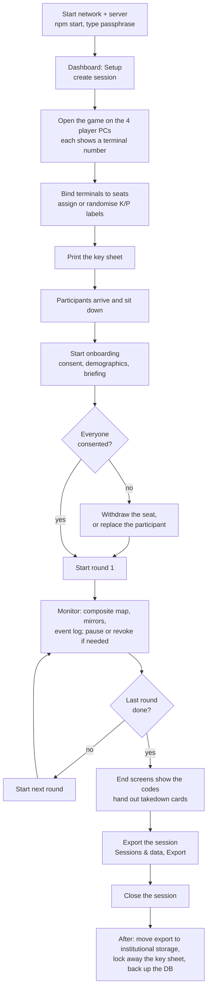

# Session runbook

A step-by-step guide for running a WhoKnowsWhoActs session: one facilitator laptop as the server and four player PCs on the same local network. It covers preparation, the session itself, wrap-up, and what to do when something goes wrong.

Background: [ARCHITECTURE.md](ARCHITECTURE.md) (how it works) · [NETWORKING.md](NETWORKING.md) (network setup and troubleshooting) · [DATA-MANAGEMENT.md](DATA-MANAGEMENT.md) (GDPR and takedown) · [DATA-TYPES.md](DATA-TYPES.md) (what is logged).

## Contents

1. [Overview](#1-overview)
2. [Once, before the study](#2-once-before-the-study)
3. [The day before a session](#3-the-day-before-a-session)
4. [Session day](#4-session-day)
5. [After the session](#5-after-the-session)
6. [When something goes wrong](#6-when-something-goes-wrong)
7. [Printable checklist](#7-printable-checklist)

## 1. Overview

Approximate timing: 30 min setup, about 10 min onboarding, the rounds, then 10 min wrap-up.

## 2. Once, before the study

- [ ] **Ethics approval** obtained. The approved texts are in place:
  - `config/consent.md` (information letter) and `config/consent.json` (checkbox statements). **Bump `version`** whenever the text changes.
  - `config/demographics.json` (questions; every question offers `prefer_not_to_say`)
  - `config/briefing.md` (game instructions)
  - `config/study.json`: title, researcher, contact e-mail, retention statement and takedown text. These are shown on the consent screen, the end screen and the takedown cards.
- [ ] **Scenario** ready in `scenarios/<id>/`: `scenario.json`, `map.svg` (one `<path id=… d=…>` per region, no transforms) and `views.json` (one view per K label: `Ka`–`Kd`). Check it in *Setup*: errors are listed under the scenario picker.
- [ ] **Default session settings** in `config/session.default.json`: rounds, quotas, visibility. These can still be changed per session in *Setup*.
- [ ] **Software installed** on the facilitator laptop: `npm install && npm run build`. Run `npm test` once; it should be all green.
- [ ] **Database passphrase chosen.** Use at least 5 random words. Store it in a password manager and/or a sealed envelope held by your supervisor. A lost passphrase means lost data: there is no recovery.
- [ ] **Dry run** with bots: `npm start`, then `npm run bots -- --count 3` in a second terminal, and play the fourth seat yourself on another device. Delete practice sessions from your data before the real study, or use a separate data directory (`WKWA_DATA_DIR=data-pilot npm start`).
- [ ] **Network** planned. Use a dedicated router or switch without internet if possible, and disable "client isolation" on Wi-Fi. See [NETWORKING.md](NETWORKING.md).
- [ ] **Paper**: key sheet and takedown cards are printed per session from the dashboard. Make sure a printer is reachable, or print right after binding the seats.

## 3. The day before a session

- [ ] Laptop charged, OS updates done (so nothing restarts during the session), sleep disabled.
- [ ] Router/switch and cables tested. Each player PC can open `http://<laptop-ip>:3000/`.
- [ ] Firewall on the laptop allows incoming TCP 3000 (see NETWORKING.md § troubleshooting).
- [ ] Encrypted backup of the database: `npm run cli -- backup --out /path/to/backup/wkwa-YYYYMMDD.db`.

## 4. Session day

### 4.1 Start (about 30 minutes before)

1. Connect the laptop and the player PCs to the session network.
2. On the laptop: `npm start`, then type the database passphrase. The terminal prints:
   - the **dashboard** URL: `http://localhost:3000/facilitator` (open it on the laptop itself)
   - the **player** URL(s): `http://<laptop-ip>:3000/`
3. In the dashboard, go to **Setup**: pick the scenario, check rounds, quotas and visibility, enter the *condition* label (e.g. `A`, `pilot`; never names), then **Create session**.

> If the server was restarted, the most recent unfinished session is resumed automatically, and browsers re-claim their seats on their own.

### 4.2 Prepare the player PCs (about 15 minutes before)

1. On each player PC, open the player URL in a browser, full-screen (F11). Each screen shows **Terminal N** in large type.
2. In **Live → Seats**, bind each terminal to a seat with *bind terminal…*. Write the seat number on a sticky note on each PC if that helps.
3. Assign the labels: choose K and P per seat and click **Save labels**, or click **🎲 Randomise labels** (the random seed is logged).
   - With `viewAssignment = byKnowledgeType`, the K label also decides which map data the seat sees.
4. **Print the key sheet**: *Sessions & data → Key sheet*. Do not save it as a file.

### 4.3 Participants arrive

1. Seat each participant at a PC. When convenient, write their **name by hand** on the key sheet line for their seat. Names never go into the software.
2. Click **Start onboarding** (*Live → Session flow*). Seats are now locked.
3. Watch the *Onboarding* column: `consent given` → `demo ✓` → `brief ✓`.
4. If a participant **declines** consent, their screen says thank you and stops. Either:
   - **Withdraw** the seat and continue with fewer players (round completion then ignores that seat), or
   - abort, and create a new session with a replacement participant.
   Afterwards, erase the decliner's code (§ 5).

### 4.4 Rounds

1. **Start round 1** becomes available once every active seat has finished onboarding.
2. During the round, watch:
   - the **composite map** (colour it by any view; click a region to compare what each view says about it)
   - the **player mirrors** (exactly what each player sees, with their live hover position)
   - the **Seats** table: quota progress, *unfocused*, *tab hidden*, *idle* and latency badges
   - the **timeline** and the **event log**
3. Tools during a round:
   - **Pause / Resume**. The game pauses automatically when a player disconnects (if `pauseOnDisconnect` is on).
   - **Revoke** a misclicked proposal or decision (event log or region panel). The original event stays in the log, and the seat gets its quota back.
   - **Broadcast** a message to all screens (e.g. "5 minutes left").
   - **Add note** for anything noteworthy (e.g. "seat 3 asked about zooming"). **Never type names.**
   - **End round now** forces the round to finish, e.g. if the rule is `manual`.
4. With the default rule, a round ends by itself when every player has used 5 proposals and 5 decisions. Then click **Start round 2**, and so on (unless auto-advance is on).

### 4.5 End

1. After the last round the dashboard shows **Game complete**. Every player screen shows their **participant code** and the contact address.
2. Print and hand out the **takedown cards**: *Sessions & data → Takedown cards*. Cut them out and give each participant the card for their seat.
3. Debrief participants as your protocol requires.
4. **Export**: *Sessions & data → Export*. The path is shown; the export contains pseudonymised data.
5. **Close session** (*Live*). Player screens keep showing the end screen until the next session is created.

## 5. After the session

- [ ] Move the export folder (`exports/<sessionId>/…`) to **institutional storage** and delete the local copy.
- [ ] Lock away the **key sheet**, separate from any data. Write the planned destruction date on it.
- [ ] **Decliners or withdrawn participants:** erase their data if your protocol says so. Use *Sessions & data → Takedown / erasure* (type the code twice) or `npm run cli -- erase --code WK-…`.
- [ ] **Backup:** `npm run cli -- backup --out …` to institutional storage.
- [ ] Stop the server with `Ctrl+C`.
- [ ] Optional: `npm run cli -- verify` (integrity check).

**Takedown requests later on:** follow [DATA-MANAGEMENT.md § 10](DATA-MANAGEMENT.md#10-takedown-and-erasure-procedure).

## 6. When something goes wrong

| Situation | What happens | What to do |
| --- | --- | --- |
| A player's browser was **reloaded or closed** | The seat is kept: the browser holds a reconnect token. If it happened during a round, the game auto-pauses. | Re-open the player URL on the same PC; it re-joins the same seat. Then **Resume**. |
| A player PC **lost the network** | `PlayerDisconnected` and an auto-pause | Fix the connection; the page reconnects by itself. Then **Resume**. |
| **Wrong terminal** bound to a seat (lobby) | — | **Unbind** the seat and bind the right terminal. Before onboarding this is harmless. |
| A participant **leaves** mid-game | — | **Withdraw** their seat. Rounds then complete without them. |
| **Misclick** by a player | The action is visible to everyone | **Revoke** it in the event log or the region panel (current round only). |
| **Server crashed** or the laptop restarted | Events up to the crash are safely stored | Run `npm start` again and type the passphrase. The session is resumed automatically, and browsers reconnect and re-claim their seats. Then **Resume**. A round time limit keeps counting the downtime; extend or end the round if needed. |
| **"Wrong passphrase"** at start | The server refuses to open the database | Retype it, paying attention to keyboard layout and caps lock. |
| Player URL **does not load** | — | See [NETWORKING.md § troubleshooting](NETWORKING.md): firewall, wrong IP, Wi-Fi client isolation. |
| Player PC shows **"opened in another window"** | The same seat was opened in two tabs or PCs | Close the extra tab; the newest window holds the seat. |
| **Dashboard says "access denied"** | It was opened from a PC other than the laptop | Use `http://localhost:3000/facilitator` on the laptop, or start with `ADMIN_TOKEN=…` and open `/facilitator?token=…`. |
| Everything is broken, you need to stop | — | **Abort session** (with a reason). The data is kept and marked as aborted; participants see the end screen with their code. |

## 7. Printable checklist

**Before participants arrive**
- [ ] Network up; `npm start`; passphrase entered
- [ ] Session created (scenario, rounds, condition checked)
- [ ] 4 player PCs show terminal numbers; all bound to seats
- [ ] Labels assigned or randomised; key sheet printed

**With participants**
- [ ] Names written on the key sheet (by hand)
- [ ] Onboarding started; all consented / demographics / briefing ✓
- [ ] Round 1 … round N played
- [ ] End screens with codes shown; takedown cards handed out

**Wrap-up**
- [ ] Export done → moved to institutional storage → local copy deleted
- [ ] Session closed; server stopped
- [ ] Key sheet locked away; backup made; decliners erased (if applicable)
