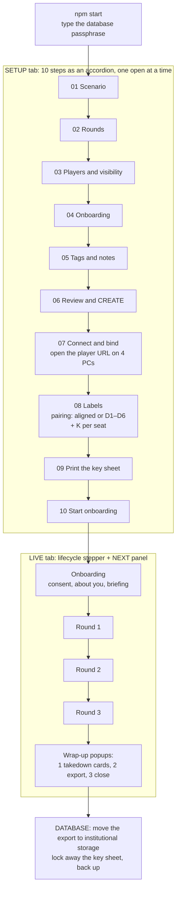

# Session runbook

Step by step for running a *Who Knows, Who Acts?* session: one facilitator laptop as the server and four player PCs on the same local network. It covers preparation, the session itself, wrap-up, and what to do when something goes wrong.

Background: [ARCHITECTURE.md](ARCHITECTURE.md) (how it works) · [NETWORKING.md](NETWORKING.md) (network set-up and troubleshooting) · [DATA-MANAGEMENT.md](DATA-MANAGEMENT.md) (GDPR and takedown) · [DATA-TYPES.md](DATA-TYPES.md) (what is logged) · [AESTHETIC-RULES.md](AESTHETIC-RULES.md) (UI conventions and keyboard shortcuts).

## Contents

1. [Overview](#1-overview)
2. [Once, before the study](#2-once-before-the-study)
3. [The day before a session](#3-the-day-before-a-session)
4. [Session day](#4-session-day)
5. [After the session](#5-after-the-session)
6. [When something goes wrong](#6-when-something-goes-wrong)
7. [Printable checklist](#7-printable-checklist)

## 1. Overview

The facilitator manager has three tabs, in order of use:

| Tab | What it is for |
| --- | --- |
| **[1] SETUP / LIVE** | One tab with two faces. **SETUP** walks you through ten steps, stacked as collapsible panels (an accordion): the current step is open, finished steps collapse into a one-line summary. After *Start onboarding* the tab flips to **LIVE**, and a green **● LIVE** indicator appears in the top bar; click it to come back from any tab. |
| **[2] REPLAY** | Watch any recorded session again. Play shows every propose/decide action for 1 s and pauses at the end of each round (about 2 minutes for a default session of 3 × 4 × 10 actions); the slider and ⏮/⏭ move event by event or action by action. |
| **[3] DATABASE** | Sessions (resume, replay, export, key sheet, takedown-card PDFs, **delete**), exports, takedown/erasure, erasure and deletion registers. Hover any button to see what it does. |

**Wayfinding.** In SETUP, a blue bar pinned to the top of the page shows the current step (`▶ STEP 03/10 · PLAYERS & VISIBILITY`) and a strip of all ten steps, even when you scroll; click a finished step to reopen it. Each step's header shows `✓` done · `▶` current · `·` upcoming · `■` locked plus a summary; the two commit points, review & create (06) and start onboarding (10), are coloured lavender. Wrap-up popups show `STEP nn/NN`. In LIVE, the **NEXT** panel always shows the single next action, and `N` does it.

**Keyboard.** `1` `2` `3` switch tabs, `N` next action, `P` pause/resume, `D` display settings, `T` colours (Latte → Mocha → High contrast), `F` font (JetBrains Mono → OpenDyslexic → System font), `S` text size (Small ↔ Large), `A` animations on/off, `?` help. In a setup step `Enter` moves to the next step; in popups `Enter` is the primary action and `Esc` closes. The setup draft is kept in your browser.

Approximate timing: 30 min setup, about 10 min onboarding, the rounds, 10 min wrap-up.

## 2. Once, before the study

- [ ] **Ethics approval** obtained, with the approved texts in place:
  - `config/consent.md` (information letter) and `config/consent.json` (checkbox statements). **Bump `version`** whenever the text changes.
  - `config/demographics.json` (questions; every question offers `prefer_not_to_say`)
  - `config/briefing.md` (game instructions)
  - `config/study.json`: title, researcher, contact e-mail, retention statement and takedown text. These are shown on the consent screen, the end screen and the takedown cards.
- [ ] **Scenario** ready in `scenarios/<id>/`: `scenario.json`, `map.svg` (one `<path id=… d=…>` per region, no transforms) and `views.json` (one view per K label: `Ka`–`Kd`). Setup step 01 shows a preview of each view, and lists errors under the scenario.
- [ ] **Default session settings** in `config/session.default.json`: rounds, quotas, visibility, onboarding. They pre-fill the setup wizard and can be changed per session.
- [ ] **Software installed** on the facilitator laptop: `npm install && npm run build`. Run `npm test` once; it should be all green.
- [ ] **Database passphrase chosen**, at least 5 random words. Store it in a password manager and/or a sealed envelope held by your supervisor. A lost passphrase means lost data: there is no recovery.
- [ ] **Dry run** with bots: `npm start`, then `npm run bots -- --count 3` in a second terminal. Play the fourth seat yourself on another device. Tag practice sessions `pilot` (step 05), or use a separate data directory (`WKWA_DATA_DIR=data-pilot npm start`).
- [ ] **Network** planned: ideally a dedicated router/switch without internet, with Wi-Fi "client isolation" off. See [NETWORKING.md](NETWORKING.md).
- [ ] **Printer** reachable from the laptop. The key sheet and the takedown cards (one PDF per participant) are printed per session from the manager.

## 3. The day before a session

- [ ] Laptop charged, OS updates done (so nothing restarts during the session), sleep disabled.
- [ ] Router/switch and cables tested; each player PC can open `http://<laptop-ip>:3000/`.
- [ ] Firewall on the laptop allows incoming TCP 3000 (see NETWORKING.md § troubleshooting).
- [ ] Encrypted backup of the database: `npm run cli -- backup --out /path/to/backup/wkwa-YYYYMMDD.db`.

## 4. Session day

### 4.1 Start the server (about 30 minutes before)

1. Connect the laptop and the player PCs to the session network.
2. On the laptop, run `npm start` and type the database passphrase. The terminal prints the **manager** URL (`http://localhost:3000/facilitator`; open it on the laptop) and the **player** URL(s).
3. The manager opens on **SETUP** with step **01 SCENARIO** expanded.

> If the server was restarted mid-session, the most recent unfinished session is resumed automatically, browsers re-claim their seats on their own, and the tab shows LIVE again.

### 4.2 SETUP steps 01–06: configure

| Step | What to check |
| --- | --- |
| **01 Scenario** | The map and datasets. Use the preview's view selector to check each view. |
| **02 Rounds** | Number of rounds, rule (quotas or facilitator-ended), quotas per player, optional time limit, how the next round starts, per-round overrides. |
| **03 Players & visibility** | Seats, how map views are assigned and what players see about each other. Display settings (colours, font, text size, animations) are **not** set here: each participant chooses them with the **DISPLAY** button on their screen, and they are not recorded. |
| **04 Onboarding** | Consent, demographics, briefing. Turning consent off asks for confirmation: only for tests without participants. |
| **05 Tags & notes** | Comma-separated **tags** (e.g. `pilot, condition-A`). They label the session in DATABASE and the exports. **Never use names.** |
| **06 Review & create** | One summary of everything, with *Edit* links. **CREATE SESSION** writes it into `SessionCreated`; steps 01–06 are then locked (■). |

The draft is kept in your browser until you create the session, so a reload loses nothing.

### 4.3 SETUP steps 07–10: prepare the room (about 15 minutes before)

| Step | What to do |
| --- | --- |
| **07 Connect & bind** | The step shows the player URL(s). Open it on each PC in full-screen (F11); each screen shows **CLIENT N**. Bind each client to a seat. The step is done when it shows `[4/4 seats bound]`. |
| **08 Labels** | 1 · Choose the **K–P pairing**: *Aligned* (Ka–Pa, Kb–Pb …) or *Dissociated* — one of the six fully dissociative pairings D1–D6 (no seat holds the same letter, no two seats mirror each other), or *random* (seed logged). The 4×4 matrix shows the result. 2 · Choose which seat gets which **K** (seat order by default, or *Shuffle K across seats*). **P is derived from the pairing**, never chosen per seat. *Save labels*. The pairing number is stored with the labels and in the exports; see [DATA-TYPES.md § Label pairings](DATA-TYPES.md#label-pairings). With view assignment "follows K", the K label also selects the seat's map data. |
| **09 Key sheet** | *Print key sheet*, then tick "printed and stored separately". Write names on it **by hand** as participants arrive; names never go into the software. |
| **10 Start onboarding** | A final checklist. **Seat the participants first**, then *START ONBOARDING*. Seats lock, players go to consent → about you → briefing, and the tab flips to **LIVE**. |

Reopen a finished step by clicking its header (steps 01–06 are locked once the session exists). `N` jumps back to the current step. To throw a lobby session away and start over, use **Discard session**.

### 4.4 LIVE: onboarding and rounds

The top of LIVE shows the **lifecycle**: `ONBOARDING ─ ROUND 1 ─ ROUND 2 ─ ROUND 3 ─ WRAP-UP`. Below it, **NEXT** always says what happens next:

| NEXT says | Do |
| --- | --- |
| "Waiting for onboarding: seat 2 (consent), …" | Wait. The Seats panel shows each seat's onboarding step. |
| "Seat 3 declined consent" | **Withdraw** that seat (Seats panel) to continue with fewer players, or abort and set up again. |
| "Everyone is ready" → **START ROUND 1** (`N`) | Start the round. |
| "Round 1 of 3 in progress · 14/40 actions · 4:12" | Monitor. **PAUSE** (`P`) if needed; *End round now* forces the end. |
| "Round 1 complete" → **START ROUND 2** (`N`) | Start the next round (or it starts automatically if auto-advance is on). |
| "Game complete" → **WRAP UP SESSION** (`N`) | Go to § 4.5. |

While a round runs, watch:

- **Seats**: quota bars `▰▰▱▱▱`, `[UNFOCUSED]`, `[TAB HIDDEN]`, `[IDLE]`, latency, reconnects.
- **Composite map**: colour it by any view. Click a region to compare what every view says about it.
- **Player views**: exactly what each player sees, with their live hover position.
- **Timeline**, **Event log** (filter by type or seat; click a row for the full event) and **Live telemetry**.

**Tools:**

- **Broadcast** a message to every screen.
- **Add note** for anything noteworthy. **Never type names.**
- **Edit labels** (only during onboarding and between rounds).
- **End game early** and **Abort session**.
- **Revoke** an action from the event log or the region panel (current round only). The seat gets its quota back; the original event stays in the log.

Every destructive action asks for confirmation in a popup.

### 4.5 Wrap-up (three popups)

1. **Takedown cards:** every player's screen shows their participant code. Download each seat's **Card PDF** (A6), print it and give it to that participant, then tick "Cards are handed out". Delete the downloaded PDFs after printing (they contain the codes).
2. **Export:** *Export session* writes the pseudonymised export; the path is shown.
3. **Close:** archives the session. The tab flips back to **SETUP** for the next session, and the finished session appears in DATABASE and REPLAY.

Debrief participants as your protocol requires.

## 5. After the session

- [ ] Move the export folder (`exports/<sessionId>/…`) to **institutional storage** and delete the local copy.
- [ ] Lock the **key sheet** away, separate from any data, with the planned destruction date written on it.
- [ ] **Decliners or withdrawn participants:** erase their data if your protocol says so. Use *DATABASE → 3 · Takedown / erasure* (look up the code, then type it again to confirm) or `npm run cli -- erase --code WK-…`.
- [ ] **Backup:** `npm run cli -- backup --out …` to institutional storage.
- [ ] Stop the server with `Ctrl+C`.
- [ ] Optional: `npm run cli -- verify` (integrity check).

**Practice or failed sessions:** delete them entirely in *DATABASE → Delete* (you type the session id to confirm), optionally with their export folders.

**Takedown requests later on:** follow [DATA-MANAGEMENT.md § 10](DATA-MANAGEMENT.md#10-takedown-and-erasure-procedure).

## 6. When something goes wrong

| Situation | What happens | What to do |
| --- | --- | --- |
| A player's browser was **reloaded or closed** | The seat is kept (the browser holds a reconnect token). During a round the game auto-pauses. | Re-open the player URL on the same PC; it re-joins the same seat. Then **RESUME** (`P`). |
| A player PC **lost the network** | `PlayerDisconnected` and an auto-pause; the player sees "Connection lost" | Fix the connection; the page reconnects by itself. Then **RESUME**. |
| **Wrong client** bound (step 07) | — | **Unbind** it and bind the right one. Harmless before onboarding. |
| A participant **leaves** mid-game | — | **Withdraw** their seat (Seats panel). Rounds complete without them. |
| **Misclick** by a player | Visible to everyone | **Revoke** it (event log or region panel, current round only). |
| **Server crashed** or laptop restarted | Events up to the crash are stored | `npm start` again and type the passphrase. The session resumes, browsers re-claim their seats, and the tab shows LIVE. Then **RESUME**. A round time limit keeps counting the downtime; end the round if needed. |
| **"Wrong passphrase"** at start | The server refuses to open the database | Retype it, paying attention to keyboard layout and caps lock. |
| Player URL **does not load** | — | See [NETWORKING.md § troubleshooting](NETWORKING.md): firewall, wrong IP, Wi-Fi client isolation. Step 07 lists the URLs of every network interface. |
| Player PC shows **"opened in another window"** | The same seat was opened twice | Close the extra tab; the newest window holds the seat. |
| Manager says **ACCESS DENIED** | It was opened from another PC | Use `http://localhost:3000/facilitator` on the laptop, or start with `ADMIN_TOKEN=…` and open `/facilitator?token=…`. |
| Animations are distracting / slow, or text is hard to read | Display settings | Manager: `D` (or the DISPLAY segment in the status bar), or directly `A` animations, `T` colours (incl. High contrast), `F` font (incl. OpenDyslexic), `S` text size. Players: the **DISPLAY** button in the bottom-right corner of their screen has the same four settings; show the participant where it is. Anyone whose OS requests reduced motion never gets animations. |
| Everything is broken, you must stop | — | *Tools → Abort session* (with a reason). Data is kept and marked aborted; players see the end screen with their code. |

## 7. Printable checklist

**Before participants arrive**
- [ ] Network up; `npm start`; passphrase entered
- [ ] Steps 01–06 done (scenario, rounds, players, onboarding, tags) → session created
- [ ] Step 07: 4 clients bound · Step 08: labels assigned · Step 09: key sheet printed

**With participants**
- [ ] Names written on the key sheet (by hand)
- [ ] Step 10: onboarding started (tab shows LIVE)
- [ ] All seats ready → round 1 … round N
- [ ] Wrap-up 1: takedown cards handed out

**Wrap-up**
- [ ] Wrap-up 2: export → moved to institutional storage → local copy deleted
- [ ] Wrap-up 3: session closed; server stopped
- [ ] Key sheet locked away; backup made; decliners erased (if applicable)
