<!-- Generated by `npm run screenshots -- gallery` from e2e/screenshots/catalogue.ts and docs/img/screenshots.json. Do not edit by hand. -->

# Screenshots

> [!NOTE]
> Every screen of *Who Knows, Who Acts?*, grouped by what it is for, in the order a session runs. Whole screens are full screen (1920 × 1080); images named `live-panel-…` or `part-…` are crops of one part. Files are in `server/` (the facilitator console on the server computer) and `client/` (the player screens on the client PCs). Everything shown is fictional: a temporary database, the demo grids and scripted players.

> [!TIP]
> When a screen changes, it gets a new version (`name-v2.png`, `name-v3.png`, …) shown next to the older ones, so the gallery is a visual timeline; *Timeline of changes* at the end lists them by date. Take new screenshots with the `/screenshot-app` skill or `npm run screenshots -- plan`, then `capture` and `publish`.

---

## 1. Setting up a session

Facilitator, SETUP tab: a ten-step wizard. Steps 01–06 configure the session, 07–10 prepare the room (step 07 is in § 2).

| | |
| --- | --- |
| 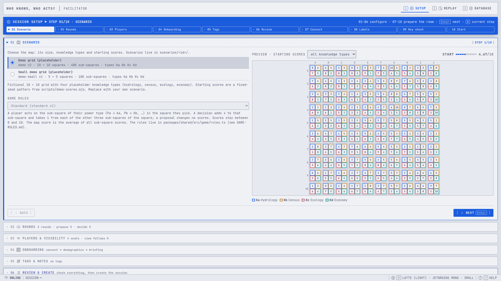 | 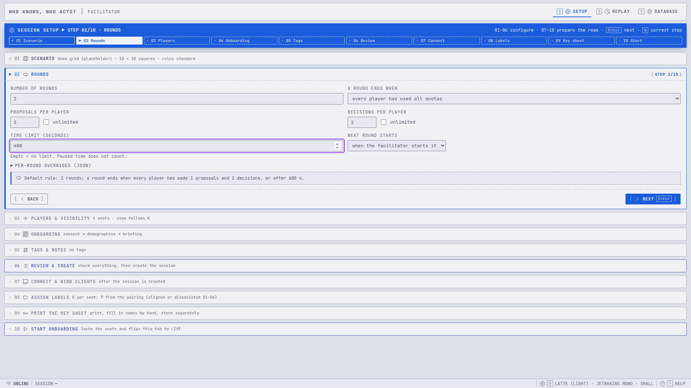 |
| **Step 01 · Scenario:** Choose the map and game rules; the starting scores are previewed. | **Step 02 · Rounds:** Rounds, quotas per player, time limit, how rounds end and start. |
|  |  |
| **Step 03 · Players:** Real participants, seats, map view per seat, what players see. | **Step 04 · Onboarding:** Consent, questionnaire and briefing, each switched on or off. |
|  | 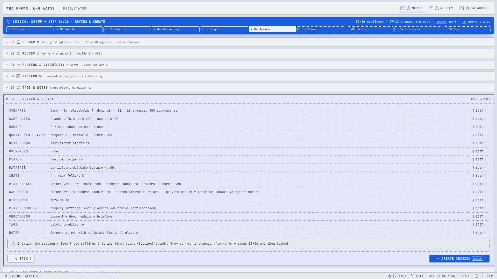 |
| **Step 05 · Tags:** Tags and a note that describe the session in the dataset. | **Step 06 · Review:** Every setting in one table before *Create session* locks them. |
| 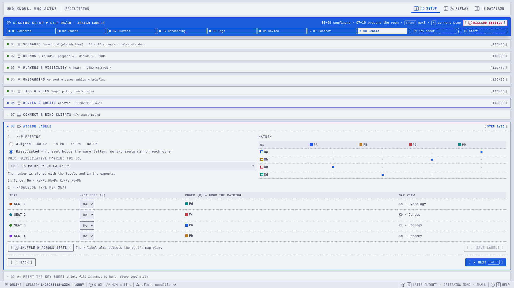 | 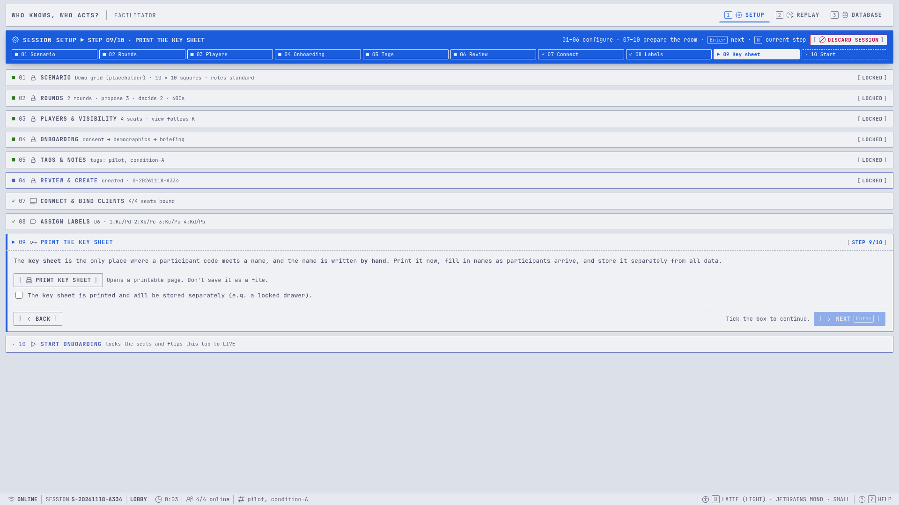 |
| **Step 08 · Labels:** The K–P pairing (here dissociated D6), its matrix, the K per seat. | **Step 09 · Key sheet:** Print the sheet that links codes to names; store it apart. |
| 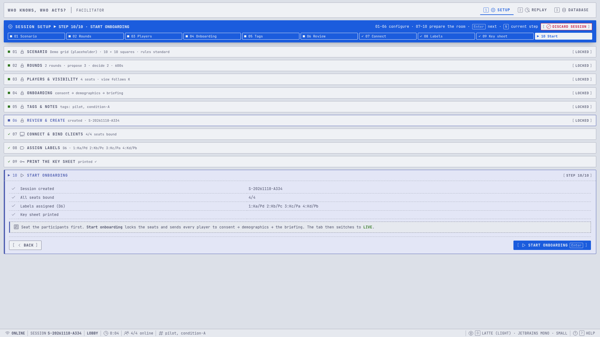 |  |
| **Step 10 · Start:** A final checklist; *Start onboarding* locks the seats and opens LIVE. |  |

---

## 2. Connecting the player PCs

Each player PC opens the game page and shows a client number; the facilitator binds every client to a seat in step 07.

| | |
| --- | --- |
| 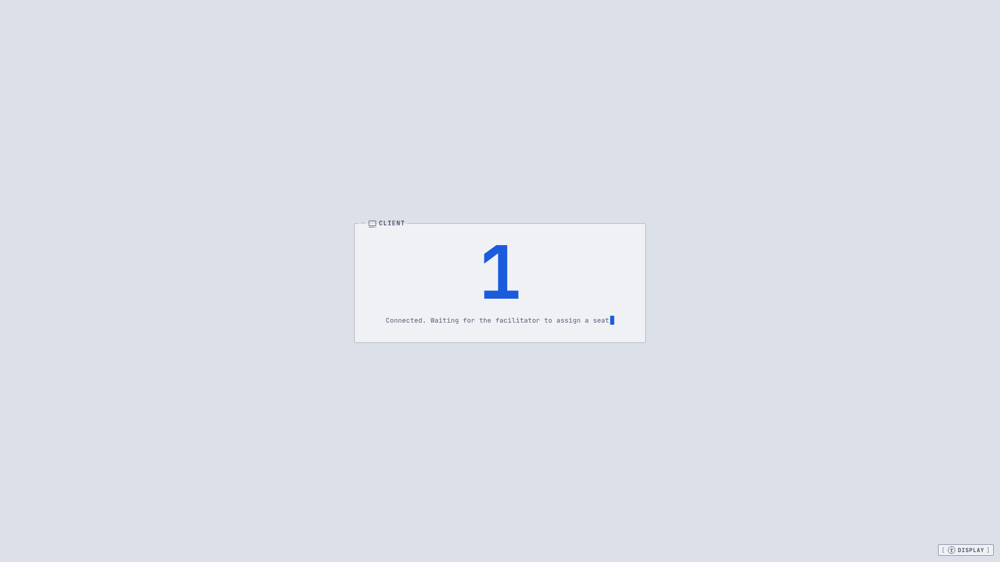 |  |
| **Player · Waiting for a seat:** A PC waiting to be bound; the large number is its client number. | **Facilitator · Step 07 · Connect:** Four clients connected, no seat bound yet. |
|  |  |
| **Facilitator · Step 07 · All seats bound:** Every seat bound to a client and given a participant code. | **Player · Seat assigned:** Bound to seat 1, waiting for onboarding to start. |

---

## 3. Onboarding

Players go through consent → about you → briefing; the facilitator sees which step each seat is on.

| | |
| --- | --- |
|  | 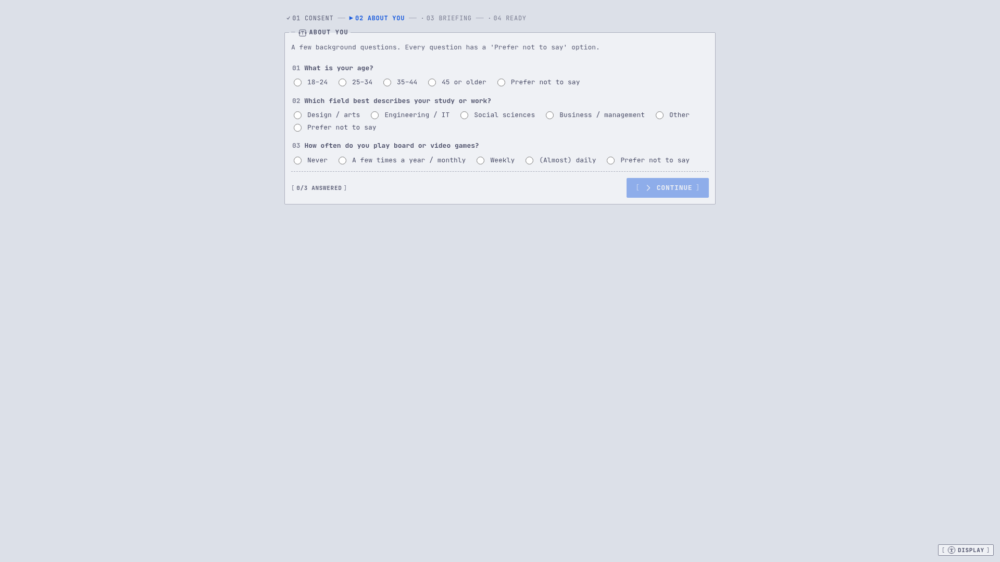 |
| **Player · Consent:** Information and consent (placeholder text); required statements are starred. | **Player · About you:** The short background questionnaire. |
|  | 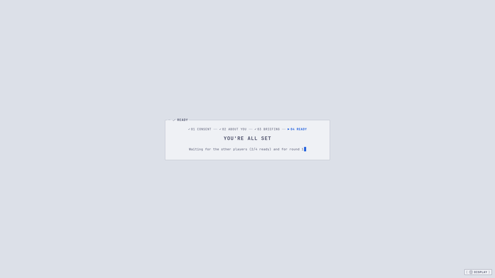 |
| **Player · Briefing:** How to play, and this player's roles: sees the Ka scores, acts on Kd. | **Player · Ready:** Waiting for the other players and for round 1. |
|  |  |
| **Facilitator · LIVE during onboarding:** Every seat at a different onboarding step. |  |

**Facilitator · Seats panel:** Each seat's onboarding step: consent, demographics, briefing or ready.

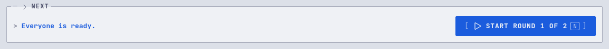

**Facilitator · NEXT panel:** Once every seat is ready, NEXT offers *Start round 1 of 2*.

---

## 4. Reading the map

Every player sees the same grid but only the scores of their own knowledge type. Each square has four sub-squares: Ka top left, Kb top right, Kc bottom left, Kd bottom right.

| | |
| --- | --- |
| 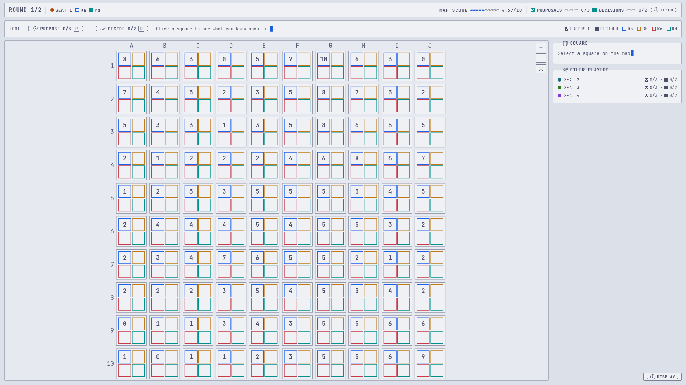 |  |
| **Start of round 1:** Only the Ka scores are shown, in the top-left sub-squares. | **Square selected:** Square D4's four sub-squares in the side panel. |

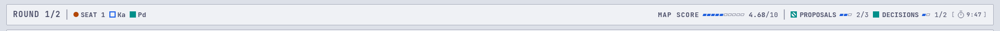

**Status line:** Round, seat, K/P labels, map score, quota bars and time left.

| | |
| --- | --- |
| 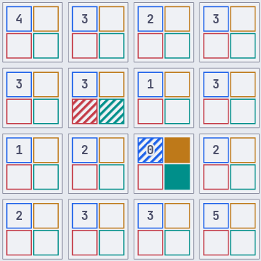 |  |
| **Map close-up:** Sub-squares outlined in K colours; hatched = proposed, filled = decided. | **Square panel:** Own score, `?` for unknown ones, marks, and where you act. |
| 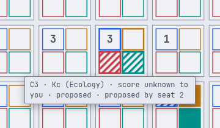 |  |
| **Hover info:** The sub-square, whether you know its score, who proposed it. |  |

---

## 5. Proposing and deciding

A player acts on the sub-square of their power type (here Pd → Kd) in the square they pick. Every action is confirmed first.

**Tools:** Propose and Decide with their quotas; the hint says where an action lands.

| | |
| --- | --- |
|  |  |
| **Propose tool:** Hovering E2 outlines the Kd sub-square a proposal would mark. | **Confirmation:** Proposing G5 · Kd asks for confirmation in the side panel. |
|  | 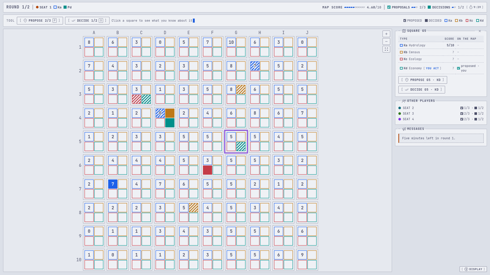 |
| **Confirm or cancel:** *Confirm* (Enter) sends the action; *Cancel* (Esc) sends nothing. | **Marks on the map:** Mid-round: everyone's proposals (hatched) and decisions (filled). |

---

## 6. Following the round

Facilitator, LIVE tab: the whole session on one page.

**LIVE during round 1:** NEXT and TOOLS, the seats, the composite map and every player's view.

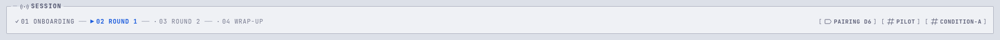

**Session panel:** The lifecycle (onboarding → rounds → wrap-up), the pairing and the tags.

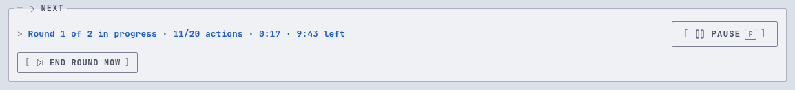

**NEXT panel:** Actions so far, time used and left, *Pause* and *End round now*.

**Seats panel:** Each seat's client, code, K/P labels, map view, quota bars and last activity.

**Composite map:** Every score and the map score; square D4 is selected.

| | |
| --- | --- |
|  |  |
| **Square comparison:** Scores, starting scores, who sees and who acted. | **Player views:** Live mirrors of what each seat sees, with its labels. |

---

## 7. Timeline, event log and telemetry

What happened when: every action, pause and note, as it is recorded.

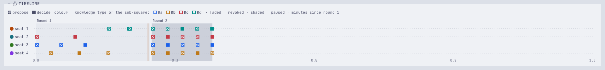

**Timeline:** Both rounds: a lane per seat, the pause shaded, marks in K colours.

**Timeline hover info:** A decision on the timeline and the score changes it caused.

| | |
| --- | --- |
| 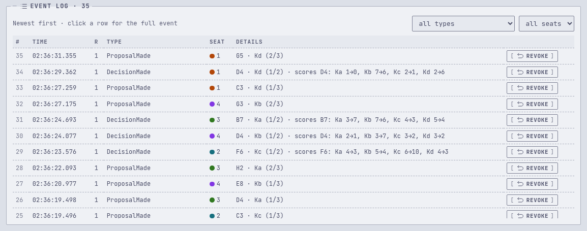 | 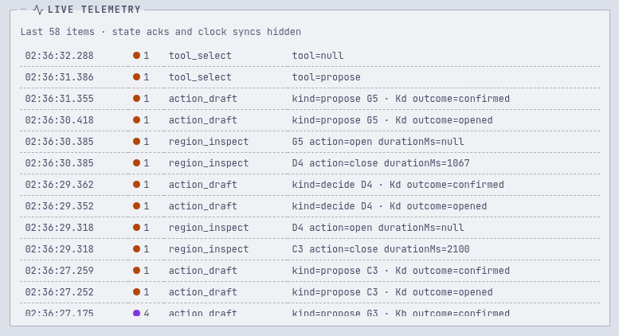 |
| **Event log:** Newest first, with score changes and *Revoke* per action. | **Live telemetry:** Hovers, inspections, tool choices and drafts per seat. |

---

## 8. Steering the session

The facilitator's tools, and what the players see when they are used.

### Messages and notes

| | |
| --- | --- |
| 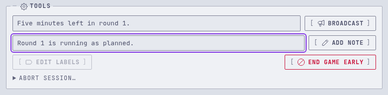 |  |
| **Facilitator · TOOLS panel:** A broadcast and a log note typed in, next to Edit labels and End game early. | **Player · Messages:** The broadcast under *Messages*, below the other seats' progress. |

### Pausing

| | |
| --- | --- |
|  |  |
| **Facilitator · Paused:** Round 1 paused; NEXT offers *Resume*. | **Player · Game paused:** The game is frozen until the facilitator resumes. |

### Corrections

| | |
| --- | --- |
| 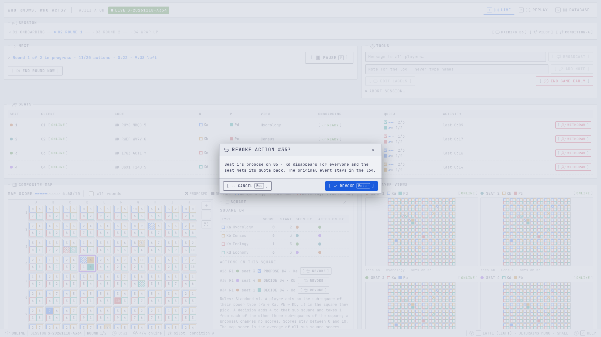 |  |
| **Facilitator · Revoke:** Revoking an action asks first; the original event stays in the log. | **Facilitator · Edit labels:** Labels can change between rounds; the change is logged. |

### Ending rounds and the game

| | |
| --- | --- |
|  | 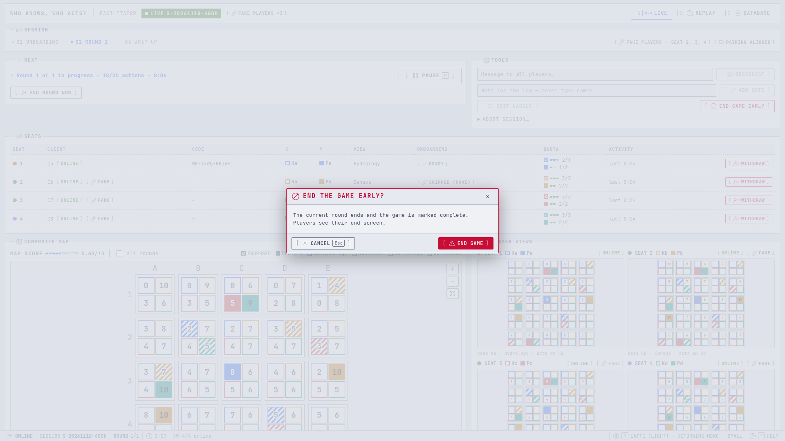 |
| **Facilitator · End round now:** Asks before it ends the round. | **Facilitator · End game early:** Asks before it marks the game complete. |
|  |  |
| **Facilitator · Between rounds:** NEXT offers *Start round 2 of 2*. | **Player · Round complete:** Round 1 complete, waiting for round 2. |

---

## 9. End of the game and wrap-up

Players see their participant code; the facilitator wraps up in three steps.

| | |
| --- | --- |
|  |  |
| **Facilitator · Game complete:** NEXT leads to the wrap-up. | **Player · Session complete:** The end screen with the personal participant code. |
|  |  |
| **Facilitator · Wrap-up 1 · Takedown cards:** A card PDF per participant, to print and hand out. | **Facilitator · Wrap-up 2 · Export:** The export is written (in this run, to a temporary folder). |
|  |  |
| **Facilitator · Wrap-up 3 · Close:** Closing archives the session; lock the key sheet away. |  |

---

## 10. Stored sessions and replay

Facilitator, DATABASE and REPLAY tabs.

| | |
| --- | --- |
|  | 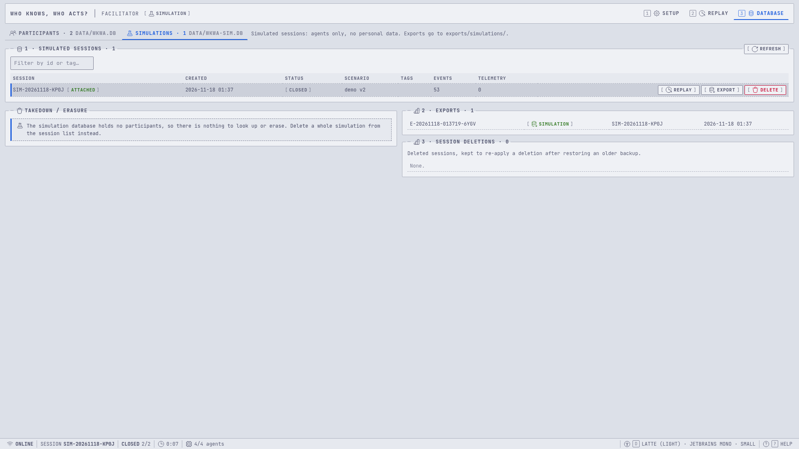 |
| **DATABASE · Participants:** Sessions, exports, deletions and the erasure register. | **DATABASE · Simulations:** A separate database with nothing to erase. |
| 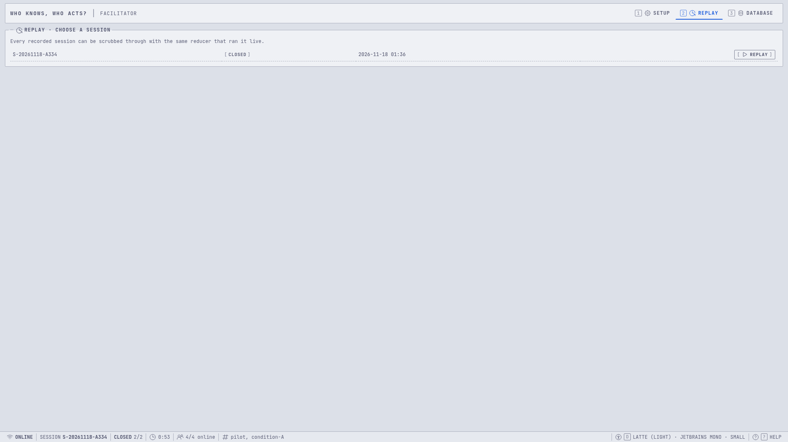 |  |
| **REPLAY · Choose a session:** Pick a recorded session. | **REPLAY · A session:** Step through it event by event, here at a pause in round 1. |

**Erasure lookup:** A participant code looked up before erasure: the session, seat and exports that hold it.

---

## 11. Testing without participants

Fake players are test clients the server creates; simulated players are agents that play every seat.

| | |
| --- | --- |
|  | 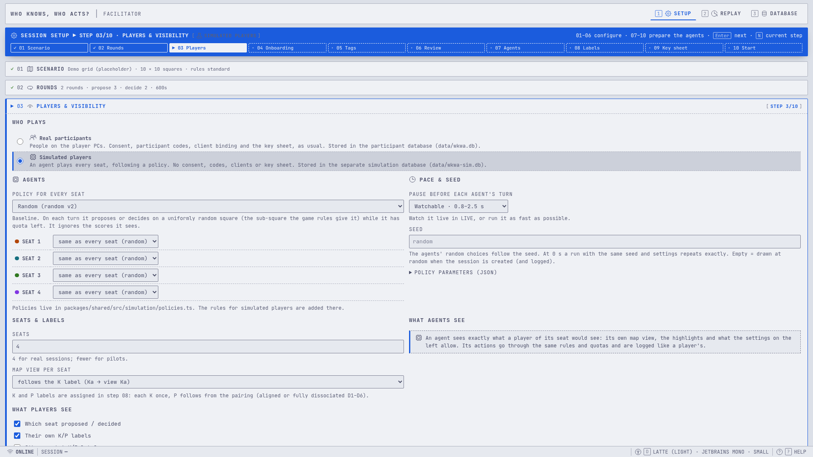 |
| **Fake players:** One player PC, with fake players on the other three seats. | **Simulated players · Step 03:** An agent policy per seat, a pace and a seed. |
| 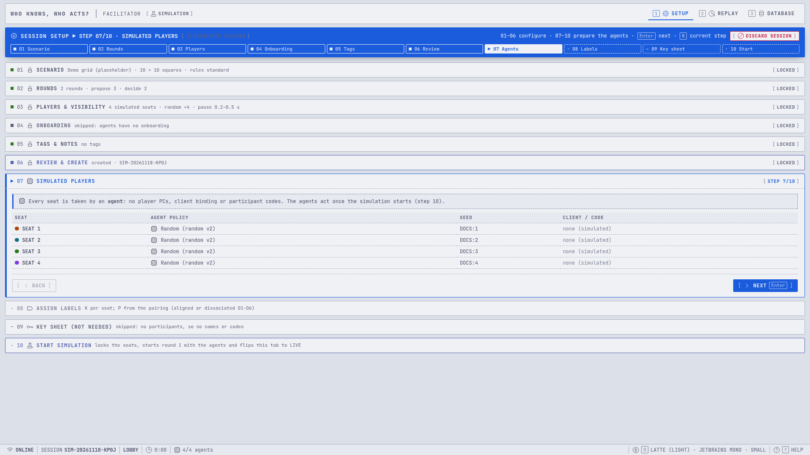 | 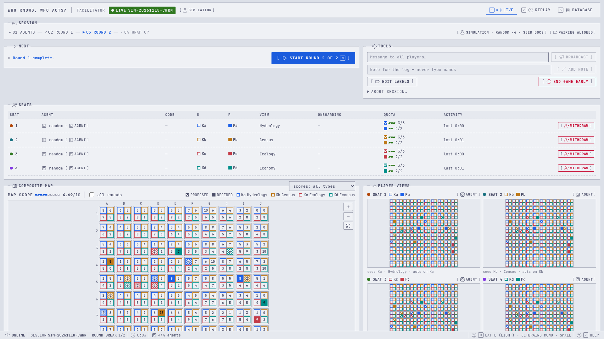 |
| **Simulated players · Step 07:** The agent and seed of every seat. | **Simulated players · LIVE:** Round 1, played by the agents on their own. |

---

## 12. The 5 × 5 map

The small demo grid: 25 squares, 100 sub-squares.

| | |
| --- | --- |
| 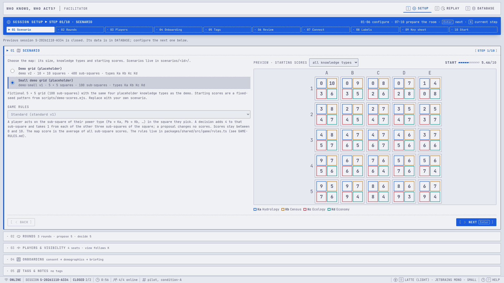 | 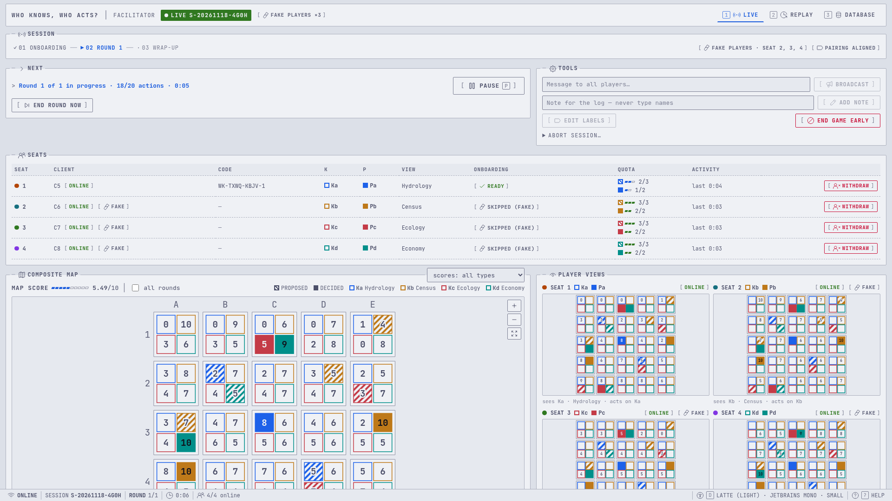 |
| **Facilitator · Step 01 · Small grid:** The small grid selected in step 01. | **Facilitator · LIVE on the small grid:** A round on the small grid, with three fake players. |
|  |  |
| **Player · Game on the small grid:** Square C3 selected. |  |

---

## 13. Display and accessibility

Every screen picks its own colours, font, text size and animations; the choice is never recorded.

| | |
| --- | --- |
| 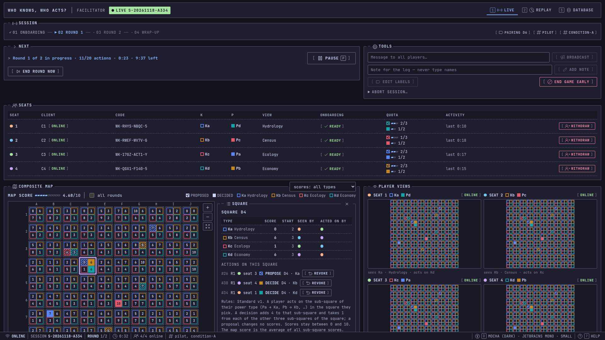 |  |
| **Facilitator · Mocha:** LIVE in Mocha (dark). | **Facilitator · High contrast:** LIVE in high contrast. |
|  | 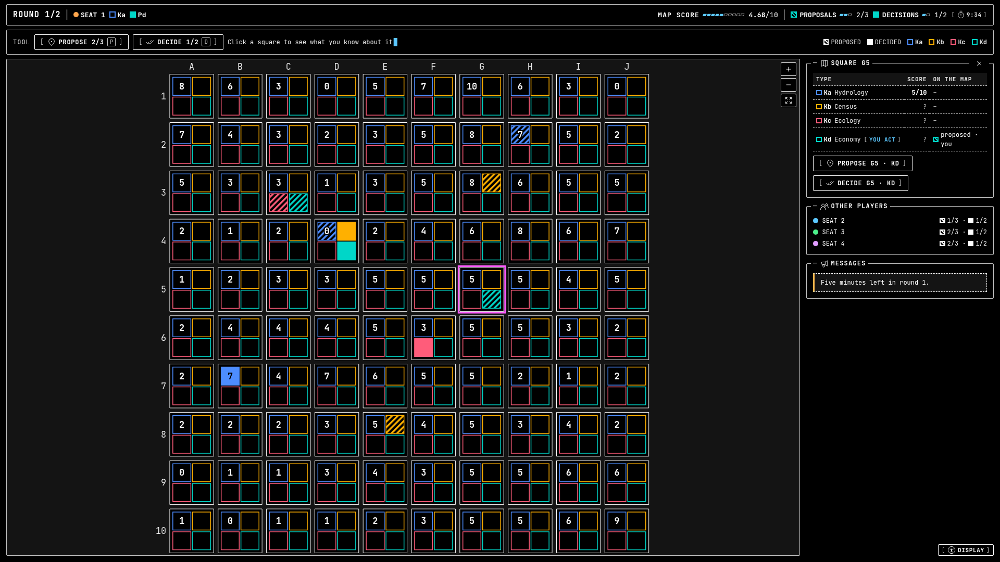 |
| **Player · Mocha:** The game in Mocha (dark). | **Player · High contrast:** The game in high contrast. |
|  |  |
| **Player · OpenDyslexic, large text:** The side panel widens to fit the larger text. | **Facilitator · Display settings:** The facilitator's display popup (`D`). |
| 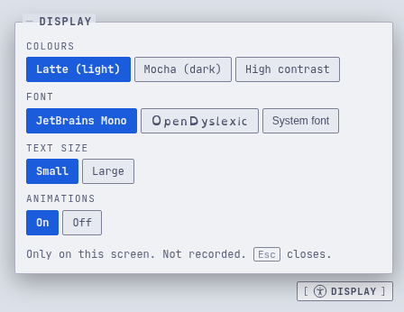 | 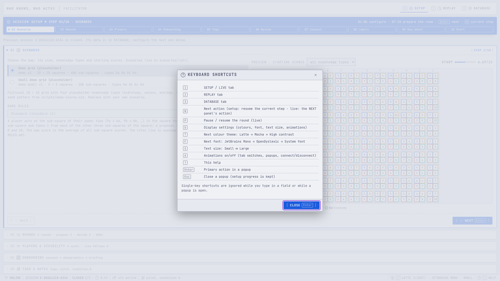 |
| **Player · DISPLAY panel:** Bottom right of every player screen; not recorded. | **Facilitator · Keyboard shortcuts:** Every shortcut (`?`). |

---

## Timeline of changes

Newest first: every new version of a screen, and when new screens were added.

| Date | Screen | Version | What changed |
| --- | --- | --- | --- |
| 2026-11-18 | 77 screens | v1 | First version. |
