<!-- Generated by `npm run screenshots -- gallery` from e2e/screenshots/catalogue.ts and docs/img/screenshots.json. Do not edit by hand. -->

# Screenshots

> [!NOTE]
> Every screen of *Who Knows, Who Acts?*, grouped by what it is for, in the order a session runs. Whole screens are full screen (1920 × 1080); images named `live-panel-…` or `part-…` are crops of one part. Files are in `server/` (the facilitator console on the server computer) and `client/` (the player screens on the client PCs). Everything shown is fictional: a temporary database, the demo grids and scripted players.

> [!TIP]
> When a screen changes, it gets a new version (`name-v2.png`, `name-v3.png`, …) shown next to the older ones, so the gallery is a visual timeline; *Timeline of changes* at the end lists them by date. Take new screenshots with the `/screenshot-app` skill or `npm run screenshots -- plan`, then `capture` and `publish`.

---

## 1. Setting up a session

Facilitator, SETUP tab: a ten-step wizard. Steps 01–06 configure the session, 07–10 prepare the room (step 07 is in § 2).

| | |
| --- | --- |
|  |  |
| **Step 01 · Scenario:** Choose the map and game rules; the starting scores are previewed. | **Step 02 · Rounds:** Rounds, quotas per player, time limit, how rounds end and start. |
| 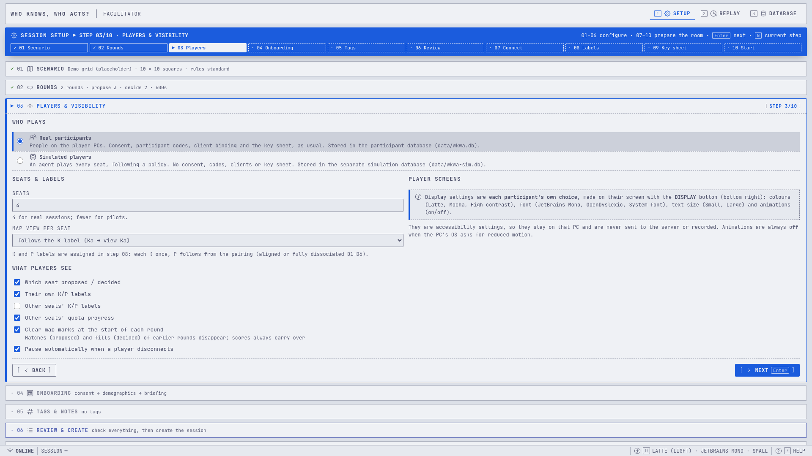 |  |
| **Step 03 · Players:** Real participants, seats, map view per seat, what players see. |  |

**Step 04 · Onboarding** · 2 versions, oldest first

| v1 · 2026-11-18 | v2 · 2026-11-19 |
| --- | --- |
| 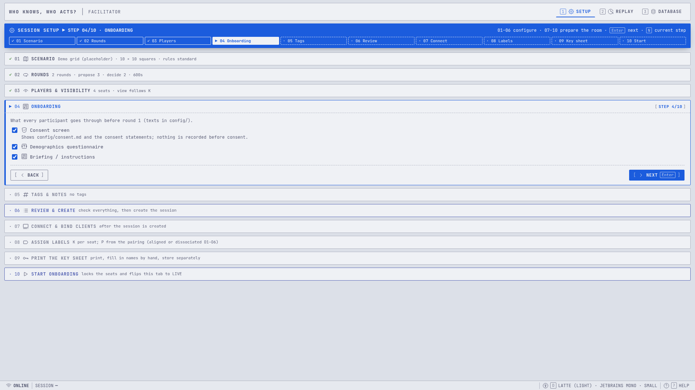 | 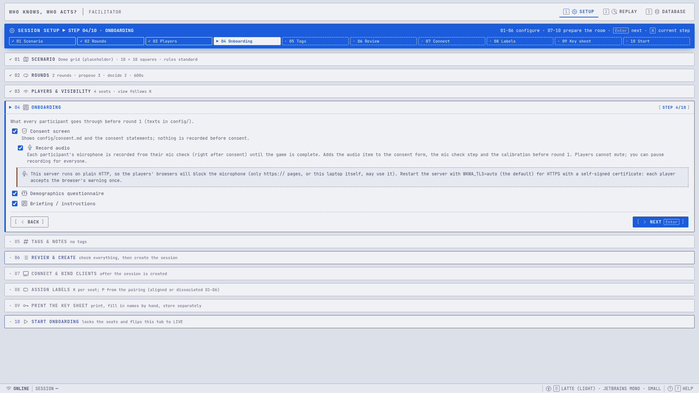 |
| Consent, questionnaire and briefing, each switched on or off. | Record audio option under the consent screen, with the warning shown on a plain-HTTP server. |

| | |
| --- | --- |
| 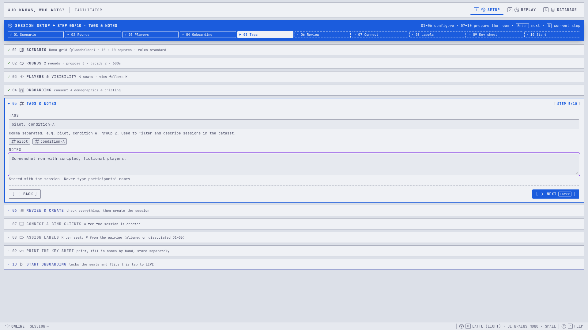 |  |
| **Step 05 · Tags:** Tags and a note that describe the session in the dataset. |  |

**Step 06 · Review** · 2 versions, oldest first

| v1 · 2026-11-18 | v2 · 2026-11-19 |
| --- | --- |
|  | 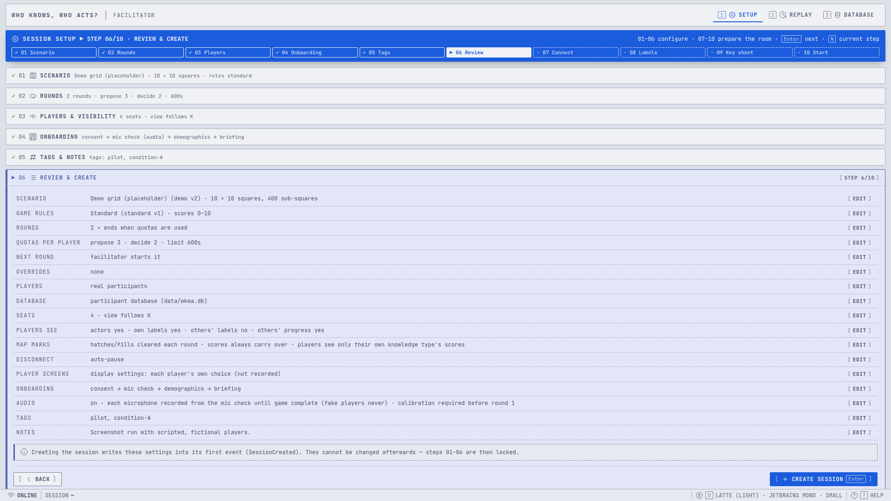 |
| Every setting in one table before *Create session* locks them. | Review lists the mic check step and a new AUDIO row. |

| | |
| --- | --- |
|  |  |
| **Step 08 · Labels:** The K–P pairing (here dissociated D6), its matrix, the K per seat. | **Step 09 · Key sheet:** Print the sheet that links codes to names; store it apart. |
|  |  |
| **Step 10 · Start:** A final checklist; *Start onboarding* locks the seats and opens LIVE. |  |

---

## 2. Connecting the player PCs

Each player PC opens the game page and shows a client number; the facilitator binds every client to a seat in step 07.

| | |
| --- | --- |
|  |  |
| **Player · Waiting for a seat:** A PC waiting to be bound; the large number is its client number. |  |

**Facilitator · Step 07 · Connect** · 2 versions, oldest first

| v1 · 2026-11-18 | v2 · 2026-11-19 |
| --- | --- |
| 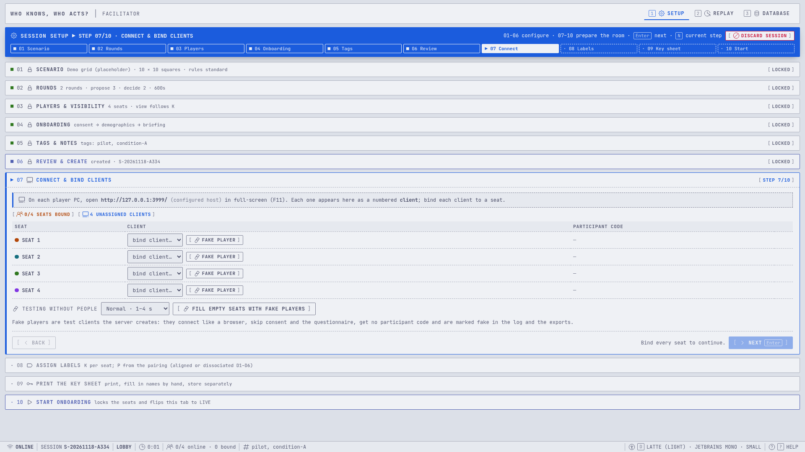 | 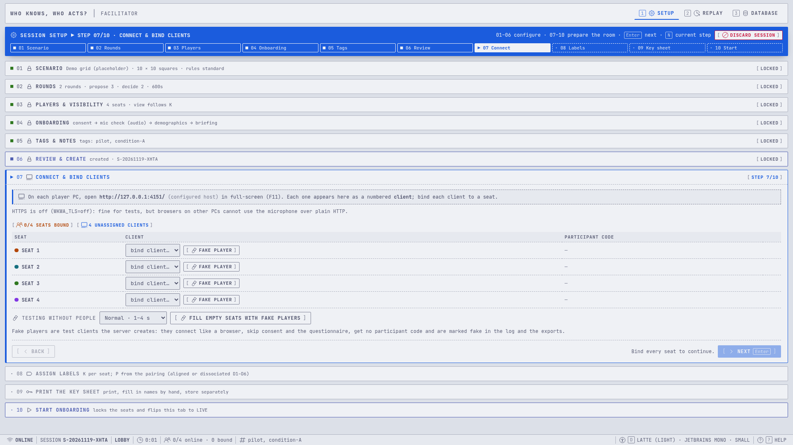 |
| Four clients connected, no seat bound yet. | Connect notes that browsers on other PCs cannot use the microphone over plain HTTP. |

| | |
| --- | --- |
| 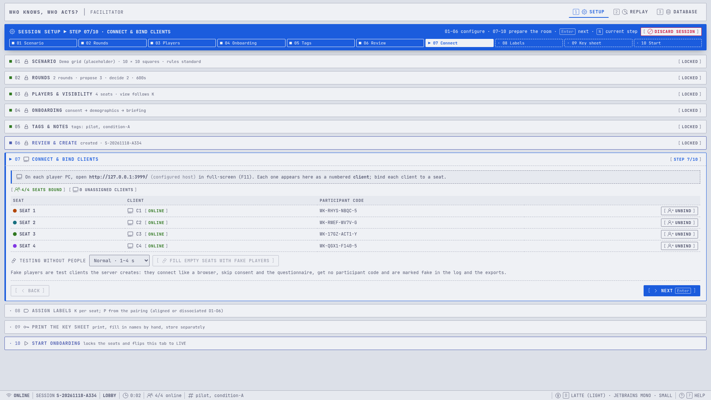 | 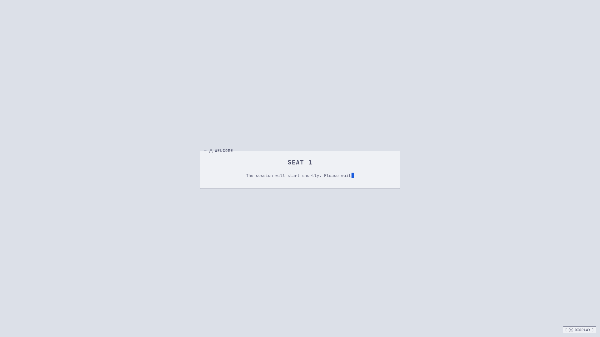 |
| **Facilitator · Step 07 · All seats bound:** Every seat bound to a client and given a participant code. | **Player · Seat assigned:** Bound to seat 1, waiting for onboarding to start. |

---

## 3. Onboarding

Players go through consent → about you → briefing; the facilitator sees which step each seat is on.

**Player · Consent** · 2 versions, oldest first

| v1 · 2026-11-18 | v2 · 2026-11-19 |
| --- | --- |
| 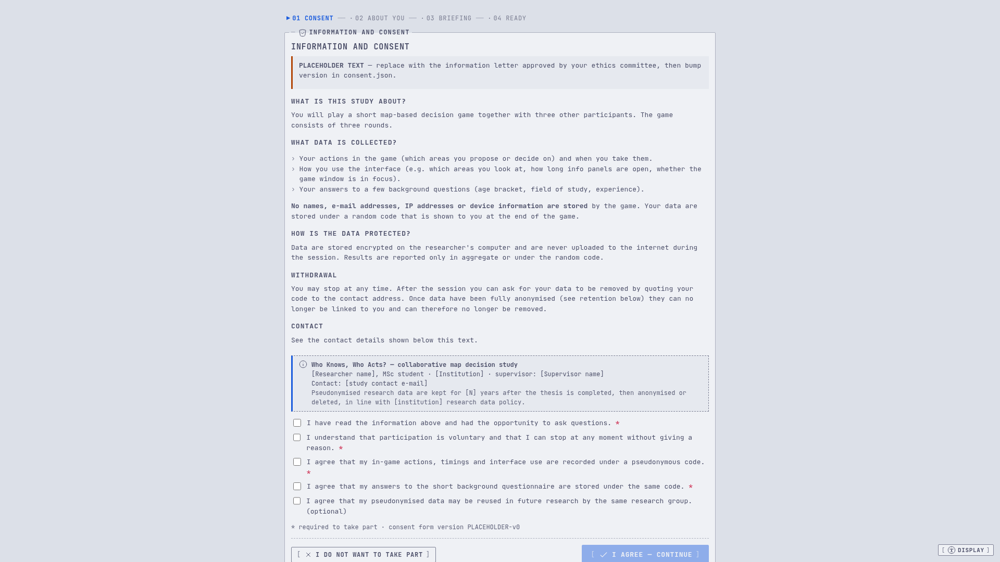 | 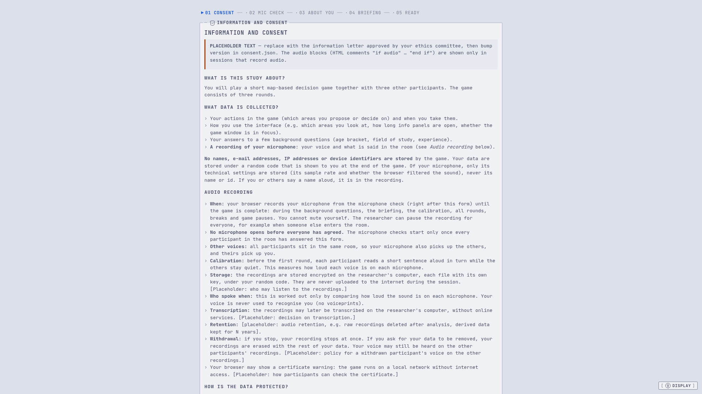 |
| Information and consent (placeholder text); required statements are starred. | Mic check step in the progress bar; the consent text gains an Audio recording section. |

**Player · About you** · 2 versions, oldest first

| v1 · 2026-11-18 | v2 · 2026-11-19 |
| --- | --- |
|  | 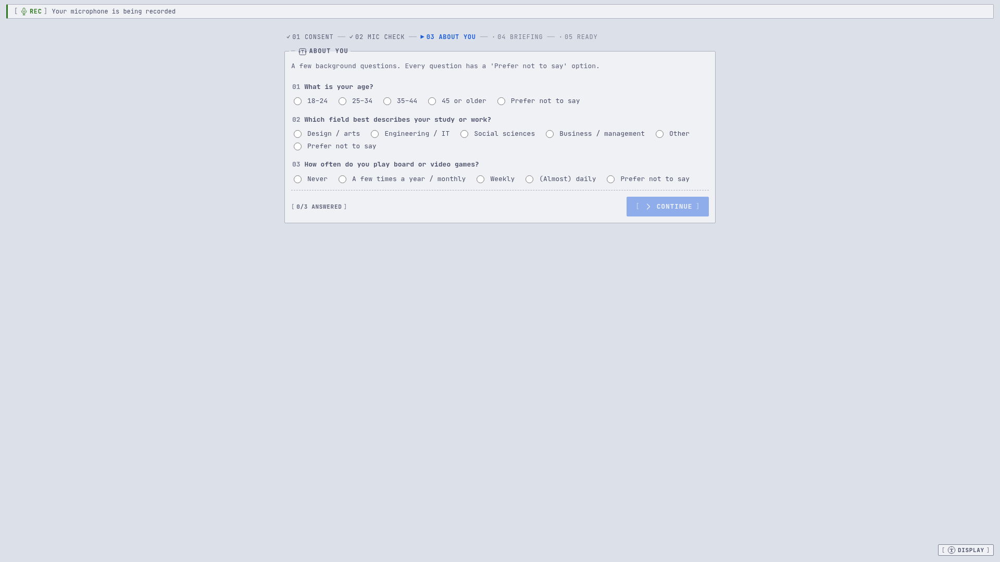 |
| The short background questionnaire. | REC bar on top while the microphone records; the mic check step is done in the progress bar. |

| | |
| --- | --- |
| 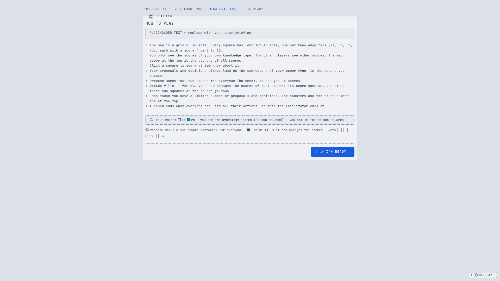 |  |
| **Player · Briefing:** How to play, and this player's roles: sees the Ka scores, acts on Kd. |  |

**Player · Ready** · 2 versions, oldest first

| v1 · 2026-11-18 | v2 · 2026-11-19 |
| --- | --- |
|  | 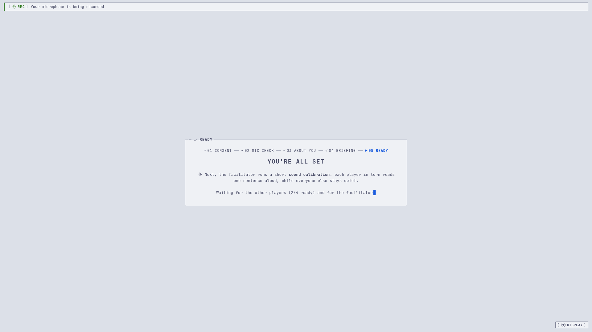 |
| Waiting for the other players and for round 1. | Ready with audio: REC bar on top, and a note that a short sound calibration comes next. |

**Facilitator · LIVE during onboarding** · 2 versions, oldest first

| v1 · 2026-11-18 | v2 · 2026-11-19 |
| --- | --- |
| 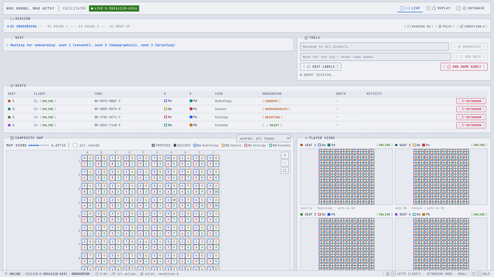 | 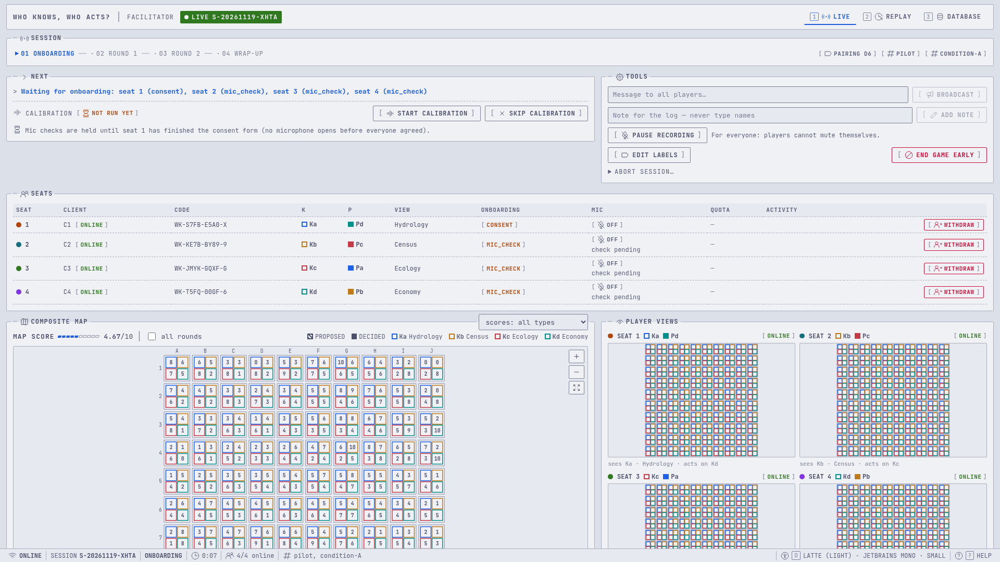 |
| Every seat at a different onboarding step. | Onboarding with audio: calibration row in NEXT, Mic column, mic checks held until all consented. |

**Facilitator · Seats panel** · 2 versions, oldest first

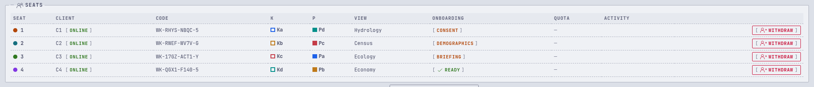

**v1 · 2026-11-18:** Each seat's onboarding step: consent, demographics, briefing or ready.

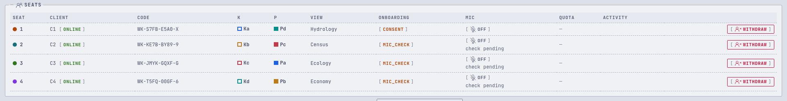

**v2 · 2026-11-19:** New Mic column: each seat's recording state; mic checks pending until everyone has consented.

**Facilitator · NEXT panel** · 2 versions, oldest first

**v1 · 2026-11-18:** Once every seat is ready, NEXT offers *Start round 1 of 2*.

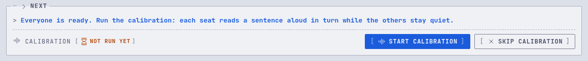

**v2 · 2026-11-19:** Everyone ready: with audio, NEXT asks for the calibration before round 1.

---

## 4. Reading the map

Every player sees the same grid but only the scores of their own knowledge type. Each square has four sub-squares: Ka top left, Kb top right, Kc bottom left, Kd bottom right.

| | |
| --- | --- |
|  | 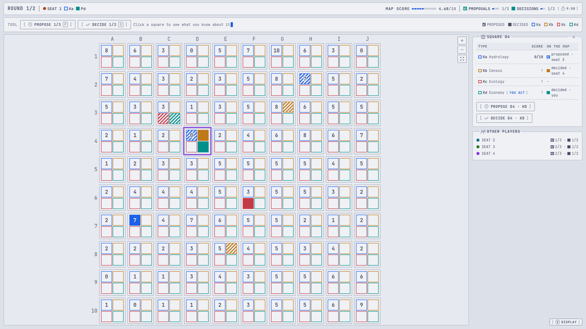 |
| **Start of round 1:** Only the Ka scores are shown, in the top-left sub-squares. | **Square selected:** Square D4's four sub-squares in the side panel. |

**Status line** · 2 versions, oldest first

**v1 · 2026-11-18:** Round, seat, K/P labels, map score, quota bars and time left.

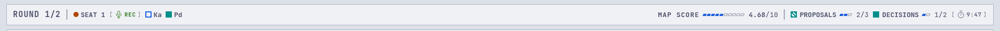

**v2 · 2026-11-19:** REC tag in the status line while the microphone records.

| | |
| --- | --- |
|  | 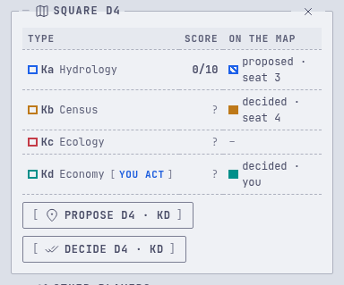 |
| **Map close-up:** Sub-squares outlined in K colours; hatched = proposed, filled = decided. | **Square panel:** Own score, `?` for unknown ones, marks, and where you act. |
|  |  |
| **Hover info:** The sub-square, whether you know its score, who proposed it. |  |

---

## 5. Proposing and deciding

A player acts on the sub-square of their power type (here Pd → Kd) in the square they pick. Every action is confirmed first.

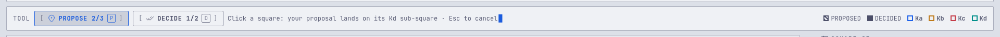

**Tools:** Propose and Decide with their quotas; the hint says where an action lands.

| | |
| --- | --- |
| 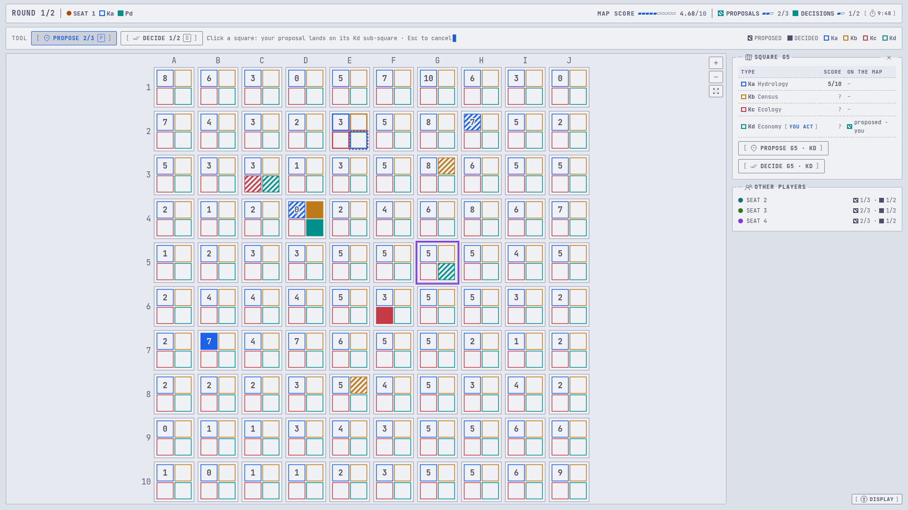 | 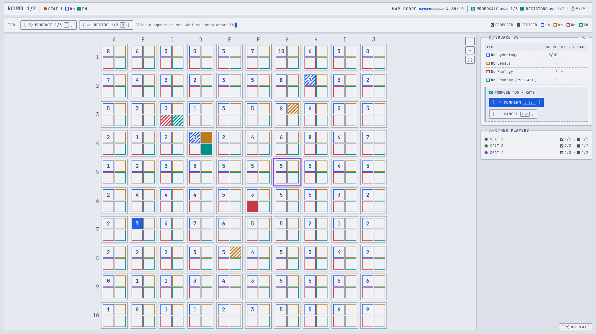 |
| **Propose tool:** Hovering E2 outlines the Kd sub-square a proposal would mark. | **Confirmation:** Proposing G5 · Kd asks for confirmation in the side panel. |
| 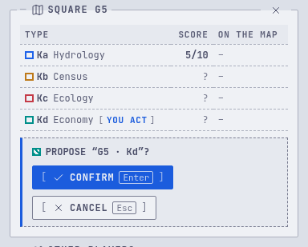 |  |
| **Confirm or cancel:** *Confirm* (Enter) sends the action; *Cancel* (Esc) sends nothing. | **Marks on the map:** Mid-round: everyone's proposals (hatched) and decisions (filled). |

---

## 6. Following the round

Facilitator, LIVE tab: the whole session on one page.

**LIVE during round 1** · 2 versions, oldest first

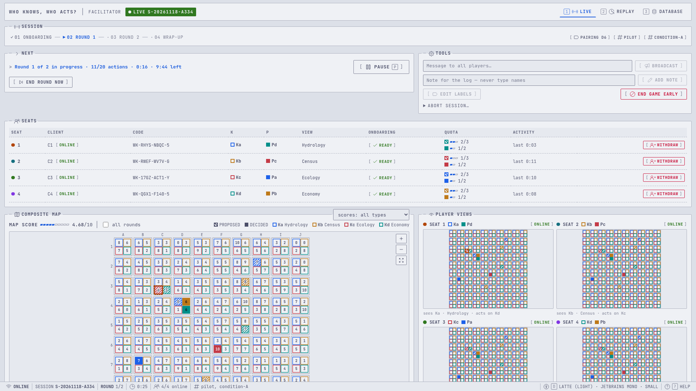

**v1 · 2026-11-18:** NEXT and TOOLS, the seats, the composite map and every player's view.

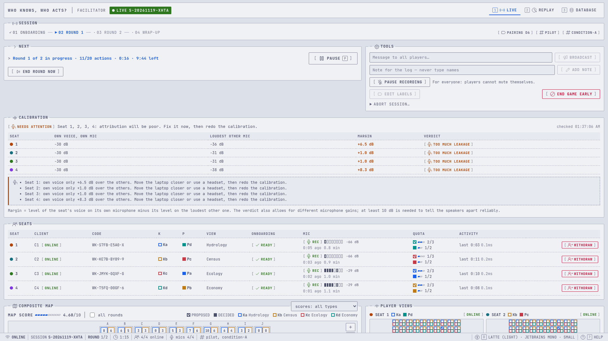

**v2 · 2026-11-19:** Round with audio: calibration card, Mic column with live levels, mics n/m in the status bar.

**Session panel:** The lifecycle (onboarding → rounds → wrap-up), the pairing and the tags.

**NEXT panel:** Actions so far, time used and left, *Pause* and *End round now*.

**Seats panel** · 2 versions, oldest first

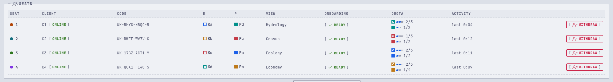

**v1 · 2026-11-18:** Each seat's client, code, K/P labels, map view, quota bars and last activity.

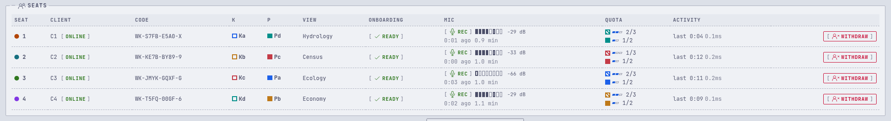

**v2 · 2026-11-19:** Mic column: REC state, live level, last chunk and recorded minutes per seat.

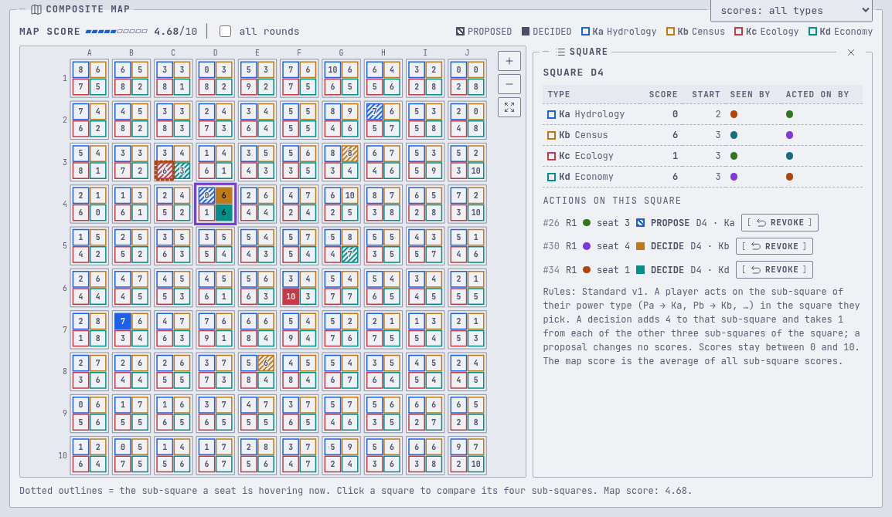

**Composite map:** Every score and the map score; square D4 is selected.

| | |
| --- | --- |
| 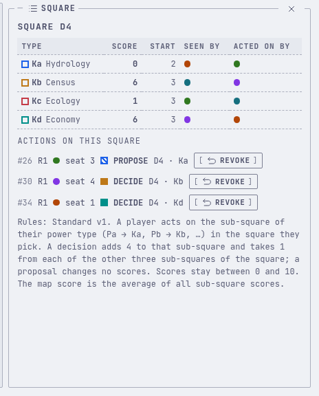 | 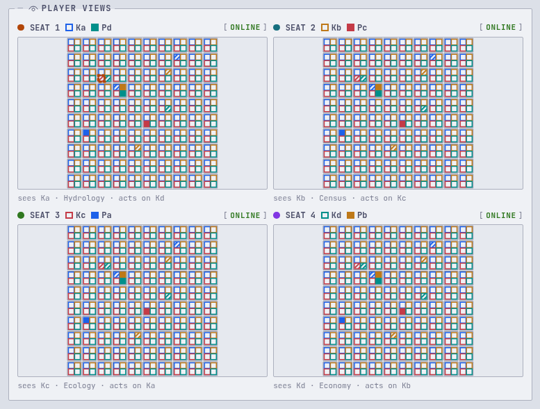 |
| **Square comparison:** Scores, starting scores, who sees and who acted. | **Player views:** Live mirrors of what each seat sees, with its labels. |

---

## 7. Timeline, event log and telemetry

What happened when: every action, pause and note, as it is recorded.

**Timeline** · 2 versions, oldest first

**v1 · 2026-11-18:** Both rounds: a lane per seat, the pause shaded, marks in K colours.

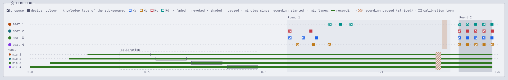

**v2 · 2026-11-19:** Mic lanes under the seats: recording, recording paused (striped) and calibration turns.

**Timeline hover info** · 2 versions, oldest first

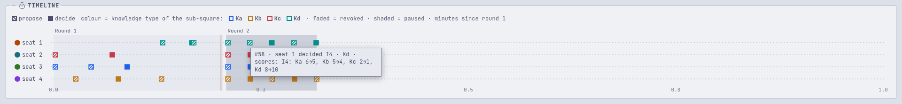

**v1 · 2026-11-18:** A decision on the timeline and the score changes it caused.

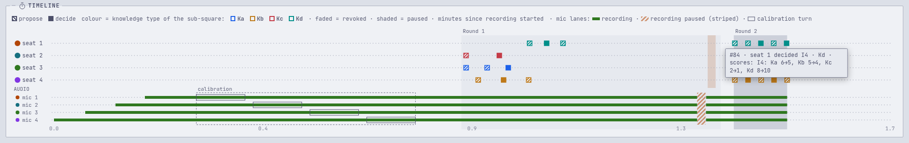

**v2 · 2026-11-19:** Hover info on the timeline, now with the mic lanes below the seats.

| | |
| --- | --- |
|  |  |
| **Event log:** Newest first, with score changes and *Revoke* per action. | **Live telemetry:** Hovers, inspections, tool choices and drafts per seat. |

---

## 8. Steering the session

The facilitator's tools, and what the players see when they are used.

### Messages and notes

**Facilitator · TOOLS panel** · 2 versions, oldest first

| v1 · 2026-11-18 | v2 · 2026-11-19 |
| --- | --- |
|  | 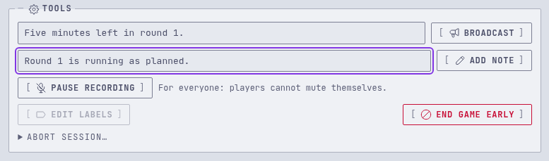 |
| A broadcast and a log note typed in, next to Edit labels and End game early. | TOOLS gains Pause recording (for everyone: players cannot mute themselves). |

| | |
| --- | --- |
| 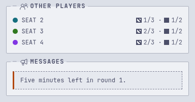 |  |
| **Player · Messages:** The broadcast under *Messages*, below the other seats' progress. |  |

### Pausing

| | |
| --- | --- |
| 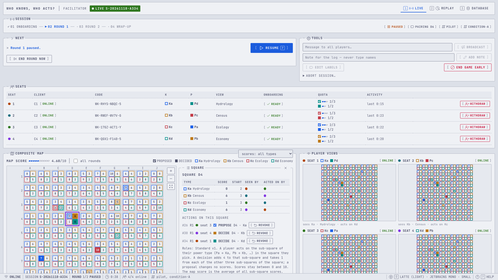 |  |
| **Facilitator · Paused:** Round 1 paused; NEXT offers *Resume*. | **Player · Game paused:** The game is frozen until the facilitator resumes. |

### Corrections

| | |
| --- | --- |
|  | 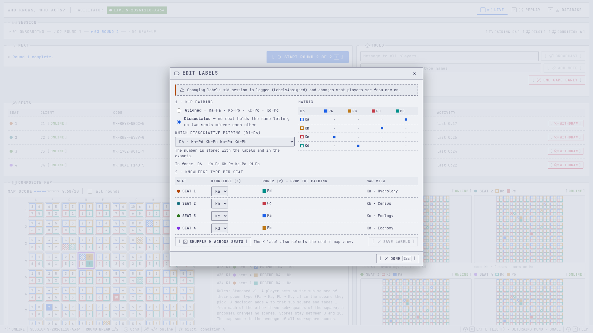 |
| **Facilitator · Revoke:** Revoking an action asks first; the original event stays in the log. | **Facilitator · Edit labels:** Labels can change between rounds; the change is logged. |

### Ending rounds and the game

| | |
| --- | --- |
| 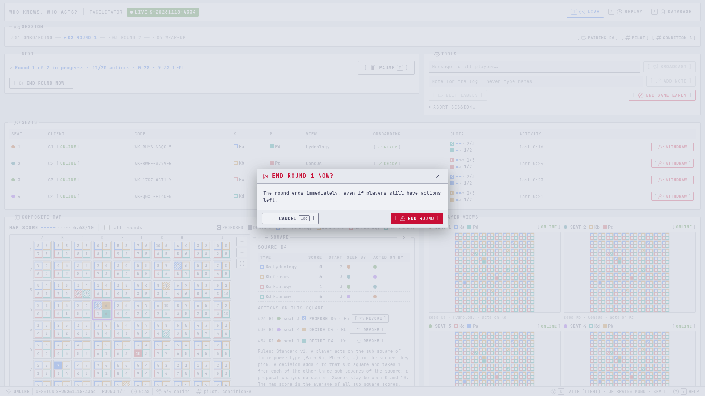 |  |
| **Facilitator · End round now:** Asks before it ends the round. | **Facilitator · End game early:** Asks before it marks the game complete. |
| 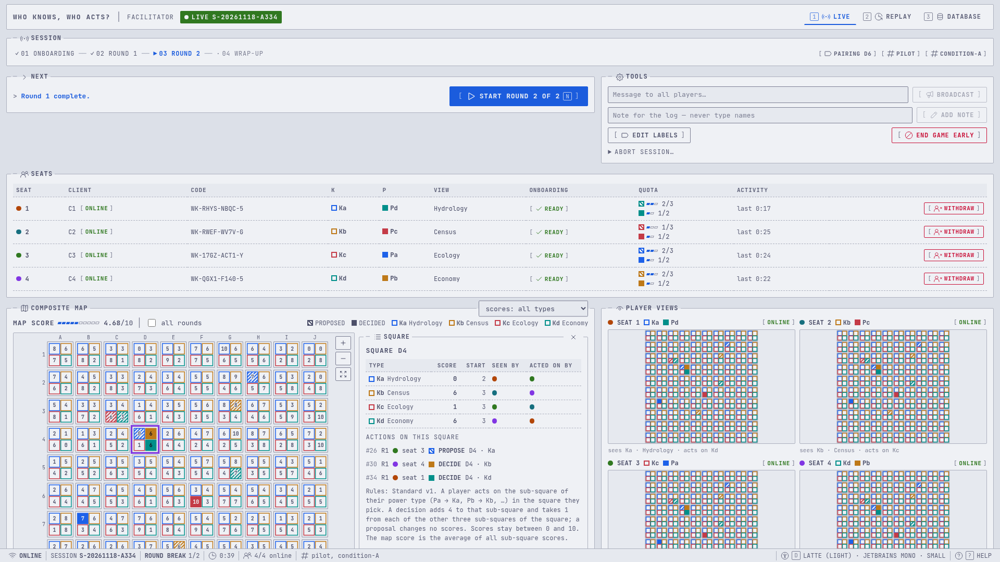 | 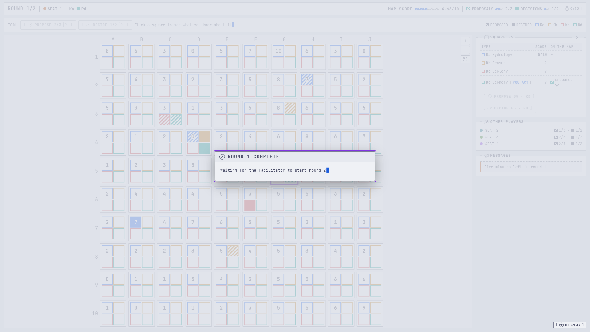 |
| **Facilitator · Between rounds:** NEXT offers *Start round 2 of 2*. | **Player · Round complete:** Round 1 complete, waiting for round 2. |

---

## 9. End of the game and wrap-up

Players see their participant code; the facilitator wraps up in three steps.

| | |
| --- | --- |
| 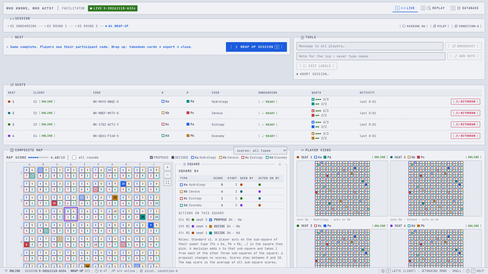 | 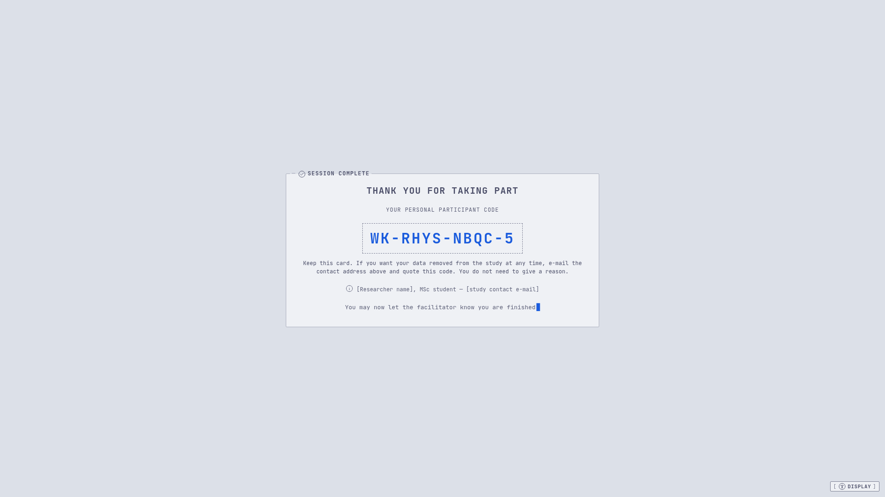 |
| **Facilitator · Game complete:** NEXT leads to the wrap-up. | **Player · Session complete:** The end screen with the personal participant code. |
| 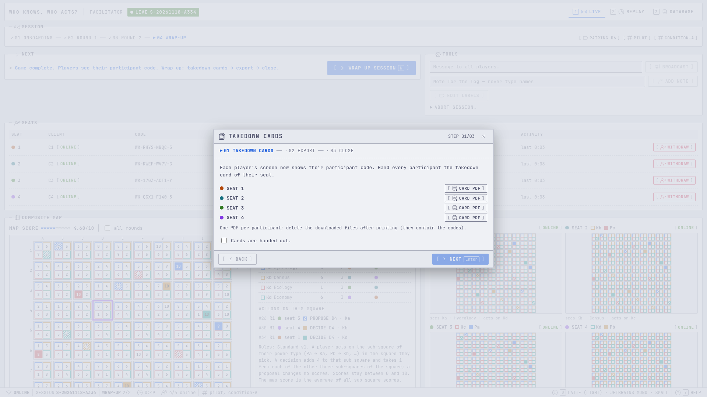 | 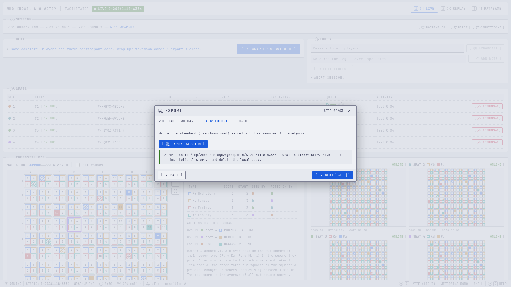 |
| **Facilitator · Wrap-up 1 · Takedown cards:** A card PDF per participant, to print and hand out. | **Facilitator · Wrap-up 2 · Export:** The export is written (in this run, to a temporary folder). |

**Facilitator · Wrap-up 3 · Close** · 2 versions, oldest first

| v1 · 2026-11-18 | v2 · 2026-11-19 |
| --- | --- |
| 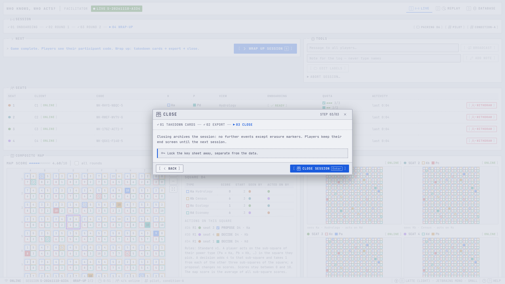 | 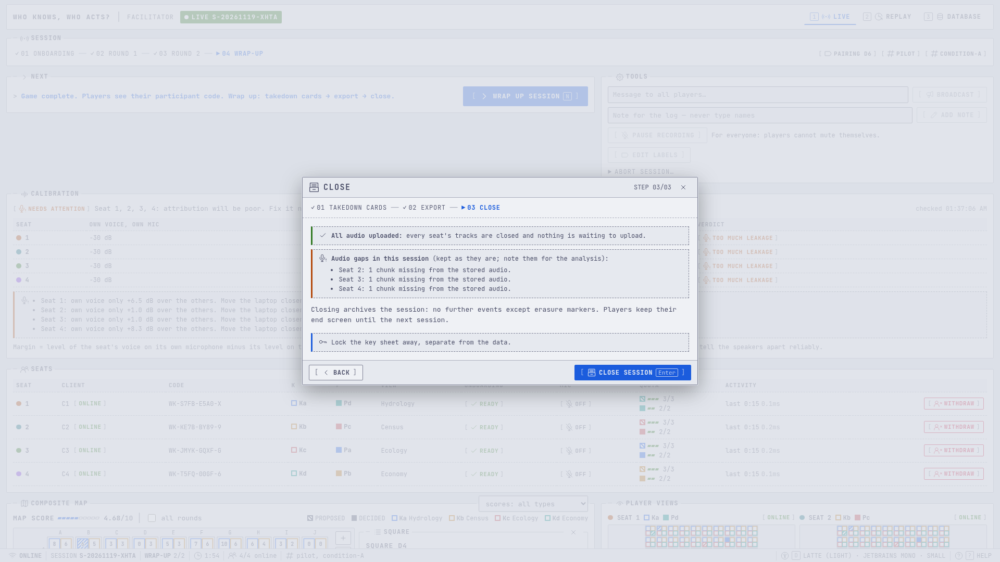 |
| Closing archives the session; lock the key sheet away. | Close checks the audio first: all uploaded, and any gaps in the stored audio per seat. |

---

## 10. Stored sessions and replay

Facilitator, DATABASE and REPLAY tabs.

**DATABASE · Participants** · 2 versions, oldest first

| v1 · 2026-11-18 | v2 · 2026-11-19 |
| --- | --- |
| 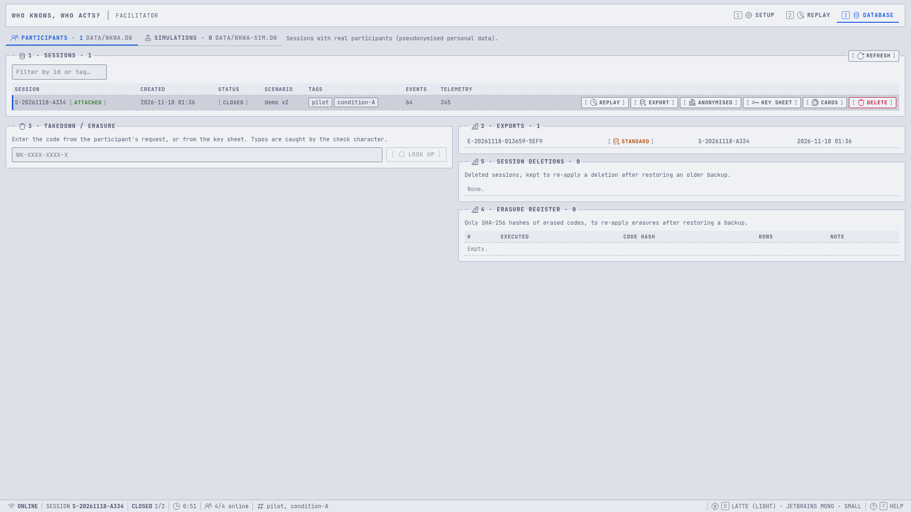 |  |
| Sessions, exports, deletions and the erasure register. | Sessions list gains the Audio column (tracks and recorded time). |

**DATABASE · Simulations** · 2 versions, oldest first

| v1 · 2026-11-18 | v2 · 2026-11-19 |
| --- | --- |
|  |  |
| A separate database with nothing to erase. | Audio column in the simulation list too: simulated sessions never record audio. |

| | |
| --- | --- |
|  |  |
| **REPLAY · Choose a session:** Pick a recorded session. |  |

**REPLAY · A session** · 2 versions, oldest first

| v1 · 2026-11-18 | v2 · 2026-11-19 |
| --- | --- |
|  |  |
| Step through it event by event, here at a pause in round 1. | Replay shows audio events in the event line and mic lanes in the timeline. |

**Erasure lookup** · 2 versions, oldest first

**v1 · 2026-11-18:** A participant code looked up before erasure: the session, seat and exports that hold it.

**v2 · 2026-11-19:** Erasure lookup also counts the code's audio tracks and their recorded time.

---

## 11. Testing without participants

Fake players are test clients the server creates; simulated players are agents that play every seat.

| | |
| --- | --- |
|  |  |
| **Fake players:** One player PC, with fake players on the other three seats. | **Simulated players · Step 03:** An agent policy per seat, a pace and a seed. |
|  |  |
| **Simulated players · Step 07:** The agent and seed of every seat. | **Simulated players · LIVE:** Round 1, played by the agents on their own. |

---

## 12. The 5 × 5 map

The small demo grid: 25 squares, 100 sub-squares.

| | |
| --- | --- |
|  |  |
| **Facilitator · Step 01 · Small grid:** The small grid selected in step 01. | **Facilitator · LIVE on the small grid:** A round on the small grid, with three fake players. |
|  |  |
| **Player · Game on the small grid:** Square C3 selected. |  |

---

## 13. Recording audio

Optional microphone recording (setup step 04, "Record audio"): each player's own mic check, the facilitator-led calibration, the recording indicator, and the facilitator's controls and audio tools.

### Player: mic check

| | |
| --- | --- |
|  |  |
| **Player · Mic check held until everyone agreed:** Mic check held: no microphone opens until every player in the room has finished the consent form. | **Player · Mic check ready:** Mic check ready: recording starts here, there is no mute button; Start mic check asks for the mic. |
|  |  |
| **Player · Mic check listening:** Mic check listening: live level meter, the sentence to read and how much speech was heard so far. | **Player · Mic check passed:** Mic check passed: the voice was heard clearly; recording goes on through the rest of onboarding. |
|  |  |
| **Player · Microphone blocked:** Microphone blocked by the browser: the steps to allow it, and Try again. |  |

### Player: calibration

| | |
| --- | --- |
|  |  |
| **Player · Calibration: waiting:** Calibration waiting: everyone is ready (4/4) and waits for the facilitator to start the calibration. | **Player · Calibration: your turn:** Calibration, your turn: the sentence to read aloud, the seconds left and a live level meter. |
|  |  |
| **Player · Calibration: stay quiet:** Calibration, another seat's turn: stay quiet while seat 1 reads. |  |

### Player: in the game

| | |
| --- | --- |
|  |  |
| **Player · Game with recording paused:** Game with recording paused by the facilitator: PAUSED tag in the status line; play goes on. | **Player · Game with a microphone error:** Microphone stopped during the game: a banner with what to check and Try again; the game goes on. |

### Facilitator: onboarding

**Facilitator · NEXT: mic checks held:** NEXT with audio: calibration not run yet; mic checks held until seats 1-3 finish the consent form.

**Facilitator · NEXT: calibration running:** NEXT during the calibration: which seat is reading, Redo and Skip calibration.

**Facilitator · NEXT: calibration done:** NEXT after the calibration: the result with each seat's margin, Start round 1 and Redo.

### Facilitator: LIVE

**Facilitator · Calibration quality:** Calibration quality: each seat's own voice against the loudest other mic, verdict and advice.

**Facilitator · Status bar with mics n/m:** Status bar with mics 4/4: how many seats are recording right now.

| | |
| --- | --- |
|  |  |
| **Facilitator · Pause recording for everyone:** Pause recording for everyone: confirmation with an optional reason, logged and exported. |  |

**Facilitator · TOOLS with recording paused:** TOOLS while recording is paused: since when, the reason, and Resume recording.

| | |
| --- | --- |
|  |  |
| **Facilitator · Skip a seat's mic check:** Skip a seat's mic check when its microphone cannot be made to work: logged reason, not recorded. | **Facilitator · LIVE with a microphone problem:** LIVE with a microphone error on seat 1: ERROR in the Mic column, mics 0/1 in the status bar. |

### Facilitator: DATABASE

| | |
| --- | --- |
|  |  |
| **Facilitator · DATABASE: sessions with the Audio column:** DATABASE sessions with the Audio column: tracks and recorded time; click it to open the audio. | **Facilitator · Audio popup:** Audio popup: per-seat tracks, gaps and missing audio, speaker attribution, export and delete. |
|  |  |
| **Facilitator · Speaker attribution result:** Speaker attribution of synthetic bot audio: grade, talk-time bars, margins and speech timeline. | **Facilitator · Export audio result:** Audio export result: clean WAV of seat 1 with length, size and SHA-256, in the export register. |
|  |  |
| **Facilitator · Delete audio: type the session id:** Delete audio: raw or all audio, a warning about exports still on disk, type the session id. |  |

---

## 14. Display and accessibility

Every screen picks its own colours, font, text size and animations; the choice is never recorded.

| | |
| --- | --- |
|  |  |
| **Facilitator · Mocha:** LIVE in Mocha (dark). | **Facilitator · High contrast:** LIVE in high contrast. |
|  |  |
| **Player · Mocha:** The game in Mocha (dark). | **Player · High contrast:** The game in high contrast. |
|  |  |
| **Player · OpenDyslexic, large text:** The side panel widens to fit the larger text. | **Facilitator · Display settings:** The facilitator's display popup (`D`). |
|  |  |
| **Player · DISPLAY panel:** Bottom right of every player screen; not recorded. | **Facilitator · Keyboard shortcuts:** Every shortcut (`?`). |

---

## Timeline of changes

Newest first: every new version of a screen, and when new screens were added.

| Date | Screen | Version | What changed |
| --- | --- | --- | --- |
| 2026-11-19 | Step 04 · Onboarding | v2 | Record audio option under the consent screen, with the warning shown on a plain-HTTP server. |
| 2026-11-19 | Step 06 · Review | v2 | Review lists the mic check step and a new AUDIO row. |
| 2026-11-19 | Step 07 · Connect | v2 | Connect notes that browsers on other PCs cannot use the microphone over plain HTTP. |
| 2026-11-19 | Consent | v2 | Mic check step in the progress bar; the consent text gains an Audio recording section. |
| 2026-11-19 | About you | v2 | REC bar on top while the microphone records; the mic check step is done in the progress bar. |
| 2026-11-19 | Ready | v2 | Ready with audio: REC bar on top, and a note that a short sound calibration comes next. |
| 2026-11-19 | LIVE during onboarding | v2 | Onboarding with audio: calibration row in NEXT, Mic column, mic checks held until all consented. |
| 2026-11-19 | Seats panel | v2 | New Mic column: each seat's recording state; mic checks pending until everyone has consented. |
| 2026-11-19 | NEXT panel | v2 | Everyone ready: with audio, NEXT asks for the calibration before round 1. |
| 2026-11-19 | Status line | v2 | REC tag in the status line while the microphone records. |
| 2026-11-19 | LIVE during round 1 | v2 | Round with audio: calibration card, Mic column with live levels, mics n/m in the status bar. |
| 2026-11-19 | Seats panel | v2 | Mic column: REC state, live level, last chunk and recorded minutes per seat. |
| 2026-11-19 | Timeline | v2 | Mic lanes under the seats: recording, recording paused (striped) and calibration turns. |
| 2026-11-19 | Timeline hover info | v2 | Hover info on the timeline, now with the mic lanes below the seats. |
| 2026-11-19 | TOOLS panel | v2 | TOOLS gains Pause recording (for everyone: players cannot mute themselves). |
| 2026-11-19 | Wrap-up 3 · Close | v2 | Close checks the audio first: all uploaded, and any gaps in the stored audio per seat. |
| 2026-11-19 | DATABASE · Participants | v2 | Sessions list gains the Audio column (tracks and recorded time). |
| 2026-11-19 | DATABASE · Simulations | v2 | Audio column in the simulation list too: simulated sessions never record audio. |
| 2026-11-19 | REPLAY · A session | v2 | Replay shows audio events in the event line and mic lanes in the timeline. |
| 2026-11-19 | Erasure lookup | v2 | Erasure lookup also counts the code's audio tracks and their recorded time. |
| 2026-11-19 | 24 screens | v1 | First version. |
| 2026-11-18 | 77 screens | v1 | First version. |
